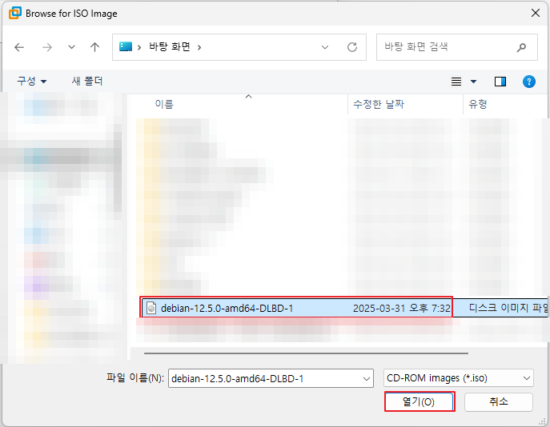
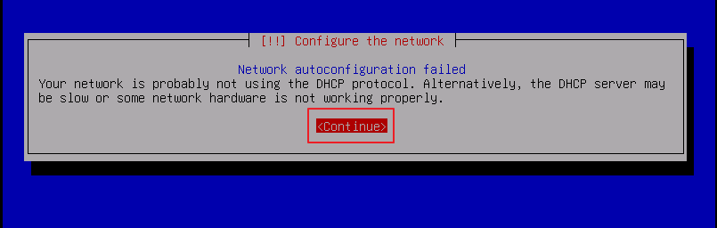
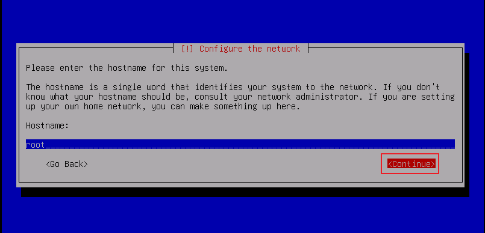
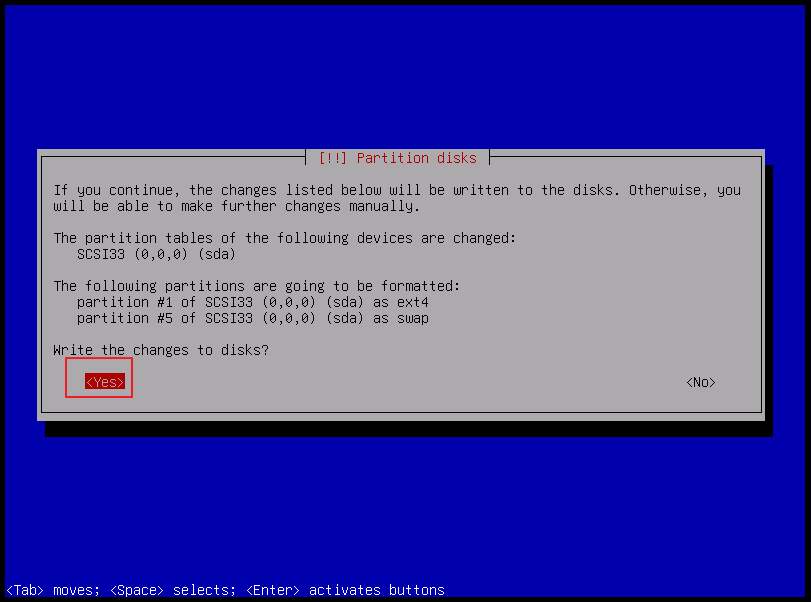

# Debian VM Installation Guide

[한국어](README/README.ko.md) | **English** | [日本語](README/README.ja.md) | [简体中文](README/README.zh-CN.md) | [Español](README/README.es.md) | [Français](README/README.fr.md)

 

How to create a new VM in VMware Workstation Pro and install Debian with the text-mode installer. This VM is then used as the **Debian CLI VM** that later clones are based on.

## Contents

- [1. Create the VM](#1-create-the-vm)
- [2. Start the installer and choose the region](#2-start-the-installer-and-choose-the-region)
- [3. Network and hostname](#3-network-and-hostname)
- [4. Accounts and passwords](#4-accounts-and-passwords)
- [5. Disk partitioning](#5-disk-partitioning)
- [6. Software selection and GRUB](#6-software-selection-and-grub)
- [Summary](#summary)

---

## 1. Create the VM

Start VMware and press **Ctrl + N** to create a new VM.

Select the **ISO file** needed to boot.

Click **Next** and keep the defaults until the next screen.

In **Customize Hardware**, set the **Network Adapter** to **Host-only**.

It's optional, but you can remove the **USB Controller** and **Sound Card** if you like.

Click **Finish** and the VM powers on automatically.

---

## 2. Start the installer and choose the region

Press **Ctrl + G** to send input to the VM, then use the **arrow keys, Space and Enter** to make your choices.

> Quick way: **English** Enter → **other** Enter → **aaa** Enter → **kkk** Enter

Find the continent of your country. For Korea, select **Asia**.

Scroll down a little and select **Korea, Republic of (South Korea)**, not North Korea.

On the following locale screens, choose as shown.

---

## 3. Network and hostname

When the network (DHCP) configuration screen appears, press **Cancel**.

Select the last option so that **the network is not configured now**.

For the hostname (admin name), use the value from the task sheet if there is one; otherwise, type anything (e.g. `root`).

---

## 4. Accounts and passwords

For the root password, use the one from the task sheet if there is one; otherwise, choose your own. Check **Show Password in Clear** to make sure you typed it correctly.

Type the same password again to verify it.

For the user's name, use the one from the task sheet if there is one; otherwise, type anything (e.g. `sysop`).

Type the account username the same as the name above.

It's easiest to use the same password as root for the user, unless the task sheet gives one. Again, check **Show Password in Clear** to verify it.

Type the same password in the confirmation field.

> The real password visible in the captures has been masked as `********`.

---

## 5. Disk partitioning

When asked how to partition the disk, select the first option, **Guided - use entire disk**.

On this screen, select the last option, **Finish partitioning and write changes to disk**.

When asked whether to write the partition changes and format, **always select Yes**. If you select No, you may have to start the setup over.

---

## 6. Software selection and GRUB

This screen asks whether to anonymously send information about frequently used packages to the developers. Select **No**.

**Uncheck everything except the last checkbox (standard system utilities).** This installs a CLI system without a desktop.

The question is "Install the GRUB boot loader to your primary drive?". Select **Yes**.

This screen asks where to install the GRUB boot loader. Select **the disk below (/dev/sda)**.

The installation is finished and the system will reboot. Click **Continue** and the Linux installation is done. Good job!

---

## Summary

- Create the VM with **Ctrl + N**, select the ISO, and change the **Network Adapter to Host-only** (removing USB and Sound Card is optional).
- Control the installer with **Ctrl + G**, then arrow keys, Space and Enter. The region is **Asia → Korea**.
- **Cancel** the DHCP configuration and **configure the network later**.
- Use the **values from the task sheet** for the hostname, username and passwords. Check them with Show Password in Clear.
- Partitioning: **Guided - use entire disk → Finish → Yes**.
- Keep **only standard system utilities**, and install GRUB with **Yes → /dev/sda**.
