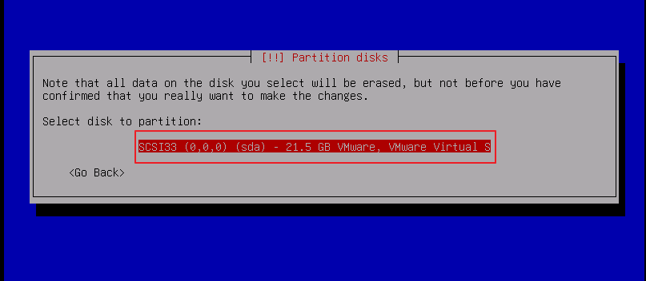
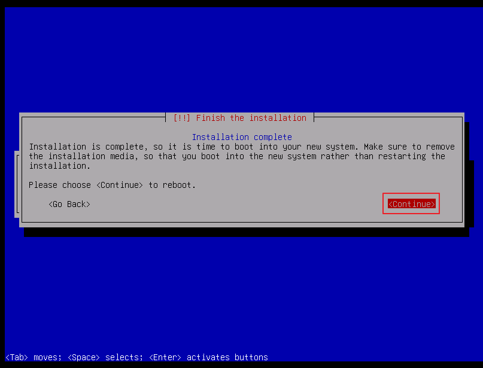

# Guía de instalación de una VM Debian

[한국어](README.ko.md) | [English](../README.md) | [日本語](README.ja.md) | [简体中文](README.zh-CN.md) | **Español** | [Français](README.fr.md)

 

Cómo crear una VM nueva en VMware Workstation Pro e instalar Debian con el instalador en modo texto. Esta VM se usa después como **Debian CLI VM**, la base de los clones posteriores.

## Contenido

- [1. Crear la VM](#1-crear-la-vm)
- [2. Iniciar el instalador y elegir la región](#2-iniciar-el-instalador-y-elegir-la-región)
- [3. Red y nombre de host](#3-red-y-nombre-de-host)
- [4. Cuentas y contraseñas](#4-cuentas-y-contraseñas)
- [5. Particionado del disco](#5-particionado-del-disco)
- [6. Selección de software y GRUB](#6-selección-de-software-y-grub)
- [Resumen](#resumen)

---

## 1. Crear la VM

Abre VMware y pulsa **Ctrl + N** para crear una VM nueva.

Selecciona el **archivo ISO** necesario para arrancar.

Pulsa **Next** y deja los valores por defecto hasta la siguiente pantalla.

En **Customize Hardware**, configura el **Network Adapter** como **Host-only**.

No es obligatorio, pero si quieres puedes quitar el **USB Controller** y la **Sound Card**.

Pulsa **Finish** y la VM se enciende automáticamente.

---

## 2. Iniciar el instalador y elegir la región

Pulsa **Ctrl + G** para enviar la entrada a la VM y usa las **flechas, la barra espaciadora y Enter** para elegir.

> Forma rápida: **English** Enter → **other** Enter → **aaa** Enter → **kkk** Enter

Busca el continente de tu país. Para Corea, selecciona **Asia**.

Baja un poco y selecciona **Korea, Republic of (South Korea)**, no North Korea.

En las siguientes pantallas de locale, elige como se muestra.

---

## 3. Red y nombre de host

Cuando aparezca la pantalla de configuración de red (DHCP), pulsa **Cancelar (Cancel)**.

Selecciona la última opción para **no configurar la red ahora**.

Para el nombre de host (nombre de administrador), usa el de la hoja de la tarea si lo indica; si no, escribe cualquiera (p. ej. `root`).

---

## 4. Cuentas y contraseñas

Para la contraseña de root, usa la de la hoja de la tarea si la indica; si no, elige una. Marca **Show Password in Clear** para comprobar que la has escrito bien.

Escribe la misma contraseña otra vez para confirmarla.

Para el nombre del usuario, usa el de la hoja de la tarea si lo indica; si no, escribe cualquiera (p. ej. `sysop`).

Escribe el nombre de la cuenta igual que el nombre de arriba.

Lo más cómodo es usar para el usuario la misma contraseña que para root, salvo que la hoja de la tarea indique otra. Aquí también marca **Show Password in Clear** para comprobarla.

Escribe la misma contraseña en el campo de confirmación.

> La contraseña real visible en las capturas se ha ocultado como `********`.

---

## 5. Particionado del disco

Cuando pregunte cómo particionar el disco, selecciona la primera opción, **Guided - use entire disk**.

En esta pantalla, selecciona la última opción, **Finish partitioning and write changes to disk**.

Cuando pregunte si quieres escribir los cambios de particiones y formatear, **selecciona siempre Yes**. Si eliges No, puede que tengas que empezar la configuración de nuevo.

---

## 6. Selección de software y GRUB

Esta pantalla pregunta si quieres enviar de forma anónima a los desarrolladores información sobre los paquetes que más usas. Selecciona **No**.

**Desmarca todo excepto la última casilla (standard system utilities).** Así se instala un sistema CLI sin escritorio.

La pregunta es "¿Instalar el cargador de arranque GRUB en el disco principal?". Selecciona **Yes**.

Esta pantalla pregunta dónde instalar el cargador de arranque GRUB. Selecciona **el disco de abajo (/dev/sda)**.

La instalación ha terminado y el sistema se reiniciará. Pulsa **Continue** y la instalación de Linux habrá terminado. ¡Buen trabajo!

---

## Resumen

- Crea la VM con **Ctrl + N**, selecciona la ISO y cambia el **Network Adapter a Host-only** (quitar USB y Sound Card es opcional).
- Maneja el instalador con **Ctrl + G** y luego flechas, barra espaciadora y Enter. La región es **Asia → Korea**.
- **Cancela** la configuración DHCP y **configura la red más tarde**.
- Usa los **valores de la hoja de la tarea** para el nombre de host, el usuario y las contraseñas. Compruébalos con Show Password in Clear.
- Particionado: **Guided - use entire disk → Finish → Yes**.
- Deja **solo standard system utilities** e instala GRUB con **Yes → /dev/sda**.
