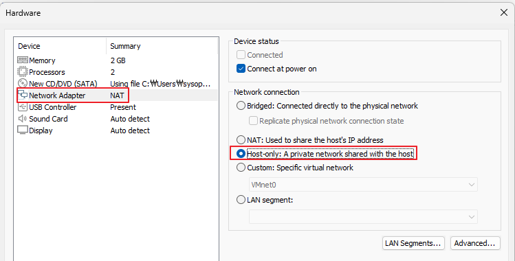
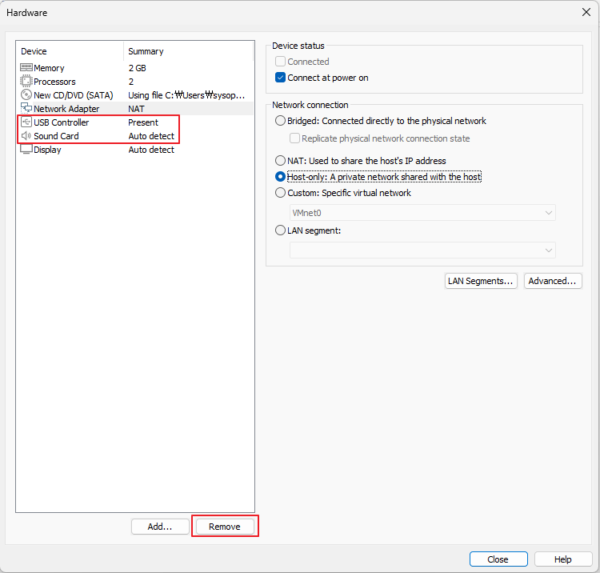
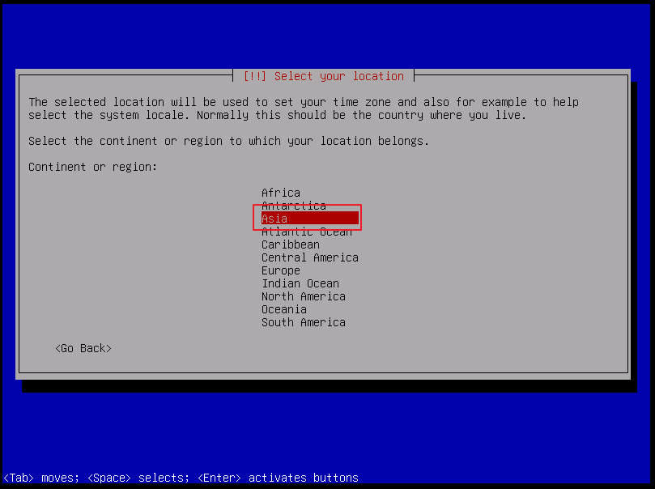
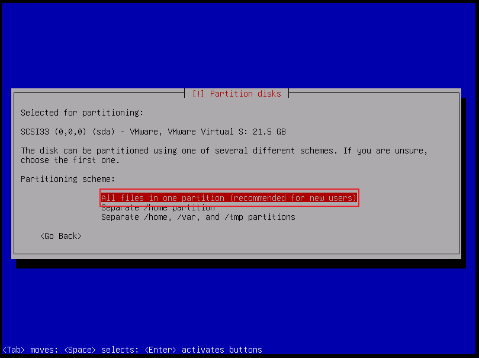
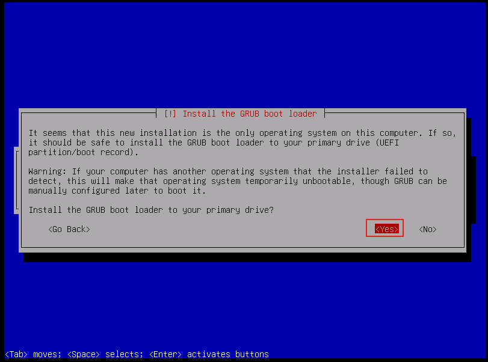
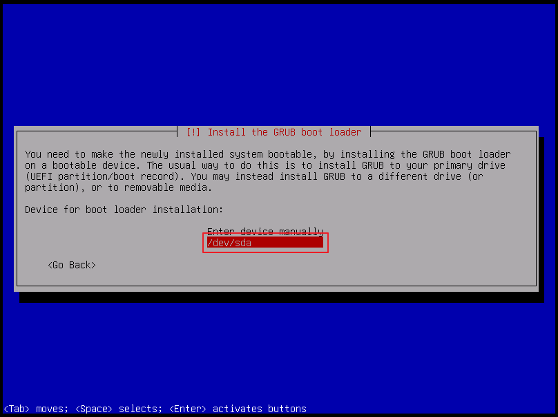

# Guide d'installation d'une VM Debian

[한국어](README.ko.md) | [English](../README.md) | [日本語](README.ja.md) | [简体中文](README.zh-CN.md) | [Español](README.es.md) | **Français**

 

Comment créer une nouvelle VM dans VMware Workstation Pro et installer Debian avec l'installateur en mode texte. Cette VM sert ensuite de **Debian CLI VM**, la base des clones suivants.

## Sommaire

- [1. Créer la VM](#1-créer-la-vm)
- [2. Lancer l'installateur et choisir la région](#2-lancer-linstallateur-et-choisir-la-région)
- [3. Réseau et nom d'hôte](#3-réseau-et-nom-dhôte)
- [4. Comptes et mots de passe](#4-comptes-et-mots-de-passe)
- [5. Partitionnement du disque](#5-partitionnement-du-disque)
- [6. Sélection des logiciels et GRUB](#6-sélection-des-logiciels-et-grub)
- [Résumé](#résumé)

---

## 1. Créer la VM

Lancez VMware et appuyez sur **Ctrl + N** pour créer une nouvelle VM.

Sélectionnez le **fichier ISO** nécessaire au démarrage.

Cliquez sur **Next** et gardez les valeurs par défaut jusqu'à l'écran suivant.

Dans **Customize Hardware**, réglez le **Network Adapter** sur **Host-only**.

Ce n'est pas obligatoire, mais vous pouvez supprimer le **USB Controller** et la **Sound Card** si vous le souhaitez.

Cliquez sur **Finish** : la VM démarre automatiquement.

---

## 2. Lancer l'installateur et choisir la région

Appuyez sur **Ctrl + G** pour envoyer la saisie à la VM, puis utilisez les **flèches, la barre d'espace et Entrée** pour faire vos choix.

> Méthode rapide : **English** Entrée → **other** Entrée → **aaa** Entrée → **kkk** Entrée

Trouvez le continent de votre pays. Pour la Corée, sélectionnez **Asia**.

Descendez un peu et sélectionnez **Korea, Republic of (South Korea)**, et non North Korea.

Sur les écrans de locale suivants, choisissez comme sur les captures.

---

## 3. Réseau et nom d'hôte

Quand l'écran de configuration réseau (DHCP) apparaît, appuyez sur **Annuler (Cancel)**.

Sélectionnez la dernière option pour **ne pas configurer le réseau maintenant**.

Pour le nom d'hôte (nom d'administrateur), utilisez celui de la feuille d'exercice s'il y en a un ; sinon, tapez n'importe quoi (ex. : `root`).

---

## 4. Comptes et mots de passe

Pour le mot de passe root, utilisez celui de la feuille d'exercice s'il y en a un ; sinon, choisissez le vôtre. Cochez **Show Password in Clear** pour vérifier que vous l'avez bien saisi.

Saisissez à nouveau le même mot de passe pour le confirmer.

Pour le nom de l'utilisateur, utilisez celui de la feuille d'exercice s'il y en a un ; sinon, tapez n'importe quoi (ex. : `sysop`).

Saisissez le nom du compte comme le nom ci-dessus.

Le plus simple est d'utiliser pour l'utilisateur le même mot de passe que pour root, sauf si la feuille d'exercice en indique un. Là encore, cochez **Show Password in Clear** pour le vérifier.

Saisissez le même mot de passe dans le champ de confirmation.

> Le vrai mot de passe visible sur les captures a été masqué par `********`.

---

## 5. Partitionnement du disque

Quand l'installateur demande comment partitionner le disque, sélectionnez la première option, **Guided - use entire disk**.

Sur cet écran, sélectionnez la dernière option, **Finish partitioning and write changes to disk**.

Quand il demande s'il faut écrire les modifications de partitions et formater, **sélectionnez toujours Yes**. Si vous choisissez No, vous devrez peut-être tout recommencer.

---

## 6. Sélection des logiciels et GRUB

Cet écran demande s'il faut envoyer anonymement aux développeurs des informations sur les paquets que vous utilisez le plus. Sélectionnez **No**.

**Décochez tout sauf la dernière case (standard system utilities).** On installe ainsi un système CLI sans bureau.

La question est « Installer le chargeur de démarrage GRUB sur le disque principal ? ». Sélectionnez **Yes**.

Cet écran demande où installer le chargeur de démarrage GRUB. Sélectionnez **le disque du dessous (/dev/sda)**.

L'installation est terminée et le système va redémarrer. Cliquez sur **Continue** et l'installation de Linux est finie. Bravo !

---

## Résumé

- Créez la VM avec **Ctrl + N**, sélectionnez l'ISO et passez le **Network Adapter en Host-only** (supprimer USB et Sound Card est facultatif).
- Pilotez l'installateur avec **Ctrl + G**, puis les flèches, la barre d'espace et Entrée. La région est **Asia → Korea**.
- **Annulez** la configuration DHCP et **configurez le réseau plus tard**.
- Utilisez les **valeurs de la feuille d'exercice** pour le nom d'hôte, l'utilisateur et les mots de passe. Vérifiez-les avec Show Password in Clear.
- Partitionnement : **Guided - use entire disk → Finish → Yes**.
- Ne gardez **que standard system utilities** et installez GRUB avec **Yes → /dev/sda**.
