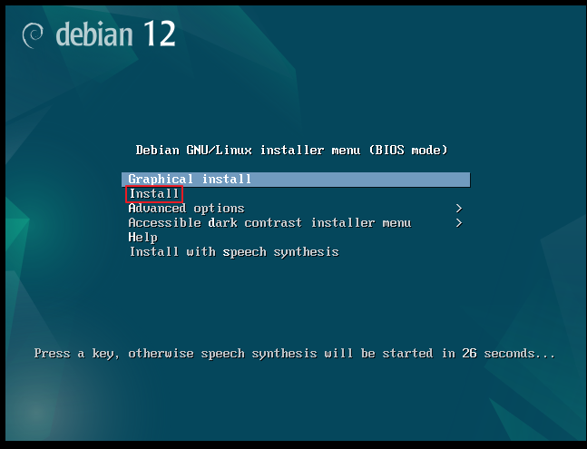
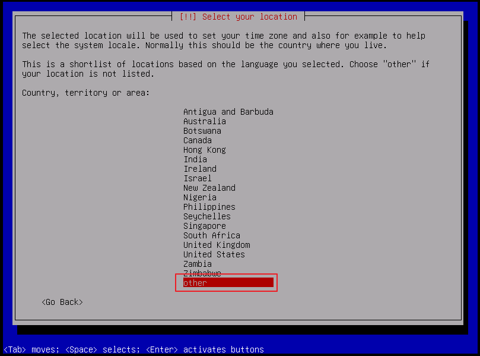
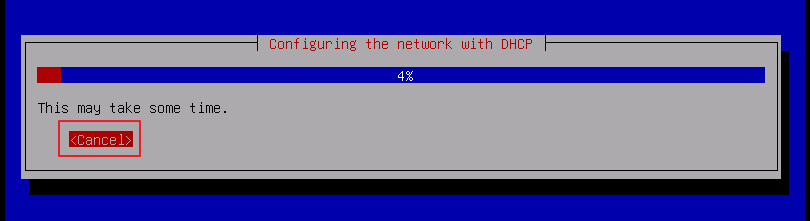

# Debian VM インストールガイド

[한국어](README.ko.md) | [English](../README.md) | **日本語** | [简体中文](README.zh-CN.md) | [Español](README.es.md) | [Français](README.fr.md)

 

VMware Workstation Pro で新しい VM を作成し、テキストモードのインストーラーで Debian をインストールする手順です。この VM は、のちに Clone の元になる **Debian CLI VM** として使います。

## 目次

- [1. VM を作成する](#1-vm-を作成する)
- [2. インストール開始と地域の設定](#2-インストール開始と地域の設定)
- [3. ネットワークとホスト名](#3-ネットワークとホスト名)
- [4. アカウントとパスワード](#4-アカウントとパスワード)
- [5. ディスクのパーティション](#5-ディスクのパーティション)
- [6. ソフトウェアの選択と GRUB](#6-ソフトウェアの選択と-grub)
- [まとめ](#まとめ)

---

## 1. VM を作成する

VMware を起動し、**Ctrl + N** を押して新しい VM を作成します。

起動に必要な **ISO ファイル**を選択します。

**Next** を押し、次の画面まではデフォルトのまま進めます。

**Customize Hardware** で **Network Adapter** を **Host-only** に設定します。

必須ではありませんが、必要なら **USB Controller** と **Sound Card** を削除してもかまいません。

**Finish** を押すと VM が自動で起動します。

---

## 2. インストール開始と地域の設定

**Ctrl + G** で VM に入力を移し、**矢印キー・スペースキー・Enter** で設定します。

> すばやく設定する方法:**English** で Enter → **other** で Enter → **aaa** で Enter → **kkk** で Enter

自分の国がある大陸を探して選択します。韓国なので **Asia** を選びます。

少し下にスクロールして、North Korea ではなく **Korea, Republic of(South Korea)**を選びます。

続くロケールの画面は図のとおりに選択します。

---

## 3. ネットワークとホスト名

ネットワーク(DHCP)の設定画面が出たら **キャンセル(Cancel)**を押します。

いちばん下の項目を選び、**ネットワークは今は設定しません。**

ホスト名(管理者名)は、課題用紙に指定があればそのとおりに、なければ何でもかまいません(例:`root`)。

---

## 4. アカウントとパスワード

root のパスワードは、課題用紙に指定があればそのとおりに、なければ好きなパスワードを入力します。**Show Password in Clear** にチェックを入れると、入力したパスワードが正しいか確認できます。

確認欄にも同じパスワードを入力します。

ユーザー名も、課題用紙に指定があればそのとおりに、なければ何でもかまいません(例:`sysop`)。

アカウント名も上のユーザー名と同じに入力します。

ユーザーのパスワードは上の root パスワードと同じにすると楽です。課題用紙に指定があればそれを使います。ここでも **Show Password in Clear** にチェックを入れて確認します。

確認欄にも同じパスワードを入力します。

> キャプチャーに写っていた実際のパスワードは `********` で隠しています。

---

## 5. ディスクのパーティション

パーティションの方法を聞く画面が出たら、いちばん上の **Guided - use entire disk** を選びます。

この画面が出たら、いちばん下の **Finish partitioning and write changes to disk** を選びます。

パーティションの変更とフォーマットの確認画面では、**必ず Yes** を選びます。No を押すと、設定を最初からやり直すことになるかもしれません。

---

## 6. ソフトウェアの選択と GRUB

よく使うパッケージの情報を開発者に匿名で送るかどうかを聞く画面です。**No** を選びます。

**最後のチェックボックス(standard system utilities)だけを残し**、ほかはすべてチェックを外します。デスクトップなしの CLI でインストールします。

「GRUB ブートローダーをプライマリドライブにインストールしますか?」という質問です。**Yes** を選びます。

GRUB ブートローダーをどこにインストールするかを聞く画面です。**下にあるディスク(/dev/sda)**を選びます。

インストールが終わって再起動するという画面です。**Continue** を押せば Linux のインストールは完了です。お疲れさまでした!

---

## まとめ

- 新しい VM は **Ctrl + N** で作成し、ISO を選んでから **Network Adapter を Host-only** に変えます(USB・Sound Card の削除は任意)。
- インストーラーは **Ctrl + G** のあと矢印キー・スペースキー・Enter で操作します。地域は **Asia → Korea** です。
- DHCP の設定は**キャンセル**し、**ネットワークはあとで**設定します。
- ホスト名、ユーザー名、パスワードは**課題用紙の値**を使います。Show Password in Clear で入力を確認します。
- パーティションは **Guided - use entire disk → Finish → Yes** です。
- ソフトウェアは **standard system utilities だけ**を残し、GRUB は **Yes → /dev/sda** にインストールします。
