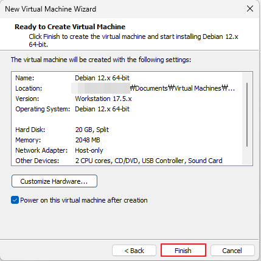
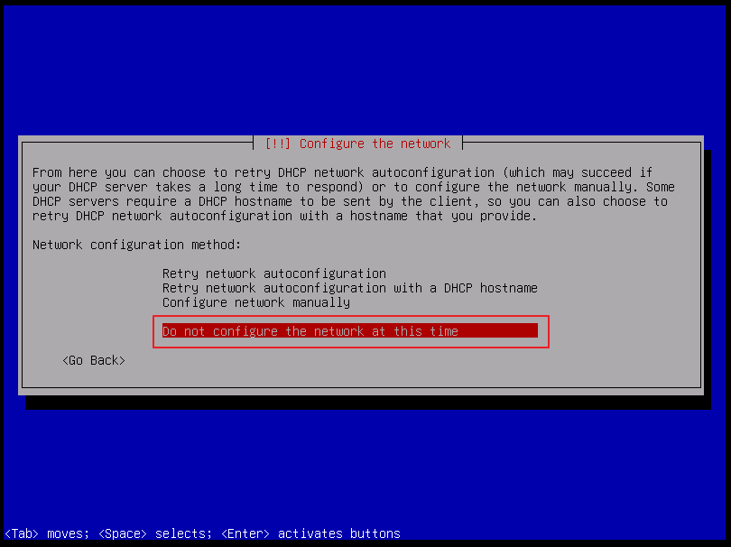
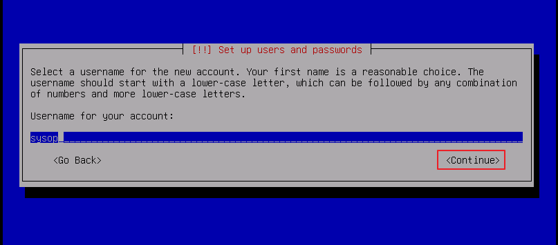
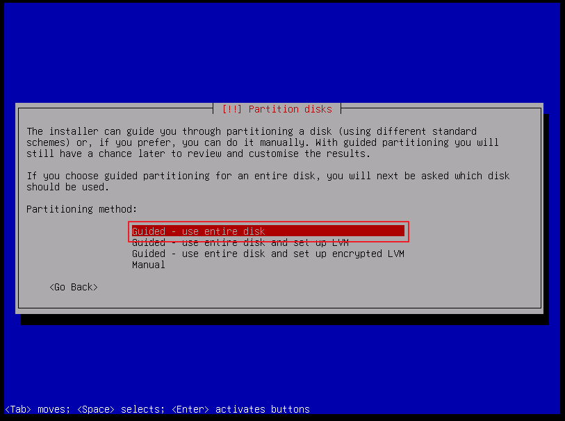
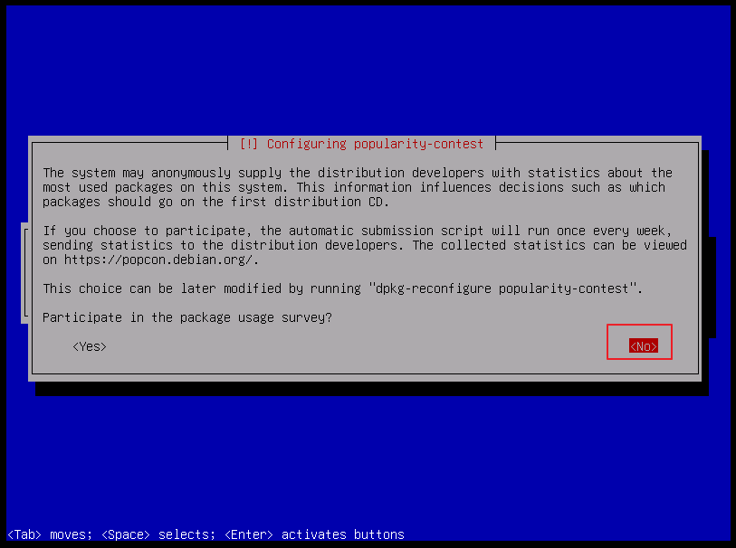
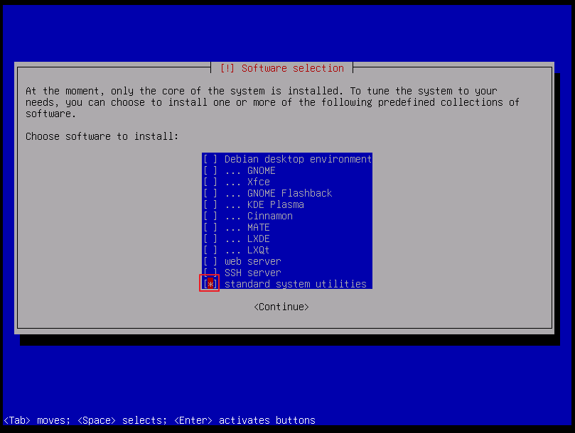

# Debian VM 설치 가이드

**한국어** | [English](../README.md) | [日本語](README.ja.md) | [简体中文](README.zh-CN.md) | [Español](README.es.md) | [Français](README.fr.md)

 

VMware Workstation Pro에서 새 VM을 만들고 Debian을 텍스트 설치 화면으로 설치하는 과정입니다. 이렇게 만든 VM은 이후 Clone의 기준이 되는 **Debian CLI VM**으로 씁니다.

## 목차

- [1. VM 만들기](#1-vm-만들기)
- [2. 설치 시작과 지역 설정](#2-설치-시작과-지역-설정)
- [3. 네트워크와 호스트 이름](#3-네트워크와-호스트-이름)
- [4. 계정과 비밀번호](#4-계정과-비밀번호)
- [5. 디스크 파티션](#5-디스크-파티션)
- [6. 소프트웨어 선택과 GRUB](#6-소프트웨어-선택과-grub)
- [정리](#정리)

---

## 1. VM 만들기

VMware를 실행하고 **Ctrl + N**을 눌러 새 VM을 만듭니다.

부팅할 때 필요한 **ISO 파일**을 선택합니다.

**Next**를 누르고, 다음 화면까지는 기본값으로 넘깁니다.

**Customize Hardware**에서 **Network Adapter**를 **Host-only**로 설정합니다.

필수는 아니지만, 원한다면 **USB Controller**와 **Sound Card**를 제거해도 됩니다.

**Finish**를 누르면 VM이 자동으로 켜집니다.

---

## 2. 설치 시작과 지역 설정

**Ctrl + G**로 VM에 입력을 넘긴 뒤, **방향키·스페이스바·Enter**로 설정합니다.

> 빠르게 설정하는 방법: **English**에서 Enter → **other** Enter → **aaa** Enter → **kkk** Enter

자기 나라가 있는 대륙을 찾아 선택합니다. 한국이므로 **Asia**를 선택합니다.

조금 내려서 North Korea가 아닌 **Korea, Republic of(South Korea)**를 선택합니다.

이어지는 로케일 화면은 그림처럼 선택합니다.

---

## 3. 네트워크와 호스트 이름

네트워크(DHCP)를 설정하는 화면이 나오면 **취소(Cancel)**를 누릅니다.

맨 아래 항목을 선택해서 **네트워크는 지금 설정하지 않습니다.**

호스트 이름(관리자 이름)은 과제지에 적혀 있으면 그대로 입력하고, 없으면 아무거나 입력합니다(예: `root`).

---

## 4. 계정과 비밀번호

root 비밀번호는 과제지에 적혀 있으면 그대로, 없으면 원하는 비밀번호를 입력합니다. **Show Password in Clear**에 체크하면 입력한 비밀번호가 맞는지 확인할 수 있습니다.

비밀번호 확인에도 같은 비밀번호를 입력합니다.

사용자 이름도 과제지에 적혀 있으면 그대로, 없으면 아무거나 입력합니다(예: `sysop`).

계정 이름도 위의 사용자 이름과 똑같이 입력합니다.

사용자 비밀번호는 위의 root 비밀번호와 같게 하면 편합니다. 과제지에 적혀 있으면 그것을 씁니다. 이때도 **Show Password in Clear**에 체크해서 확인합니다.

비밀번호 확인란에도 같은 비밀번호를 입력합니다.

> 캡처에 보이던 실제 비밀번호는 `********`로 가렸습니다.

---

## 5. 디스크 파티션

파티션 방식을 묻는 화면이 나오면 맨 위의 **Guided - use entire disk**를 선택합니다.

이런 화면이 나오면 맨 아래의 **Finish partitioning and write changes to disk**를 선택합니다.

디스크 파티션 변경과 포맷 여부를 묻는 화면에서는 **무조건 Yes**를 선택합니다. No를 누르면 설정을 처음부터 다시 해야 할 수도 있습니다.

---

## 6. 소프트웨어 선택과 GRUB

자주 쓰는 패키지 정보를 개발자에게 익명으로 보낼지 묻는 화면입니다. **No**를 선택합니다.

**마지막 체크박스(standard system utilities)만 남기고** 나머지는 모두 체크를 해제합니다. 데스크톱 없이 CLI로 설치합니다.

"GRUB 부트로더를 기본 드라이브에 설치할까요?"라는 질문입니다. **Yes**를 선택합니다.

GRUB 부트로더를 어디에 설치할지 묻는 화면입니다. **아래쪽의 디스크(/dev/sda)**를 선택합니다.

설치가 끝나서 재부팅한다는 화면입니다. **Continue**를 누르면 리눅스 설치가 끝납니다. 수고하셨습니다!

---

## 정리

- 새 VM은 **Ctrl + N**으로 만들고, ISO를 선택한 뒤 **Network Adapter를 Host-only**로 바꿉니다(USB·Sound Card 제거는 선택).
- 설치 화면은 **Ctrl + G** 후 방향키·스페이스바·Enter로 조작합니다. 지역은 **Asia → Korea**입니다.
- DHCP 설정은 **취소**하고 **네트워크는 나중에** 설정합니다.
- 호스트 이름, 사용자 이름, 비밀번호는 **과제지에 적힌 값**을 씁니다. Show Password in Clear로 입력을 확인합니다.
- 파티션은 **Guided - use entire disk → Finish → Yes**입니다.
- 소프트웨어는 **standard system utilities만** 남기고, GRUB은 **Yes → /dev/sda**에 설치합니다.
