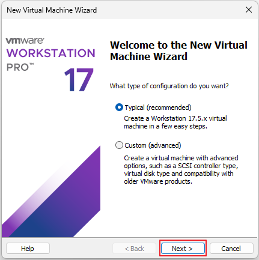
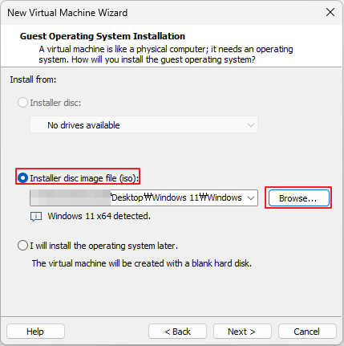
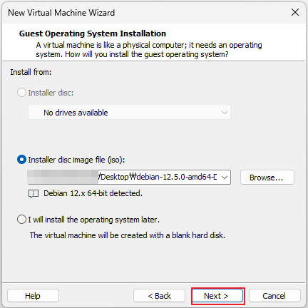
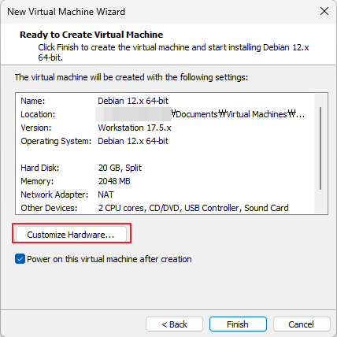
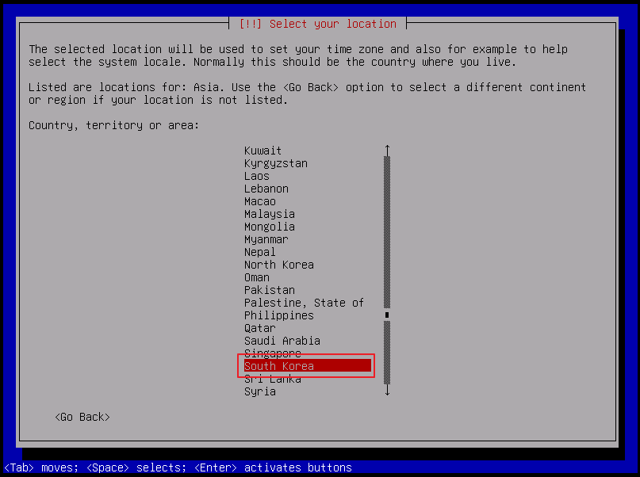
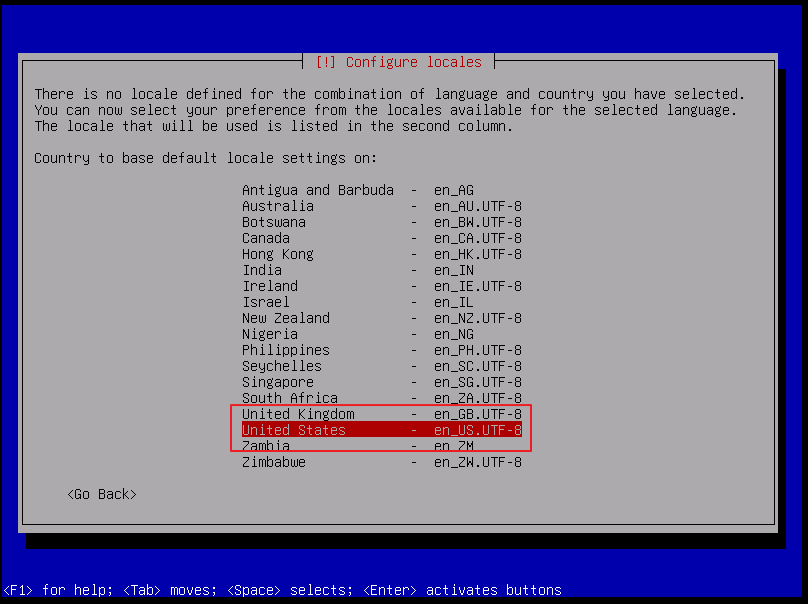
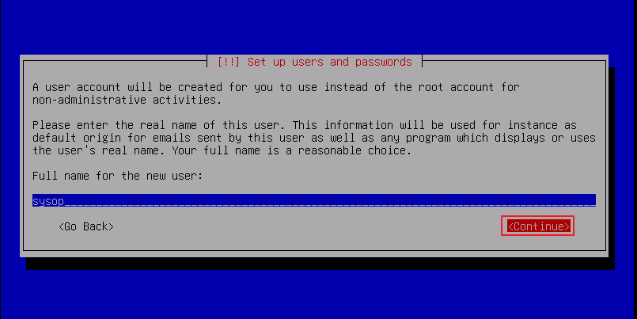
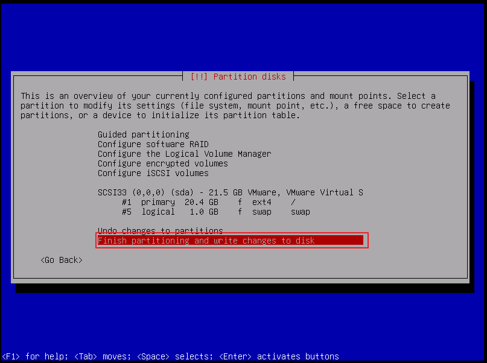

# Debian VM 安装指南

[한국어](README.ko.md) | [English](../README.md) | [日本語](README.ja.md) | **简体中文** | [Español](README.es.md) | [Français](README.fr.md)

 

在 VMware Workstation Pro 中新建 VM,并用文本模式安装程序安装 Debian 的过程。这台 VM 之后会作为 Clone 的基础,即 **Debian CLI VM**。

## 目录

- [1. 创建 VM](#1-创建-vm)
- [2. 开始安装与地区设置](#2-开始安装与地区设置)
- [3. 网络与主机名](#3-网络与主机名)
- [4. 账户与密码](#4-账户与密码)
- [5. 磁盘分区](#5-磁盘分区)
- [6. 软件选择与 GRUB](#6-软件选择与-grub)
- [总结](#总结)

---

## 1. 创建 VM

启动 VMware,按 **Ctrl + N** 新建 VM。

选择启动所需的 **ISO 文件**。

点击 **Next**,到下一个画面为止都保持默认值。

在 **Customize Hardware** 中把 **Network Adapter** 设为 **Host-only**。

这不是必须的,但如果愿意,可以删除 **USB Controller** 和 **Sound Card**。

点击 **Finish**,VM 会自动开机。

---

## 2. 开始安装与地区设置

按 **Ctrl + G** 把输入交给 VM,然后用**方向键、空格键和 Enter** 进行设置。

> 快速设置方法:**English** 回车 → **other** 回车 → **aaa** 回车 → **kkk** 回车

找到自己国家所在的大洲并选择。在韩国就选 **Asia**。

稍微往下滚动,选择 **Korea, Republic of(South Korea)**,不要选 North Korea。

接下来的 locale 画面按图中所示选择。

---

## 3. 网络与主机名

出现网络(DHCP)设置画面时,按 **取消(Cancel)**。

选择最下面的选项,**现在不配置网络。**

主机名(管理员名)如果任务书上有指定就照填,没有的话随便填(例:`root`)。

---

## 4. 账户与密码

root 密码如果任务书上有指定就照填,没有的话填你想要的密码。勾选 **Show Password in Clear** 可以确认输入的密码是否正确。

确认密码时也输入同样的密码。

用户名如果任务书上有指定就照填,没有的话随便填(例:`sysop`)。

账户名也和上面的用户名填得一样。

用户密码和上面的 root 密码设成一样比较方便;任务书上有指定的话就用指定的。这里也勾选 **Show Password in Clear** 进行确认。

确认密码栏也输入同样的密码。

> 截图中能看到的真实密码已用 `********` 遮住。

---

## 5. 磁盘分区

出现询问分区方式的画面时,选择最上面的 **Guided - use entire disk**。

出现这个画面时,选择最下面的 **Finish partitioning and write changes to disk**。

询问是否写入分区更改并格式化时,**一定要选 Yes**。选 No 的话,可能要从头重新设置。

---

## 6. 软件选择与 GRUB

这个画面询问是否把常用软件包的信息匿名发送给开发者。选择 **No**。

**只保留最后一个复选框(standard system utilities)**,其余全部取消勾选。这样安装的是没有桌面的 CLI 系统。

问题是“是否把 GRUB 引导程序安装到主驱动器?”。选择 **Yes**。

这个画面询问把 GRUB 引导程序安装到哪里。选择**下面的磁盘(/dev/sda)**。

安装完成,即将重启。点击 **Continue**,Linux 就安装好了。辛苦了!

---

## 总结

- 用 **Ctrl + N** 新建 VM,选择 ISO 后把 **Network Adapter 改为 Host-only**(删除 USB・Sound Card 可选)。
- 安装程序先按 **Ctrl + G**,再用方向键、空格键和 Enter 操作。地区选 **Asia → Korea**。
- **取消** DHCP 设置,**之后再配置网络**。
- 主机名、用户名和密码使用**任务书上的值**,用 Show Password in Clear 确认输入。
- 分区:**Guided - use entire disk → Finish → Yes**。
- 软件**只保留 standard system utilities**,GRUB 选 **Yes → /dev/sda** 安装。
