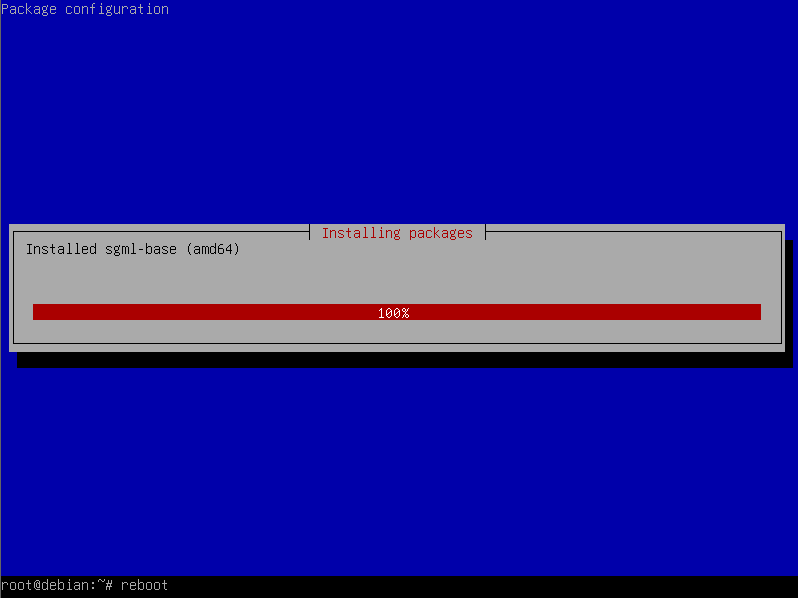

# Linux GUI Install

[한국어](README/README.ko.md) | **English** | [日本語](README/README.ja.md) | [简体中文](README/README.zh-CN.md) | [Español](README/README.es.md) | [Français](README/README.fr.md)

 

How to create a **GUI VM** by cloning the Linux CLI template VM.

> For the CLI VM, read [01. Debian VM Installation Guide](../01-Debian-VM-Install/) first.

## Contents

- [1. Full clone the Debian CLI VM](#1-full-clone-the-debian-cli-vm)
- [2. Boot Linux](#2-boot-linux)
- [3. Install the GUI](#3-install-the-gui)
- [4. Check](#4-check)
- [Summary](#summary)

---

## 1. Full clone the Debian CLI VM

On the Debian CLI VM, select **Manage → Clone**.


Press Enter → Enter, then select **Create a full clone**.


Putting **GUI** in the name to tell it apart from the CLI VM makes life easier later.


When the clone is created, press Enter (Close).


---

## 2. Boot Linux

Power on the VM.


Log in as the **root** user.


---

## 3. Install the GUI

Type the following command and press Enter.

```bash
tasksel
```


Check **Debian desktop environment** with the Space bar and press Enter.


Wait for the download and installation to finish.


Reboot with `reboot`, and the system boots into the GUI.

```bash
reboot
```



---

## 4. Check

When you see a screen like this, you can use it as the **original Linux GUI VM**.


---

## Summary

- The GUI VM is created by **full cloning the Debian CLI VM**. Put GUI in the name to tell them apart.
- Log in as root and select **Debian desktop environment** in **`tasksel`**.
- When the installation finishes, **`reboot`**; once the GUI appears, use it as the original GUI VM.
