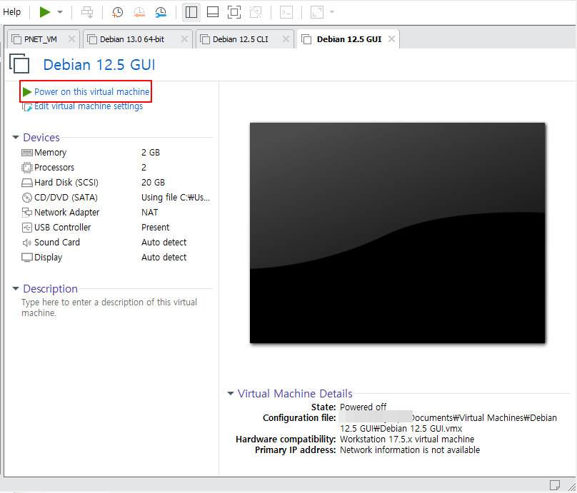

# Linux GUI Install

[한국어](README.ko.md) | [English](../README.md) | [日本語](README.ja.md) | [简体中文](README.zh-CN.md) | **Español** | [Français](README.fr.md)

 

Cómo crear una **VM con GUI** clonando la VM plantilla Linux CLI.

> Para la VM CLI, lee primero [01. Guía de instalación de una VM Debian](../../01-Debian-VM-Install/README/README.es.md).

## Contenido

- [1. Full clone de la VM Debian CLI](#1-full-clone-de-la-vm-debian-cli)
- [2. Arrancar Linux](#2-arrancar-linux)
- [3. Instalar la GUI](#3-instalar-la-gui)
- [4. Comprobación](#4-comprobación)
- [Resumen](#resumen)

---

## 1. Full clone de la VM Debian CLI

En la VM Debian CLI, selecciona **Manage → Clone**.


Pulsa Enter → Enter y luego selecciona **Create a full clone**.


Poner **GUI** en el nombre para distinguirla de la VM CLI te facilitará la vida más adelante.


Cuando se haya creado el clon, pulsa Enter (Close).


---

## 2. Arrancar Linux

Enciende la VM.



Inicia sesión como usuario **root**.


---

## 3. Instalar la GUI

Escribe el siguiente comando y pulsa Enter.

```bash
tasksel
```


Marca **Debian desktop environment** con la barra espaciadora y pulsa Enter.


Espera a que terminen la descarga y la instalación.


Reinicia con `reboot` y el sistema arrancará en la GUI.

```bash
reboot
```


---

## 4. Comprobación

Si ves una pantalla como esta, ya puedes usarla como la **VM original de Linux con GUI**.


---

## Resumen

- La VM con GUI se crea con un **full clone de la VM Debian CLI**. Pon GUI en el nombre para distinguirlas.
- Inicia sesión como root y selecciona **Debian desktop environment** en **`tasksel`**.
- Cuando termine la instalación, haz **`reboot`**; cuando aparezca la GUI, úsala como VM original con GUI.
