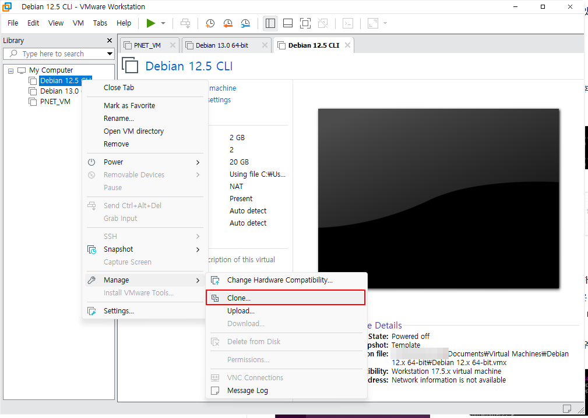
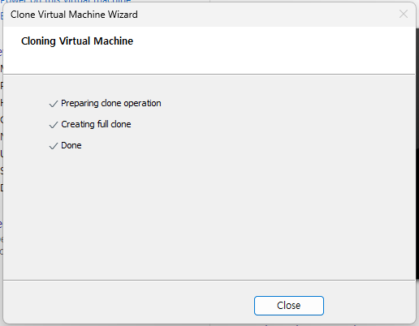
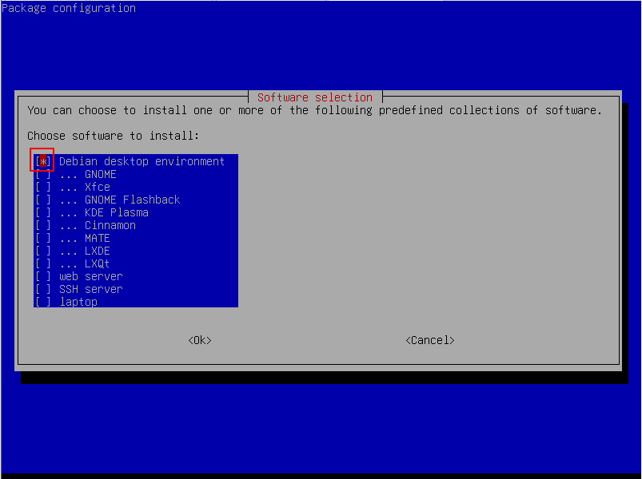
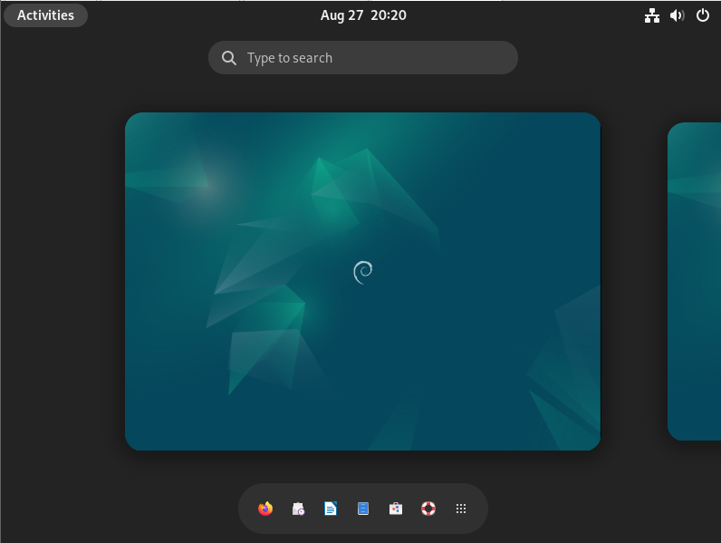

# Linux GUI Install

[한국어](README.ko.md) | [English](../README.md) | [日本語](README.ja.md) | [简体中文](README.zh-CN.md) | [Español](README.es.md) | **Français**

 

Comment créer une **VM avec interface graphique (GUI)** en clonant la VM modèle Linux CLI.

> Pour la VM CLI, lisez d'abord [01. Guide d'installation d'une VM Debian](../../01-Debian-VM-Install/README/README.fr.md).

## Sommaire

- [1. Full clone de la VM Debian CLI](#1-full-clone-de-la-vm-debian-cli)
- [2. Démarrer Linux](#2-démarrer-linux)
- [3. Installer la GUI](#3-installer-la-gui)
- [4. Vérification](#4-vérification)
- [Résumé](#résumé)

---

## 1. Full clone de la VM Debian CLI

Sur la VM Debian CLI, sélectionnez **Manage → Clone**.



Appuyez sur Entrée → Entrée, puis sélectionnez **Create a full clone**.


Mettre **GUI** dans le nom pour la distinguer de la VM CLI vous simplifiera la vie plus tard.


Une fois le clone créé, appuyez sur Entrée (Close).



---

## 2. Démarrer Linux

Allumez la VM.


Connectez-vous avec l'utilisateur **root**.


---

## 3. Installer la GUI

Tapez la commande suivante et appuyez sur Entrée.

```bash
tasksel
```


Cochez **Debian desktop environment** avec la barre d'espace et appuyez sur Entrée.



Attendez la fin du téléchargement et de l'installation.


Redémarrez avec `reboot` : le système démarre sur l'interface graphique.

```bash
reboot
```


---

## 4. Vérification

Si vous voyez un écran comme celui-ci, vous pouvez l'utiliser comme **VM Linux GUI d'origine**.



---

## Résumé

- La VM GUI se crée par un **full clone de la VM Debian CLI**. Mettez GUI dans le nom pour les distinguer.
- Connectez-vous en root et sélectionnez **Debian desktop environment** dans **`tasksel`**.
- Une fois l'installation terminée, faites **`reboot`** ; quand la GUI apparaît, utilisez-la comme VM GUI d'origine.
