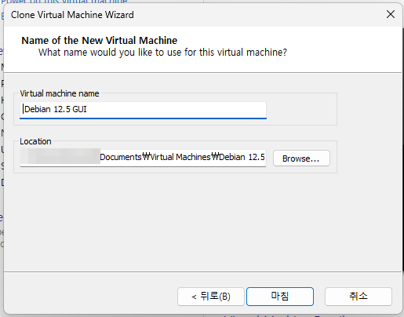
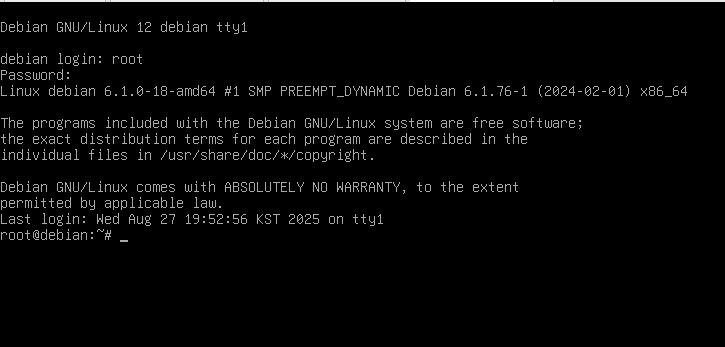

# Linux GUI Install

[한국어](README.ko.md) | [English](../README.md) | **日本語** | [简体中文](README.zh-CN.md) | [Español](README.es.md) | [Français](README.fr.md)

 

Linux CLI Template VM を Clone して **GUI VM** を作る手順です。

> CLI VM については、先に [01. Debian VM インストールガイド](../../01-Debian-VM-Install/README/README.ja.md) を参照してください。

## 目次

- [1. Debian CLI VM を Full Clone](#1-debian-cli-vm-を-full-clone)
- [2. Linux の起動](#2-linux-の起動)
- [3. GUI のインストール](#3-gui-のインストール)
- [4. 確認](#4-確認)
- [まとめ](#まとめ)

---

## 1. Debian CLI VM を Full Clone

Debian CLI VM で **Manage → Clone** を選びます。


Enter → Enter のあと、**Create a full clone** を選びます。


CLI VM と区別するため、名前に **GUI** を入れておくとあとで便利です。



作成が終わったら Enter(Close)を押します。


---

## 2. Linux の起動

VM の電源を入れます。


**root** ユーザーでログインします。



---

## 3. GUI のインストール

次のコマンドを入力して Enter を押します。

```bash
tasksel
```


**Debian desktop environment** をスペースキーでチェックし、Enter を押します。


ダウンロードとインストールが終わるまで待ちます。


`reboot` で再起動すると、GUI 画面で起動します。

```bash
reboot
```


---

## 4. 確認

次のような画面が表示されれば、**Linux GUI の元 VM** として使えます。


---

## まとめ

- GUI VM は **Debian CLI VM を Full Clone** して作ります。名前に GUI を入れて区別します。
- root でログインし、**`tasksel`** で **Debian desktop environment** を選びます。
- インストールが終わったら **`reboot`** し、GUI 画面が出たら GUI の元 VM として使います。
