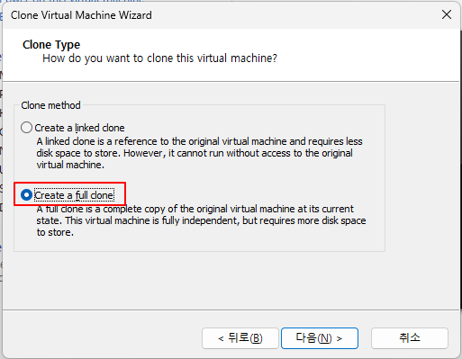
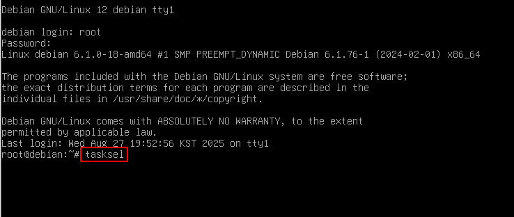
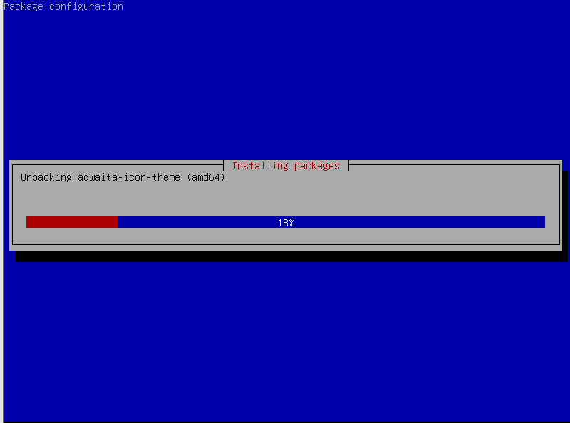

# Linux GUI Install

**한국어** | [English](../README.md) | [日本語](README.ja.md) | [简体中文](README.zh-CN.md) | [Español](README.es.md) | [Français](README.fr.md)

 

Linux CLI Template VM을 Clone해서 **GUI VM**을 만드는 과정입니다.

> CLI VM은 [01. Debian VM 설치 가이드](../../01-Debian-VM-Install/README/README.ko.md) 를 먼저 보세요.

## 목차

- [1. Debian CLI VM을 Full Clone](#1-debian-cli-vm을-full-clone)
- [2. Linux 부팅](#2-linux-부팅)
- [3. GUI 설치](#3-gui-설치)
- [4. 확인](#4-확인)
- [정리](#정리)

---

## 1. Debian CLI VM을 Full Clone

Debian CLI VM에서 **Manage → Clone**을 선택합니다.


Enter → Enter 이후에 **Create a full clone**을 선택합니다.



CLI VM과 구분하기 위해 이름에 **GUI**를 넣어 두면 나중에 편합니다.


생성이 끝나면 Enter(Close)를 누릅니다.


---

## 2. Linux 부팅

VM의 전원을 켭니다.


**root** 사용자로 로그인합니다.


---

## 3. GUI 설치

다음 명령어를 입력하고 Enter를 누릅니다.

```bash
tasksel
```



**Debian desktop environment**를 스페이스바로 체크하고 Enter를 누릅니다.


다운로드와 설치가 끝날 때까지 기다립니다.



`reboot`로 재부팅하면 GUI 화면으로 부팅됩니다.

```bash
reboot
```


---

## 4. 확인

다음과 같은 화면이 나오면 **리눅스 GUI 원본 VM**으로 사용할 수 있습니다.


---

## 정리

- GUI VM은 **Debian CLI VM을 Full Clone**해서 만듭니다. 이름에 GUI를 넣어 구분합니다.
- root로 로그인한 뒤 **`tasksel`**에서 **Debian desktop environment**를 선택합니다.
- 설치가 끝나면 **`reboot`**하고, GUI 화면이 나오면 GUI 원본 VM으로 씁니다.
