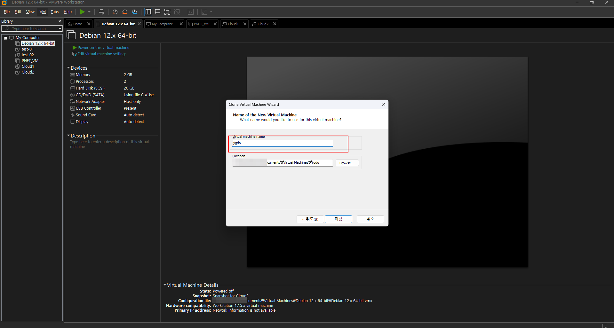
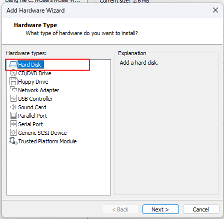
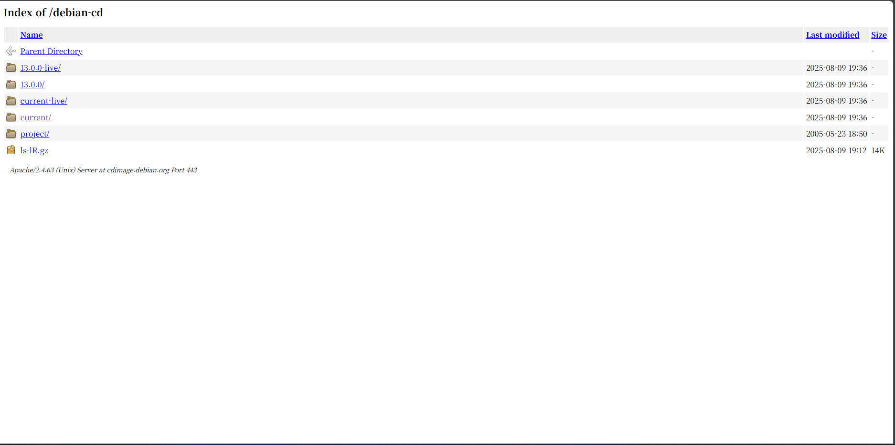

# Linux ISO Image Installation Guide

[한국어](README/README.ko.md) | **English** | [日本語](README/README.ja.md) | [简体中文](README/README.zh-CN.md) | [Español](README/README.es.md) | [Français](README/README.fr.md)

 

How to build the Debian DLBD ISO image with **jigdo** on a Debian VM and download it to a Windows PC.

> For the base Debian VM, read [01. Debian VM Installation Guide](../01-Debian-VM-Install/) first.

## Contents

- [1. Create the Jigdo VM](#1-create-the-jigdo-vm)
- [2. Network and hard disk](#2-network-and-hard-disk)
- [3. Log in and configure the network](#3-log-in-and-configure-the-network)
- [4. Format and mount the disk](#4-format-and-mount-the-disk)
- [5. Install jigdo and download the files](#5-install-jigdo-and-download-the-files)
- [6. Build the ISO file](#6-build-the-iso-file)
- [7. Download the ISO to a Windows PC](#7-download-the-iso-to-a-windows-pc)
- [Summary](#summary)

---

## 1. Create the Jigdo VM

In VMware, **clone** the existing Debian Linux VM to create a **Jigdo** VM.



---

## 2. Network and hard disk

Set the Jigdo VM's network (VMnet) to **NAT**, because it has to download files from the internet.


**Add a hard disk** to the VM.




Select **Create a new virtual disk**.


Add a **200 GB** hard disk. The picture shows the second option selected, but select the third one so the disk can be formatted later.


---

## 3. Log in and configure the network

Start the VM and log in as **root**.


Install **Vim** right away.

```bash
apt install vim
```


Configure the VM to get its IP address via **DHCP**.

```bash
vim /etc/network/interfaces
```


```text
auto ens33
iface ens33 inet dhcp
```


Save and quit with `:wq`, then restart the networking service.

```bash
systemctl restart networking
```


---

## 4. Format and mount the disk

Check with `fdisk -l` that the **200 GB disk** is there.


**Format** the 200 GB disk before mounting it. The disk name depends on the environment, so use the 200 GB disk you saw in `fdisk -l` (e.g. if the 200 GB disk is `/dev/sda`, run `mkfs.ext4 /dev/sda`).

```bash
mkfs.ext4 /dev/sdb
```


Create a mount directory and mount the disk.

```bash
mkdir /jigdo
mount /dev/sdb /jigdo
```


Check that the disk is mounted.

```bash
df -h
```


---

## 5. Install jigdo and download the files

Install **jigdo-file**.

```bash
apt install jigdo-file
```


Find the internet address of the jigdo files. Go to <https://cdimage.debian.org/debian-cd>, open **current → amd64 → jigdo-dlbd** and scroll down.



You'll download these **6 files** (the `.jigdo` and `.template` for DLBD-1 to 3) on Linux. The browser is now at `https://cdimage.debian.org/debian-cd/current/amd64/jigdo-dlbd/`; each file's download address is this path plus the file name.


Once you've found the addresses, move to the jigdo directory.

```bash
cd /jigdo
```


Right-click one of the 6 files and **copy the link address**.


On Linux, type `wget` and paste the address. Download **all 6 files** this way, including the templates and jigdo files.

```bash
wget https://cdimage.debian.org/debian-cd/current/amd64/jigdo-dlbd/debian-13.0.0-amd64-DLBD-1.jigdo
```


---

## 6. Build the ISO file

Taking number 1 of 1, 2 and 3 as an example, first copy the **link of jigdo file 1**.


On Linux, type `jigdo-lite` and paste the address. When **Files to scan** appears, type nothing and press Enter.

```bash
jigdo-lite https://cdimage.debian.org/debian-cd/current/amd64/jigdo-dlbd/debian-13.0.0-amd64-DLBD-1.jigdo
```


When asked for a mirror, paste `http://mirror.siwoo.org/debian` as is and press Enter. The download starts (**it takes a very long time**).


The download is complete.


---

## 7. Download the ISO to a Windows PC

Download the ISO file to the PC with Windows **PowerShell**. First, check the **IP address of ens33** with `ip add`.

```bash
ip add
```


In PowerShell, run `scp` with the VM's IP and the file path. If you get `Connection refused` as below, you need to **enable SSH** on the VM.

```powershell
scp root@<VM IP>:/jigdo/debian-13.0.0/amd64-DLBD-1.iso C:
```


Install **openssh-server** on the VM.

```bash
apt-get install openssh-server
```


Restart the SSH service to apply the settings.

```bash
systemctl restart ssh
```


Run the same command again and you'll see the prompt below. Type `yes` and press Enter, then enter the **password you use to log in to the VM as root**; the download starts.


> - If you get a host key warning, remove the old key on the PC with `ssh-keygen -R <VM IP>`.
> - If you can't remember the root password, set it again on the VM with `passwd`.

If it still doesn't work, opening the permissions lets Windows download the file (**it takes a long time**).

```bash
chmod 777 ~/.ssh
```


> `chmod 777` is only for a lab VM. Don't open permissions like this on a real server.

---

## Summary

- Clone the existing Debian VM into a **Jigdo VM**, set the network to **NAT** and add a **200 GB** hard disk.
- Configure **DHCP** in `/etc/network/interfaces` and apply it with `systemctl restart networking`.
- **Format the 200 GB disk with `mkfs.ext4`**, **mount it on `/jigdo`** and check with `df -h`.
- Install `jigdo-file` and download the 6 **jigdo-dlbd** files from cdimage.debian.org with `wget`.
- Run **`jigdo-lite <jigdo URL>`** and enter a mirror to build the ISO (takes a long time).
- Use **`scp`** to copy it to the PC; if the connection is refused, install **openssh-server**.
