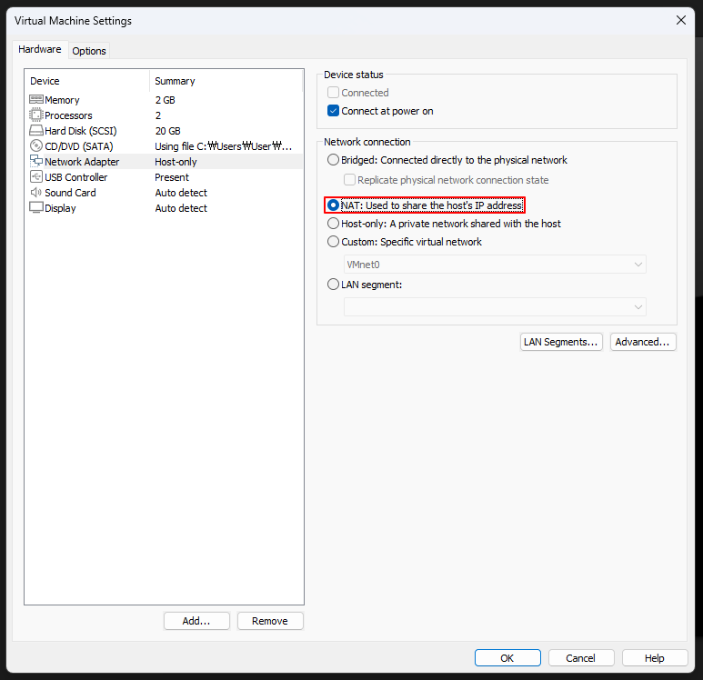
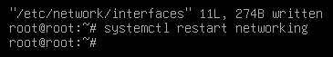
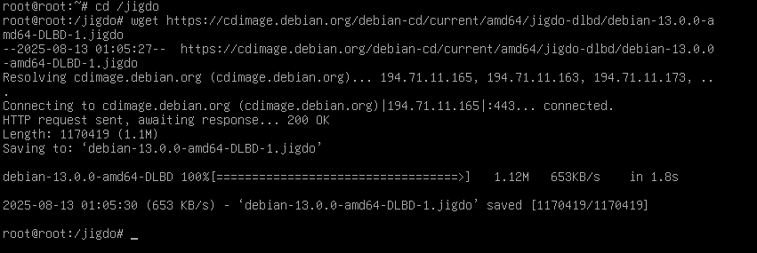
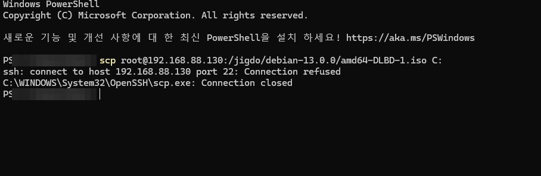
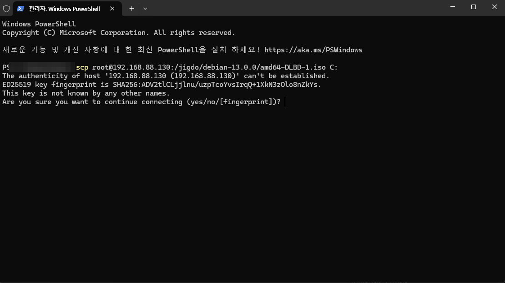

# Guía de instalación de la imagen ISO de Linux

[한국어](README.ko.md) | [English](../README.md) | [日本語](README.ja.md) | [简体中文](README.zh-CN.md) | **Español** | [Français](README.fr.md)

 

Cómo crear la imagen ISO DLBD de Debian con **jigdo** en una VM Debian y descargarla a un PC con Windows.

> Para la VM Debian base, lee primero [01. Guía de instalación de una VM Debian](../../01-Debian-VM-Install/README/README.es.md).

## Contenido

- [1. Crear la VM Jigdo](#1-crear-la-vm-jigdo)
- [2. Red y disco duro](#2-red-y-disco-duro)
- [3. Iniciar sesión y configurar la red](#3-iniciar-sesión-y-configurar-la-red)
- [4. Formatear y montar el disco](#4-formatear-y-montar-el-disco)
- [5. Instalar jigdo y descargar los archivos](#5-instalar-jigdo-y-descargar-los-archivos)
- [6. Crear el archivo ISO](#6-crear-el-archivo-iso)
- [7. Descargar la ISO a un PC con Windows](#7-descargar-la-iso-a-un-pc-con-windows)
- [Resumen](#resumen)

---

## 1. Crear la VM Jigdo

En VMware, **clona** la VM Debian Linux existente para crear una VM **Jigdo**.


---

## 2. Red y disco duro

Configura la red (VMnet) de la VM Jigdo como **NAT**, porque tiene que descargar archivos de internet.



**Añade un disco duro** a la VM.


Selecciona **Create a new virtual disk**.


Añade un disco duro de **200 GB**. En la imagen aparece seleccionada la segunda opción, pero selecciona la tercera para poder formatear el disco más tarde.


---

## 3. Iniciar sesión y configurar la red

Arranca la VM e inicia sesión como **root**.


Instala **Vim** enseguida.

```bash
apt install vim
```


Configura la VM para que obtenga su IP por **DHCP**.

```bash
vim /etc/network/interfaces
```


```text
auto ens33
iface ens33 inet dhcp
```


Guarda y sal con `:wq`, y reinicia el servicio de red.

```bash
systemctl restart networking
```



---

## 4. Formatear y montar el disco

Comprueba con `fdisk -l` que está el **disco de 200 GB**.


**Formatea** el disco de 200 GB antes de montarlo. El nombre del disco depende del entorno, así que usa el disco de 200 GB que viste en `fdisk -l` (p. ej., si el disco de 200 GB es `/dev/sda`, ejecuta `mkfs.ext4 /dev/sda`).

```bash
mkfs.ext4 /dev/sdb
```


Crea un directorio de montaje y monta el disco.

```bash
mkdir /jigdo
mount /dev/sdb /jigdo
```


Comprueba que el disco está montado.

```bash
df -h
```


---

## 5. Instalar jigdo y descargar los archivos

Instala **jigdo-file**.

```bash
apt install jigdo-file
```


Busca la dirección de los archivos jigdo en internet. Entra en <https://cdimage.debian.org/debian-cd>, abre **current → amd64 → jigdo-dlbd** y baja.


Descargarás estos **6 archivos** (el `.jigdo` y el `.template` de DLBD-1 a 3) en Linux. El navegador está ahora en `https://cdimage.debian.org/debian-cd/current/amd64/jigdo-dlbd/`; la dirección de descarga de cada archivo es esta ruta más el nombre del archivo.


Cuando tengas las direcciones, entra en el directorio jigdo.

```bash
cd /jigdo
```


Haz clic derecho en uno de los 6 archivos y **copia la dirección del enlace**.


En Linux, escribe `wget` y pega la dirección. Descarga así **los 6 archivos**, incluidos los templates y los jigdo.

```bash
wget https://cdimage.debian.org/debian-cd/current/amd64/jigdo-dlbd/debian-13.0.0-amd64-DLBD-1.jigdo
```



---

## 6. Crear el archivo ISO

Tomando como ejemplo el número 1 de 1, 2 y 3, primero copia el **enlace del archivo jigdo 1**.


En Linux, escribe `jigdo-lite` y pega la dirección. Cuando aparezca **Files to scan**, no escribas nada y pulsa Enter.

```bash
jigdo-lite https://cdimage.debian.org/debian-cd/current/amd64/jigdo-dlbd/debian-13.0.0-amd64-DLBD-1.jigdo
```


Cuando pida un mirror, pega `http://mirror.siwoo.org/debian` tal cual y pulsa Enter. Empezará la descarga (**tarda muchísimo**).


La descarga ha terminado.


---

## 7. Descargar la ISO a un PC con Windows

Descarga el archivo ISO al PC con **PowerShell** de Windows. Primero, comprueba la **dirección IP de ens33** con `ip add`.

```bash
ip add
```


En PowerShell, ejecuta `scp` con la IP de la VM y la ruta del archivo. Si aparece `Connection refused` como abajo, tienes que **activar SSH** en la VM.

```powershell
scp root@<VM IP>:/jigdo/debian-13.0.0/amd64-DLBD-1.iso C:
```



Instala **openssh-server** en la VM.

```bash
apt-get install openssh-server
```


Reinicia el servicio SSH para aplicar la configuración.

```bash
systemctl restart ssh
```


Ejecuta el mismo comando otra vez y verás la pregunta de abajo. Escribe `yes`, pulsa Enter y luego introduce la **contraseña con la que inicias sesión en la VM como root**; empezará la descarga.



> - Si aparece un aviso de clave de host, borra la clave antigua en el PC con `ssh-keygen -R <VM IP>`.
> - Si no recuerdas la contraseña de root, vuelve a definirla en la VM con `passwd`.

Si aún no funciona, abrir los permisos permite descargar el archivo en Windows (**tarda bastante**).

```bash
chmod 777 ~/.ssh
```


> `chmod 777` es solo para una VM de laboratorio. No abras así los permisos en un servidor real.

---

## Resumen

- Clona la VM Debian existente como **VM Jigdo**, configura la red como **NAT** y añade un disco de **200 GB**.
- Configura **DHCP** en `/etc/network/interfaces` y aplícalo con `systemctl restart networking`.
- **Formatea el disco de 200 GB con `mkfs.ext4`**, **móntalo en `/jigdo`** y compruébalo con `df -h`.
- Instala `jigdo-file` y descarga con `wget` los 6 archivos **jigdo-dlbd** de cdimage.debian.org.
- Ejecuta **`jigdo-lite <URL del jigdo>`** e introduce un mirror para crear la ISO (tarda mucho).
- Usa **`scp`** para copiarla al PC; si se rechaza la conexión, instala **openssh-server**.
