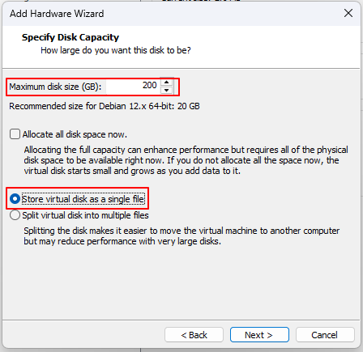
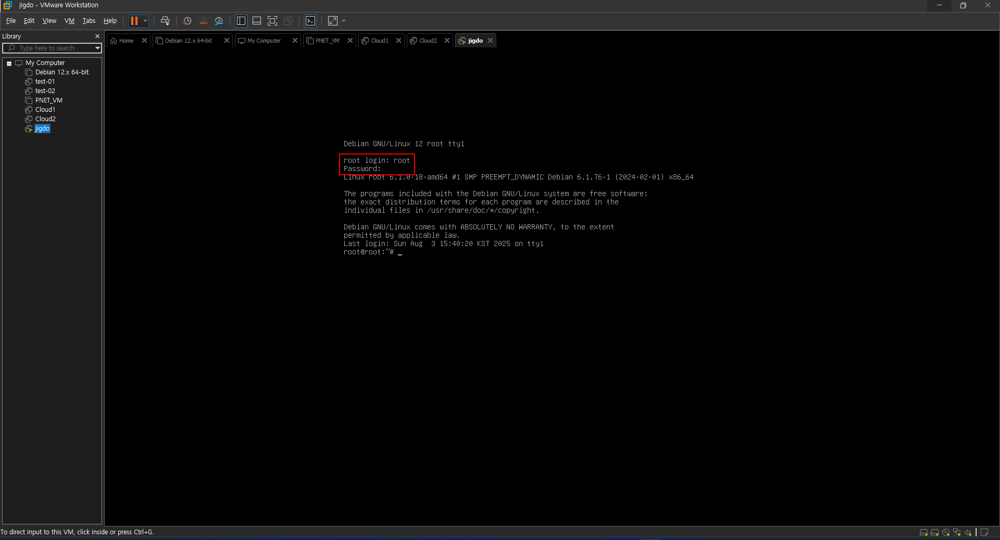
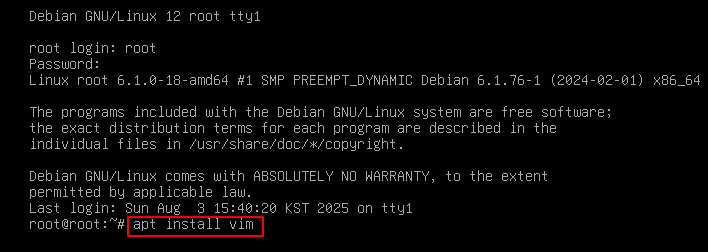
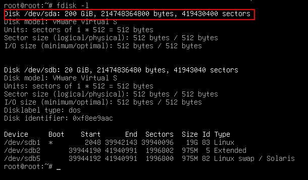
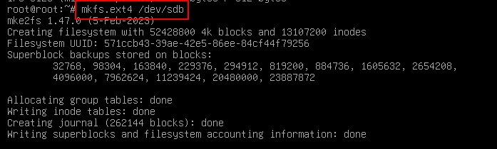
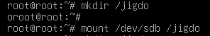
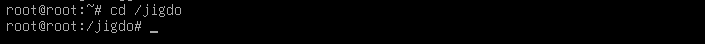
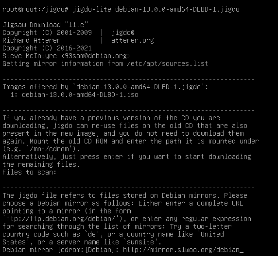
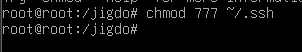

# Guide d'installation de l'image ISO Linux

[한국어](README.ko.md) | [English](../README.md) | [日本語](README.ja.md) | [简体中文](README.zh-CN.md) | [Español](README.es.md) | **Français**

 

Comment créer l'image ISO DLBD de Debian avec **jigdo** sur une VM Debian et la télécharger sur un PC Windows.

> Pour la VM Debian de base, lisez d'abord [01. Guide d'installation d'une VM Debian](../../01-Debian-VM-Install/README/README.fr.md).

## Sommaire

- [1. Créer la VM Jigdo](#1-créer-la-vm-jigdo)
- [2. Réseau et disque dur](#2-réseau-et-disque-dur)
- [3. Connexion et configuration réseau](#3-connexion-et-configuration-réseau)
- [4. Formater et monter le disque](#4-formater-et-monter-le-disque)
- [5. Installer jigdo et télécharger les fichiers](#5-installer-jigdo-et-télécharger-les-fichiers)
- [6. Créer le fichier ISO](#6-créer-le-fichier-iso)
- [7. Télécharger l'ISO sur un PC Windows](#7-télécharger-liso-sur-un-pc-windows)
- [Résumé](#résumé)

---

## 1. Créer la VM Jigdo

Dans VMware, **clonez** la VM Debian Linux existante pour créer une VM **Jigdo**.


---

## 2. Réseau et disque dur

Réglez le réseau (VMnet) de la VM Jigdo sur **NAT**, car elle doit télécharger des fichiers sur Internet.


**Ajoutez un disque dur** à la VM.


Sélectionnez **Create a new virtual disk**.


Ajoutez un disque dur de **200 Go**. L'image montre la deuxième option sélectionnée, mais choisissez la troisième pour pouvoir formater le disque plus tard.




---

## 3. Connexion et configuration réseau

Démarrez la VM et connectez-vous en **root**.



Installez tout de suite **Vim**.

```bash
apt install vim
```



Configurez la VM pour qu'elle obtienne son adresse IP par **DHCP**.

```bash
vim /etc/network/interfaces
```


```text
auto ens33
iface ens33 inet dhcp
```


Enregistrez et quittez avec `:wq`, puis redémarrez le service réseau.

```bash
systemctl restart networking
```


---

## 4. Formater et monter le disque

Vérifiez avec `fdisk -l` que le **disque de 200 Go** est bien là.



**Formatez** le disque de 200 Go avant de le monter. Le nom du disque dépend de l'environnement : utilisez le disque de 200 Go repéré dans `fdisk -l` (ex. : si le disque de 200 Go est `/dev/sda`, lancez `mkfs.ext4 /dev/sda`).

```bash
mkfs.ext4 /dev/sdb
```



Créez un répertoire de montage et montez le disque.

```bash
mkdir /jigdo
mount /dev/sdb /jigdo
```



Vérifiez que le disque est bien monté.

```bash
df -h
```


---

## 5. Installer jigdo et télécharger les fichiers

Installez **jigdo-file**.

```bash
apt install jigdo-file
```


Trouvez l'adresse Internet des fichiers jigdo. Allez sur <https://cdimage.debian.org/debian-cd>, ouvrez **current → amd64 → jigdo-dlbd** et faites défiler vers le bas.


Vous allez télécharger ces **6 fichiers** (le `.jigdo` et le `.template` de DLBD-1 à 3) sous Linux. Le navigateur est maintenant sur `https://cdimage.debian.org/debian-cd/current/amd64/jigdo-dlbd/` ; l'adresse de téléchargement de chaque fichier est ce chemin suivi du nom du fichier.


Une fois les adresses trouvées, placez-vous dans le répertoire jigdo.

```bash
cd /jigdo
```



Faites un clic droit sur l'un des 6 fichiers et **copiez l'adresse du lien**.


Sous Linux, tapez `wget` et collez l'adresse. Téléchargez ainsi **les 6 fichiers**, templates et jigdo compris.

```bash
wget https://cdimage.debian.org/debian-cd/current/amd64/jigdo-dlbd/debian-13.0.0-amd64-DLBD-1.jigdo
```


---

## 6. Créer le fichier ISO

En prenant l'exemple du numéro 1 parmi 1, 2 et 3, copiez d'abord le **lien du fichier jigdo 1**.


Sous Linux, tapez `jigdo-lite` puis collez l'adresse. Quand **Files to scan** apparaît, ne tapez rien et appuyez sur Entrée.

```bash
jigdo-lite https://cdimage.debian.org/debian-cd/current/amd64/jigdo-dlbd/debian-13.0.0-amd64-DLBD-1.jigdo
```


Quand un miroir est demandé, collez `http://mirror.siwoo.org/debian` tel quel et appuyez sur Entrée. Le téléchargement commence (**c'est très long**).



Le téléchargement est terminé.


---

## 7. Télécharger l'ISO sur un PC Windows

Téléchargez le fichier ISO sur le PC avec **PowerShell** sous Windows. Vérifiez d'abord l'**adresse IP de ens33** avec `ip add`.

```bash
ip add
```


Dans PowerShell, lancez `scp` avec l'IP de la VM et le chemin du fichier. Si vous obtenez `Connection refused` comme ci-dessous, il faut **activer SSH** sur la VM.

```powershell
scp root@<VM IP>:/jigdo/debian-13.0.0/amd64-DLBD-1.iso C:
```


Installez **openssh-server** sur la VM.

```bash
apt-get install openssh-server
```


Redémarrez le service SSH pour appliquer la configuration.

```bash
systemctl restart ssh
```


Relancez la même commande et vous verrez la question ci-dessous. Tapez `yes`, appuyez sur Entrée, puis saisissez le **mot de passe que vous utilisez pour vous connecter à la VM en root** : le téléchargement commence.


> - En cas d'avertissement sur la clé d'hôte, supprimez l'ancienne clé sur le PC avec `ssh-keygen -R <VM IP>`.
> - Si vous avez oublié le mot de passe root, redéfinissez-le sur la VM avec `passwd`.

Si cela ne fonctionne toujours pas, ouvrir les permissions permet à Windows de télécharger le fichier (**c'est long**).

```bash
chmod 777 ~/.ssh
```



> `chmod 777` est réservé à une VM de lab. N'ouvrez pas les permissions ainsi sur un vrai serveur.

---

## Résumé

- Clonez la VM Debian existante en **VM Jigdo**, réglez le réseau sur **NAT** et ajoutez un disque de **200 Go**.
- Configurez le **DHCP** dans `/etc/network/interfaces` et appliquez-le avec `systemctl restart networking`.
- **Formatez le disque de 200 Go avec `mkfs.ext4`**, **montez-le sur `/jigdo`** et vérifiez avec `df -h`.
- Installez `jigdo-file` et téléchargez avec `wget` les 6 fichiers **jigdo-dlbd** de cdimage.debian.org.
- Lancez **`jigdo-lite <URL du jigdo>`** et saisissez un miroir pour créer l'ISO (c'est long).
- Utilisez **`scp`** pour la copier sur le PC ; si la connexion est refusée, installez **openssh-server**.
