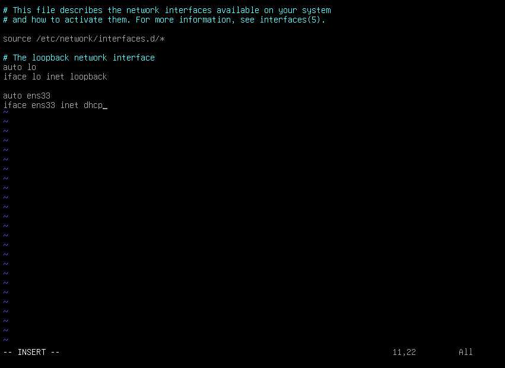
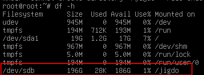

# Linux ISO Image インストールガイド

[한국어](README.ko.md) | [English](../README.md) | **日本語** | [简体中文](README.zh-CN.md) | [Español](README.es.md) | [Français](README.fr.md)

 

Debian VM で **jigdo** を使って Debian DLBD の ISO イメージを作り、Windows PC にダウンロードする手順です。

> 元になる Debian VM については、先に [01. Debian VM インストールガイド](../../01-Debian-VM-Install/README/README.ja.md) を参照してください。

## 目次

- [1. Jigdo VM を作る](#1-jigdo-vm-を作る)
- [2. ネットワークとハードディスク](#2-ネットワークとハードディスク)
- [3. VM へのログインとネットワーク設定](#3-vm-へのログインとネットワーク設定)
- [4. ディスクのフォーマットとマウント](#4-ディスクのフォーマットとマウント)
- [5. jigdo のインストールとファイルのダウンロード](#5-jigdo-のインストールとファイルのダウンロード)
- [6. ISO ファイルを作る](#6-iso-ファイルを作る)
- [7. Windows PC へ ISO をダウンロード](#7-windows-pc-へ-iso-をダウンロード)
- [まとめ](#まとめ)

---

## 1. Jigdo VM を作る

VMware で既存の Debian Linux を元に **Clone** して、**Jigdo** VM を 1 台作ります。


---

## 2. ネットワークとハードディスク

Jigdo VM のネットワーク(VMnet)を **NAT** にします。インターネットからファイルをダウンロードする必要があるためです。


VM に**ハードディスクを追加**します。


**Create a new virtual disk** を選びます。


ハードディスクを **200GB** 追加します。写真では 2 番目を選んでいますが、あとでディスクをフォーマットできるように 3 番目を選びます。


---

## 3. VM へのログインとネットワーク設定

VM を起動し、**root** でログインします。


すぐに **Vim** をインストールします。

```bash
apt install vim
```


VM が **DHCP** で IP を受け取るように設定します。

```bash
vim /etc/network/interfaces
```


```text
auto ens33
iface ens33 inet dhcp
```



`:wq` で保存して終了し、ネットワークサービスを再起動します。

```bash
systemctl restart networking
```


---

## 4. ディスクのフォーマットとマウント

`fdisk -l` で **200GB のディスク**があることを確認します。


マウントする前に 200GB のディスクを**フォーマット**します。ディスク名は環境によって違うので、`fdisk -l` で確認した 200GB のディスクを指定します(例:200GB のディスクが `/dev/sda` なら `mkfs.ext4 /dev/sda`)。

```bash
mkfs.ext4 /dev/sdb
```


マウント用のディレクトリを作ってマウントします。

```bash
mkdir /jigdo
mount /dev/sdb /jigdo
```


正しくマウントされたか確認します。

```bash
df -h
```



---

## 5. jigdo のインストールとファイルのダウンロード

**jigdo-file** をインストールします。

```bash
apt install jigdo-file
```


jigdo ファイルのインターネット上のアドレスを探します。<https://cdimage.debian.org/debian-cd> にアクセスし、**current → amd64 → jigdo-dlbd** と進んで下にスクロールします。


ここから **6 つのファイル**(DLBD-1〜3 の `.jigdo` と `.template`)を Linux でダウンロードします。いまブラウザーのアドレスは `https://cdimage.debian.org/debian-cd/current/amd64/jigdo-dlbd/` で、これに各ファイル名を付けたものがダウンロードのアドレスです。


アドレスが見つかったら jigdo ディレクトリに移動します。

```bash
cd /jigdo
```


ダウンロードする 6 つのファイルのうち 1 つを右クリックして、**リンクのアドレスをコピー**します。


Linux で `wget` と入力し、コピーしたアドレスを貼り付けます。こうして template と jigdo を含めて **6 つすべて**をダウンロードします。

```bash
wget https://cdimage.debian.org/debian-cd/current/amd64/jigdo-dlbd/debian-13.0.0-amd64-DLBD-1.jigdo
```


---

## 6. ISO ファイルを作る

1、2、3 のうち 1 を例にすると、まず 1 番の **jigdo ファイルのリンク**をコピーします。


Linux で `jigdo-lite` と入力してから、コピーしたアドレスを貼り付けます。**Files to scan** と出たら何も入力せずに Enter で進めます。

```bash
jigdo-lite https://cdimage.debian.org/debian-cd/current/amd64/jigdo-dlbd/debian-13.0.0-amd64-DLBD-1.jigdo
```


ミラーサイトの入力を求められたら、`http://mirror.siwoo.org/debian` をそのまま貼り付けて Enter を押します。ダウンロードが始まります(**とても時間がかかります**)。


ダウンロードが完了した様子です。


---

## 7. Windows PC へ ISO をダウンロード

Windows の **PowerShell** で ISO ファイルを PC にダウンロードします。まず `ip add` で **ens33 の IP アドレス**を確認します。

```bash
ip add
```


PowerShell で VM の IP とファイルのパスを入れて `scp` を実行します。下のように `Connection refused` と出たら、VM で **SSH を有効に**する必要があるという意味です。

```powershell
scp root@<VM IP>:/jigdo/debian-13.0.0/amd64-DLBD-1.iso C:
```


VM に **openssh-server** をインストールします。

```bash
apt-get install openssh-server
```


SSH サービスを再起動して設定を反映します。

```bash
systemctl restart ssh
```


同じコマンドをもう一度入力すると、下のように表示されます。`yes` と入力して Enter を押し、パスワードには **VM に root でログインするときのパスワード**を入力すると、ダウンロードが始まります。


> - ホストキーの警告が出たら、PC で `ssh-keygen -R <VM IP>` を実行して古いキーを削除します。
> - root のパスワードを忘れたら、VM で `passwd` を実行して設定し直します。

それでもだめなら、権限を許可すれば Windows で正常にダウンロードできます(**時間がかかります**)。

```bash
chmod 777 ~/.ssh
```


> `chmod 777` は実習用 VM だけで使う方法です。実際のサーバーではこのように権限を開けません。

---

## まとめ

- 既存の Debian VM を Clone して **Jigdo VM** を作り、ネットワークは **NAT**、ハードディスクは **200GB** を追加します。
- `/etc/network/interfaces` に **DHCP** を設定し、`systemctl restart networking` で反映します。
- 200GB のディスクを **`mkfs.ext4` でフォーマット**し、**`/jigdo` にマウント**してから `df -h` で確認します。
- `jigdo-file` をインストールし、cdimage.debian.org の **jigdo-dlbd** ファイル 6 つを `wget` でダウンロードします。
- **`jigdo-lite <jigdo のアドレス>`** を実行してミラーを入力すると ISO が作られます(時間がかかります)。
- PC へのダウンロードには **`scp`** を使い、接続が拒否されたら **openssh-server** をインストールします。
