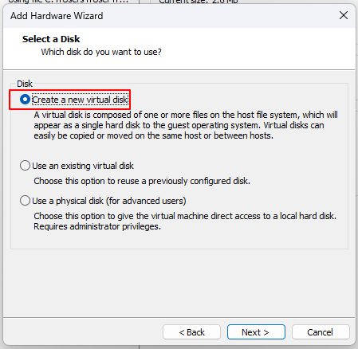
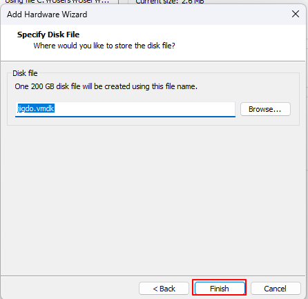
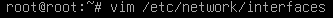
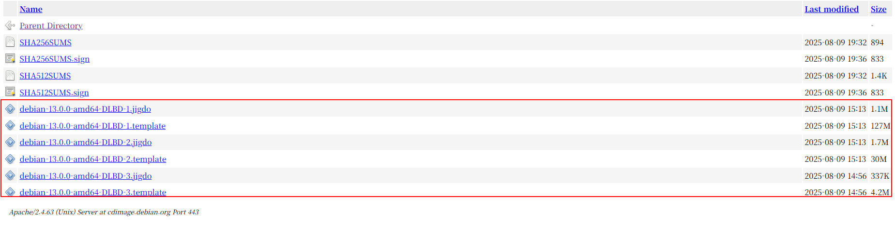
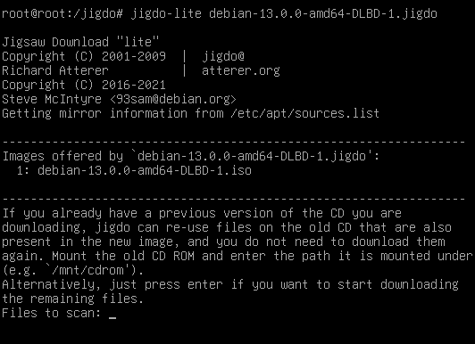
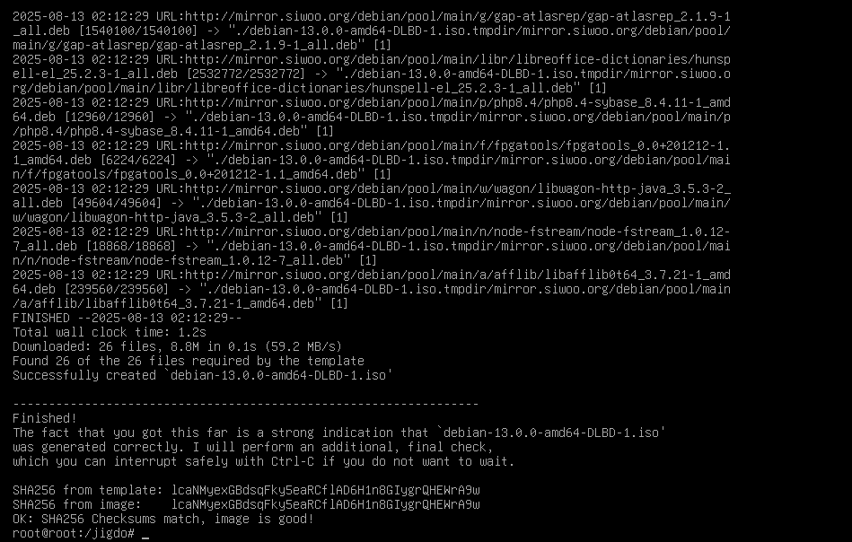
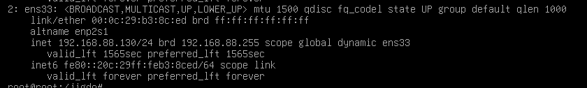
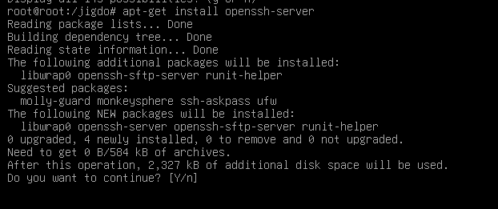
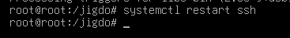

# Linux ISO Image 설치 가이드

**한국어** | [English](../README.md) | [日本語](README.ja.md) | [简体中文](README.zh-CN.md) | [Español](README.es.md) | [Français](README.fr.md)

 

Debian VM에서 **jigdo**로 Debian DLBD ISO 이미지를 만들고, Windows PC로 내려받는 과정입니다.

> 기준이 되는 Debian VM은 [01. Debian VM 설치 가이드](../../01-Debian-VM-Install/README/README.ko.md) 를 먼저 보세요.

## 목차

- [1. Jigdo VM 만들기](#1-jigdo-vm-만들기)
- [2. 네트워크와 하드디스크](#2-네트워크와-하드디스크)
- [3. VM 접속과 네트워크 설정](#3-vm-접속과-네트워크-설정)
- [4. 디스크 포맷과 마운트](#4-디스크-포맷과-마운트)
- [5. jigdo 설치와 파일 다운로드](#5-jigdo-설치와-파일-다운로드)
- [6. ISO 파일 만들기](#6-iso-파일-만들기)
- [7. Windows PC로 ISO 내려받기](#7-windows-pc로-iso-내려받기)
- [정리](#정리)

---

## 1. Jigdo VM 만들기

VMware에서 기존 Debian 리눅스를 기준으로 **Clone**해서 **Jigdo** VM을 하나 만듭니다.


---

## 2. 네트워크와 하드디스크

Jigdo VM의 네트워크(VMnet)를 **NAT**로 지정합니다. 인터넷에서 파일을 내려받아야 하기 때문입니다.


VM에 **하드디스크를 추가**합니다.


**Create a new virtual disk**를 선택합니다.



하드디스크를 **200GB** 추가합니다. 사진에는 두 번째를 선택한 것으로 나와 있지만, 나중에 디스크를 포맷할 수 있도록 세 번째를 선택합니다.




---

## 3. VM 접속과 네트워크 설정

VM을 실행하고 **root**로 로그인합니다.


바로 **Vim**을 설치합니다.

```bash
apt install vim
```


VM이 **DHCP**로 IP를 받도록 설정합니다.

```bash
vim /etc/network/interfaces
```



```text
auto ens33
iface ens33 inet dhcp
```


`:wq`로 저장하고 나와서 네트워크 서비스를 재시작합니다.

```bash
systemctl restart networking
```


---

## 4. 디스크 포맷과 마운트

`fdisk -l`로 **200GB 디스크**가 있는지 확인합니다.


마운트하기 전에 200GB 디스크를 **포맷**합니다. 디스크 이름은 환경마다 다르므로 `fdisk -l`에서 확인한 200GB 디스크를 지정합니다(예: 200GB 디스크가 `/dev/sda`라면 `mkfs.ext4 /dev/sda`).

```bash
mkfs.ext4 /dev/sdb
```


마운트할 디렉터리를 만들고 마운트합니다.

```bash
mkdir /jigdo
mount /dev/sdb /jigdo
```


마운트가 제대로 되었는지 확인합니다.

```bash
df -h
```


---

## 5. jigdo 설치와 파일 다운로드

**jigdo-file**을 설치합니다.

```bash
apt install jigdo-file
```


jigdo 파일의 인터넷 주소를 찾습니다. <https://cdimage.debian.org/debian-cd> 에 접속한 뒤 **current → amd64 → jigdo-dlbd**로 들어가서 아래로 스크롤합니다.


여기서 **6개 파일**(DLBD-1~3의 `.jigdo`와 `.template`)을 리눅스에서 내려받습니다. 지금 브라우저의 주소는 `https://cdimage.debian.org/debian-cd/current/amd64/jigdo-dlbd/` 이고, 여기에 각 파일 이름을 붙인 것이 다운로드 주소입니다.



주소를 찾았으면 jigdo 디렉터리로 이동합니다.

```bash
cd /jigdo
```


내려받을 6개 파일 중 하나를 우클릭해서 **링크 주소를 복사**합니다.


리눅스에서 `wget`을 입력하고 복사한 주소를 붙여 넣습니다. 이렇게 template과 jigdo를 포함해 **6개 모두** 내려받습니다.

```bash
wget https://cdimage.debian.org/debian-cd/current/amd64/jigdo-dlbd/debian-13.0.0-amd64-DLBD-1.jigdo
```


---

## 6. ISO 파일 만들기

1, 2, 3 중 1을 예로 들면, 먼저 1번 **jigdo 파일의 링크**를 복사합니다.


리눅스에서 `jigdo-lite`를 입력한 뒤 복사한 주소를 붙여 넣습니다. **Files to scan**이 나오면 아무것도 입력하지 않고 Enter로 넘깁니다.

```bash
jigdo-lite https://cdimage.debian.org/debian-cd/current/amd64/jigdo-dlbd/debian-13.0.0-amd64-DLBD-1.jigdo
```



미러 사이트를 입력하라고 나오면 `http://mirror.siwoo.org/debian` 을 그대로 붙여 넣고 Enter를 누릅니다. 다운로드가 시작됩니다(**매우 오래 걸립니다**).


다운로드가 끝난 모습입니다.



---

## 7. Windows PC로 ISO 내려받기

Windows **PowerShell**로 ISO 파일을 PC에 내려받습니다. 먼저 `ip add`로 **ens33의 IP 주소**를 확인합니다.

```bash
ip add
```



PowerShell에서 VM의 IP와 파일 경로를 넣어 `scp`를 실행합니다. 아래처럼 `Connection refused`가 나오면 VM에서 **SSH를 켜야** 한다는 뜻입니다.

```powershell
scp root@<VM IP>:/jigdo/debian-13.0.0/amd64-DLBD-1.iso C:
```


VM에 **openssh-server**를 설치합니다.

```bash
apt-get install openssh-server
```



SSH 서비스를 재시작해서 설정을 적용합니다.

```bash
systemctl restart ssh
```



같은 명령어를 다시 입력하면 아래처럼 나옵니다. `yes`를 입력하고 Enter를 누른 뒤, 비밀번호에는 **VM에 root로 로그인할 때 쓰는 비밀번호**를 입력하면 다운로드가 시작됩니다.


> - 호스트 키 경고가 나오면 PC에서 `ssh-keygen -R <VM IP>`로 예전 키를 지웁니다.
> - root 비밀번호가 기억나지 않으면 VM에서 `passwd`로 다시 설정합니다.

그래도 안 되면 권한을 허용해 주면 Windows에서 정상적으로 내려받을 수 있습니다(**오래 걸립니다**).

```bash
chmod 777 ~/.ssh
```


> `chmod 777`은 실습 VM에서만 쓰는 방법입니다. 실제 서버에서는 권한을 이렇게 열지 않습니다.

---

## 정리

- 기존 Debian VM을 Clone해서 **Jigdo VM**을 만들고, 네트워크는 **NAT**, 하드디스크는 **200GB**를 추가합니다.
- `/etc/network/interfaces`에 **DHCP**를 설정하고 `systemctl restart networking`으로 적용합니다.
- 200GB 디스크를 **`mkfs.ext4`로 포맷**하고 **`/jigdo`에 마운트**한 뒤 `df -h`로 확인합니다.
- `jigdo-file`을 설치하고 cdimage.debian.org의 **jigdo-dlbd** 파일 6개를 `wget`으로 받습니다.
- **`jigdo-lite <jigdo 주소>`**를 실행하고 미러를 입력하면 ISO가 만들어집니다(오래 걸림).
- PC로 받을 때는 **`scp`**를 쓰고, 연결이 거부되면 **openssh-server**를 설치합니다.
