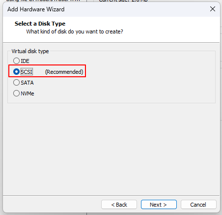
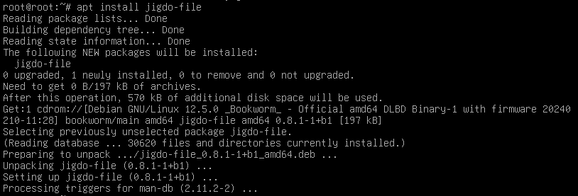
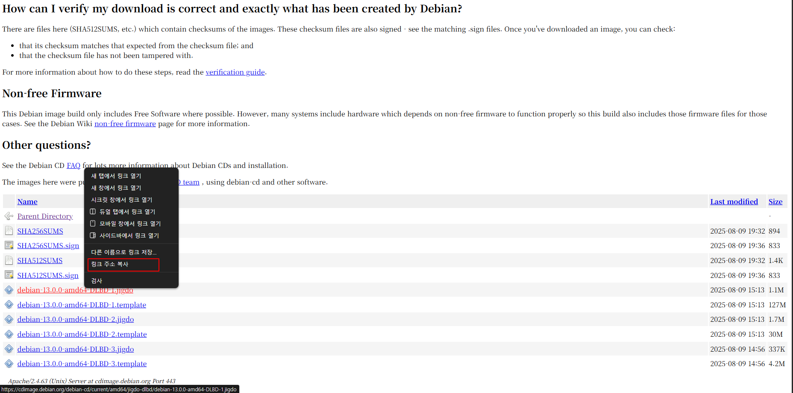
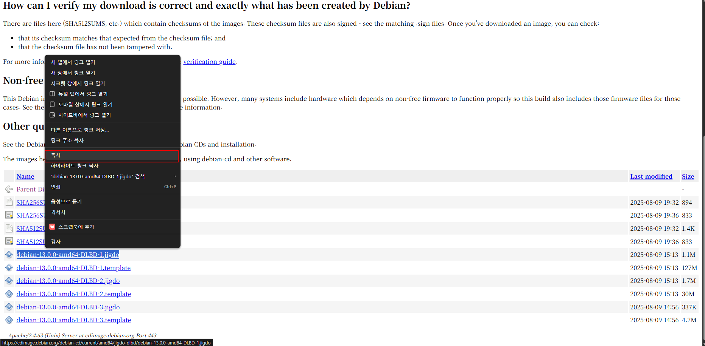

# Linux ISO Image 安装指南

[한국어](README.ko.md) | [English](../README.md) | [日本語](README.ja.md) | **简体中文** | [Español](README.es.md) | [Français](README.fr.md)

 

在 Debian VM 上用 **jigdo** 制作 Debian DLBD ISO 镜像,并下载到 Windows PC 的过程。

> 作为基础的 Debian VM 请先阅读 [01. Debian VM 安装指南](../../01-Debian-VM-Install/README/README.zh-CN.md)。

## 目录

- [1. 创建 Jigdo VM](#1-创建-jigdo-vm)
- [2. 网络与硬盘](#2-网络与硬盘)
- [3. 登录 VM 与网络设置](#3-登录-vm-与网络设置)
- [4. 磁盘格式化与挂载](#4-磁盘格式化与挂载)
- [5. 安装 jigdo 并下载文件](#5-安装-jigdo-并下载文件)
- [6. 制作 ISO 文件](#6-制作-iso-文件)
- [7. 把 ISO 下载到 Windows PC](#7-把-iso-下载到-windows-pc)
- [总结](#总结)

---

## 1. 创建 Jigdo VM

在 VMware 中以现有的 Debian Linux 为基础 **Clone**,创建一台 **Jigdo** VM。


---

## 2. 网络与硬盘

把 Jigdo VM 的网络(VMnet)设为 **NAT**,因为它需要从互联网下载文件。


给 VM **添加一块硬盘**。




选择 **Create a new virtual disk**。


添加一块 **200GB** 的硬盘。图中选的是第二项,但为了之后能格式化磁盘,要选第三项。


---

## 3. 登录 VM 与网络设置

启动 VM,用 **root** 登录。


马上安装 **Vim**。

```bash
apt install vim
```


把 VM 设置为通过 **DHCP** 获取 IP。

```bash
vim /etc/network/interfaces
```


```text
auto ens33
iface ens33 inet dhcp
```


用 `:wq` 保存退出,然后重启网络服务。

```bash
systemctl restart networking
```


---

## 4. 磁盘格式化与挂载

用 `fdisk -l` 确认有一块 **200GB 的磁盘**。


挂载之前先**格式化** 200GB 的磁盘。磁盘名称因环境而异,所以要指定在 `fdisk -l` 中看到的那块 200GB 磁盘(例:如果 200GB 磁盘是 `/dev/sda`,就执行 `mkfs.ext4 /dev/sda`)。

```bash
mkfs.ext4 /dev/sdb
```


创建挂载目录并挂载。

```bash
mkdir /jigdo
mount /dev/sdb /jigdo
```


确认是否挂载成功。

```bash
df -h
```


---

## 5. 安装 jigdo 并下载文件

安装 **jigdo-file**。

```bash
apt install jigdo-file
```



查找 jigdo 文件的网络地址。访问 <https://cdimage.debian.org/debian-cd>,依次进入 **current → amd64 → jigdo-dlbd**,然后往下滚动。


我们要在 Linux 上下载这 **6 个文件**(DLBD-1~3 的 `.jigdo` 和 `.template`)。浏览器当前的地址是 `https://cdimage.debian.org/debian-cd/current/amd64/jigdo-dlbd/`,在后面加上各个文件名就是下载地址。


找到地址后,进入 jigdo 目录。

```bash
cd /jigdo
```


在要下载的 6 个文件中任选一个,右键**复制链接地址**。



在 Linux 上输入 `wget`,再粘贴复制的地址。用这种方法把包括 template 和 jigdo 在内的 **6 个文件全部**下载下来。

```bash
wget https://cdimage.debian.org/debian-cd/current/amd64/jigdo-dlbd/debian-13.0.0-amd64-DLBD-1.jigdo
```


---

## 6. 制作 ISO 文件

以 1、2、3 中的 1 为例,先复制 1 号 **jigdo 文件的链接**。



在 Linux 上输入 `jigdo-lite`,再粘贴复制的地址。出现 **Files to scan** 时什么也不输入,直接按 Enter 跳过。

```bash
jigdo-lite https://cdimage.debian.org/debian-cd/current/amd64/jigdo-dlbd/debian-13.0.0-amd64-DLBD-1.jigdo
```


提示输入镜像站点时,把 `http://mirror.siwoo.org/debian` 原样粘贴进去并按 Enter。下载就会开始(**非常耗时**)。


下载完成的样子。


---

## 7. 把 ISO 下载到 Windows PC

用 Windows **PowerShell** 把 ISO 文件下载到 PC。先用 `ip add` 确认 **ens33 的 IP 地址**。

```bash
ip add
```


在 PowerShell 中填入 VM 的 IP 和文件路径,执行 `scp`。如果像下面这样出现 `Connection refused`,说明需要在 VM 上**启用 SSH**。

```powershell
scp root@<VM IP>:/jigdo/debian-13.0.0/amd64-DLBD-1.iso C:
```


在 VM 上安装 **openssh-server**。

```bash
apt-get install openssh-server
```


重启 SSH 服务使设置生效。

```bash
systemctl restart ssh
```


再输入一次同样的命令,会出现下面的提示。输入 `yes` 并按 Enter,然后输入**以 root 登录 VM 时使用的密码**,下载就会开始。


> - 如果出现主机密钥警告,在 PC 上用 `ssh-keygen -R <VM IP>` 删除旧密钥。
> - 如果忘了 root 密码,在 VM 上用 `passwd` 重新设置。

如果还是不行,开放权限后就能在 Windows 上正常下载(**耗时较长**)。

```bash
chmod 777 ~/.ssh
```


> `chmod 777` 只用于实验 VM。在实际服务器上不要这样开放权限。

---

## 总结

- Clone 现有的 Debian VM 作为 **Jigdo VM**,网络设为 **NAT**,添加 **200GB** 硬盘。
- 在 `/etc/network/interfaces` 中设置 **DHCP**,用 `systemctl restart networking` 生效。
- 用 **`mkfs.ext4` 格式化** 200GB 磁盘,**挂载到 `/jigdo`**,再用 `df -h` 确认。
- 安装 `jigdo-file`,用 `wget` 下载 cdimage.debian.org 上的 6 个 **jigdo-dlbd** 文件。
- 执行 **`jigdo-lite <jigdo 地址>`** 并输入镜像站点,就会生成 ISO(耗时较长)。
- 下载到 PC 时使用 **`scp`**,如果连接被拒绝就安装 **openssh-server**。
