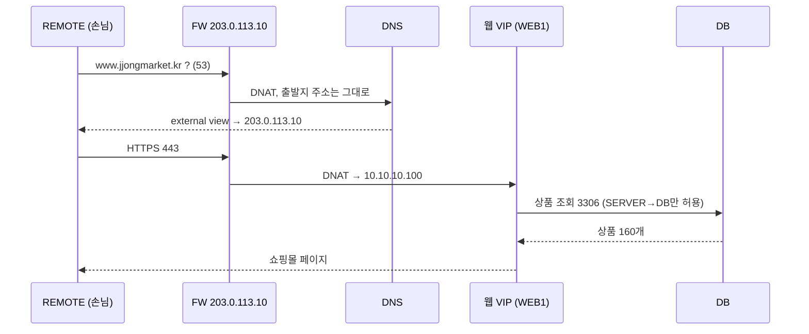
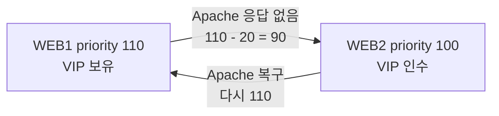
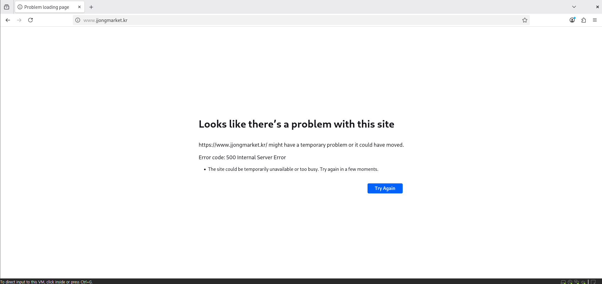
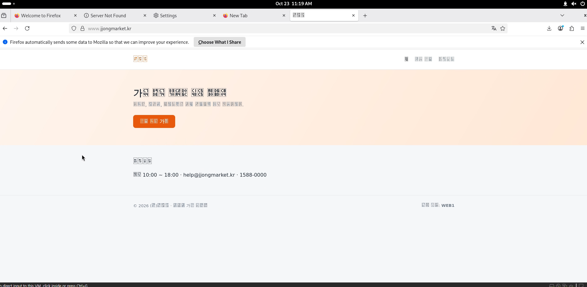
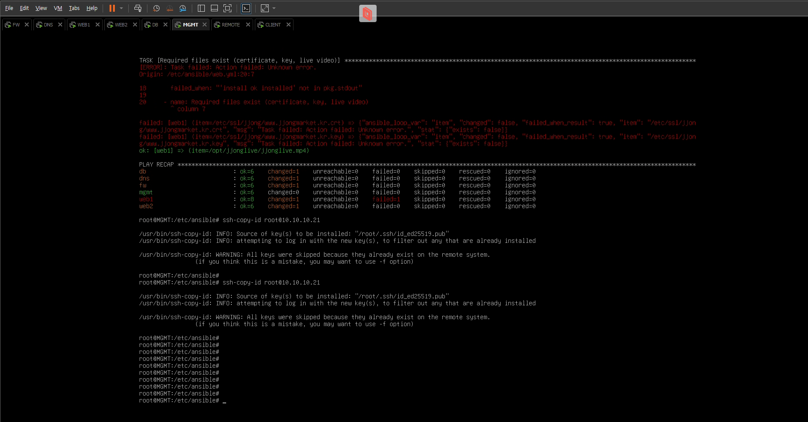

# JJongMarket IDC Lab

**클라우드 비용 때문에 IDC로 이사한 가상의 쇼핑몰, "쫑마켓"의 인프라를 Debian VM 8대로 직접 만든 기록입니다.**

웹 서버 하나를 꺼도 쇼핑몰은 계속 열리고, 재택 관리자는 VPN으로만 관리망에 들어오며, DB를 통째로 지워도 백업으로 되살립니다.
여기에 상품 160개짜리 쇼핑몰과 라이브 커머스 방송까지 얹었습니다.


> **English summary** - A homelab that rebuilds a small company's IDC rack with 8 Debian 13 VMs on VMware: an nftables firewall/router, split-horizon BIND9, WireGuard remote access, a private CA, a keepalived-based HA web tier running a PHP/MariaDB shop with an HLS live-commerce stream, nightly backups pulled off-host, Prometheus/Grafana monitoring, and Ansible for drift correction. Every chapter has build steps, verification commands and failure tests. Docs are written in Korean.

<p align="center">
  <br>
  <sub>쇼핑몰 안의 라이브 커머스 "쫑라이브". 웹 서버 두 대가 각자 ffmpeg로 같은 방송을 내보내서, 한 대가 죽어도 방송이 이어집니다.</sub>
</p>

---

## 목차

- [왜 만들었나](#왜-만들었나)
- [토폴로지](#토폴로지)
- [무엇이 어떻게 동작하나](#무엇이-어떻게-동작하나)
- [구축 순서](#구축-순서)
- [직접 망가뜨려 보기](#직접-망가뜨려-보기)
- [막혔던 것들](#막혔던-것들)
- [저장소 구조](#저장소-구조)
- [한계와 다음 계획](#한계와-다음-계획)

## 왜 만들었나

현장실습 첫 외근으로 IDC에 서버를 설치하러 간 날, 방화벽 뒤에 웹 서버와 DB가 나뉘어 꽂혀 있는 걸 처음 봤습니다.
기능반에서 DNS, 방화벽, VPN을 과제 단위로 따로따로 풀어 왔는데, 실제로는 이것들이 하나의 서비스를 위해 엮여 돌아간다는 게 와닿았습니다.

그래서 "회사 하나의 인프라"를 기획부터 장애 테스트까지 끝까지 만들어 보기로 했습니다.

**시나리오**: (주)쫑마켓은 직원 20명 규모의 온라인 쇼핑몰입니다. 클라우드 비용이 계속 늘어 IDC 랙 하나를 빌려 직접 운영하기로 했고, 나는 인프라 담당자입니다.

| 요구사항 | 해결 |
| --- | --- |
| 인터넷에서 `https://www.jjongmarket.kr` 로 접속 | FW DNAT → 웹 VIP → Apache |
| 웹 서버 한 대가 죽어도 쇼핑몰 유지 | keepalived VRRP + Apache 상태 검사 |
| 필요한 포트만 연다 | nftables 기본 차단 + 허용 목록 |
| 관리는 관리망에서만, 재택은 VPN | WireGuard, VPN → MGMT 22·443만 허용 |
| 안에서는 내부 주소, 밖에서는 공인 주소 | BIND9 view (split-horizon) |
| 상품 데이터 백업 | 매일 덤프 + 다른 서버(MGMT)에 보관 |
| 상태를 한눈에 | Prometheus + blackbox + Grafana |
| 다음 담당자가 다시 만들 수 있게 | 챕터별 문서 + Ansible |

모르는 개념과 오류는 Claude에게 물어 가며 공부했고, 명령과 설정은 이해한 다음 VM에 직접 쳐서 확인했습니다. 진행 과정은 [Daily Log](daily-log) 에 날짜별로 남겼습니다.

## 토폴로지


| 존 | 대역 | VMnet | VM |
| --- | --- | --- | --- |
| OUTSIDE | 203.0.113.0/24 | 0 | FW 외부 NIC, REMOTE |
| SERVER | 10.10.10.0/24 | 1 | DNS .10, WEB1 .21, WEB2 .22, **웹 VIP .100** |
| DB | 10.10.20.0/24 | 2 | DB .10 |
| MGMT | 10.10.30.0/24 | 3 | MGMT .10, CLIENT (DHCP) |
| VPN | 10.8.0.0/24 | - | FW .1, REMOTE .2 |

| VM | 역할 |
| --- | --- |
| **FW** | 4개 망을 잇는 라우터, nftables, DNAT, DHCP 릴레이, WireGuard |
| **DNS** | BIND9 내부·외부 view, 내부 NTP(chrony) |
| **WEB1 / WEB2** | Apache + PHP 쇼핑몰, keepalived, 쫑라이브(ffmpeg HLS) |
| **DB** | MariaDB, 매일 백업 |
| **MGMT** | DHCP, Root CA, SSH CA, 백업 보관, Prometheus, Grafana, Ansible |
| **CLIENT** | 사내 운영자 PC (GNOME) |
| **REMOTE** | 인터넷 고객이자 재택 관리자 (GNOME, WireGuard) |

모든 VM은 Host-only 망에만 붙어 있습니다. 인터넷은 없다고 보고, 패키지를 설치할 때만 NAT 어댑터를 잠깐 붙였다 뗐습니다.

## 무엇이 어떻게 동작하나

### 손님이 쇼핑몰에 들어올 때



같은 `www.jjongmarket.kr` 을 사내 CLIENT가 물으면 internal view가 `10.10.10.100` 을 바로 알려 줍니다. 그래서 헤어핀 NAT가 필요 없습니다.

### 웹 서버가 죽었을 때



keepalived가 2초마다 `health.html` 을 확인합니다. DNS와 DNAT는 모두 VIP를 가리키고, 로그인 세션은 DB에 있어서 손님은 서버가 바뀐 걸 모르고 장바구니도 그대로입니다.

### 재택 관리자가 들어올 때

REMOTE는 DHCP에서 게이트웨이를 받지 않습니다. VPN을 켜기 전에는 내부로 갈 길 자체가 없고, 켜면 `10.10.0.0/16` 만 터널을 타며(split tunnel) FW는 VPN 대역에 MGMT의 22, 443만 열어 줍니다.

### 쫑라이브


1분짜리 영상을 ffmpeg가 실제 속도로 무한 반복하며 2초짜리 HLS 조각으로 자르고, Apache가 `/hls/` 로 내보냅니다. 다시 인코딩하지 않아(`-c copy`) CPU를 거의 쓰지 않습니다.

## 구축 순서

노션 Session 탭의 토글 순서 그대로입니다. 각 문서에는 장비별 Configuration만 담았고, 설정 파일 원본과 배포 자료는 [`Resources/`](Resources) 에 있습니다.

| # | 챕터 | 핵심 |
| --- | --- | --- |
| 01 | [Basic Configuration](Session/01-basic-configuration.md) | 공통 패키지, 호스트네임 |
| 02 | [IP Configuration](Session/02-ip-configuration.md) | FW 4 NIC, 각 망 `.254` 게이트웨이 |
| 03 | [IP Forwarding](Session/03-ip-forwarding.md) | `ip_forward`, 재부팅 대비 `rc.local` |
| 04 | [DHCP](Session/04-dhcp.md) | MGMT 서버 + FW dnsmasq 릴레이 |
| 05 | [Nftables](Session/05-nftables.md) | 기본 drop, DNAT, MSS clamping |
| 06 | [Certificate Authority](Session/06-certificate-authority.md) | 사설 Root CA, 전 장비 신뢰 |
| 07 | [DNS](Session/07-dns.md) | internal / external view |
| 08 | [Wireguard](Session/08-wireguard.md) | split tunnel |
| 09 | [SSH](Session/09-ssh.md) | SSH CA로 서명한 root 키 |
| 10 | [Chrony](Session/10-chrony.md) | DNS가 내부 시간 기준 |
| 11 | [MariaDB](Session/11-mariadb.md) | bind-address, 계정 호스트 제한 |
| 12 | [Backup](Session/12-backup.md) | pipefail, `.tmp` → `mv`, MGMT로 pull |
| 13 | [Keepalived](Session/13-keepalived.md) | VRRP, Apache 상태 검사 |
| 14 | [WEB](Session/14-web.md) | Apache + PHP 쇼핑몰, HTTPS |
| 15 | [Streaming](Session/15-streaming.md) | ffmpeg HLS 쫑라이브 |
| 16 | [Monitoring](Session/16-monitoring.md) | node-exporter, blackbox, Prometheus, Grafana |
| 17 | [Ansible](Session/17-ansible.md) | 공통 설정, 웹 배포, `changed=0` |

노션 Resources 탭에 올려 두고 쓰던 배포 zip도 [`Resources/`](Resources) 에 그대로 있습니다.

## 직접 망가뜨려 보기

구축이 끝나면 일부러 고장을 내 보고 버티는지 확인했습니다. 챕터별 확인 명령과 함께 [docs/verification.md](docs/verification.md) 에 정리했습니다.

| 상황 | 방법 | 결과 |
| --- | --- | --- |
| 웹 서버 Apache 중단 | WEB1 `systemctl stop apache2` | 몇 초 안에 WEB2가 VIP 인수, 로그인 유지 |
| 웹 서버 전원 꺼짐 | WEB1 `poweroff` | 쇼핑몰 유지, Grafana에 WEB1 DOWN, HostDown 알림 |
| 방송 중단 | `systemctl stop jjonglive` | "방송 준비 중", LiveDown 알림 |
| DB 삭제 | `drop database shop` | 쇼핑몰 오류 → 백업으로 복원, 상품 160개 복구 |
| 설정이 틀어짐 | WEB2 `chmod 700 inc` | `ansible-playbook` 한 번으로 되돌아옴 |
| 전체 재부팅 | `ansible 'all:!mgmt' -m reboot` | 모든 서비스가 스스로 다시 올라옴 |

점검하다가 찾은 보안상 아쉬운 점(CA 개인키가 모든 서버에 복사된 것 등)도 같은 문서에 조치와 함께 적었습니다.

## 막혔던 것들

| | |
| --- | --- |
|  | **500 에러** - root로는 되고 www-data로는 안 됨. Windows에서 scp로 보낸 `inc` 폴더가 700이었다. |
|  | **한글이 전부 네모** - 인코딩이 아니라 CLIENT에 한글 글꼴이 없었다. |
|  | **Ansible이 WEB1에서 멈춤** - 인증서 경로가 달랐다. 덮어쓰기 전에 검사하게 만들어서 쇼핑몰은 안 죽었다. |

10가지 사례 전체: [docs/troubleshooting.md](docs/troubleshooting.md)

## 쇼핑몰

PHP 8.4 + MariaDB로 만든 실습용 쇼핑몰입니다. 회사, 상품, 리뷰는 모두 가상입니다.

- 상품 160개 (10개 카테고리), 리뷰 800개, 검색과 정렬
- 장바구니 → 배송지·결제수단 → 주문 → 시간에 따라 바뀌는 가상 배송 단계
- 판매 등록(이미지 업로드), 카드 등록(Luhn 검사, 끝 4자리만 저장, CVC 저장 안 함)
- 멤버십 쫑클럽, 쫑배송, 광고 팝업, 쫑라이브
- CSRF 토큰, `password_hash`, DB 세션 (웹 서버가 바뀌어도 로그인 유지)

데모 계정: `demo@jjongmarket.kr` / `Jjong1234!`

## 저장소 구조

```
JJongMarket-IDC-Lab/
├── README.md
├── Session/                  01 ~ 17 챕터별 Configuration (노션 Session 탭)
├── Resources/                노션 Resources 탭
│   ├── jjong-idc-lab_*.zip   WEB, Streaming, Monitoring, Ansible 배포 묶음
│   ├── configs/              장비에 그대로 들어가는 설정 파일
│   ├── ansible/              /etc/ansible 에 풀리는 플레이북
│   ├── web/                  쇼핑몰 PHP
│   ├── live/                 쫑라이브 영상과 제작 소스
│   └── scripts/              zip 생성 스크립트
├── docs/
│   ├── verification.md       챕터별 점검, 장애 테스트, 보안 점검
│   ├── troubleshooting.md
│   └── images/
└── daily-log/                Day 01 ~ Day 10
```

비밀번호는 모두 `<ROOT_PASSWORD>`, `<VRRP_PASS>` 같은 자리 표시로 바꿨습니다. DB 계정 비밀번호 `ChangeMe-Shop1` 은 예시이니 바꿔서 씁니다.

## 한계와 다음 계획

VM을 8대로 제한해서 일부는 일부러 단순하게 두었습니다.

| 지금 | 영향 | 다음 |
| --- | --- | --- |
| FW 1대 | FW가 죽으면 전체 통신 중단 | FW 2대 + keepalived + conntrackd |
| DB 1대 (백업만) | 복원하는 동안 쇼핑몰 중단 | MariaDB 복제 |
| DNS 1대 | 이름 풀이 불가 | secondary DNS |
| Grafana http | 관리 화면 평문 | 사설 CA 인증서로 https |
| Ansible은 공통 설정과 웹만 | FW, DNS, DB는 손으로 재구축 | role로 이전 |
| ssh-copy-id 키가 남아 있음 | CA를 거치지 않는 접속 경로 | CA 인증서 키로만 접속 |

## License

[MIT](LICENSE)
