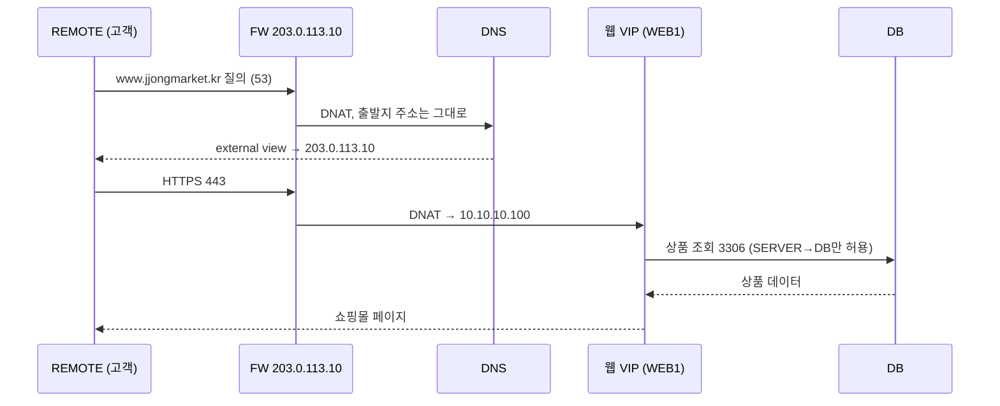
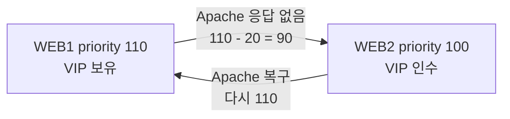

# JJongMarket IDC Lab

가상의 온라인 쇼핑몰 "쫑마켓"이 클라우드에서 IDC로 서버를 옮긴다는 설정으로, Debian VM 8대에 회사 인프라 하나를 처음부터 끝까지 구축한 프로젝트입니다.


| 항목 | 내용 |
| --- | --- |
| 기간 | 2026.10.14 ~ 2026.10.27 |
| 인원 | 1명 (설계, 구축, 문서화) |
| 환경 | VMware Workstation, Debian 13.2, VM 8대 (서버 6 CLI, 클라이언트 2 GNOME) |
| 상태 | 17개 챕터 구축 완료, 점검과 장애 테스트 정리 완료 |

## 시작하게 된 계기

현장실습 중 처음으로 IDC에 서버를 설치하러 간 적이 있습니다. 방화벽 뒤에 웹 서버와 DB가 따로 나뉘어 있는 걸 실제로 보고 나니, 기능반에서 DNS, 방화벽, VPN을 과제 하나씩 따로 풀던 것과는 느낌이 많이 달랐습니다. 실제 회사에서는 이것들이 전부 하나의 서비스를 위해 엮여서 돌아가고 있었습니다.

그래서 서비스 하나하나를 설치해 보는 게 아니라, 회사 하나의 인프라를 기획부터 장애 테스트까지 직접 만들어 보기로 했습니다.

공부하면서 모르는 개념이나 오류는 Claude에게 물어보며 이해했고, 명령과 설정은 이해한 뒤 VM에 직접 입력해 확인했습니다. 날짜별 진행 기록은 [daily-log](daily-log) 에 있습니다.

## 시나리오

(주)쫑마켓은 직원 20명 규모의 온라인 쇼핑몰입니다. 클라우드 비용이 계속 늘어서 IDC 랙 하나를 빌려 서버를 직접 운영하기로 했고, 저는 인프라 담당자라는 설정입니다.

| 요구사항 | 구현 |
| --- | --- |
| 인터넷에서 `https://www.jjongmarket.kr` 로 접속 | FW DNAT → 웹 VIP → Apache |
| 웹 서버 한 대가 고장 나도 쇼핑몰 유지 | keepalived VRRP, Apache 상태 검사 |
| 필요한 포트만 열기 | nftables 기본 차단, 허용 목록 |
| 서버 관리는 관리망에서만, 재택 근무는 VPN | WireGuard, VPN은 MGMT의 22·443만 허용 |
| 안에서는 내부 주소, 밖에서는 공인 주소로 응답 | BIND9 view (split-horizon) |
| 상품 데이터 백업 | 매일 덤프, MGMT로 가져와 따로 보관 |
| 서버와 서비스 상태를 한 화면에서 | Prometheus, blackbox, Grafana |
| 다음 담당자가 같은 환경을 다시 만들 수 있게 | 챕터별 문서, Ansible |

## 토폴로지


| 존 | 대역 | VMnet | VM |
| --- | --- | --- | --- |
| OUTSIDE | 203.0.113.0/24 | 0 | FW 외부 NIC, REMOTE |
| SERVER | 10.10.10.0/24 | 1 | DNS .10, WEB1 .21, WEB2 .22, 웹 VIP .100 |
| DB | 10.10.20.0/24 | 2 | DB .10 |
| MGMT | 10.10.30.0/24 | 3 | MGMT .10, CLIENT (DHCP) |
| VPN | 10.8.0.0/24 | - | FW .1, REMOTE .2 |

| VM | 역할 |
| --- | --- |
| FW | 4개 망을 잇는 라우터, nftables, DNAT, DHCP 릴레이, WireGuard |
| DNS | BIND9 내부·외부 view, 내부 NTP 서버 |
| WEB1 / WEB2 | Apache + PHP 쇼핑몰, keepalived, 쫑라이브 방송 |
| DB | MariaDB, 매일 백업 |
| MGMT | DHCP, Root CA, SSH CA, 백업 보관, Prometheus, Grafana, Ansible |
| CLIENT | 사내 운영자 PC |
| REMOTE | 인터넷 고객이면서 재택 관리자 |

모든 VM은 Host-only 망에만 연결했습니다. 인터넷이 없는 환경을 가정했고, 패키지를 설치할 때만 NAT 어댑터를 잠깐 붙였다가 뺐습니다.

## 동작 흐름

### 고객이 쇼핑몰에 접속할 때



사내 CLIENT가 같은 이름을 물으면 internal view가 `10.10.10.100` 을 바로 알려 주기 때문에 헤어핀 NAT가 필요 없습니다.

### 웹 서버가 고장 났을 때



keepalived가 2초마다 `health.html` 을 확인합니다. DNS와 DNAT는 모두 VIP를 가리키고 로그인 세션은 DB에 저장되기 때문에, 서버가 바뀌어도 로그인과 장바구니가 그대로 유지됩니다.

### 재택 관리자가 접속할 때

REMOTE는 DHCP로 게이트웨이를 받지 않아서 VPN을 켜기 전에는 내부망으로 갈 경로가 없습니다. VPN을 켜면 `10.10.0.0/16` 대역만 터널로 가고(split tunnel), FW는 VPN 대역에 MGMT의 22, 443 포트만 열어 줍니다.

### 쫑라이브


쇼핑몰 안에 라이브 커머스 페이지를 하나 넣었습니다. 1분짜리 영상을 ffmpeg가 실제 재생 속도로 계속 반복하면서 2초 단위 HLS 조각으로 자르고, Apache가 `/hls/` 경로로 내보냅니다. 재인코딩 없이 `-c copy` 로 처리해서 CPU 사용량이 거의 없고, WEB1과 WEB2가 각자 방송하기 때문에 한 대가 꺼져도 방송이 이어집니다.

## 구축 순서

노션 Session 탭에 정리한 순서와 같습니다. 각 문서에는 장비별 설정 명령만 있고, 설정 파일 원본과 배포용 zip은 [Resources](Resources) 폴더에 있습니다.

| # | 챕터 | 내용 |
| --- | --- | --- |
| 01 | [Basic Configuration](Session/01-basic-configuration.md) | 공통 패키지, 호스트네임 |
| 02 | [IP Configuration](Session/02-ip-configuration.md) | FW 4개 NIC, 각 망 `.254` 게이트웨이 |
| 03 | [IP Forwarding](Session/03-ip-forwarding.md) | `ip_forward`, 재부팅 대비 `rc.local` |
| 04 | [DHCP](Session/04-dhcp.md) | MGMT DHCP 서버, FW dnsmasq 릴레이 |
| 05 | [Nftables](Session/05-nftables.md) | 기본 drop, DNAT, MSS clamping |
| 06 | [Certificate Authority](Session/06-certificate-authority.md) | 사설 Root CA, 전 장비 신뢰 등록 |
| 07 | [DNS](Session/07-dns.md) | internal / external view |
| 08 | [Wireguard](Session/08-wireguard.md) | split tunnel VPN |
| 09 | [SSH](Session/09-ssh.md) | SSH CA로 서명한 root 키 |
| 10 | [Chrony](Session/10-chrony.md) | DNS 서버를 내부 시간 기준으로 |
| 11 | [MariaDB](Session/11-mariadb.md) | bind-address, 계정 접속 대역 제한 |
| 12 | [Backup](Session/12-backup.md) | 매일 덤프, MGMT로 rsync |
| 13 | [Keepalived](Session/13-keepalived.md) | VRRP, Apache 상태 검사 |
| 14 | [WEB](Session/14-web.md) | Apache + PHP 쇼핑몰, HTTPS |
| 15 | [Streaming](Session/15-streaming.md) | ffmpeg HLS 방송 |
| 16 | [Monitoring](Session/16-monitoring.md) | node-exporter, blackbox, Prometheus, Grafana |
| 17 | [Ansible](Session/17-ansible.md) | 공통 설정, 웹 배포 자동화 |

## 점검과 장애 테스트

구축을 마친 뒤 챕터별로 동작을 확인하고, 일부러 장애를 내서 서비스가 유지되는지 테스트했습니다. 자세한 명령과 결과는 [docs/verification.md](docs/verification.md) 에 정리했습니다.

| 상황 | 방법 | 결과 |
| --- | --- | --- |
| 웹 서버 Apache 중단 | WEB1 `systemctl stop apache2` | 몇 초 안에 WEB2가 VIP를 가져가고 로그인 유지 |
| 웹 서버 전원 꺼짐 | WEB1 `poweroff` | 쇼핑몰은 계속 열리고 Grafana에 WEB1 DOWN, HostDown 알림 |
| 방송 중단 | `systemctl stop jjonglive` | "방송 준비 중" 표시, LiveDown 알림 |
| DB 삭제 | `drop database shop` | 쇼핑몰 오류, 백업으로 복원 후 상품 160개 복구 |
| 설정 변경 | WEB2 `chmod 700 inc` | `ansible-playbook` 한 번으로 원래대로 |
| 전체 재부팅 | `ansible 'all:!mgmt' -m reboot` | 모든 서비스가 자동으로 다시 올라옴 |

점검하면서 SSH CA 개인키가 모든 서버에 복사되어 있는 문제도 발견했고, 조치 방법을 같은 문서에 같이 적었습니다.

## 트러블슈팅

구축하면서 실제로 막혔던 문제 10가지를 [docs/troubleshooting.md](docs/troubleshooting.md) 에 화면과 함께 정리했습니다. 그중 기억에 남는 세 가지입니다.

| | |
| --- | --- |
|  | **500 에러**<br>root로 실행하면 정상인데 www-data로 실행하면 실패했습니다. Windows에서 scp로 보낸 `inc` 폴더 권한이 700이었습니다. |
|  | **한글이 전부 네모로 표시**<br>인코딩 문제인 줄 알았는데, CLIENT에 한글 글꼴이 설치되어 있지 않았습니다. |
|  | **Ansible이 WEB1에서 중단**<br>인증서 경로가 달랐습니다. 설정을 덮어쓰기 전에 파일부터 확인하도록 만들어 둬서 쇼핑몰에는 영향이 없었습니다. |

## 쇼핑몰

PHP 8.4와 MariaDB로 만든 실습용 쇼핑몰입니다. 회사, 상품, 리뷰는 모두 가상입니다.

- 상품 160개(10개 카테고리), 리뷰 800개, 검색과 정렬
- 장바구니, 배송지와 결제수단 입력, 주문, 시간에 따라 바뀌는 가상 배송 단계
- 판매 상품 등록(이미지 업로드), 카드 등록(Luhn 검사, 끝 4자리만 저장, CVC는 저장하지 않음)
- 멤버십(쫑클럽), 쫑배송, 광고 팝업, 쫑라이브
- CSRF 토큰, `password_hash`, DB 세션

데모 계정: `demo@jjongmarket.kr` / `Jjong1234!`

## 폴더 구조

```
JJongMarket-IDC-Lab/
├── README.md
├── Session/                  01 ~ 17 챕터별 설정
├── Resources/
│   ├── jjong-idc-lab_*.zip   WEB, Streaming, Monitoring, Ansible 배포 파일
│   ├── configs/              장비별 설정 파일
│   ├── ansible/              플레이북 (/etc/ansible)
│   ├── web/                  쇼핑몰 PHP
│   ├── live/                 쫑라이브 영상과 제작 소스
│   └── scripts/              zip 생성 스크립트
├── docs/
│   ├── verification.md       점검, 장애 테스트, 보안 점검
│   ├── troubleshooting.md
│   └── images/
└── daily-log/                Day 01 ~ Day 10
```

비밀번호는 `<ROOT_PASSWORD>`, `<VRRP_PASS>` 처럼 가려 두었습니다. DB 계정 비밀번호 `ChangeMe-Shop1` 은 예시 값입니다.

## 회고

처음 계획과 실제로 만든 결과가 꽤 달라졌습니다. VPN은 OpenVPN으로 시작했다가 설정이 단순한 WireGuard로 바꿨고, 상품 8개짜리 목록 페이지로 생각했던 웹은 쇼핑몰과 라이브 방송까지 커졌습니다. exporter를 여러 개 붙이는 대신 blackbox로 고객 입장에서 서비스가 응답하는지 확인하는 쪽이 이 구성에 더 맞았습니다.

가장 많이 배운 건 오류를 추적하는 과정이었습니다. 500 에러를 실행 사용자를 바꿔 가며 재현해 보고, 한글 깨짐을 글꼴 문제로 좁혀 가면서, 과제를 풀 때보다 원인을 찾는 시간이 훨씬 길었지만 그만큼 기억에 남았습니다. 손으로 한 번 실수했던 권한 문제와 패키지 누락을 Ansible이 매번 검사하게 만들면서 자동화를 왜 하는지도 직접 느꼈습니다.

아직 남은 과제는 아래와 같습니다.

| 현재 | 영향 | 개선 방향 |
| --- | --- | --- |
| FW 1대 | FW 장애 시 전체 통신 중단 | FW 2대, keepalived, conntrackd |
| DB 1대 (백업만) | 복원하는 동안 쇼핑몰 중단 | MariaDB 복제 |
| DNS 1대 | 이름 풀이 불가 | secondary DNS |
| Grafana http | 관리 화면이 평문 | 사설 CA 인증서로 https |
| Ansible은 공통 설정과 웹만 | FW, DNS, DB는 수동으로 재구축 | role로 이전 |
| ssh-copy-id로 넣은 키 | CA를 거치지 않는 접속 경로 | CA 인증서 키로만 접속 |

## License

[MIT](LICENSE)
