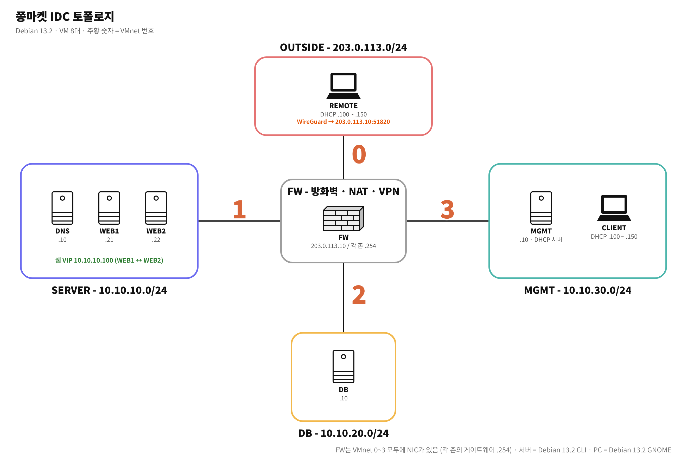

# Day 02 - 2026.10.15 (수) 설계

## 오늘 한 일

- 망을 용도별로 4개로 나눔: OUTSIDE / SERVER / DB / MGMT
- 주소 규칙 정함: 각 망의 `.254` 는 FW, 서버는 `.10` `.21` `.22`, VIP와 클라이언트는 `.100`
- 토폴로지 그림과 README 초안 작성, 노션에 JJongMarket IDC 페이지 만듦

## 설계하면서 고민한 것

- **DB를 왜 따로 떼나**: 웹 서버가 뚫렸을 때 DB까지 바로 닿지 않게. FW에서 SERVER 망 → DB 3306만 열면 된다.
- **203.0.113.0/24**: 문서용으로 예약된 대역(RFC 5737)이라 진짜 인터넷 주소와 안 겹친다. 바깥 역할에 딱 맞았다.
- **VPN**: 처음엔 OpenVPN으로 계획했다. (Day 05에서 바꿈)

## 내일 할 것

VM 만들고 IP 잡기
