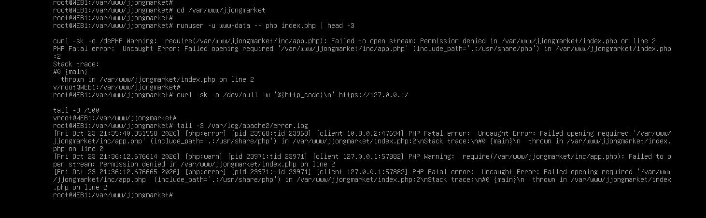
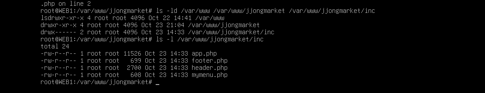
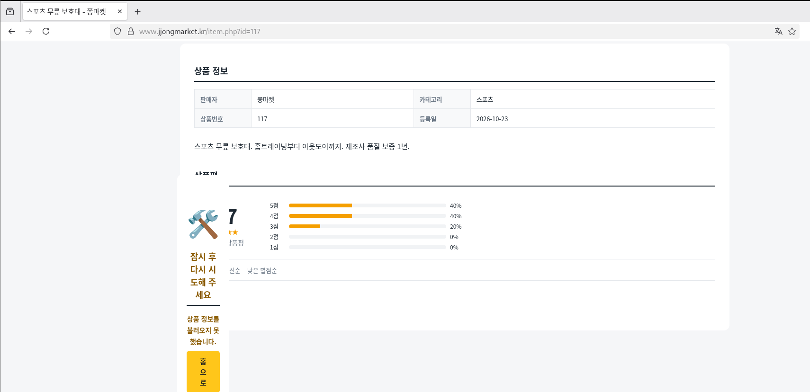
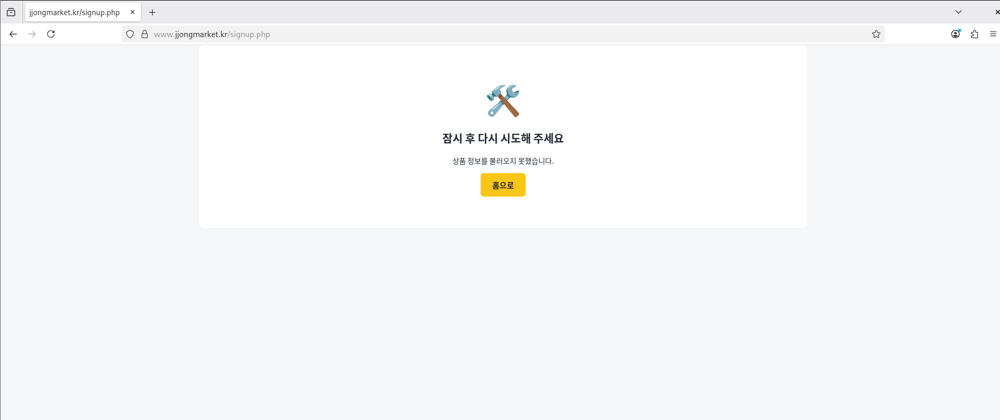
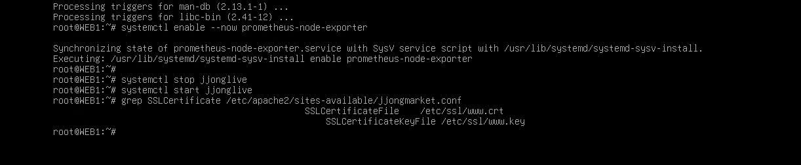

# Troubleshooting

직접 구축하면서 실제로 막혔던 것들입니다. 증상, 원인, 해결 순서로 적었고, 그때 찍어 둔 화면을 같이 붙였습니다.

| # | 증상 | 챕터 |
| --- | --- | --- |
| 1 | [쇼핑몰 한글이 전부 네모로 나옴](#1-쇼핑몰-한글이-전부-네모로-나옴) | WEB |
| 2 | [VMware 콘솔에 한글이 붙여 넣어지지 않음](#2-vmware-콘솔에-한글이-붙여-넣어지지-않음) | 전체 |
| 3 | [노션에서 복사한 설정에 `<>` 가 끼어 있음](#3-노션에서-복사한-설정에--가-끼어-있음) | Keepalived, WEB |
| 4 | [vim에 붙여 넣으면 들여쓰기가 계단처럼 밀림](#4-vim에-붙여-넣으면-들여쓰기가-계단처럼-밀림) | 전체 |
| 5 | [500 Internal Server Error](#5-500-internal-server-error) | WEB |
| 6 | [상품 상세가 깨지고 회원가입이 안 됨](#6-상품-상세가-깨지고-회원가입이-안-됨) | WEB |
| 7 | [주문서 입력칸이 전부 비어 있음](#7-주문서-입력칸이-전부-비어-있음) | WEB |
| 8 | [Ansible에서 MGMT 빼고 전부 UNREACHABLE](#8-ansible에서-mgmt-빼고-전부-unreachable) | Ansible |
| 9 | [Ansible이 WEB1에서 멈춤 (인증서 경로)](#9-ansible이-web1에서-멈춤-인증서-경로) | Ansible |
| 10 | [노션 5MB 업로드 제한](#10-노션-5mb-업로드-제한) | 자료 관리 |

---

### 1. 쇼핑몰 한글이 전부 네모로 나옴


- **증상**: 쇼핑몰은 열리는데 한글만 전부 네모(□)로 보임. 숫자, 영어, 서버 이름 `WEB1` 은 정상.
- **원인**: 서버 문제가 아니라 CLIENT(Debian GNOME)에 **한글 글꼴이 없음**. HTML은 UTF-8로 잘 왔지만 그릴 글꼴이 없었다.
- **해결**: CLIENT, REMOTE에 글꼴과 입력기 설치

  ```bash
  apt install -y fonts-noto-cjk ibus-hangul
  ```

- **배운 점**: "깨짐"이 인코딩 문제인지 글꼴 문제인지 먼저 구분해야 한다. 영어와 숫자가 멀쩡하고 한글 자리에 네모가 정확히 한 글자씩 있으면 글꼴 문제다.

### 2. VMware 콘솔에 한글이 붙여 넣어지지 않음

- **증상**: Prometheus 알림 규칙, Grafana 대시보드 JSON처럼 한글이 들어간 설정을 콘솔에 붙여 넣으면 한글 부분이 사라지거나 깨짐.
- **원인**: VMware 콘솔은 키 입력을 흉내 내는 방식이라 한글 붙여 넣기를 지원하지 않는다.
- **해결**:
  - 한글이 꼭 필요한 파일(JSON, SQL)은 NAT 어댑터를 잠깐 붙여 `scp` 로 **파일째** 옮김
  - 콘솔로 쳐야 하는 설정(rules-jjong.yml 등)은 주석과 문구를 영어로 바꿈

### 3. 노션에서 복사한 설정에 `<>` 가 끼어 있음

- **증상**: keepalived가 상태 검사 스크립트를 못 찾고, Apache `RewriteRule` 이 이상하게 동작.
- **원인**: 노션이 코드 블록 밖의 URL을 자동으로 링크로 바꾸면서 복사할 때 `<http://127.0.0.1/health.html>` 처럼 꺾쇠가 붙어 나왔다.
- **해결**: 붙여 넣은 뒤 `<` `>` 를 지움. `RewriteRule ^ https://...` 의 `^` 는 지우면 안 된다.
- **배운 점**: 설정은 반드시 코드 블록 안에 넣어 두고 복사한다.

### 4. vim에 붙여 넣으면 들여쓰기가 계단처럼 밀림

- **증상**: YAML, conf를 붙여 넣으면 줄마다 들여쓰기가 누적되고, 주석(`#`)이 다음 줄로 번짐.
- **원인**: vimrc의 `set si`(smartindent)가 붙여 넣는 글자를 타이핑으로 보고 자동 들여쓰기를 함.
- **해결**: 붙여 넣기 전에 `:set paste`, 끝나면 `:set nopaste`.

### 5. 500 Internal Server Error


- **증상**: 쇼핑몰 v2 파일을 올린 뒤 메인 페이지가 500.
- **추적**: root로 실행하면 정상인데 Apache 사용자(www-data)로 실행하면 실패.

  ```bash
  php index.php | head -5                          # 정상
  runuser -u www-data -- php index.php | head -5   # Permission denied
  ```

  

- **원인**: Windows에서 `scp -r` 로 보낸 `inc` 폴더 권한이 `drwx------`(700)였다. www-data가 `inc/app.php` 를 열 수 없었다.

  

- **해결**:

  ```bash
  chmod -R a+rX /var/www/jjongmarket
  ```

  `X`(대문자)는 폴더에만 실행 권한을 줘서 파일은 644, 폴더는 755가 된다.
- **재발 방지**: Ansible `web.yml` 이 매번 폴더를 755로 맞춘다. 장애 테스트 T7에서 일부러 700으로 바꾸고 되돌아오는지 확인했다.

### 6. 상품 상세가 깨지고 회원가입이 안 됨

| 상품 상세 | 회원가입 |
| --- | --- |
|  |  |

- **증상**: 상품 상세 페이지 중간에 오류 상자가 끼어들고, 회원가입은 "잠시 후 다시 시도해 주세요".
- **원인**: `php-mbstring` 이 설치되지 않음. 한글 이름 길이 검사, 리뷰 자르기 등에 쓰는 `mb_strlen`, `mb_substr` 가 없어서 PHP가 중간에 멈췄다.
- **해결**:

  ```bash
  apt install -y php-mbstring
  systemctl restart apache2
  ```

  그리고 `inc/app.php` 에 mbstring이 없을 때 쓰는 대체 함수를 넣어, 패키지가 빠져도 페이지가 죽지 않게 했다.
- **재발 방지**: Ansible이 `php-mbstring` 설치 여부를 검사한다.

### 7. 주문서 입력칸이 전부 비어 있음

- **증상**: 주문서(checkout)에 받는 사람, 주소가 미리 채워져야 하는데 전부 빈칸.
- **원인**: 공통 머리 `header.php` 가 알림 메시지를 `$f` 변수에 담았는데, 주문서 페이지도 입력값을 `$f` 에 담고 있었다. include 순서 때문에 덮어써졌다.
- **해결**: `header.php` 쪽 변수를 `$flash_msg` 로 바꿈.
- **배운 점**: PHP include는 변수 범위를 공유한다. 공통 파일에서는 짧은 변수 이름을 피한다.

### 8. Ansible에서 MGMT 빼고 전부 UNREACHABLE

- **증상**: `ansible-playbook site.yml` 에서 MGMT만 ok, 나머지 5대는 UNREACHABLE. 그런데 `ssh root@10.10.10.21 hostname` 은 잘 됨.
- **원인**: 손으로 ssh 할 때는 호스트 키 확인(yes)과 비밀번호를 사람이 입력했지만, Ansible은 대화형 입력을 할 수 없다.
- **해결**:

  ```bash
  ssh-keyscan 10.10.30.254 10.10.10.10 10.10.10.21 10.10.10.22 10.10.20.10 >> /root/.ssh/known_hosts
  ssh-keygen -t ed25519 -N "" -f /root/.ssh/id_ed25519
  ssh-copy-id root@<각 서버>
  ```

- **남은 과제**: 이 키는 SSH CA를 거치지 않는다. [Verification - 보안 점검](verification.md#보안-점검) 참고.

### 9. Ansible이 WEB1에서 멈춤 (인증서 경로)


- **증상**: common.yml은 6대 모두 성공, web.yml이 WEB1의 `Required files exist` 에서 failed.
- **원인**: 플레이북은 인증서를 `/etc/ssl/jjong/www.jjongmarket.kr.crt` 에서 찾았는데, 실제로는 `/etc/ssl/www.crt` 에 있었다.

  

- **해결**: `web.yml` 과 `files/jjongmarket.conf` 의 경로를 `/etc/ssl/www.crt`, `/etc/ssl/www.key` 로 수정.
- **배운 점**: 이 검사가 없었다면 Ansible이 없는 경로를 가리키는 Apache 설정으로 덮어쓰고, 다음 재시작 때 쇼핑몰이 죽었을 것이다. `serial: 1` 덕분에 WEB1에서 멈췄고 WEB2는 건드리지 않았다. 설정을 덮어쓰기 전에 전제 조건부터 검사하도록 만든 게 효과를 봤다.

### 10. 노션 5MB 업로드 제한

- **증상**: 쫑라이브 영상과 Grafana 패키지를 노션 Resources에 올릴 수 없음.
- **해결**:
  - 영상은 `crf 27`, `-preset veryslow`, `-tune animation` 으로 다시 인코딩해 1분 3.6MB로 줄임
  - Grafana deb는 4MB씩 분할 압축 후 `Get-FileHash` 로 합친 파일이 원본과 같은지 확인
