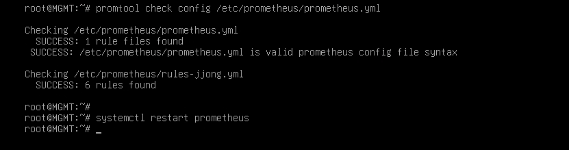

# Verification

Configuration을 처음부터 그대로 따라 했을 때 각 챕터가 실제로 어떻게 동작하는지, 그리고 그걸 눈으로 확인하는 방법을 정리했습니다.
명령어 아래에는 정상일 때 나와야 하는 결과를 적었습니다. `[ MGMT ]` 의 ansible 명령은 `/etc/ansible` 에서 실행합니다.

- [챕터별 점검](#챕터별-점검)
- [장애 테스트](#장애-테스트)
- [보안 점검](#보안-점검)

## 챕터별 점검

### Basic Configuration

```bash
# [ MGMT ]
ansible all -a hostname
```
FW, DNS, WEB1, WEB2, DB, MGMT가 각자 자기 장비에서 출력됩니다.

### IP Configuration

FW가 4개 망에 다리를 걸치고 있어 망을 넘는 모든 트래픽은 FW를 지납니다.

```bash
# [ FW ]
ip -br a            # ens33 203.0.113.10 / ens37 10.10.10.254 / ens38 10.10.20.254 / ens39 10.10.30.254
# [ DB ]
ip route            # default via 10.10.20.254
# [ MGMT ]
ping -c 2 10.10.20.10     # 응답 (MGMT 망은 FW에서 전부 허용)
```

### IP Forwarding

```bash
# [ FW ]
sysctl net.ipv4.ip_forward     # = 1
systemctl status rc-local      # active (exited)
```
재부팅 후에도 1이어야 합니다. 장애 테스트 T9에서 같이 확인합니다.

### DHCP

```bash
# [ CLIENT ]
ip -br a ; ip route        # 10.10.30.1xx, default via 10.10.30.254
# [ REMOTE ]
ip -br a ; ip route        # 203.0.113.1xx, default 없음
# [ MGMT ]
journalctl -u isc-dhcp-server | grep DHCPACK
```
REMOTE 쪽 로그는 `via 203.0.113.10` 으로 찍힙니다. FW의 릴레이를 거쳐 왔다는 표시입니다.

### Nftables

```bash
# [ REMOTE ] VPN 끈 상태
nmap -Pn 203.0.113.10          # 53, 80, 443만 open
# [ WEB1 ]
nmap -Pn -p 3306 10.10.20.10   # open
nmap -Pn -p 22 10.10.30.10     # filtered
```
웹 서버가 뚫려도 DB의 3306까지만 갈 수 있고 관리망으로는 넘어가지 못합니다.
forward에 icmp 허용이 없어서 MGMT에서 보낸 것 말고는 망을 넘는 ping이 막힙니다. 그래서 포트 단위로 확인합니다.

### Certificate Authority

```bash
# [ MGMT ]
openssl verify -CAfile /etc/ssl/RootCA.crt /etc/ssl/www.crt     # www.crt: OK
# [ CLIENT ]
curl -sI https://www.jjongmarket.kr | head -1                  # HTTP/1.1 200 (-k 없이)
```

### DNS

```bash
# [ DNS ]
named-checkconf
# [ CLIENT ]
dig www.jjongmarket.kr +short                    # 10.10.10.100
dig -x 10.10.10.21 +short                        # web1.jjong.internal.
# [ REMOTE ] VPN 끈 상태
dig @203.0.113.10 www.jjongmarket.kr +short      # 203.0.113.10
dig @203.0.113.10 ns.jjong.internal              # status: REFUSED
# [ REMOTE ] VPN 켠 상태
dig www.jjongmarket.kr +short                    # 10.10.10.100
```
같은 이름인데 묻는 위치에 따라 답이 바뀝니다. DNAT를 거쳐도 출발지 주소가 그대로라서 DNS가 바깥 질의를 구분할 수 있습니다.

### Wireguard

```bash
# [ REMOTE ]
nmcli connection up wg0
ip route | grep wg0              # 10.10.0.0/16, 10.8.0.0/24
ssh root@10.10.30.10 hostname    # MGMT
# [ FW ]
wg show                          # latest handshake: 몇 초 전
```
VPN을 끄면 같은 ssh가 `Network is unreachable` 로 실패합니다. REMOTE는 DHCP에서 게이트웨이를 받지 않기 때문입니다.

### SSH

```bash
# [ MGMT ]
ssh-keygen -L -f /root/.ssh/id_ecdsa-cert.pub        # Key ID "jjong root key", Principals: root
ssh -i /root/.ssh/id_ecdsa root@10.10.20.10 hostname # 비밀번호 없이 DB
```

### Chrony

```bash
# [ MGMT ]
ansible 'all:!dns' -a "chronyc sources"     # 모두 ^* 10.10.10.10
# [ DNS ]
chronyc clients
```

### MariaDB

```bash
# [ DB ]
ss -lntp | grep 3306                                                           # 10.10.20.10:3306
mariadb -e "select count(*) from shop.products; select count(*) from shop.reviews"   # 160, 800
mariadb -e "show grants for 'shop'@'10.10.10.%'"
# [ WEB1 ]
ls -l /etc/jjongmarket/db.ini                                                  # -rw-r----- root www-data
```

### Backup

```bash
# [ DB ]
/usr/local/sbin/mariadb-backup.sh
ls -l /var/backups/mariadb                 # shop_날짜_시간.sql.gz, -rw-------
journalctl -t mariadb-backup -n 3          # OK
# [ MGMT ]
rsync -a --exclude '*.tmp' 10.10.20.10:/var/backups/mariadb/ /srv/backup/db/ && ls -l /srv/backup/db
```

### Keepalived

```bash
# [ WEB1, WEB2 ]
ip -br a show ens33                                   # WEB1에만 10.10.10.100
journalctl -u keepalived | grep STATE | tail -2       # MASTER / BACKUP
# [ CLIENT ]
curl -s http://www.jjongmarket.kr/health.html         # WEB1
```

### WEB

```bash
# [ CLIENT ]
curl -sI http://www.jjongmarket.kr | grep -i location                                   # https://www.jjongmarket.kr/
curl -s -o /dev/null -w '%{http_code}\n' https://www.jjongmarket.kr/inc/app.php         # 403
echo | openssl s_client -connect www.jjongmarket.kr:443 2>/dev/null | openssl x509 -noout -ext subjectAltName
# [ REMOTE ] 외부 손님 입장
curl -sI --resolve www.jjongmarket.kr:443:203.0.113.10 https://www.jjongmarket.kr | head -1   # 200
```
Firefox에서 `demo@jjongmarket.kr` 로 로그인해 주문까지 해 봅니다. 마이쫑에 주문이 나오고 시간이 지나면 배송 단계가 바뀝니다.

### Streaming

```bash
# [ WEB1 ]
systemctl is-active jjonglive
grep MEDIA-SEQUENCE /var/www/hls/stream.m3u8    # 몇 초 뒤 다시 보면 숫자가 올라가 있음
# [ CLIENT ]
curl -s https://www.jjongmarket.kr/hls/stream.m3u8 | head -1    # #EXTM3U
```


### Monitoring

```bash
# [ MGMT ]
promtool check rules /etc/prometheus/rules-jjong.yml
curl -s localhost:9090/api/v1/targets | grep -o '"health":"[a-z]*"' | sort | uniq -c    # 10 "health":"up"
```



CLIENT Firefox: `http://10.10.30.10:9090/targets` 모두 UP, `/alerts` 모두 Inactive, `http://10.10.30.10:3000` 쫑마켓 인프라 현황.

### Ansible

```bash
# [ MGMT ]
ansible all -m ping
ansible-playbook site.yml      # 두 번째 실행부터 모든 장비 changed=0
```

## 장애 테스트

CLIENT에 Grafana 대시보드를 띄워 놓고 하나씩 진행합니다.

| # | 상황 | 어디서 | 방법 | 기대 결과 | 복구 |
| --- | --- | --- | --- | --- | --- |
| T1 | 웹 서비스 중단 | WEB1 | `systemctl stop apache2` | 몇 초 안에 VIP가 WEB2로. health.html이 WEB2, 로그인 유지 | `systemctl start apache2` |
| T2 | 웹 서버 전원 꺼짐 | WEB1 | `poweroff` | WEB2가 VIP 인수, 1분 뒤 HostDown | VMware에서 켜기 |
| T3 | 방송 중단 | VIP 가진 WEB | `systemctl stop jjonglive` | 쫑라이브 "방송 준비 중", LiveDown | `systemctl start jjonglive` |
| T4 | DB 중단 | DB | `systemctl stop mariadb` | 쇼핑몰 오류 화면, MariaDBDown·ShopDown | `systemctl start mariadb` |
| T5 | DB 삭제 후 복원 | DB | 아래 T5 | 상품 160개 복구 | - |
| T6 | VPN 재시작 | FW | `systemctl restart wg-quick@wg0` | REMOTE SSH가 잠깐 멈췄다 이어짐 | - |
| T7 | 설정 틀어짐 | WEB2 → MGMT | `chmod 700 .../inc` → `ansible-playbook web.yml --limit web2` | 플레이북이 되돌림 | - |
| T8 | 디스크 부족 | MGMT | `fallocate -l 15G /tmp/fill` | DiskAlmostFull | `rm /tmp/fill` |
| T9 | 전체 재부팅 | MGMT | 아래 T9 | 모든 서비스가 스스로 다시 올라옴 | - |

T1에서 로그인이 유지되는 건 세션이 웹 서버가 아니라 DB에 저장되기 때문입니다.

**T5. 백업 복원** - [ DB ]

```bash
/usr/local/sbin/mariadb-backup.sh                       # 먼저 최신 백업
B=$(ls -t /var/backups/mariadb/*.sql.gz | head -1)
mariadb -e "drop database shop"                         # 쇼핑몰 오류
gunzip -c $B | mariadb
mariadb -e "select count(*) from shop.products"         # 160
```
덤프를 `--databases shop` 으로 떠서 파일 안에 CREATE DATABASE가 들어 있습니다. 계정 권한은 mysql DB에 따로 있어 그대로 남습니다.

**T9. 전체 재부팅** - [ MGMT ]

```bash
ansible 'all:!mgmt' -m reboot
ansible fw -a "sysctl net.ipv4.ip_forward"     # = 1 (rc.local)
ansible-playbook site.yml                      # changed=0
```

## 보안 점검

점검하면서 찾은 아쉬운 점입니다.

**1. SSH CA 개인키가 모든 서버에 있음**
SSH 챕터에서 `/etc/ssl` 을 통째로 복사해서 `ssh-CA/ca`(CA 개인키)와 `www.key` 가 FW, DNS, DB에도 들어갔습니다. 서버에 필요한 건 `ca.pub` 뿐입니다.

```bash
# [ MGMT ]
ansible 'all:!mgmt' -m file -a "path=/etc/ssl/ssh-CA/ca state=absent"
ansible 'fw:dns:db' -m file -a "path=/etc/ssl/www.key state=absent"
ansible all -m ping
```

**2. CA를 거치지 않는 키가 추가됨**
Ansible 챕터에서 `ssh-copy-id` 로 ed25519 키를 넣었습니다. 이 키는 CA 서명과 유효기간 없이도 접속됩니다. `ansible.cfg` 에 `private_key_file = /root/.ssh/id_ecdsa` 를 넣고 authorized_keys를 비우는 게 다음 과제입니다.

**3. VPN을 끈 REMOTE는 이름 풀이가 안 됨**
DHCP가 REMOTE에도 DNS 10.10.10.10을 주는데, VPN이 꺼져 있으면 그 주소로 갈 경로가 없습니다. 203.0.113.0 범위의 DNS를 203.0.113.10으로 바꾸면 외부 view가 답하게 됩니다.

**4. Grafana가 http, 기본 계정**
3000번 http로 열려 있습니다. 사설 CA 인증서로 https를 붙이는 걸 검토합니다.
