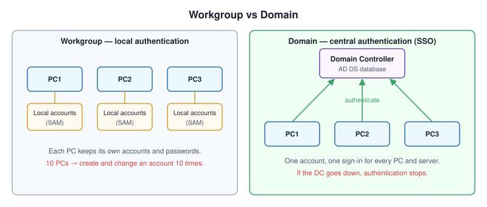

# Fundamentos de Active Directory

[한국어](README.ko.md) | [English](../README.md) | [日本語](README.ja.md) | [简体中文](README.zh-CN.md) | **Español** | [Français](README.fr.md)

¿Por qué usar Active Directory (AD)? Esta página explica el SSO y el significado de "directorio", la autenticación y la autorización, los métodos de cifrado necesarios para entender el tráfico de AD y la diferencia entre un grupo de trabajo y un dominio.

## Contenido

- [1. El objetivo principal de AD](#1-el-objetivo-principal-de-ad)
- [2. Bases de seguridad: autenticación y autorización](#2-bases-de-seguridad-autenticación-y-autorización)
- [3. Proteger los datos: cifrado](#3-proteger-los-datos-cifrado)
- [4. Dominio vs grupo de trabajo](#4-dominio-vs-grupo-de-trabajo)
- [5. Una analogía](#5-una-analogía)
- [Resumen](#resumen)

---

## 1. El objetivo principal de AD

### Inicio de sesión único (SSO)

**La razón principal para usar AD** es crear un entorno de **inicio de sesión único (SSO, Single Sign-On)**.

- **Sin AD (grupo de trabajo)**: con 10 equipos hay que crear la cuenta **por separado** en los 10, y cada cambio de contraseña también se hace 10 veces.
- **Con AD (dominio)**: un servidor central, el **controlador de dominio (DC)**, se encarga de la autenticación. Se puede **diseñar que una sola cuenta dé acceso a toda la infraestructura de la empresa**.
- **Para qué sirve AD**: **gestión de cuentas**, **autenticación** (demostrar quién eres) y **autorización** (qué puedes hacer), todo de forma **centralizada** en un solo lugar.

### ¿Por qué "directorio"?

- **Directorio**: no es una "carpeta" del sistema de archivos, sino algo parecido a una **guía telefónica**: un **almacén con mucha información** usada en la empresa, como cuentas y grupos.
- **Por qué "Active"**: a diferencia de una guía impresa, difícil de cambiar, la información se puede **crear, editar, cambiar y borrar fácilmente cuando se quiera**, por eso se le llama una **"guía telefónica viva"**.
- **Antes de AD**: hasta Windows NT 4.0, la información de cuentas se guardaba en la base de datos **SAM** (Security Account Manager).

---

## 2. Bases de seguridad: autenticación y autorización

Estos dos conceptos son imprescindibles para entender la verificación de identidad y el control de acceso en AD.

### Autenticación (Authentication)

- **Definición**: "demostrar quién soy".
- **Funcionamiento**: cuando el usuario escribe su cuenta y contraseña, la solicitud se envía al **controlador de dominio (DC)**; si coincide con lo que guarda el DC, este **confirma** que es el usuario correcto.

### Autorización (Authorization)

- **Definición**: decidir **quién puede y quién no puede hacer algo**.
- Hay dos tipos de autorización: **derechos (Right)** y **permisos (Permission)**.

| Concepto | Derecho (Right) | Permiso (Permission) |
| --- | --- | --- |
| Definición | Autorización para **hacer** algo | Autorización para **usar** algo |
| Ejemplos | Apagar el equipo, acceder a él desde la red, conectarse por Escritorio remoto | Leer una carpeta, escribir un archivo |
| Punto clave | Administrator tiene todos los derechos, por eso se le llama superusuario. | Solo el **propietario** del objeto puede concederlo. |
| Propiedad | Para cambiar los permisos de un objeto ajeno se necesita el derecho adicional de **tomar posesión**. | — |

---

## 3. Proteger los datos: cifrado

Son las formas de proteger los datos en las comunicaciones de red.

### Cifrado de clave simétrica

- **Característica**: **la misma clave cifra y descifra**.
- **Ventaja**: sencillo y rápido.
- **Inconveniente**: hay que **entregar la clave de forma segura** a quien recibe los datos cifrados.

### Cifrado de clave asimétrica

- **Característica**: hay **dos claves** (asimétrico).
  - **Clave pública (Public Key)**: se usa para cifrar y se comparte con los demás.
  - **Clave privada (Private Key)**: se usa para descifrar y **nunca se comparte**.
- **Funcionamiento**: los datos cifrados con la **clave pública** del destinatario solo se pueden descifrar con su **clave privada**.
- **Tecnología basada en ello**: certificados y entidades de certificación, es decir, la **PKI** (Public Key Infrastructure).
- **Ventaja**: seguridad mucho mayor.

### Firma digital (Digital Signature)

- **Objetivo**: demostrar que los datos **los envió realmente esa persona** (identidad).
- **Funcionamiento**: el remitente firma con su **clave privada** y el destinatario lo verifica con la **clave pública** del remitente.

### Cifrado híbrido (mixto, HTTPS)

- La mayoría de las soluciones de cifrado usan un método híbrido que combina la **seguridad** de la clave asimétrica con la **velocidad** de la simétrica.
- **Principio**: la **clave simétrica**, lo más importante, se envía cifrada con el método **asimétrico** seguro, y **toda la comunicación de grandes volúmenes posterior** usa la **clave simétrica**, rápida y eficiente.

---

## 4. Dominio vs grupo de trabajo

En Windows se distinguen según **quién gestiona la autenticación**.

| Concepto | Grupo de trabajo (Workgroup) | Dominio (Domain) |
| --- | --- | --- |
| Valor por defecto | Es el valor por defecto al instalar Windows. | Se configura al implementar Active Directory. |
| Quién autentica | Cada equipo gestiona localmente sus cuentas y contraseñas. (autenticación local) | Un sistema central, el controlador de dominio (DC), se encarga de la autenticación. |
| Conexión con AD | No está conectado a AD. | Conectarse a un dominio se llama "unirse al dominio". |
| Ventajas | Sencillo y se gestiona equipo por equipo; adecuado para entornos pequeños. | Permite SSO; seguridad, autenticación y autorización se gestionan en un solo lugar. |
| Inconvenientes | Hay que introducir cuenta y contraseña en cada equipo. | Si el sistema central (DC) falla, todo el sistema de autenticación deja de funcionar. |

> La diferencia clave es **quién realiza la autenticación de la identidad**.

---

## 5. Una analogía

Piensa en un entorno de AD como un **sistema de biblioteca central**.

- Te registras una vez en la biblioteca central (**DC**) (**creas la cuenta**) y con un solo carné (**SSO**) puedes usar todas las salas de lectura de la empresa (**equipos, servidores**).
- Cada sala **pregunta a la biblioteca central** si el carné es válido antes de abrir la puerta.
- Si la biblioteca cierra (**fallo del DC**) o se anula el carné (**cuenta eliminada**), esa persona ya no puede entrar en ninguna sala.

---

## Resumen

- El objetivo principal de AD es el **SSO**: gestión de cuentas, autenticación y autorización se hacen **de forma centralizada en el DC**.
- Un **directorio** es una "guía telefónica" de cuentas y grupos; **Active** significa una guía "viva" que se puede cambiar en cualquier momento. Antes de AD (NT 4.0) se usaba **SAM**.
- La **autenticación** es "quién eres"; la **autorización** es "qué puedes hacer". La autorización se divide en **derechos** y **permisos**.
- Las **claves simétricas** son rápidas pero entregar la clave es el problema; las **asimétricas** son seguras y son la base de la **PKI** y la **firma digital**. En la práctica se usa un **híbrido** de ambas (HTTPS).
- En un **grupo de trabajo** la autenticación es local; en un **dominio** autentica el DC. El dominio es cómodo, pero si el DC se detiene también lo hace la autenticación, por eso los DC se hacen redundantes.
