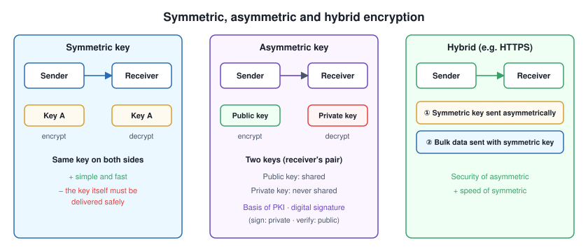

# Active Directory 基础

[한국어](README.ko.md) | [English](../README.md) | [日本語](README.ja.md) | **简体中文** | [Español](README.es.md) | [Français](README.fr.md)

先从为什么要使用 Active Directory（AD）讲起。本文介绍 SSO 与“目录”的含义、身份验证与授权、理解 AD 通信所需的加密方式，以及工作组与域的区别。

## 目录

- [1. 使用 AD 的核心目标](#1-使用-ad-的核心目标)
- [2. 安全基础：身份验证与授权](#2-安全基础身份验证与授权)
- [3. 保护数据：加密](#3-保护数据加密)
- [4. 域 vs 工作组](#4-域-vs-工作组)
- [5. 一个比喻](#5-一个比喻)
- [总结](#总结)

---

## 1. 使用 AD 的核心目标

### 单点登录（SSO）

**使用 AD 的最大理由**是构建 **SSO（Single Sign-On，单点登录）** 环境。

- **没有 AD 时（工作组）**：如果有 10 台计算机，就要在 10 台上**分别**创建账户，修改密码也要做 10 次。
- **有 AD 时（域）**：由中央服务器**域控制器（DC）** 处理身份验证。可以**设计成用一个账户使用公司内的所有基础设施**。
- **AD 的目的**：在一个地方**集中**完成**账户管理**、**身份验证**（证明你是谁）和**授权**（你能做什么）。

### 为什么叫“目录”？

- **目录**：不是文件系统中的“文件夹”，而更接近**电话簿**的意思，是保存公司基础设施中使用的账户、组等**各种信息的存储库**。
- **Active 的含义**：它不像纸质电话簿那样难以修改，而是**随时可以轻松创建、修改、变更、删除信息**，因此被称为**“活的电话簿”**。
- **AD 出现之前**：到 Windows NT 4.0 为止，账户信息保存在 **SAM**（Security Account Manager）数据库中。

---

## 2. 安全基础：身份验证与授权

这是理解 AD 结构中身份确认和访问控制所必需的两个概念。

### 身份验证（Authentication）

- **定义**：“证明我是谁”的过程。
- **工作方式**：用户输入账户和密码后，验证请求会发送到**域控制器（DC）**；如果与 DC 中保存的信息一致，DC 就**确认**这就是该用户。

### 授权（Authorization）

- **定义**：判断**谁能做什么、不能做什么**。
- 授权分为**用户权限（Right）** 和**访问权限（Permission）** 两种。

| 区分 | 用户权限（Right） | 访问权限（Permission） |
| --- | --- | --- |
| 定义 | **做**某事的许可 | **使用**某物的许可 |
| 示例 | 关闭计算机、从网络访问计算机、远程桌面连接 | 读取文件夹、写入文件 |
| 重要特点 | Administrator 拥有所有权限，因此被称为超级账户。 | 只有该对象的**所有者**才能授予。 |
| 所有权 | 要更改他人对象的访问权限，需要另外拥有**取得所有权**的用户权限。 | — |

---

## 3. 保护数据：加密

这是在网络通信中保护数据的方式。

### 对称密钥加密

- **特点**：**加密和解密使用同一把密钥**。
- **优点**：处理简单、速度快。
- **缺点**：必须把密钥**安全地交给**接收加密数据的人。

### 非对称密钥加密

- **特点**：有**两把密钥**（非对称）。
  - **公钥（Public Key）**：用于加密，可以与他人共享。
  - **私钥（Private Key）**：用于解密，**绝不共享**。
- **工作方式**：用对方的**公钥**加密的数据，只有对方的**私钥**才能解密。
- **基础技术**：证书与证书颁发机构技术，即 **PKI**（Public Key Infrastructure）的基础。
- **优点**：安全性高得多。

### 数字签名（Digital Signature）

- **目的**：证明数据**确实是那个人发送的**（身份）。
- **工作方式**：发送者用自己的**私钥**签名，接收者用发送者的**公钥**验证。

### 混合加密（混合方式，HTTPS）

- 大多数加密方案都采用结合非对称密钥**安全性**与对称密钥**速度**的混合方式。
- **原理**：最重要的**对称密钥**本身用安全的**非对称密钥**方式加密后传递，**之后的大量数据通信**则使用快速高效的**对称密钥**方式。

---

## 4. 域 vs 工作组

这是 Windows 环境中按照**由谁管理身份验证**来区分的。

| 区分 | 工作组（Workgroup） | 域（Domain） |
| --- | --- | --- |
| 默认设置 | 安装 Windows 时的默认值。 | 通过配置 Active Directory 来设置。 |
| 身份验证主体 | 每台计算机在本地管理账户和密码。（本地身份验证） | 由中央系统域控制器（DC）处理身份验证。 |
| 与 AD 的连接 | 不连接 AD。 | 连接到域称为“加入域”。 |
| 优点 | 简单，可单独管理，适合小规模环境。 | 支持 SSO，可在一个地方管理所有安全与身份验证、授权。 |
| 缺点 | 每台计算机都要输入账户和密码。 | 中央系统（DC）出故障时，整个身份验证体系都无法工作。 |

> 区分两者的关键在于**由谁对身份进行验证（Authentication）**。

---

## 5. 一个比喻

可以把 AD 环境想象成一个**中央图书馆系统**。

- 在中央图书馆（**DC**）登记身份（**创建账户**）后，凭领到的一张借书证（**SSO**）就能使用公司内所有的阅览室（**计算机、服务器**）。
- 每个阅览室都会**向中央图书馆询问**这张借书证是否有效，然后才开门。
- 如果图书馆关门（**DC 故障**）或借书证被注销（**删除账户**），这个人就再也进不了任何阅览室。

---

## 总结

- AD 最主要的目的是 **SSO**：账户管理、身份验证和授权都在 **DC 这一处集中**处理。
- **目录**是存放账户和组信息的“电话簿”，**Active** 指随时可以修改的“活的”电话簿。AD 之前（NT 4.0）使用 **SAM**。
- **身份验证**是“你是谁”，**授权**是“你能做什么”。授权分为**用户权限（Right）** 和**访问权限（Permission）**。
- **对称密钥**速度快但密钥传递是难题；**非对称密钥**更安全，是 **PKI** 和**数字签名**的基础。实际中使用二者结合的**混合方式**（HTTPS）。
- **工作组**是本地身份验证，**域**由 DC 进行身份验证。域很方便，但 DC 一停身份验证也会停止，所以要对 DC 做冗余。
