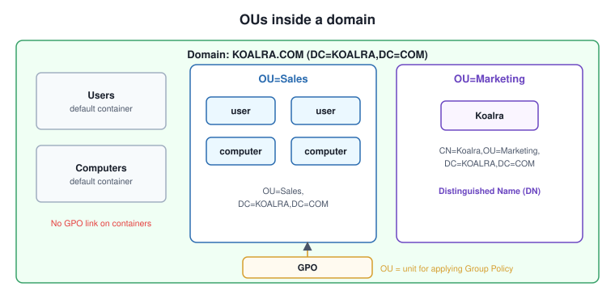

# AD DS Components and LDAP

[한국어](README/README.ko.md) | **English** | [日本語](README/README.ja.md) | [简体中文](README/README.zh-CN.md) | [Español](README/README.es.md) | [Français](README/README.fr.md)

The protocols AD uses for authentication (Kerberos) and for looking up information (LDAP), and the physical and logical components that make up AD. Then domains, OUs, DNs and forests, with diagrams.

## Contents

- [1. Basic terms and protocols](#1-basic-terms-and-protocols)
- [2. AD components](#2-ad-components)
- [3. AD DS domains](#3-ad-ds-domains)
- [4. OUs and distinguished names](#4-ous-and-distinguished-names)
- [5. LDAP and query tools](#5-ldap-and-query-tools)
- [6. AD DS forests](#6-ad-ds-forests)
- [Summary](#summary)

---

## 1. Basic terms and protocols

### Terms

| English | Meaning |
| --- | --- |
| Attribute | A property of an object |
| Object | An entry (user, group, computer…) |
| department | The department-name attribute |
| displayName | The display-name attribute |

### Kerberos for authentication, LDAP for lookups

- Active Directory uses the **Kerberos** protocol for authentication, on port **88**.
- AD is not only for authentication; it can also be used as a **database of information**.
- To **query** something, the **LDAP** protocol is used, on port **389**.
- In short, AD is a database: its data is used for **authentication**, and you can also get information out of it with **queries**.

---

## 2. AD components

AD has **physical components** you can actually see and **logical components** that are conceptual. The server that handles authentication in AD is called a **domain controller (DC)**.

### Physical components

- **Data store**: the database files you can see on the DC.
- **Domain controllers**: the servers that handle authentication.
- **Global catalog server**: a DC with a special role is called a GC.
- **RODC**: a read-only domain controller.

### Logical components

- **Partitions**: the AD database is divided internally by purpose; each piece is a partition.
- **Schema**: the definitions of objects and attributes.
- **Domains**: a single management and authentication boundary.
- **Domain trees**: a tree formed by several linked domains.
- **Forests**: a collection of several domain trees.
- **Sites**: represent a split of the network.
- **OUs**: organizational units — a boundary divided up for some reason.

---

## 3. AD DS domains

- A domain is **the largest scope one domain controller can authenticate**.
- Creating a domain requires **at least one domain controller**.
- The domain controller stores information about the domain **object by object**.
- AD recommends **two or more** domain controllers. (e.g. load balancing, fault tolerance)
- A domain administrator holds **every right** inside the domain.
- The domain is **the smallest boundary** in AD.

---

## 4. OUs and distinguished names

### OU (Organizational Unit)

An OU is the way to **logically divide a domain into pieces**.

- It subdivides the domain for management.
- It is also **the unit for deploying Group Policy (GPOs)**.

### Distinguished Name (DN)

The name that **uniquely identifies an object** in AD is its distinguished name. It is written from the object at the bottom up to the domain.

- `OU=Sales,DC=KOALRA,DC=COM`: the Sales OU in the KOALRA.COM domain
- `CN=Koalra,OU=Marketing,DC=KOALRA,DC=COM`: the Koalra object in the Marketing OU

---

## 5. LDAP and query tools

AD is a database. **LDAP (Lightweight Directory Access Protocol)** is a directory-service protocol for centrally and efficiently managing and looking up information such as users, groups and devices on a network.

AD can be queried out of the box; these tools let you query it:

- **Active Directory administrative tools** (Users and Computers, etc.)
- **LDP** (`ldp.exe`)
- **ADSI Edit** (`ADSIEDIT.MSC`)

---

## 6. AD DS forests

AD can have several domains, and the domains linked together form a **forest**.

- A forest is **a collection of domains with the same attribute and object structure**.
- Having the same structure is described as **sharing the same schema**.
- Domains joined in one contiguous namespace (e.g. `sales.koalra.com` under `koalra.com`) form a **domain tree**, and several domain trees make a forest.

---

## Summary

- AD is a database that authenticates with **Kerberos (88)** and is queried with **LDAP (389)**.
- Physical components: **data store, DC, GC, RODC**. Logical components: **partitions, schema, domains, domain trees, forests, sites, OUs**.
- A **domain** is the largest scope a DC can authenticate and the smallest boundary in AD; two or more DCs are recommended.
- An **OU** logically divides a domain and is **the unit Group Policy is applied to**.
- A **DN** uniquely identifies an object in the form `CN=…,OU=…,DC=…`.
- A **forest** is a set of domains (trees) sharing the same schema.
