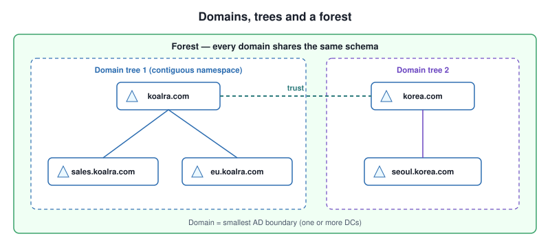

# AD DS 구성 요소와 LDAP

**한국어** | [English](../README.md) | [日本語](README.ja.md) | [简体中文](README.zh-CN.md) | [Español](README.es.md) | [Français](README.fr.md)

AD가 인증에 쓰는 프로토콜(Kerberos)과 정보 조회에 쓰는 프로토콜(LDAP), AD를 이루는 물리적·논리적 구성 요소를 정리합니다. 이어서 도메인, OU, DN, 포리스트의 개념을 그림과 함께 살펴봅니다.

## 목차

- [1. 기본 용어와 프로토콜](#1-기본-용어와-프로토콜)
- [2. AD의 구성 요소](#2-ad의-구성-요소)
- [3. AD DS 도메인](#3-ad-ds-도메인)
- [4. OU와 Distinguished Name](#4-ou와-distinguished-name)
- [5. LDAP과 쿼리 도구](#5-ldap과-쿼리-도구)
- [6. AD DS 포리스트](#6-ad-ds-포리스트)
- [정리](#정리)

---

## 1. 기본 용어와 프로토콜

### 용어

| 영어 | 뜻 |
| --- | --- |
| Attribute | 속성 (특성) |
| Object | 개체 |
| department | 부서명 속성 |
| displayName | 표시 이름 속성 |

### 인증은 Kerberos, 조회는 LDAP

- Active Directory는 인증에 **Kerberos** 프로토콜을 사용합니다. 포트 번호는 **88번**입니다.
- AD는 인증용일 뿐 아니라 **정보를 담은 데이터베이스**로도 쓸 수 있습니다.
- 무언가를 **질의(Query)** 할 때는 **LDAP** 프로토콜을 사용하고, 포트 번호는 **389번**입니다.
- 즉, AD는 데이터베이스이고, 그 정보로 **인증**도 하고 **쿼리**로 정보를 받아 올 수도 있습니다.

---

## 2. AD의 구성 요소

AD에는 실제로 눈에 보이는 **물리적 구성 요소(Physical components)** 와 개념적인 **논리적 구성 요소(Logical components)** 가 있습니다. AD에서 인증을 처리하는 서버를 **도메인 컨트롤러(Domain Controller, DC)** 라고 합니다.

### 물리적 구성 요소

- **Data store**: DC에서 눈에 보이는 데이터베이스 파일들입니다.
- **Domain controllers**: 인증을 처리하는 서버입니다.
- **Global catalog server**: DC 중 특별한 역할을 맡은 서버를 GC라고 부릅니다.
- **RODC**: 읽기 전용 도메인 컨트롤러입니다.

### 논리적 구성 요소

- **Partitions**: AD 데이터베이스는 내부적으로 용도별로 나뉘어 있고, 나뉜 하나하나를 파티션이라고 합니다.
- **Schema**: 개체와 속성(Attribute)의 정의입니다.
- **Domains**: 하나의 관리·인증 경계(바운더리)입니다.
- **Domain trees**: 도메인 여러 개가 이어져 형성하는 트리입니다.
- **Forests**: 도메인 트리가 여러 개 모인 것입니다.
- **Sites**: 네트워크적인 구분을 표현합니다.
- **OUs**: 하나의 경계 안을 이유에 따라 쪼갠 조직 구성 단위입니다.

---

## 3. AD DS 도메인

- 도메인은 **하나의 도메인 컨트롤러가 인증할 수 있는 최대 범위**입니다.
- 도메인을 만들려면 **도메인 컨트롤러가 한 대 이상** 있어야 합니다.
- 도메인 컨트롤러에는 도메인에 대한 정보가 **Object(개체) 단위**로 저장됩니다.
- AD는 도메인 컨트롤러를 **2대 이상** 구성하는 것을 권장합니다. (예: 부하 분산, 장애 대비)
- 도메인 관리자는 도메인 안의 **모든 권한**을 갖습니다.
- AD에서 **가장 작은 경계 단위**가 도메인입니다.

---

## 4. OU와 Distinguished Name

### OU (Organizational Unit)

하나의 도메인 안을 **논리적으로 나눠 조각내는 기술**을 OU라고 합니다.

- 관리를 위해 도메인을 세분화하는 작업입니다.
- **그룹 정책(GPO)을 배포하는 단위**가 되기도 합니다.

### Distinguished Name (DN)

AD 안에서 **유일하게 개체를 가리키는 이름**을 Distinguished Name이라고 합니다. 가장 아래 개체부터 위쪽 도메인 순서로 적습니다.

- `OU=Sales,DC=KOALRA,DC=COM`: KOALRA.COM 도메인의 Sales OU
- `CN=Koalra,OU=Marketing,DC=KOALRA,DC=COM`: Marketing OU 안의 Koalra 개체

---

## 5. LDAP과 쿼리 도구

AD는 데이터베이스입니다. **LDAP(Lightweight Directory Access Protocol)** 은 네트워크에서 사용자, 그룹, 장치 같은 정보를 중앙에서 효율적으로 관리하고 조회하기 위한 디렉터리 서비스 프로토콜입니다.

AD는 기본적으로 쿼리가 가능하며, 다음 도구로 AD를 조회할 수 있습니다.

- **Active Directory 관리 도구** (사용자 및 컴퓨터 등)
- **LDP** (`ldp.exe`)
- **ADSI 편집기** (`ADSIEDIT.MSC`)

---

## 6. AD DS 포리스트

AD는 도메인을 여러 개 만들 수 있고, 이 도메인들을 서로 연결한 것을 **포리스트(Forest)** 라고 합니다.

- 포리스트는 **같은 Attribute와 Object 구조를 가진 도메인들의 집합체**입니다.
- 이렇게 구조가 같은 것을 **스키마(Schema)가 같다**고 말합니다.
- 같은 이름 공간으로 이어진 도메인 묶음(예: `koalra.com` 아래 `sales.koalra.com`)이 **도메인 트리**이고, 도메인 트리가 여러 개 모이면 포리스트가 됩니다.

---

## 정리

- AD는 **Kerberos(88번)** 로 인증하고, **LDAP(389번)** 으로 정보를 조회하는 데이터베이스입니다.
- 물리적 구성 요소는 **Data store, DC, GC, RODC**이고, 논리적 구성 요소는 **파티션, 스키마, 도메인, 도메인 트리, 포리스트, 사이트, OU**입니다.
- **도메인**은 DC가 인증할 수 있는 최대 범위이자 AD의 가장 작은 경계이며, DC는 2대 이상을 권장합니다.
- **OU**는 도메인 안을 논리적으로 나눈 단위이고, **그룹 정책을 적용하는 단위**입니다.
- **DN**은 `CN=…,OU=…,DC=…` 형식으로 개체를 유일하게 가리킵니다.
- **포리스트**는 같은 스키마를 공유하는 도메인(트리)들의 집합입니다.
