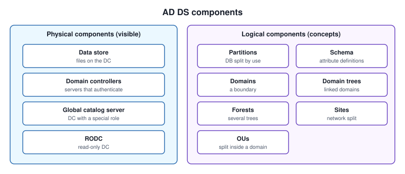

# AD DS 组件与 LDAP

[한국어](README.ko.md) | [English](../README.md) | [日本語](README.ja.md) | **简体中文** | [Español](README.es.md) | [Français](README.fr.md)

整理 AD 用于身份验证的协议（Kerberos）和用于查询信息的协议（LDAP），以及构成 AD 的物理组件和逻辑组件。接着结合图示了解域、OU、DN 和林的概念。

## 目录

- [1. 基本术语与协议](#1-基本术语与协议)
- [2. AD 的组件](#2-ad-的组件)
- [3. AD DS 域](#3-ad-ds-域)
- [4. OU 与可分辨名称](#4-ou-与可分辨名称)
- [5. LDAP 与查询工具](#5-ldap-与查询工具)
- [6. AD DS 林](#6-ad-ds-林)
- [总结](#总结)

---

## 1. 基本术语与协议

### 术语

| 英文 | 含义 |
| --- | --- |
| Attribute | 属性 |
| Object | 对象 |
| department | 部门名称属性 |
| displayName | 显示名称属性 |

### 身份验证用 Kerberos，查询用 LDAP

- Active Directory 使用 **Kerberos** 协议进行身份验证，端口号为 **88**。
- AD 不仅用于身份验证，也可以作为**保存信息的数据库**使用。
- **查询（Query）** 时使用 **LDAP** 协议，端口号为 **389**。
- 也就是说，AD 是一个数据库，既可以用其中的信息进行**身份验证**，也可以通过**查询**取得信息。

---

## 2. AD 的组件

AD 中有实际看得见的**物理组件（Physical components）** 和概念上的**逻辑组件（Logical components）**。在 AD 中处理身份验证的服务器称为**域控制器（Domain Controller，DC）**。

### 物理组件

- **Data store**：DC 上可以看到的数据库文件。
- **Domain controllers**：处理身份验证的服务器。
- **Global catalog server**：在 DC 中承担特殊角色的服务器称为 GC。
- **RODC**：只读域控制器。

### 逻辑组件

- **Partitions**：AD 数据库内部按用途划分，每一块称为一个分区。
- **Schema**：对象与属性（Attribute）的定义。
- **Domains**：一个管理与身份验证的边界。
- **Domain trees**：多个域相连形成的树。
- **Forests**：多个域树的集合。
- **Sites**：表示网络上的划分。
- **OUs**：在一个边界内根据需要再划分出的组织单位。

---

## 3. AD DS 域

- 域是**一台域控制器能够进行身份验证的最大范围**。
- 创建域需要**至少一台域控制器**。
- 域控制器中以 **Object（对象）为单位**保存域的信息。
- AD 建议配置**两台以上**域控制器。（例如：负载均衡、故障备援）
- 域管理员拥有域内的**所有权限**。
- 域是 AD 中**最小的边界单位**。

---

## 4. OU 与可分辨名称

### OU（Organizational Unit，组织单位）

在一个域内进行**逻辑划分的技术**称为 OU。

- 这是为了管理而细分域的工作。
- 它也是**部署组策略（GPO）的单位**。

### 可分辨名称（Distinguished Name，DN）

在 AD 中**唯一标识一个对象的名称**称为可分辨名称。书写顺序是从最下层的对象一直到上层的域。

- `OU=Sales,DC=KOALRA,DC=COM`：KOALRA.COM 域中的 Sales OU
- `CN=Koalra,OU=Marketing,DC=KOALRA,DC=COM`：Marketing OU 中的 Koalra 对象

---

## 5. LDAP 与查询工具

AD 是数据库。**LDAP（Lightweight Directory Access Protocol，轻型目录访问协议）** 是一种目录服务协议，用于在网络上集中、高效地管理和查询用户、组、设备等信息。

AD 默认支持查询，可以使用以下工具查询 AD：

- **Active Directory 管理工具**（用户和计算机等）
- **LDP**（`ldp.exe`）
- **ADSI 编辑器**（`ADSIEDIT.MSC`）

---

## 6. AD DS 林

AD 可以创建多个域，把这些域互相连接起来就称为**林（Forest）**。

- 林是**具有相同属性（Attribute）和对象（Object）结构的域的集合**。
- 这种结构相同的情况称为**架构（Schema）相同**。
- 以同一个命名空间连接起来的一组域（例如 `koalra.com` 下的 `sales.koalra.com`）称为**域树**，多个域树聚在一起就成为林。

---

## 总结

- AD 是一个用 **Kerberos（88）** 进行身份验证、用 **LDAP（389）** 查询信息的数据库。
- 物理组件是 **Data store、DC、GC、RODC**；逻辑组件是**分区、架构、域、域树、林、站点、OU**。
- **域**是 DC 能进行身份验证的最大范围，也是 AD 中最小的边界；建议使用两台以上 DC。
- **OU** 是在域内进行逻辑划分的单位，也是**应用组策略的单位**。
- **DN** 以 `CN=…,OU=…,DC=…` 的形式唯一标识对象。
- **林**是共享同一架构的域（树）的集合。
