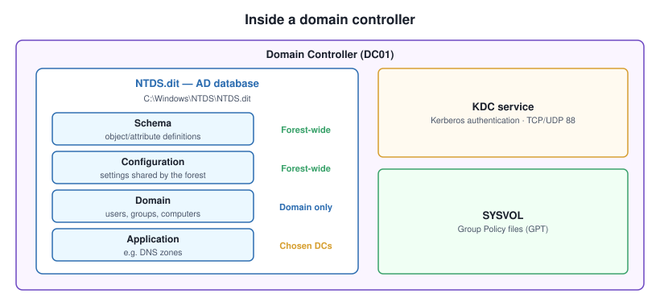

# ドメインコントローラー、スキーマと FSMO

[한국어](README.ko.md) | [English](../README.md) | **日本語** | [简体中文](README.zh-CN.md) | [Español](README.es.md) | [Français](README.fr.md)

AD サービスを提供するドメインコントローラー（DC）の中をのぞいてみます。スキーマとオブジェクト構造、DC を構成するデータベース・認証サービス・グループポリシーのファイル、データベースのパーティション、グローバルカタログ、そしてフォレスト全体の FSMO 役割を整理します。

## 目次

- [1. ドメインコントローラーとは？](#1-ドメインコントローラーとは)
- [2. スキーマとオブジェクト構造](#2-スキーマとオブジェクト構造)
- [3. DC の構成要素](#3-dc-の構成要素)
- [4. AD データベースのパーティション](#4-ad-データベースのパーティション)
- [5. グローバルカタログ（GC）](#5-グローバルカタログgc)
- [6. FSMO 役割（操作マスター）](#6-fsmo-役割操作マスター)
- [まとめ](#まとめ)

---

## 1. ドメインコントローラーとは？

- AD のすべてを提供するコンピューターを **DC（Domain Controller）** と呼びます。DC で目に見えるファイルは、事実上**データベース**だけです。
- 認証を処理するプロトコルは **Kerberos** で、それを処理するサービスを **KDC サービス**と呼びます。
- ドメインコントローラーは **2 台以上**必要です。

---

## 2. スキーマとオブジェクト構造

Active Directory は**スキーマ（Schema）** という骨組みをもとに構成されています。

- **オブジェクト（Object）と属性（Attribute）**: AD はオブジェクトで構成され、各オブジェクトは属性を持ちます。
- **スキーマ**: このオブジェクトと属性の基本的な骨組み、つまり**ひな形の設計定義**をスキーマと言います。
- **構造の同一性**: 1 つの**フォレスト全体が同じスキーマ**を使います。
- **AD 構造の始まりと終わり**: AD のすべての構造はスキーマで始まり、スキーマで終わります。

---

## 3. DC の構成要素

ドメインコントローラーは AD サービスを提供するサーバーで、認証処理のためのサービスとデータベースを含みます。

| 構成要素 | 内容 |
| --- | --- |
| AD データベースファイル | AD のデータは `C:\Windows\NTDS` フォルダーの下に `NTDS.dit` ファイルとして保存されます。 |
| 認証サービス | Kerberos 認証プロトコルを使い、それを処理するサービスは **KDC**（Key Distribution Center、キー配布センター）です。 |
| グループポリシーのファイル | グループポリシー処理用のファイルは **SYSVOL** フォルダーの下に保存されます。 |

---

## 4. AD データベースのパーティション

AD データベース（`NTDS.dit`）はいくつかの部分に分かれて保存され、パーティションごとに**複製される範囲**が異なります。

| パーティション | 保存内容 | 範囲 |
| --- | --- | --- |
| Schema | オブジェクトと属性の基本構造の定義 | フォレスト全体 |
| Configuration | フォレスト全体で同じでなければならない構成情報 | フォレスト全体 |
| Domain | ユーザー、グループ、コンピューターなど、そのドメインの個別情報 | そのドメイン |
| Application | AD を使うプログラム（例: DNS）のために割り当てる領域 | 指定した DC |

---

## 5. グローバルカタログ（GC）

GC は、**フォレスト全体にわたる検索とアドレス帳の照会**を担うサーバーです。

- 同じフォレスト内で**別のドメインのアカウント**を探したり、フォレスト全体の情報を検索したりするときに使います。
- GC の照会は、通常の LDAP ポート 389 番ではなく **3268 番**ポートを使います。
- 不要なネットワークトラフィックを防ぐため、**サイトごとに GC を少なくとも 1 台**置くことが推奨されます。

---

## 6. FSMO 役割（操作マスター）

AD は**マルチマスター複製**方式を使いますが、複製の競合が起きてはならない重要な作業は**シングルマスター（Single Master）** として指定して管理します。この役割を**操作マスター（FSMO、Flexible Single Master Operations）** と呼びます。

### フォレスト全体の操作マスター

フォレストごとに **1 台の DC だけ**が担当する役割です。

- **スキーママスター（Schema Master）**: フォレスト全体のスキーマの変更、修正、拡張を担当します。
- **ドメイン名前付けマスター（Domain Naming Master）**: フォレスト内のドメイン構造を管理します。（ドメインの追加・削除）

---

## まとめ

- **DC** は AD を提供するサーバーで、Kerberos 認証は **KDC サービス**が処理します。DC は 2 台以上置きます。
- **スキーマ**はオブジェクトと属性の設計定義で、**フォレスト全体が同じスキーマ**を使います。
- DC の中心は **`C:\Windows\NTDS\NTDS.dit`**（データベース）、**KDC**（認証）、**SYSVOL**（グループポリシーのファイル）です。
- データベースのパーティションは **Schema・Configuration**（フォレスト全体）、**Domain**（ドメイン）、**Application**（例: DNS）に分かれます。
- **GC** はフォレスト全体の検索を担い **3268 番**ポートを使います。サイトごとに 1 台以上置きます。
- 競合してはならない作業は **FSMO** として 1 台の DC に任せます。フォレスト全体の役割は**スキーママスター**と**ドメイン名前付けマスター**です。
