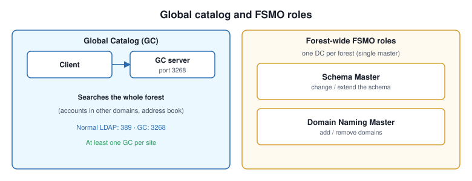

# 도메인 컨트롤러, 스키마와 FSMO

**한국어** | [English](../README.md) | [日本語](README.ja.md) | [简体中文](README.zh-CN.md) | [Español](README.es.md) | [Français](README.fr.md)

AD 서비스를 제공하는 도메인 컨트롤러(DC)의 내부를 들여다봅니다. 스키마와 개체 구조, DC를 이루는 데이터베이스·인증 서비스·그룹 정책 파일, 데이터베이스 파티션, 글로벌 카탈로그, 그리고 포리스트 범위의 FSMO 역할을 정리합니다.

## 목차

- [1. 도메인 컨트롤러란?](#1-도메인-컨트롤러란)
- [2. 스키마와 개체 구조](#2-스키마와-개체-구조)
- [3. DC의 구성 요소](#3-dc의-구성-요소)
- [4. AD 데이터베이스 파티션](#4-ad-데이터베이스-파티션)
- [5. 글로벌 카탈로그 (GC)](#5-글로벌-카탈로그-gc)
- [6. FSMO 역할 (작업 마스터)](#6-fsmo-역할-작업-마스터)
- [정리](#정리)

---

## 1. 도메인 컨트롤러란?

- AD의 모든 것을 서비스하는 컴퓨터를 **DC(Domain Controller)** 라고 합니다. DC에서 눈에 보이는 파일은 사실상 **데이터베이스**뿐입니다.
- 인증을 처리하는 프로토콜은 **Kerberos**이고, 이를 처리하는 서비스를 **KDC 서비스**라고 부릅니다.
- 도메인 컨트롤러는 **두 대 이상** 있어야 합니다.

---

## 2. 스키마와 개체 구조

Active Directory는 **스키마(Schema)** 라는 뼈대를 기반으로 구성됩니다.

- **개체(Object)와 특성(Attribute)**: AD는 개체로 구성되고, 각 개체는 특성(어트리뷰트)을 가집니다.
- **스키마**: 이 개체와 특성의 기본 뼈대, 즉 **기본 틀의 설계 정의**를 스키마라고 합니다.
- **구조의 동일성**: 하나의 **포리스트 전체는 동일한 스키마**를 사용합니다.
- **AD 구조의 시작과 끝**: AD의 모든 구조는 스키마로 시작해서 스키마로 끝납니다.

---

## 3. DC의 구성 요소

도메인 컨트롤러는 AD 서비스를 제공하는 서버로, 인증 처리를 위한 서비스와 데이터베이스를 포함합니다.

| 구성 요소 | 내용 |
| --- | --- |
| AD 데이터베이스 파일 | AD 데이터는 `C:\Windows\NTDS` 폴더 아래 `NTDS.dit` 파일로 저장됩니다. |
| 인증 서비스 | Kerberos 인증 프로토콜을 사용하고, 이를 처리하는 서비스는 **KDC**(Key Distribution Center, 키 배포 센터)입니다. |
| 그룹 정책 파일 | 그룹 정책 처리를 위한 파일은 **SYSVOL** 폴더 아래에 저장됩니다. |

---

## 4. AD 데이터베이스 파티션

AD 데이터베이스(`NTDS.dit`)는 여러 조각으로 나뉘어 저장되며, 각 파티션은 **복제되는 범위**가 다릅니다.

| 파티션 | 저장 내용 | 범위 |
| --- | --- | --- |
| Schema | 개체와 특성의 기본 구조 정의 | 포리스트 전체 |
| Configuration | 포리스트 전체에서 똑같이 구성되어야 할 설정 정보 | 포리스트 전체 |
| Domain | 사용자, 그룹, 컴퓨터 등 해당 도메인의 개별 정보 | 해당 도메인 |
| Application | AD를 사용하는 프로그램(예: DNS)을 위해 할당하는 영역 | 지정한 DC |

---

## 5. 글로벌 카탈로그 (GC)

GC는 **포리스트 전체에 걸친 검색과 주소록 쿼리**를 담당하는 서버입니다.

- 같은 포리스트 안에서 **다른 도메인의 계정**을 찾거나, 포리스트 전체 정보를 검색할 때 사용합니다.
- GC 쿼리는 일반 LDAP 포트 389번이 아니라 **3268번** 포트를 사용합니다.
- 불필요한 네트워크 트래픽을 막기 위해 **사이트마다 GC를 최소 하나씩** 두는 것을 권장합니다.

---

## 6. FSMO 역할 (작업 마스터)

AD는 **멀티마스터 복제** 방식을 사용하지만, 복제 충돌이 일어나면 안 되는 중요한 작업은 **단일 마스터(Single Master)** 로 지정해서 관리합니다. 이 역할을 **작업 마스터(FSMO, Flexible Single Master Operations)** 라고 부릅니다.

### 포리스트 범위 작업 마스터

포리스트당 **단 한 대의 DC**만 담당하는 역할입니다.

- **스키마 마스터 (Schema Master)**: 포리스트 전체 스키마의 변경, 수정, 확장을 담당합니다.
- **도메인 이름 마스터 (Domain Naming Master)**: 포리스트 안 도메인 구조를 관리합니다. (도메인 추가·제거)

---

## 정리

- **DC**는 AD를 서비스하는 서버이며, Kerberos 인증은 **KDC 서비스**가 처리합니다. DC는 2대 이상 둡니다.
- **스키마**는 개체와 특성의 설계 정의이고, **포리스트 전체가 같은 스키마**를 씁니다.
- DC의 핵심은 **`C:\Windows\NTDS\NTDS.dit`**(데이터베이스), **KDC**(인증), **SYSVOL**(그룹 정책 파일)입니다.
- 데이터베이스 파티션은 **Schema·Configuration**(포리스트 전체), **Domain**(도메인), **Application**(예: DNS)으로 나뉩니다.
- **GC**는 포리스트 전체 검색을 맡고 **3268번** 포트를 쓰며, 사이트마다 하나 이상 둡니다.
- 충돌이 나면 안 되는 작업은 **FSMO**로 한 DC에 맡깁니다. 포리스트 범위 역할은 **스키마 마스터**와 **도메인 이름 마스터**입니다.
