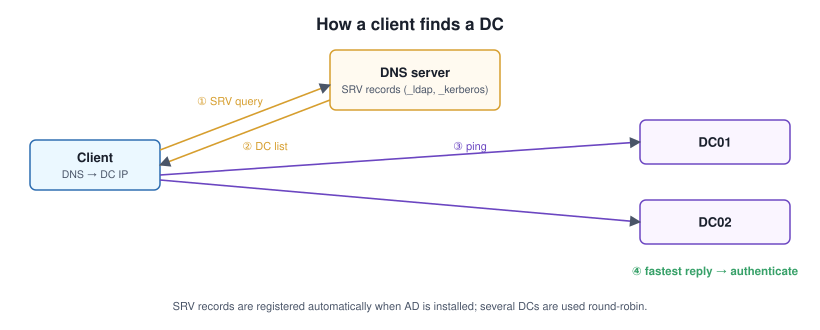

# Installer un contrôleur de domaine et DNS

[한국어](README.ko.md) | [English](../README.md) | [日本語](README.ja.md) | [简体中文](README.zh-CN.md) | [Español](README.es.md) | **Français**

Comment un serveur devient contrôleur de domaine (ajout du rôle puis promotion), et le DNS dont AD dépend entièrement. Sont abordés les enregistrements SRV, la jonction des clients au domaine, la façon dont un client trouve un DC, l'ordre de résolution des noms et les types de requêtes DNS.

## Sommaire

- [1. Préparer l'installation d'AD](#1-préparer-linstallation-dad)
- [2. Installer un contrôleur de domaine](#2-installer-un-contrôleur-de-domaine)
- [3. DNS et AD (enregistrements SRV)](#3-dns-et-ad-enregistrements-srv)
- [4. Joindre un client au domaine](#4-joindre-un-client-au-domaine)
- [5. Notions DNS avancées](#5-notions-dns-avancées)
- [Résumé](#résumé)

---

## 1. Préparer l'installation d'AD

Le serveur qui fournit Active Directory s'appelle un **contrôleur de domaine (DC)**. Quelques préparatifs sont nécessaires avant qu'un serveur puisse devenir DC.

- **Ancienne méthode (avant 2012)** : on utilisait la commande `DCPROMO`.
- **Méthode actuelle (2012 et après)** : le Gestionnaire de serveur (Server Manager) a renforcé ses fonctions d'administration à distance et l'installation a changé ; on effectue la **promotion en DC** depuis le Gestionnaire de serveur.

### Prérequis du DC

- **IP statique** : un DC doit utiliser une **IP statique**.
- **Paramètre DNS** : le serveur sur lequel on installe AD doit avoir **sa propre adresse IP** (`127.0.0.1` ou sa propre IP) comme DNS préféré.
  - Aujourd'hui, le serveur règle automatiquement son DNS préféré sur lui-même pendant l'installation d'AD. (Ce n'était pas le cas autrefois, ce qui posait beaucoup de problèmes.)
- **Nom de l'ordinateur** : choisissez le nom du serveur à l'avance. (p. ex. `DC01`, `DC02`)

---

## 2. Installer un contrôleur de domaine

Il y a deux étapes : ajouter le rôle, puis **promouvoir** le serveur en DC.

1. **Ajouter des rôles et fonctionnalités** : dans le tableau de bord du Gestionnaire de serveur, cliquez sur **Ajouter des rôles et des fonctionnalités**.
2. **Choisir le service** : cochez **Services de domaine Active Directory**. Les outils d'administration nécessaires à AD sont installés en même temps.
3. **Installer les modules de base** : cliquez sur Installer ; les modules de base d'AD et les outils d'administration s'installent.
4. **Promouvoir en DC** : à la fin de l'installation, le Gestionnaire de serveur affiche le lien **Promouvoir ce serveur en contrôleur de domaine** ; cliquez dessus pour lancer l'assistant.
5. **Choisir le niveau fonctionnel** : sauf raison particulière, choisissez **la version la plus élevée**.
6. **GC/DNS** : sur le premier DC, le catalogue global et le serveur DNS sont obligatoires ; ils sont donc sélectionnés automatiquement.
7. **Mot de passe DSRM** : définissez le mot de passe du **mode de restauration des services d'annuaire**, utilisé en cas de problème sur le DC.
8. **Redémarrage** : vérifiez les chemins et cliquez sur Installer. À la fin de l'installation, le serveur redémarre automatiquement.

### Options de promotion

| Option | Quand la choisir |
| --- | --- |
| Ajouter une nouvelle forêt | Lors de la **première** création du domaine |
| Ajouter un DC à un domaine existant | Quand un DC existe déjà et qu'on en ajoute **un de plus** pour la sauvegarde ou la répartition de charge |

> **Nom NetBIOS** : si le nom de domaine est `korea.com`, le nom NetBIOS devient `KOREA`. Un nom NetBIOS peut compter **jusqu'à 15 caractères**.

---

## 3. DNS et AD (enregistrements SRV)

AD **ne peut pas exister sans DNS.** AD trouve tous les ordinateurs grâce au DNS.

### Qu'est-ce que le DNS ?

- Il convertit les noms d'ordinateurs en adresses IP.
- **FQDN** (Fully Qualified Domain Name) : le nom complet formé du nom d'hôte (p. ex. `www`) et du nom de domaine (p. ex. `koala.com`) : `www.koala.com`.

### Qu'est-ce qu'un enregistrement SRV ?

- Un **enregistrement SRV (de service)** est un enregistrement dont le nom commence par `_` (trait de soulignement). (p. ex. `_ldap._tcp.dc._msdcs.korea.com`)
- Les enregistrements SRV contiennent des informations comme : le GC se joint sur le port **3268**, et l'authentification Kerberos utilise le port **88**.
- Avec plusieurs DC, plusieurs enregistrements SRV sont inscrits, et le **tourniquet (round robin)** répartit la charge quand les clients cherchent un DC.
- Lors de l'installation d'AD, les enregistrements SRV du DC sont **inscrits automatiquement**.

---

## 4. Joindre un client au domaine

### Indispensable avant la jonction : le DNS

- Le client doit avoir **l'adresse IP du DC** comme serveur DNS, sinon il ne peut pas trouver le DC.
- Si le DNS ne pointe pas vers le DC, **la jonction au domaine (AD join) échoue.**

### Comment joindre (GUI)

| Méthode | Détails |
| --- | --- |
| Modification simple | Dans les Propriétés système, on saisit seulement le nom de domaine et on joint. Pour donner des droits locaux à un compte du domaine, il faut l'ajouter soi-même à un groupe dans Gestion de l'ordinateur. |
| ID réseau | On utilise l'assistant **ID réseau** des Propriétés système. Il joint le domaine et peut en même temps donner au compte utilisateur les **droits d'administrateur local** sur le PC client. |

### Comment un client trouve un DC

Quand un client cherche un DC pour ouvrir une session ou joindre le domaine, il **utilise toujours le DNS**.

1. **Interroger le DNS** : le client demande à son serveur DNS les **enregistrements SRV** du domaine.
2. **Obtenir la liste des DC** : le DNS renvoie la liste des enregistrements SRV (les adresses des DC).
3. **Ping** : le client envoie un ping aux DC de la liste pour voir lesquels répondent.
4. **Choisir le meilleur DC** : il choisit le DC qui répond le plus vite et tente l'authentification.

---

## 5. Notions DNS avancées

### Ordre de résolution des noms

Un ordinateur n'interroge pas d'abord le serveur DNS ; il vérifie dans cet ordre :

1. **Nom d'hôte local** (lui-même)
2. **Fichier hosts** (`C:\Windows\System32\drivers\etc\hosts`)
3. **Cache DNS local** : informations IP reçues auparavant du DNS
4. **Interroger le serveur DNS**

### Types de requêtes DNS

| Type | Description | Sens |
| --- | --- | --- |
| Récursive (Recursive) | Le client demande au serveur DNS la **réponse finale**. | client ⇄ serveur |
| Itérative (Iterative) | Pour obtenir la réponse exacte, le serveur DNS **interroge à plusieurs reprises d'autres serveurs** : racine, TLD, faisant autorité. | serveur ⇄ serveur |

---

## Résumé

- Un DC a besoin d'une **IP statique**, d'un **DNS pointant vers lui-même** et d'un **nom d'ordinateur choisi à l'avance**. Depuis 2012, la promotion se fait dans le **Gestionnaire de serveur** au lieu de `DCPROMO`.
- Installation : **ajout du rôle AD DS → promotion** (nouvelle forêt / ajout à un domaine existant) → niveau fonctionnel → GC/DNS → **mot de passe DSRM** → redémarrage. Les noms NetBIOS comptent jusqu'à **15 caractères**.
- AD **ne fonctionne pas sans DNS.** Les **enregistrements SRV** commençant par `_` sont inscrits automatiquement pour trouver les DC, le GC (3268) et Kerberos (88).
- Un client doit **utiliser le DC comme DNS** pour joindre le domaine. L'assistant **ID réseau** accorde aussi les droits d'administrateur local.
- Trouver un DC : **requête SRV → liste des DC → ping → DC le plus rapide**.
- La résolution des noms suit **nom d'hôte local → fichier hosts → cache → serveur DNS** ; les requêtes sont **récursives** (client↔serveur) ou **itératives** (serveur↔serveur).
