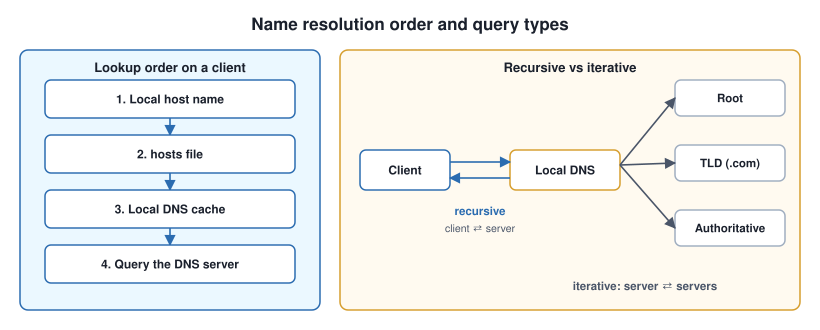

# 安装域控制器与 DNS

[한국어](README.ko.md) | [English](../README.md) | [日本語](README.ja.md) | **简体中文** | [Español](README.es.md) | [Français](README.fr.md)

整理把服务器变为域控制器的过程（添加角色与提升），以及 AD 必须依赖的 DNS。内容包括 SRV 记录、客户端加入域的方法、客户端查找 DC 的顺序、名称解析顺序和 DNS 查询类型。

## 目录

- [1. 安装 AD 前的准备](#1-安装-ad-前的准备)
- [2. 安装域控制器的过程](#2-安装域控制器的过程)
- [3. DNS 与 AD 的关系（SRV 记录）](#3-dns-与-ad-的关系srv-记录)
- [4. 客户端加入域](#4-客户端加入域)
- [5. DNS 进阶概念](#5-dns-进阶概念)
- [总结](#总结)

---

## 1. 安装 AD 前的准备

提供 Active Directory 服务的服务器称为**域控制器（DC）**。要把服务器变成 DC，需要先做一些准备。

- **以前的方式（2012 之前）**：使用 `DCPROMO` 命令。
- **现在的方式（2012 之后）**：服务器管理器（Server Manager）的远程管理功能增强，安装方式也随之改变，需要在服务器管理器中进行 **DC 提升**。

### 安装 DC 的必要条件

- **使用静态 IP**：DC 必须使用**静态 IP（Static IP）**。
- **DNS 设置**：安装 AD 的服务器必须把首选 DNS 设为**自己的 IP 地址**（`127.0.0.1` 或自己的 IP）。
  - 现在安装 AD 时，服务器会自动把首选 DNS 改为自己。（以前不会这样做，因此出过很多问题。）
- **设置计算机名**：事先确定好服务器名称。（例如：`DC01`、`DC02`）

---

## 2. 安装域控制器的过程

分两个阶段进行：先添加角色，再**提升（Promotion）** 为 DC。

1. **添加角色和功能**：在服务器管理器仪表板中点击**添加角色和功能**。
2. **选择服务**：勾选 **Active Directory 域服务**。AD 管理所需的管理工具也会一起安装。
3. **安装基本模块**：点击安装后，会安装 AD 的基本模块和管理工具。
4. **提升为 DC**：安装完成后，服务器管理器中会出现**将此服务器提升为域控制器**的链接，点击即可启动向导。
5. **选择功能级别**：如果没有特别的理由，最好选择**最高版本**。
6. **确认 GC/DNS**：在第一台 DC 上，全局编录和 DNS 服务器是必需的，因此会被自动选中。
7. **DSRM 密码**：设置 DC 出问题时使用的**目录服务还原模式**的密码。
8. **重启**：确认路径后点击安装。安装完成后服务器会自动重启。

### 提升选项

| 选项 | 何时选择 |
| --- | --- |
| 添加新林 | **第一次**创建域时 |
| 将 DC 添加到现有域 | 已经有 DC，为了备份或负载均衡**再添加一台** DC 时 |

> **NetBIOS 名称**：如果域名是 `korea.com`，NetBIOS 名称就是 `KOREA`。NetBIOS 名称**最多 15 个字符**。

---

## 3. DNS 与 AD 的关系（SRV 记录）

AD **离开 DNS 就无法存在。** AD 通过 DNS 查找所有计算机的信息。

### 什么是 DNS？

- 它负责把计算机名称转换为 IP 地址。
- **FQDN**（Fully Qualified Domain Name，完全限定域名）：由主机名（例如 `www`）加上域名（例如 `koala.com`）组成的完整名称（`www.koala.com`）。

### 什么是 SRV 记录？

- **SRV（服务）记录**是名称以 `_`（下划线）开头的记录。（例如：`_ldap._tcp.dc._msdcs.korea.com`）
- SRV 记录中包含这样的信息：查找 GC 要使用 **3268** 端口，Kerberos 身份验证使用 **88** 端口。
- 如果有多台 DC，就会注册多条 SRV 记录，查找 DC 时通过**轮询（Round Robin）** 方式分散负载。
- 安装 AD 时，DC 的 SRV 记录会**自动注册**。

---

## 4. 客户端加入域

### 加入前必做：DNS 设置

- 客户端必须在 DNS 设置中指定 **DC 的 IP 地址**，才能找到 DC。
- 如果 DNS 没有指向 DC，**就无法加入域（AD join）。**

### 加入方法（GUI）

| 方法 | 内容 |
| --- | --- |
| 简单更改 | 在系统属性中只输入域名即可加入。要给域账户本地权限，需要在计算机管理中手动把它加入组。 |
| 网络 ID | 使用系统属性中的**网络 ID** 向导。在加入域的同时，可以一次性给用户账户授予客户端 PC 的**本地管理员权限**。 |

### 客户端查找 DC 的顺序

客户端为了登录或加入域而查找 DC 时，**一定使用 DNS**。

1. **向 DNS 查询**：客户端向自己的 DNS 服务器查询该域的 **SRV 记录**。
2. **获取 DC 列表**：DNS 返回 SRV 记录（各 DC 的地址）列表。
3. **ping 确认**：客户端向收到的 DC 列表发送 ping，确认哪些 DC 在线。
4. **选择最佳 DC**：选择响应最快的 DC 并尝试身份验证。

---

## 5. DNS 进阶概念

### 名称解析顺序

计算机查找名称时，并不会一开始就询问 DNS 服务器，而是按以下顺序检查：

1. **本地主机名**（自己）
2. **hosts 文件**（`C:\Windows\System32\drivers\etc\hosts`）
3. **本地 DNS 缓存**：之前从 DNS 获得的 IP 信息
4. **向 DNS 服务器查询**

### DNS 查询类型

| 类型 | 说明 | 方向 |
| --- | --- | --- |
| 递归查询（Recursive） | 客户端向 DNS 服务器请求**最终答案**。 | 客户端 ⇄ 服务器 |
| 迭代查询（Iterative） | DNS 服务器为了得到准确答案，**反复向其他服务器**（根、TLD、权威服务器）询问。 | 服务器 ⇄ 服务器 |

---

## 总结

- DC 需要**静态 IP**、**指向自己的 DNS** 和**事先确定的计算机名**。从 2012 开始，用**服务器管理器**代替 `DCPROMO` 进行提升。
- 安装顺序为 **添加 AD DS 角色 → 提升为 DC**（新林 / 添加到现有域）→ 功能级别 → GC/DNS → **DSRM 密码** → 重启。NetBIOS 名称最多 **15 个字符**。
- AD **离开 DNS 就无法工作。** 以 `_` 开头的 **SRV 记录**会被自动注册，让客户端能找到 DC、GC（3268）和 Kerberos（88）。
- 客户端必须**把 DNS 指向 DC** 才能加入域。**网络 ID** 向导还会一并授予本地管理员权限。
- 查找 DC：**SRV 查询 → DC 列表 → ping → 最快的 DC**。
- 名称解析顺序为 **本地主机名 → hosts 文件 → 缓存 → DNS 服务器**；查询分为**递归**（客户端↔服务器）和**迭代**（服务器↔服务器）。
