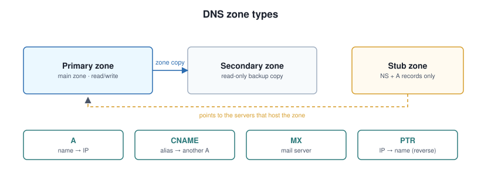

# DNS Zones, Tools and AGDLP

[한국어](README/README.ko.md) | **English** | [日本語](README/README.ja.md) | [简体中文](README/README.zh-CN.md) | [Español](README/README.es.md) | [Français](README/README.fr.md)


A review of DNS zones, records and dynamic updates — the core of AD — and how to install an additional domain controller (including Server Core). Then the AD management tools and Recycle Bin, group types and scopes, and the AGDLP group strategy.

## Contents

- [1. DNS zones and key records](#1-dns-zones-and-key-records)
- [2. Adding another domain controller](#2-adding-another-domain-controller)
- [3. AD management tools and the Recycle Bin](#3-ad-management-tools-and-the-recycle-bin)
- [4. Group types and scopes](#4-group-types-and-scopes)
- [5. The AGDLP group strategy](#5-the-agdlp-group-strategy)
- [Summary](#summary)

---

## 1. DNS zones and key records

DNS is central to AD, so you need to understand it well. A DNS server manages names by creating **zones**.

### Forward and reverse lookup

| Lookup | What it does | Example |
| --- | --- | --- |
| Forward lookup | Domain name → IP address | `www.korea.com` → `192.168.0.1` |
| Reverse lookup | IP address → domain name | `192.168.0.1` → `www.korea.com` |

### DNS zone types



1. **Primary zone**: the main zone that turns names into IPs. It can be read and written.
2. **Secondary zone**: a **read-only backup copy** of the primary zone.
3. **Stub zone**: holds **only the NS records** that tell where the zone is served and the **A records** of those servers.

### Key DNS records

| Record | Role |
| --- | --- |
| A | The most basic record: maps a name to an IP address. |
| CNAME | An **alias** that points to another name (an A record). |
| MX | Gives the address of the domain's **mail server**. |
| PTR | Created in a reverse lookup zone to map an IP address back to a name. |

### Dynamic update

A feature where clients **register their own host names in DNS**.

- It is rarely used in plain DNS, but AD uses **secure dynamic updates**, which apply security when clients register.
- **Nonsecure dynamic updates** can pile up junk data, so it is better not to use them.

---

## 2. Adding another domain controller

With only one DC, authentication stops when that DC goes down. That's why in practice **two or more DCs** are recommended.

### Using Server Core

- An AD domain controller can also be installed on **Windows Server Core**, which is small and needs fewer patches.
- Server Core has no graphical tools, so everything is done with **PowerShell** or commands. Use **`sconfig`** for the basic setup.
- A Core server can also be managed remotely from **Server Manager** on a GUI server.

```powershell
# Install the AD DS role
Install-WindowsFeature -Name AD-Domain-Services -IncludeManagementTools

# Add as a DC to an existing domain (promote)
Install-ADDomainController -DomainName "korea.com" -InstallDns
```

> **Tip**: whether GUI or CLI, before promoting to a DC set **DNS to point to an existing DC**.

---

## 3. AD management tools and the Recycle Bin

### Management tools

There are two tools for creating users and groups.

1. **Active Directory Users and Computers (ADUC)**: the long-established tool.
2. **Active Directory Administrative Center (ADAC)**: the newer tool. It **shows the PowerShell command** for each action, which is handy when writing scripts later.

### AD Recycle Bin

- In the past, an AD object deleted by mistake could **only be recovered from a backup**.
- From Windows Server 2008 R2, enabling the **AD Recycle Bin** lets you easily restore deleted users or groups.

---

## 4. Group types and scopes

Using AD well means using groups well. Put users in groups and grant rights to the groups, and everything can be managed centrally.

### Group types

| Type | Purpose |
| --- | --- |
| Distribution group | A list for sending mail. It has **no security identifier (SID)**, so it cannot be given permissions. |
| Security group | Used to **grant permissions**. It can also be used for mail. |

### Group scopes

| Scope | Purpose |
| --- | --- |
| Global group | For **grouping people**. |
| Domain local group | For **granting permissions**. |
| Universal group | Covers the **entire forest**. Handy for grouping global groups when there are several domains. |

---

## 5. The AGDLP group strategy

AGDLP grants permissions not to users directly but **step by step through groups**. It lets all permission management be handled in AD, which is one of the main reasons to use AD.


- **A** - Account: create the user accounts.
- **G** - Global Group: put the users into a global group.
- **DL** - Domain Local Group: put the global group into a domain local group.
- **P** - Permission: give the permission to the domain local group.

---

## Summary

- DNS zones are **primary** (read/write), **secondary** (read-only backup) and **stub** (NS + A only).
- Key records: **A** (name→IP), **CNAME** (alias), **MX** (mail server), **PTR** (IP→name). AD uses **secure dynamic updates**.
- Keep **two or more** DCs. On Server Core use `sconfig`, `Install-WindowsFeature` and `Install-ADDomainController`, and **point DNS to an existing DC** before promoting.
- The tools are **ADUC** and **ADAC**; ADAC shows the PowerShell commands. Turning on the **AD Recycle Bin** makes deleted objects easy to restore.
- Group types are **distribution** (no SID) and **security**; scopes are **global** (people), **domain local** (permissions) and **universal** (whole forest).
- **AGDLP**: account → global group → domain local group → permission.
