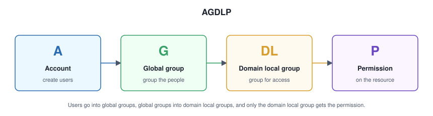

# DNS 区域、管理工具与 AGDLP

[한국어](README.ko.md) | [English](../README.md) | [日本語](README.ja.md) | **简体中文** | [Español](README.es.md) | [Français](README.fr.md)


复习作为 AD 核心的 DNS 区域、记录和动态更新，并整理额外安装域控制器的方法（包括 Server Core）。最后介绍 AD 管理工具与回收站、组的类型与作用域，以及组管理策略 AGDLP。

## 目录

- [1. DNS 区域与主要记录](#1-dns-区域与主要记录)
- [2. 额外安装域控制器](#2-额外安装域控制器)
- [3. AD 管理工具与回收站](#3-ad-管理工具与回收站)
- [4. 组的类型与作用域](#4-组的类型与作用域)
- [5. 组管理策略 AGDLP](#5-组管理策略-agdlp)
- [总结](#总结)

---

## 1. DNS 区域与主要记录

DNS 是 AD 的核心，因此需要很好地理解 DNS。DNS 服务器通过创建**区域（Zone）** 来管理名称。

### 正向查找与反向查找

| 查找 | 作用 | 示例 |
| --- | --- | --- |
| 正向查找 | 域名 → IP 地址 | `www.korea.com` → `192.168.0.1` |
| 反向查找 | IP 地址 → 域名 | `192.168.0.1` → `www.korea.com` |

### DNS 区域类型


1. **主要区域（Primary Zone）**：把名称转换为 IP 的基本主区域，可读可写。
2. **辅助区域（Secondary Zone）**：主要区域的**只读备份副本**。
3. **存根区域（Stub Zone）**：只包含指明该区域由哪些 DNS 服务器提供服务的 **NS 记录**和这些服务器的 **A 记录**。

### 主要 DNS 记录

| 记录 | 作用 |
| --- | --- |
| A | 最基本的记录，把名称映射到 IP 地址。 |
| CNAME | 指向另一个名称（A 记录）的**别名**。 |
| MX | 指明该域的**邮件服务器**地址。 |
| PTR | 创建在反向查找区域中，把 IP 地址映射回名称。 |

### 动态更新（Dynamic Update）

客户端**自己把主机名注册到 DNS** 的功能。

- 一般的 DNS 中很少使用，但 AD 使用在注册时应用安全机制的**安全动态更新**。
- **非安全的动态更新**可能堆积垃圾数据，最好不要使用。

---

## 2. 额外安装域控制器

如果只有一台 DC，它宕机时身份验证就会停止。因此在实际工作中建议安装**两台以上 DC**。

### 使用 Server Core

- AD 域控制器也可以安装在体积小、补丁少的 **Windows Server Core** 版本上。
- Core 版本没有图形工具，所有操作都要用 **PowerShell** 或命令完成。基本配置使用 **`sconfig`**。
- 也可以从 GUI 服务器上的**服务器管理器**远程管理 Core 服务器。

```powershell
# 安装 AD DS 角色
Install-WindowsFeature -Name AD-Domain-Services -IncludeManagementTools

# 作为 DC 添加到现有域（提升）
Install-ADDomainController -DomainName "korea.com" -InstallDns
```

> **提示**：无论 GUI 还是 CLI，在提升为 DC 之前都要先把 **DNS 指向现有的 DC**。

---

## 3. AD 管理工具与回收站

### 管理工具

创建用户或组时使用的工具有两个。

1. **Active Directory 用户和计算机（ADUC）**：一直以来常用的工具。
2. **Active Directory 管理中心（ADAC）**：新的管理工具。每次操作都会**显示对应的 PowerShell 命令**，以后编写脚本时很有用。

### AD 回收站

- 以前误删 AD 对象后，**只能通过备份**恢复。
- 从 Windows Server 2008 R2 开始，启用 **AD 回收站**后就能轻松恢复被删除的用户或组。

---

## 4. 组的类型与作用域

要用好 AD，就要用好组。把用户归到组中、再给组授权，就能集中管理。

### 组的类型

| 类型 | 用途 |
| --- | --- |
| 通讯组 | 用于发送邮件的集合。**没有安全标识符（SID）**，因此不能授予权限。 |
| 安全组 | 用于**授予权限**，也可以用于邮件。 |

### 组的作用域

| 作用域 | 用途 |
| --- | --- |
| 全局组 | 用于**把人归在一起**。 |
| 本地域组 | 用于**授予权限**。 |
| 通用组 | 包含**整个林**。在有多个域时，用来汇集全局组很方便。 |

---

## 5. 组管理策略 AGDLP

AGDLP 不直接把权限授予用户，而是**逐级经过组**来授予。它让所有权限管理都能在 AD 中完成，也是使用 AD 的主要理由之一。



- **A** - Account：创建用户账户。
- **G** - Global Group：把用户放入全局组。
- **DL** - Domain Local Group：把全局组放入本地域组。
- **P** - Permission：把权限授予本地域组。

---

## 总结

- DNS 区域分为**主要区域**（可读写）、**辅助区域**（只读备份）和**存根区域**（只有 NS + A）。
- 主要记录有 **A**（名称→IP）、**CNAME**（别名）、**MX**（邮件服务器）、**PTR**（IP→名称）。AD 使用**安全动态更新**。
- DC 要保持**两台以上**。在 Server Core 上使用 `sconfig`、`Install-WindowsFeature` 和 `Install-ADDomainController`，提升前先把 **DNS 指向现有 DC**。
- 管理工具有 **ADUC** 和 **ADAC**，ADAC 会显示 PowerShell 命令。启用 **AD 回收站**后可轻松恢复已删除的对象。
- 组的类型有**通讯组**（无 SID）和**安全组**；作用域有**全局**（人）、**本地域**（权限）和**通用**（整个林）。
- **AGDLP**：账户 → 全局组 → 本地域组 → 权限。
