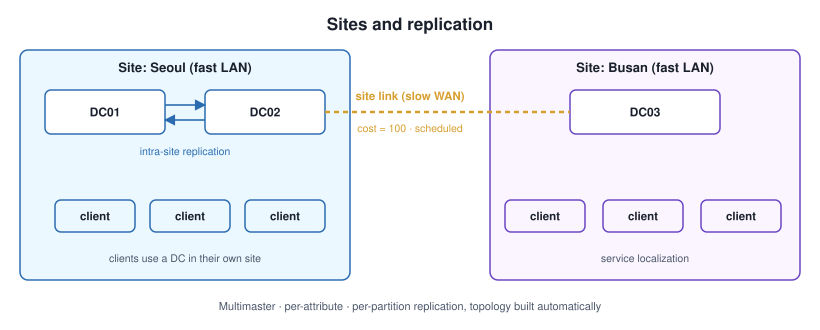

# Computer Accounts, Replication, Sites and RODC

[한국어](README/README.ko.md) | **English** | [日本語](README/README.ja.md) | [简体中文](README/README.zh-CN.md) | [Español](README/README.es.md) | [Français](README/README.fr.md)


How computer accounts behave once a machine joins the domain, plus tips for managing AD accounts. Then how DCs replicate with each other, sites and services for slow networks, and the read-only domain controller (RODC) for insecure locations.

## Contents

- [1. Computer accounts and AD](#1-computer-accounts-and-ad)
- [2. AD account management tips](#2-ad-account-management-tips)
- [3. AD replication](#3-ad-replication)
- [4. Sites and services](#4-sites-and-services)
- [5. RODC](#5-rodc)
- [Summary](#summary)

---

## 1. Computer accounts and AD

- When a computer joins the domain, a **computer account** is created automatically.
- A computer account also has a **password**, which changes automatically **every 30 days** for communication between the computer and the DC.
- The computer and the DC use this password to set up a **secure channel** and communicate.
- If a computer cannot reach a DC for **more than 30 days**, have it use VPN or DirectAccess, or raise the **maximum age** of the computer account password in Group Policy.

---

## 2. AD account management tips

- **Where Group Policy applies**: Group Policy can be linked to OUs (organizational units), but not to the **Users** or **Computers containers** where accounts are created by default.
- **Changing the default location**: to make new accounts land in an OU, use the **`redirusr`** (users) and **`redircmp`** (computers) commands.
- **Bulk tool (LDIFDE)**: to **import** user properties such as department or phone number into AD in bulk, or to **export** AD data, use **`LDIFDE`**.

```cmd
redirusr "OU=NewUsers,DC=korea,DC=com"
redircmp "OU=NewComputers,DC=korea,DC=com"
```

---

## 3. AD replication

### With several DCs

- When there are several DCs, **replication runs continuously** so that every DC holds the same data.
- **Multimaster**: data can be changed on **any** of the DCs at the same time.
- **Core goals of replication**: accuracy, integrity, consistency and fast performance.

### Technical features of replication

| Feature | Details |
| --- | --- |
| Per-attribute replication | Since Windows Server 2003 the unit of replication is the **attribute**, so changes to different attributes of the same object merge without conflict. |
| Per-partition replication | The AD database is replicated **partition by partition**, not as one whole. (schema, configuration, domain, GC, application) |
| Automatic topology | **AD designs automatically** how DCs should replicate with each other most efficiently. |

---

## 4. Sites and services

By default AD assumes all DCs are on a **fast network** when it replicates. But if the company network is split by **slow WAN links**, replication and authentication can run into trouble.

A **site** groups the network structure so AD can control replication over slow networks and steer users to **the DC on the nearest (fastest) network**.



### What sites do and how they are built

| Item | Details |
| --- | --- |
| Replication control | Controls when and how often replication runs between sites (over the WAN) to reduce the load on the link. |
| Service localization | Makes clients authenticate with **a DC in their own site**. |
| Defining sites | Sites are divided by well-connected networks (subnets). |
| Site link | The replication path that connects one site to another. |
| Cost | Each site link gets a cost; lower-cost paths are preferred. |

---

## 5. RODC

### What is an RODC?

- A normal DC can both **read and write** data, but an **RODC (Read-Only Domain Controller)** works, as the name says, **read-only**.
- It is installed at **physically insecure locations** (such as branch offices) so that important information is not exposed even if the DC is stolen.


### RODC security features

- **No passwords stored**: by default an RODC does not store sensitive security information (passwords).
- **Selective caching**: for better performance you can choose to cache (store) the passwords of **specific users** only. This speeds up authentication for users at that location while keeping things secure.

---

## Summary

- Joining a domain creates a **computer account** whose password changes **every 30 days** and is used to set up a **secure channel** with the DC.
- GPOs cannot be linked to the **Users/Computers containers**, so use `redirusr` and `redircmp` to move the default location to an OU. Use **LDIFDE** for bulk work.
- AD replication is **multimaster**, **per-attribute** (since 2003) and **per-partition**, and the topology is built **automatically**.
- **Sites** control replication over slow WAN links and make clients use a **nearby DC**. Sites are connected with **site links** and **costs**.
- An **RODC** is a **read-only DC** for insecure locations; by default it stores no passwords and **caches only chosen users**.
