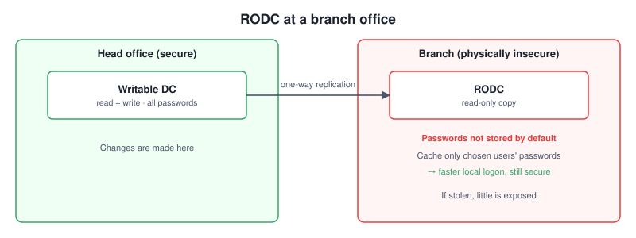

# 컴퓨터 계정, 복제, 사이트와 RODC

**한국어** | [English](../README.md) | [日本語](README.ja.md) | [简体中文](README.zh-CN.md) | [Español](README.es.md) | [Français](README.fr.md)


도메인에 가입한 컴퓨터 계정의 동작과 AD 계정 관리 팁을 정리합니다. 이어서 DC 사이의 복제 방식, 느린 네트워크를 다루는 사이트와 서비스, 보안이 취약한 지점을 위한 읽기 전용 도메인 컨트롤러(RODC)를 다룹니다.

## 목차

- [1. 컴퓨터 계정과 AD](#1-컴퓨터-계정과-ad)
- [2. AD 계정 관리 팁](#2-ad-계정-관리-팁)
- [3. AD 복제](#3-ad-복제)
- [4. 사이트와 서비스](#4-사이트와-서비스)
- [5. RODC](#5-rodc)
- [정리](#정리)

---

## 1. 컴퓨터 계정과 AD

- 컴퓨터가 도메인에 가입하면 **컴퓨터 계정**이 자동으로 만들어집니다.
- 컴퓨터 계정에도 **암호**가 있고, 컴퓨터와 DC 사이의 통신을 위해 **30일마다** 자동으로 바뀝니다.
- 컴퓨터와 DC는 이 암호 정보를 바탕으로 **보안 채널(Secure Channel)** 을 맺고 통신합니다.
- 컴퓨터가 **30일 넘게** DC와 통신하기 어렵다면 VPN이나 DirectAccess를 쓰게 하거나, 그룹 정책에서 컴퓨터 계정 암호의 **최대 사용 기간**을 늘려야 합니다.

---

## 2. AD 계정 관리 팁

- **그룹 정책 적용 위치**: OU(조직 구성 단위)에는 그룹 정책을 연결할 수 있지만, 계정이 기본으로 만들어지는 **Users**나 **Computers 컨테이너**에는 그룹 정책을 따로 연결할 수 없습니다.
- **기본 위치 변경**: 계정이 만들어지는 기본 위치를 OU로 바꾸려면 **`redirusr`**(사용자)와 **`redircmp`**(컴퓨터) 명령어를 사용합니다.
- **대량 작업 도구 (LDIFDE)**: 부서, 전화번호 같은 사용자 속성을 AD에 **대량으로 넣거나**, 반대로 AD 데이터를 **뽑아낼** 때 **`LDIFDE`** 를 사용합니다.

```cmd
redirusr "OU=NewUsers,DC=korea,DC=com"
redircmp "OU=NewComputers,DC=korea,DC=com"
```

---

## 3. AD 복제

### DC가 여러 대일 때

- DC가 여러 대 있으면, 모든 DC의 데이터가 똑같도록 **복제가 계속** 일어납니다.
- **멀티마스터 방식**: 여러 DC 중 **아무 곳에서나** 동시에 데이터를 수정할 수 있습니다.
- **복제의 핵심 목표**: 정확성, 무결성, 일관성, 그리고 빠른 성능입니다.

### 복제의 기술적 특징

| 특징 | 내용 |
| --- | --- |
| 속성 단위 복제 | Windows Server 2003부터 복제 단위가 **속성 단위**로 바뀌어, 같은 개체라도 서로 다른 속성이 바뀌면 충돌 없이 합쳐집니다. |
| 파티션별 복제 | AD 데이터베이스는 통째로가 아니라 **파티션별로** 복제됩니다. (스키마, Configuration, 도메인, GC, 애플리케이션) |
| 자동 토폴로지 | DC끼리 어떻게 복제해야 가장 효율적인지 **AD가 자동으로 설계**합니다. |

---

## 4. 사이트와 서비스

AD는 기본적으로 모든 DC가 **빠른 네트워크** 안에 있다고 생각하고 복제합니다. 그런데 회사 네트워크가 **느린 WAN 구간**으로 나뉘어 있으면 복제나 인증에 문제가 생길 수 있습니다.

**사이트(Site)** 는 느린 네트워크 환경에서 AD 복제를 제어하고, 사용자가 **가장 가까운(빠른) 네트워크의 DC**를 쓰도록 유도하기 위해 네트워크 구조를 묶는 개념입니다.


### 사이트의 기능과 구성

| 항목 | 내용 |
| --- | --- |
| 복제 제어 | 사이트 사이(WAN) 복제의 시간과 빈도를 조절해 회선 부담을 줄입니다. |
| 서비스 로컬라이제이션 | 클라이언트가 **자기 사이트 안의 DC**로 인증하도록 합니다. |
| 사이트 구분 | 빠르게 연결된 네트워크(서브넷) 단위로 사이트를 나눕니다. |
| 사이트 링크 | 사이트와 사이트를 잇는 복제 경로입니다. |
| 코스트 | 사이트 링크마다 비용(Cost)을 주어, 값이 낮은 경로를 우선 사용합니다. |

---

## 5. RODC

### RODC란?

- 일반 DC는 데이터를 **읽고 쓰기** 모두 할 수 있지만, **RODC(Read-Only Domain Controller)** 는 이름 그대로 **읽기 전용**으로만 동작하는 DC입니다.
- **물리적으로 보안이 취약한 지점**(지사 등)에 설치해서, DC가 탈취당해도 중요한 정보가 넘어가지 않도록 할 때 사용합니다.



### RODC의 보안 강화 기능

- **패스워드 미저장**: RODC는 기본적으로 보안과 관련된 중요한 정보(암호)를 저장하지 않습니다.
- **캐싱 지정**: 성능 개선을 위해 **특정 사용자**의 암호만 캐시(저장)하도록 지정할 수 있습니다. 이렇게 하면 해당 지점 사용자의 인증 속도를 높이면서도 보안을 유지할 수 있습니다.

---

## 정리

- 도메인에 가입하면 **컴퓨터 계정**이 생기고, 그 암호는 **30일마다** 바뀌어 DC와 **보안 채널**을 맺습니다.
- **Users/Computers 컨테이너**에는 GPO를 연결할 수 없으므로 `redirusr`·`redircmp`로 기본 위치를 OU로 바꿉니다. 대량 작업은 **LDIFDE**를 씁니다.
- AD 복제는 **멀티마스터**, **속성 단위**(2003부터), **파티션별** 복제이며 토폴로지는 **자동**으로 만들어집니다.
- **사이트**는 느린 WAN 구간의 복제를 제어하고, 클라이언트가 **가까운 DC**를 쓰게 합니다. 사이트 사이는 **사이트 링크**와 **코스트**로 연결합니다.
- **RODC**는 보안이 취약한 지점용 **읽기 전용 DC**로, 기본적으로 암호를 저장하지 않고 **지정한 사용자만 캐싱**합니다.
