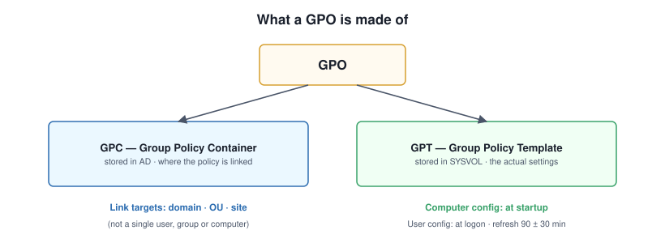

# 그룹 정책

**한국어** | [English](../README.md) | [日本語](README.ja.md) | [简体中文](README.zh-CN.md) | [Español](README.es.md) | [Français](README.fr.md)


AD를 쓰는 두 번째 큰 이유인 그룹 정책(Group Policy)을 정리합니다. 그룹 정책으로 할 수 있는 일, 구성과 연결 범위, GPC와 GPT, GPO와 GPP의 차이, 반영 주기, 처리 순서와 필터링, 결과 확인 도구까지 다룹니다.

## 목차

- [1. 그룹 정책이란?](#1-그룹-정책이란)
- [2. 그룹 정책의 구성과 연결 범위](#2-그룹-정책의-구성과-연결-범위)
- [3. 그룹 정책의 작동 방식](#3-그룹-정책의-작동-방식)
- [4. 그룹 정책(GPO)과 기본 설정(GPP)](#4-그룹-정책gpo과-기본-설정gpp)
- [5. 정책 처리 순서와 필터링](#5-정책-처리-순서와-필터링)
- [6. 정책 확인 도구와 관리 템플릿](#6-정책-확인-도구와-관리-템플릿)
- [정리](#정리)

---

## 1. 그룹 정책이란?

AD를 쓰는 이유는 크게 두 가지이고, 그중 하나가 그룹 정책입니다.

1. **인증 중앙화 (SSO)**: 한 번의 로그인으로 모든 것을 해결합니다.
2. **관리 중앙화 (GP)**: 회사나 조직 안의 Windows 클라이언트와 서버를 관리하는 기술입니다.

### 그룹 정책의 장점

- **일괄 반영**: 여러 Windows 설정을 중앙에서 한 번에 적용할 수 있습니다.
- **강제 적용**: 절대 바뀌면 안 되는 설정을 중앙에서 고정할 수 있어서 **회사 표준**을 만들 수 있습니다.

### 그룹 정책으로 할 수 있는 일

1. **보안 설정**: Windows 보안 설정을 적용합니다.
2. **애플리케이션 설정**: Windows를 포함한 다양한 앱 설정을 중앙에서 반영합니다.
3. **네트워크 설정**: 방화벽, IP 보안, 네트워크 드라이브 연결 등을 일괄 처리합니다.
4. **폴더 리디렉션**: 사용자 프로필 폴더를 서버로 모아 백업과 관리를 쉽게 합니다.

### 설정 모드 3가지

| 모드 | 의미 |
| --- | --- |
| 사용 (Enabled) | 설정을 반영합니다. |
| 사용 안 함 (Disabled) | 설정을 반대로(끄는 쪽으로) 반영합니다. |
| 구성되지 않음 (Not Configured) | 널(Null) 값으로, 아무것도 정하지 않습니다. |

---

## 2. 그룹 정책의 구성과 연결 범위

### 컴퓨터 설정과 사용자 설정

그룹 정책은 크게 두 블록으로 나뉩니다.

| 블록 | 대상 | 적용 시점 |
| --- | --- | --- |
| 컴퓨터 구성 | AD의 **컴퓨터 계정** | 컴퓨터가 **켜질 때** |
| 사용자 구성 | AD의 **사용자 계정** | 사용자가 **로그온할 때** |

### 정책 연결 범위

그룹 정책을 **어디에 연결해서 적용할지**를 정하는 범위입니다.

- **도메인**: AD의 기본 범위입니다.
- **조직 구성 단위 (OU)**: 도메인 안에서 범위를 잘라 놓은 단위입니다.
- **사이트**: 네트워크 구성에 맞춰 정책을 반영할 수 있습니다.

> 사용자 한 명, 그룹 하나, 컴퓨터 한 대에 **직접 연결할 수는 없습니다.** 정책은 도메인, OU, 사이트 단위로 연결됩니다.

---

## 3. 그룹 정책의 작동 방식

우리가 '그룹 정책(GPO)'이라고 부르는 것은 실제로 두 부분으로 나뉩니다.



1. **그룹 정책 컨테이너 (GPC)**: **AD 안에** 저장되고, 정책이 어디에 반영될지를 연결해 주는 역할입니다.
2. **그룹 정책 템플릿 (GPT)**: **실제 설정 내용**을 가지고 있으며, DC를 설치할 때 만들어지는 **SYSVOL** 폴더 안에 저장됩니다.

---

## 4. 그룹 정책(GPO)과 기본 설정(GPP)

| 구분 | 그룹 정책 (GPO) | 그룹 정책 기본 설정 (GPP) |
| --- | --- | --- |
| 강제성 | 엄격하게 강제 적용됩니다. (Strictly Enforced) | 적용은 되지만 사용자가 바꿀 수 있습니다. |
| 수정 가능 여부 | 사용자가 설정 화면에서 바꿀 수 없습니다. (비활성화됨) | 사용자가 값을 바꿀 수 있지만, 주기적으로 원래 값이 다시 반영됩니다. |
| 용도 | 보안 설정, 회사 표준처럼 강제 적용이 필요한 부분 | GPO로 설정할 수 없는 추가 영역이나 GUI 기반의 쉬운 설정 |

일반적으로 강제 적용이 필요한 보안 설정이나 회사 표준은 **GPO**를 쓰는 것이 훨씬 효율적입니다.

### 정책 적용 타이밍 (Refresh)

정책은 컴퓨터가 켜지거나 사용자가 로그온할 때뿐 아니라 **주기적으로** 업데이트됩니다.

- **기본 주기**: 90분에 무작위 오프셋 ±30분이 붙어 **60~120분** 사이에 반영됩니다.
- **보안 설정**: 변경이 없어도 **16시간마다** 다시 반영됩니다.
- **강제 업데이트**: 기다리기 싫다면 **`gpupdate`** 명령어로 바로 반영합니다.

```cmd
gpupdate /force
```

---

## 5. 정책 처리 순서와 필터링

### 정책 처리 순서

정책은 여러 단계를 내려오면서 반영되고, **마지막에 반영된 값이 최종 결과**가 됩니다.


1. 로컬 그룹 정책
2. 사이트
3. 도메인
4. OU

### 계정 정책

**암호 정책** 같은 계정 정책은 **도메인 단위로만** 반영됩니다.

> 예: 도메인에서 암호 최소 길이를 8자로 정했다면, 특정 OU에서 3자로 설정해도 **8자**가 적용됩니다.

### 강제 적용과 상속 차단

정책끼리 충돌을 막거나 우선순위를 정할 수 있습니다.

- **강제 적용 (Enforce)**: 상위(예: 도메인)의 정책을 하위로 **강제로 내려보내** 덮어쓰지 못하게 합니다.
- **상속 차단 (Block Inheritance)**: 하위 OU가 **위에서 내려오는 정책을 받지 않도록** 막습니다. (강제 적용된 정책은 막지 못합니다.)

### 보안 필터링과 WMI 필터링

- **보안 필터링**: 특정 그룹이나 사용자를 제외하거나, 원하는 그룹에만 정책이 반영되도록 권한을 조정합니다.
- **WMI 필터링**: 운영체제 버전 같은 **컴퓨터의 조건**에 맞춰 정책을 적용합니다.

---

## 6. 정책 확인 도구와 관리 템플릿

### 정책 결과 확인

- **정책 결과 집합 (RSoP)**: 그룹 정책 관리 콘솔(**GPMC**)의 그룹 정책 결과나 **`rsop.msc`** 로 최종적으로 어떤 정책이 반영되었는지 확인합니다.
- **`gpresult`**: 명령 프롬프트에서 현재 받은 정책이 무엇인지 확인할 때 사용합니다.

```cmd
gpresult /r
```

### 관리 템플릿

- 제어판, Windows 구성 요소 같은 **Windows 기본 설정이 모여 있는 곳**입니다.
- 대부분의 원하는 설정을 여기서 합니다.

---

## 정리

- AD를 쓰는 두 이유는 **인증 중앙화(SSO)** 와 **관리 중앙화(그룹 정책)** 입니다. 그룹 정책은 설정을 **일괄 반영**하고 **강제 적용**합니다.
- 설정 모드는 **사용 / 사용 안 함 / 구성되지 않음**입니다. **컴퓨터 구성은 부팅 시**, **사용자 구성은 로그온 시** 반영됩니다.
- 정책은 **도메인·OU·사이트**에만 연결할 수 있고, 개별 사용자·그룹·컴퓨터에는 직접 연결할 수 없습니다.
- GPO는 **GPC**(AD 안, 연결 정보)와 **GPT**(SYSVOL, 실제 설정)로 이루어집니다. 강제가 필요하면 **GPO**, 유연한 기본값은 **GPP**입니다.
- 새로 고침은 **90분 ± 30분**, 보안 설정은 **16시간마다**, 바로 반영하려면 **`gpupdate`** 입니다.
- 처리 순서는 **로컬 → 사이트 → 도메인 → OU**이고 마지막 값이 이깁니다. **계정 정책은 도메인에서만** 적용됩니다. **Enforce**·**Block Inheritance**·**보안/WMI 필터링**으로 범위를 조정합니다.
- 결과는 **RSoP(`rsop.msc`, GPMC)** 와 **`gpresult`** 로 확인합니다.
