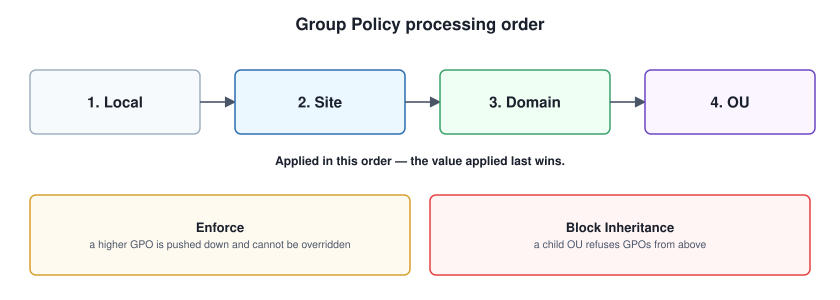

# 组策略

[한국어](README.ko.md) | [English](../README.md) | [日本語](README.ja.md) | **简体中文** | [Español](README.es.md) | [Français](README.fr.md)


整理使用 AD 的第二大理由——组策略（Group Policy）。内容包括组策略能做什么、结构与链接范围、GPC 与 GPT、GPO 与 GPP 的区别、刷新周期、处理顺序与筛选，以及查看结果的工具。

## 目录

- [1. 什么是组策略？](#1-什么是组策略)
- [2. 组策略的结构与链接范围](#2-组策略的结构与链接范围)
- [3. 组策略的工作方式](#3-组策略的工作方式)
- [4. 组策略（GPO）与首选项（GPP）](#4-组策略gpo与首选项gpp)
- [5. 策略处理顺序与筛选](#5-策略处理顺序与筛选)
- [6. 策略查看工具与管理模板](#6-策略查看工具与管理模板)
- [总结](#总结)

---

## 1. 什么是组策略？

使用 AD 的理由主要有两个，组策略就是其中之一。

1. **身份验证集中化（SSO）**：一次登录解决所有问题。
2. **管理集中化（GP）**：管理公司或组织内 Windows 客户端和服务器的技术。

### 组策略的优点

- **批量应用**：可以从中央一次性应用多项 Windows 设置。
- **强制应用**：可以在中央锁定绝不能更改的设置，从而建立**公司标准**。

### 组策略能做什么

1. **安全设置**：应用 Windows 安全设置。
2. **应用程序设置**：从中央下发 Windows 及各种应用的设置。
3. **网络设置**：批量处理防火墙、IP 安全、映射网络驱动器等。
4. **文件夹重定向**：把用户配置文件夹集中到服务器上，便于备份和管理。

### 三种设置模式

| 模式 | 含义 |
| --- | --- |
| 已启用（Enabled） | 应用该设置。 |
| 已禁用（Disabled） | 以相反方式（关闭方向）应用该设置。 |
| 未配置（Not Configured） | 空（Null）值，不做任何规定。 |

---

## 2. 组策略的结构与链接范围

### 计算机配置与用户配置

组策略大致分为两个部分。

| 部分 | 对象 | 应用时机 |
| --- | --- | --- |
| 计算机配置 | AD 中的**计算机账户** | 计算机**启动时** |
| 用户配置 | AD 中的**用户账户** | 用户**登录时** |

### 策略链接范围

决定组策略**链接到哪里并在哪里应用**的范围。

- **域**：AD 的基本范围。
- **组织单位（OU）**：在域内划分出范围的单位。
- **站点**：可以按照网络结构应用策略。

> **不能直接链接**到单个用户、单个组或单台计算机。策略以域、OU、站点为单位进行链接。

---

## 3. 组策略的工作方式

我们所说的“组策略（GPO）”实际上分为两部分。


1. **组策略容器（GPC）**：保存在 **AD 中**，负责把策略与应用位置关联起来。
2. **组策略模板（GPT）**：包含**实际的设置内容**，保存在安装 DC 时创建的 **SYSVOL** 文件夹中。

---

## 4. 组策略（GPO）与首选项（GPP）

| 区分 | 组策略（GPO） | 组策略首选项（GPP） |
| --- | --- | --- |
| 强制性 | 严格强制应用。（Strictly Enforced） | 会应用，但用户可以修改。 |
| 能否修改 | 用户无法在设置界面中修改。（被禁用） | 用户可以修改值，但会定期重新应用预期的值。 |
| 用途 | 安全设置、公司标准等需要强制应用的部分 | GPO 无法设置的其他领域，或基于 GUI 的简便设置 |

一般来说，需要强制应用的安全设置或公司标准，使用 **GPO** 要高效得多。

### 策略应用时机（刷新）

除了计算机启动和用户登录时，策略还会**定期**更新。

- **默认周期**：90 分钟加上 ±30 分钟的随机偏移，因此在 **60～120 分钟**之间应用。
- **安全设置**：即使没有变化，也会**每 16 小时**重新应用一次。
- **强制更新**：不想等待时，可以用 **`gpupdate`** 命令立即应用。

```cmd
gpupdate /force
```

---

## 5. 策略处理顺序与筛选

### 策略处理顺序

策略会经过几个层级逐级应用，**最后应用的值就是最终结果**。



1. 本地组策略
2. 站点
3. 域
4. OU

### 账户策略

**密码策略**等账户策略**只在域级别**生效。

> 例：如果域中把最短密码长度设为 8 个字符，即使某个 OU 设为 3 个字符，生效的仍是 **8 个字符**。

### 强制与阻止继承

可以防止策略之间的冲突，或规定优先顺序。

- **强制（Enforce）**：把上级（例如域）的策略**强制下推**，下级无法覆盖。
- **阻止继承（Block Inheritance）**：让下级 OU **不接收从上级传下来的策略**。（无法阻止已强制的策略。）

### 安全筛选与 WMI 筛选

- **安全筛选**：调整权限，排除特定组或用户，或只让策略应用于想要的组。
- **WMI 筛选**：根据操作系统版本等**计算机条件**来应用策略。

---

## 6. 策略查看工具与管理模板

### 查看策略结果

- **策略的结果集（RSoP）**：通过组策略管理控制台（**GPMC**）中的组策略结果或 **`rsop.msc`**，查看最终应用了哪些策略。
- **`gpresult`**：在命令提示符中查看当前收到了哪些策略。

```cmd
gpresult /r
```

### 管理模板

- **汇集 Windows 基本设置的地方**，例如控制面板和 Windows 组件。
- 大多数需要的设置都在这里进行。

---

## 总结

- 使用 AD 的两个理由是**身份验证集中化（SSO）** 和**管理集中化（组策略）**。组策略可以**批量应用**设置并**强制应用**。
- 设置模式有**已启用 / 已禁用 / 未配置**。**计算机配置在启动时**、**用户配置在登录时**应用。
- 策略只能链接到**域、OU 和站点**，不能直接链接到单个用户、组或计算机。
- GPO 由 **GPC**（在 AD 中，链接信息）和 **GPT**（在 SYSVOL 中，实际设置）组成。需要强制时用 **GPO**，灵活的默认值用 **GPP**。
- 刷新周期为 **90 ± 30 分钟**，安全设置**每 16 小时**一次，想立即应用就用 **`gpupdate`**。
- 处理顺序为**本地 → 站点 → 域 → OU**，最后的值生效。**账户策略只在域上应用**。用 **Enforce**、**Block Inheritance** 和**安全/WMI 筛选**调整范围。
- 结果用 **RSoP（`rsop.msc`、GPMC）** 和 **`gpresult`** 查看。
