# RAID

[한국어](README/README.ko.md) | **English** | [日本語](README/README.ja.md) | [简体中文](README/README.zh-CN.md) | [Español](README/README.es.md) | [Français](README/README.fr.md)

Notes on the RAID concept, controllers and cache, and RAID levels — then a hands-on lab in Windows **Disk Management** that builds spanned, striped, mirrored and RAID-5 volumes, breaks disks and recovers them.

## Contents

- [1. What is RAID?](#1-what-is-raid)
- [2. RAID controller and cache memory](#2-raid-controller-and-cache-memory)
- [3. RAID levels](#3-raid-levels)
- [4. Building RAID in Windows](#4-building-raid-in-windows)
- [5. Disk failure and recovery](#5-disk-failure-and-recovery)
- [Summary](#summary)

---

## 1. What is RAID?

### Concept and purpose

**RAID (Redundant Array of Independent Disks)** combines several physical disks so they can be used as **one logical disk**. The idea was to build faster, more reliable storage from several cheap disks instead of one expensive large disk.

> Several small disks and one large disk can have the same capacity. So why bother with RAID?

The purpose of RAID is not capacity, but **performance** and **availability**.

- **Performance**: one disk can only do so much I/O. When data is spread across several disks, they read and write at the same time.
- **Availability**: a single disk is a **single point of failure (SPOF)** — the moment it fails, the service stops. RAID keeps the service running even when a disk fails.

That's why some capacity is deliberately given up for fault tolerance. With ten 1TB disks, the usable capacity can be 5TB or 9TB depending on the method.

### Three basic techniques

Every RAID level is a combination of these three.

| Technique | How it works | What you gain |
| --- | --- | --- |
| Striping | Cut data into fixed-size pieces and spread them across disks | Performance |
| Mirroring | Copy the same data to several disks | Availability |
| Parity | Store a recovery value along with the data | Availability + capacity efficiency |

- **Parity** is recovery information made by XOR-ing the data. If one disk fails, the lost data is recalculated from the remaining data and the parity.
- The unit that striping splits data into is the **stripe size**. A small stripe lets several disks read one large file together, which helps **sequential** work. A large stripe lets each disk handle small requests on its own, which helps **random I/O**.

### Hardware RAID vs software RAID

RAID is divided by **who does the RAID work**.

| | Hardware RAID | Software RAID |
| --- | --- | --- |
| Who does it | A dedicated RAID controller card | The operating system (server CPU) |
| Pros | No load on the server CPU, stable | No extra cost |
| Cons | Expensive. Each vendor writes its own format, so a failed controller must be replaced with the same family | Uses the server CPU. It doesn't work at the bootloader stage, so protecting the boot disk needs a separate setup |
| Examples | HPE Smart Array, Dell PERC | Windows dynamic disks / Storage Spaces, Linux mdadm |

---

## 2. RAID controller and cache memory

### What the RAID controller does

A RAID controller sits between the server and the disks and manages RAID.

- It groups several physical disks into logical disks and presents them to the operating system.
- It splits data, mirrors it or calculates parity, and writes it.
- When it detects a disk failure, it marks the volume as **degraded**, and when a new disk is inserted, it runs a **rebuild**.
- In normal operation, it looks for bad sectors in advance and checks that data and parity match.
- It uses cache memory to make up for slow disk I/O.

When a disk failure is detected, two things come into play.

- **Rebuild**: recreating the failed disk's data on a new disk. A mirror copies its partner disk; parity methods read all remaining disks and calculate. **There is no fault tolerance during a rebuild.**
- **Hot spare**: a spare disk installed in advance. When a disk fails, the controller brings it in automatically and starts the rebuild right away.

### What the controller cache does

Disks are much slower than memory. The cache is a buffer that holds data briefly in between.

| Mode | Behavior | Notes |
| --- | --- | --- |
| Write-Through | Reports completion only after the disk write finishes | Safe but slow |
| Write-Back | Reports completion as soon as data is in the cache | Fast. Small writes are batched, which also reduces the write cost of RAID 5/6 |
| Read-Ahead | Loads the data likely to be read next | Helps sequential reads |

- With Write-Back, there is a moment when unwritten data exists only in the cache, so a power loss destroys it. That's why the cache is protected by a **BBU (battery)** or a **flash backup module**, and when that device fails, the controller usually **switches to Write-Through**.
- In RAID 5/6, if power is lost while data and parity are being written, they may no longer match — the **write hole** problem. The cache protection device prevents this too.

---

## 3. RAID levels

### RAID 0 / 1 / 5

The standard RAID levels are 0 to 6. RAID 2, 3 and 4 are hardly used today, because their error correction moved inside the disks or because of the parity-disk bottleneck. The basics in practice are **0, 1 and 5**.

| Level | Method | Description |
| --- | --- | --- |
| RAID 0 | Striping | Spreads data across disks. Fastest, but **if a single disk fails, all data is lost** |
| RAID 1 | Mirroring | Stores the same data on two disks. Half the capacity, but keeps running if one side fails |
| RAID 5 | Distributed parity | Rotates data and parity across all disks. One disk's worth is used for parity, and one failure can be recovered. Removes the bottleneck of RAID 4, which kept all parity on one disk |

In Windows, these three levels can be built with **dynamic disks**: a striped volume is RAID 0, a mirrored volume is RAID 1, and a RAID-5 volume is RAID 5. Simple and spanned volumes are dynamic volumes too, but they are not RAID.

### How parity works

Parity is made with **XOR**: two equal bits give 0, two different bits give 1. XOR-ing the same value twice gives back the original, so if one piece is lost, XOR-ing the rest restores it.

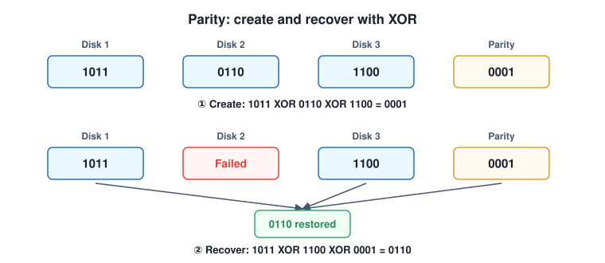

A rebuild repeats this calculation across the whole disk. That's why a rebuild must **read every remaining disk from start to finish**.

### RAID 6

RAID 6 distributes two parities (**P and Q**) made with different formulas. P is XOR; Q uses a different method such as Reed-Solomon coding. With two equations, data can be solved even when **two disks are lost at the same time**.

As disks grow larger, a RAID 5 rebuild takes from several hours to more than a day. If another disk fails during that time, it's over. RAID 6 survives one more failure even during a rebuild. **That's why RAID 6 is recommended for large disks.**

### Nested RAID (10 / 01)

RAID 10 builds **mirrors first** and stripes them together. RAID 01 builds **stripes first** and mirrors them. Both give 50% capacity, but they differ in how well they survive failures.

With 4 disks, when disk 1 fails:

- **RAID 10**: data is lost only if its partner, disk 2, also fails. Only **1** of the remaining 3 disks is dangerous.
- **RAID 01**: set A, which contains disk 1, stops entirely. If either disk 3 or 4 in set B fails, it's over. **2** of the remaining 3 disks are dangerous.

For rebuilds, too, RAID 10 only copies one partner, while RAID 01 must rebuild a whole set. That's why **RAID 10** is used in practice.

### Write penalty (why RAID 5 writes are slow)

The **write penalty** is the number of actual disk I/Os caused by one write request. To change one block in RAID 5, the parity must also be recalculated, so **four I/Os** happen.

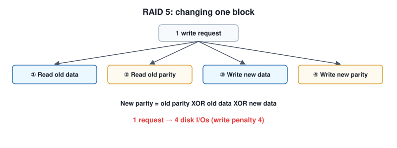

With 4 disks (150 IOPS each, 600 IOPS total) and 70% reads / 30% writes, the numbers are as follows. Reads stay at 420; the 180 writes are divided by the penalty.

| Level | Calculation | Result |
| --- | --- | --- |
| RAID 10 | 420 + 180 ÷ 2 | **510 IOPS** |
| RAID 5 | 420 + 180 ÷ 4 | **465 IOPS** |
| RAID 6 | 420 + 180 ÷ 6 | **450 IOPS** |

The gap grows as the write ratio rises, so write-heavy databases use RAID 10.

### Comparison and use cases

| Level | Min. disks | Usable capacity | Fault tolerance | Write penalty | Main use |
| --- | --- | --- | --- | --- | --- |
| RAID 0 | 2 | 100% | None | 1 | Temporary work space |
| RAID 1 | 2 | 50% | 1 disk | 2 | OS disk |
| RAID 5 | 3 | (N−1)/N | 1 disk | 4 | Read-heavy file server |
| RAID 6 | 4 | (N−2)/N | 2 disks | 6 | Large / backup storage |
| RAID 10 | 4 | 50% | 1 per pair | 2 | Databases, virtualization |

No level gives the best of all three. Choose based on whether **performance, capacity or reliability** comes first.

---

## 4. Building RAID in Windows

### Lab setup

Add **9** hard disks to the machine. They could really be TB-sized, but **synchronization** — making two disks identical, as for a mirrored volume — can take a long time, so **GB-sized disks are used**. The explanation still says TB to stay close to a real environment.

| Volume | Drive | Disks | Size |
| --- | --- | --- | --- |
| Spanned | T: | 2TB + 1TB | 3TB |
| Striped (RAID 0) | U: | 1TB × 2 | 2TB |
| Mirrored (RAID 1) | V: | 1TB × 2 | 1TB |
| RAID-5 | W: | 1TB × 3 | 2TB |

### Preparation

After adding the 9 disks, run `diskmgmt.msc`. Bring all the added disks **online**.

Uninitialized disks are checked automatically. Sometimes initializing and bringing online happen in a different order, but it doesn't matter which comes first.

The RAID volumes we're about to build can only be made on **dynamic disks**.

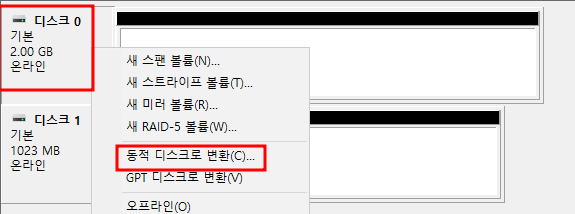

Disk 9 was already in use, so it's better not to convert it. Convert **only the new disks for RAID**.

> Numbers like Disk 1 and Disk 2 in Disk Management are not fixed to the hard disk device. The operating system simply numbers the currently installed disks **in SCSI order**. If a disk in the middle is removed, the numbers don't leave a gap — they shift up by one. For example, if Disk 3 is removed from Disks 0–10, they are renumbered as Disks 0–9.

### Spanned volume

A spanned volume can't be made from the 2TB Disk 0 alone, so add one more 1TB disk.

With 2TB and 1TB added, check that the total volume size is about 3TB.

The two disks are joined into one, and the spanned volume is done. Drive T can now be used like a single 3TB hard disk.

File Explorer also shows about 3TB of free space on drive T.

> The size doesn't have to match exactly after creating the volume. Space used by the system can cause some difference.

### Striped volume (RAID 0)

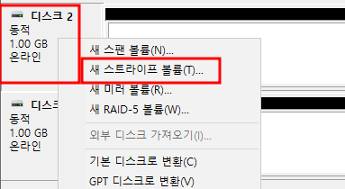

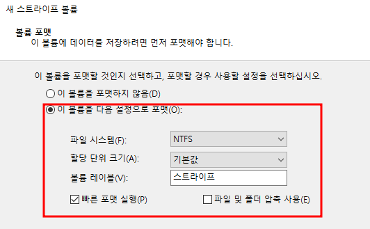

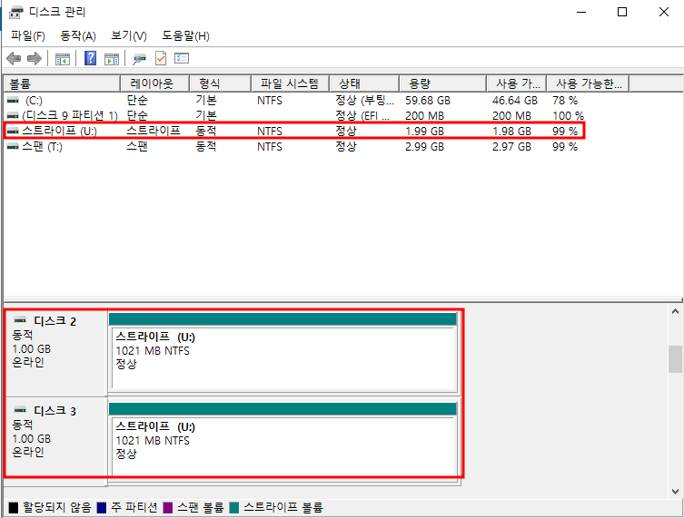

### Mirrored volume (RAID 1)

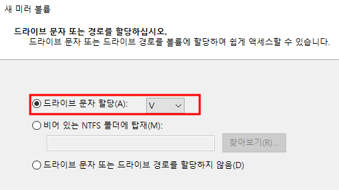

> A mirrored volume needs **synchronization** to make the two disks identical, so it can take a long time with large disks.

### RAID-5 volume

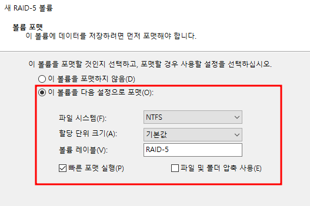

As in the RAID concepts above, the mirrored (V:) and RAID-5 (W:) volumes provide **fault tolerance**.

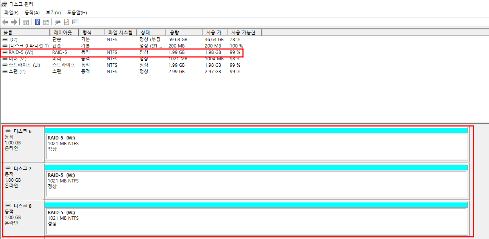

File Explorer shows all four volumes.

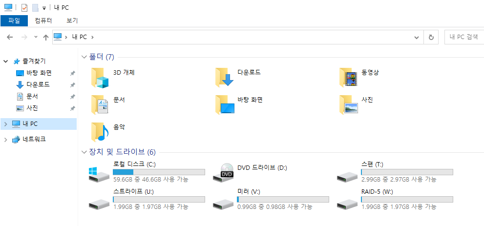

---

## 5. Disk failure and recovery

### When a hard disk fails

This time, we break one disk in each volume and see which volume types keep their data.

As in the figure, remove one disk per volume and check directly whether the data survives. First, copy the same test files to every drive (about an 8.6MB folder in this example).

Shut down the machine and remove 4 disks. Click **Advanced** and check the SCSI number carefully before removing. In this example, SCSI 0:1, 0:3, 0:5 and 0:8 were removed (0:7 is not used).

Boot the machine again and open File Explorer.

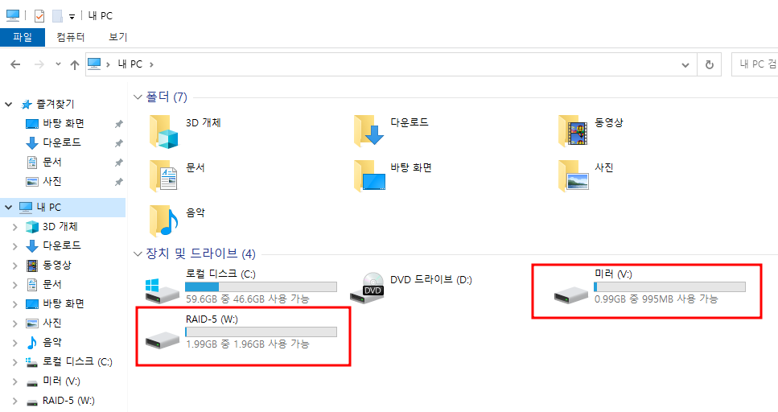

**Only the mirrored (V:) and RAID-5 (W:) volumes**, which provide fault tolerance, remain. The spanned (T:) and striped (U:) volumes are gone.

Check the status in `diskmgmt.msc`.

- The spanned and striped volumes are **Failed**.
- The mirrored and RAID-5 volumes show **Failed Redundancy**. The data is preserved for now, but redundancy is broken, so they **can no longer tolerate a fault**. The data is there, but it isn't safe.

### Replace with new disks and restore

Once their status is repaired, mirrored and RAID-5 volumes provide fault tolerance again. Spanned and striped volumes can be brought back, but if the disk was replaced with a new one, **there is no way to recover the data**. (Occasionally, a data recovery company can rescue data from a failed disk.)

Shut down the machine, install new hard disks at SCSI 0:1, 0:3, 0:5 and 0:8 where the disks were removed, boot again and run `diskmgmt.msc`. Initialize the new disks and convert them to dynamic disks.

### Recovering the spanned and striped volumes

Spanned and striped volumes can't be repaired, so **delete the volume and create it again**. Delete the striped volume the same way.

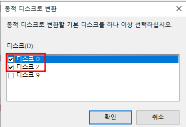

Create the spanned volume again, as before.

Create the striped volume again too.

Both are recreated.

### Recovering the mirrored volume

A mirrored volume can **restore its redundancy**. First, remove the mirror on the missing disk.

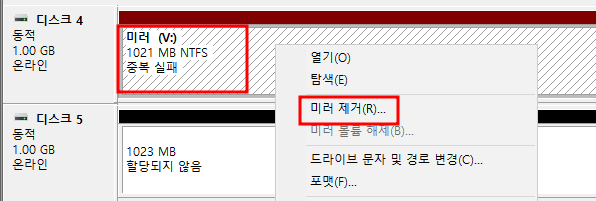

When the warning appears, click **Yes**.

The mirrored volume (V:) has become a simple volume. The name still says '미러' (mirror) only because that label was given when the volume was created — it means nothing.

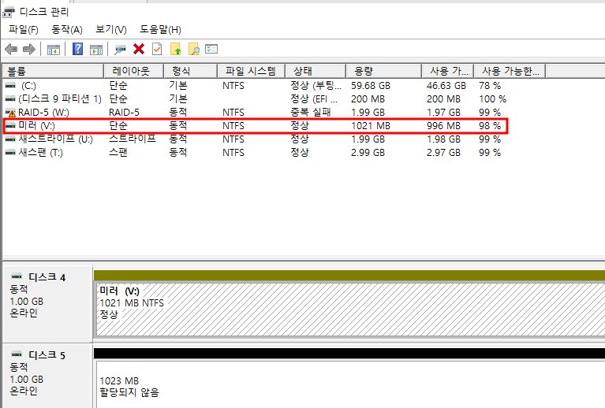

Add the mirror again using the new disk.

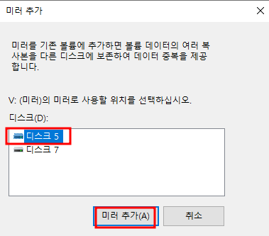

The mirrored volume is recovered.

### Recovering the RAID-5 volume

A RAID-5 volume is rebuilt onto the new disk with **Repair Volume**.

The RAID-5 repair is complete.

### Wrap-up

Close Disk Management and open it again. If you scroll down and see a **missing disk** left over from the earlier errors, remove it.

In File Explorer, the spanned and striped volumes were recreated and have no old data, but **the data on the mirrored and RAID-5 volumes is still there**.

---

## Summary

- The purpose of RAID is not capacity but **performance** and **availability**. The three basic techniques are **striping, mirroring and parity**.
- In hardware RAID a dedicated controller does the RAID work; in software RAID the operating system (server CPU) does.
- Controller cache **Write-Back** is fast but needs a BBU or flash backup against power loss.
- Parity is created and recovered with **XOR**. RAID 6 uses two parities to survive up to 2 disk failures.
- In practice, choose **RAID 10** over RAID 01, RAID 10 for write-heavy loads, and **RAID 6** for large disks.
- In the Windows dynamic disk lab, removing one disk per volume leaves **only the mirror and RAID-5 with data**; spanned and striped volumes lose their data.
- A mirror regains fault tolerance with **Remove Mirror → Add Mirror**, and RAID-5 with **Repair Volume**.
