# RAID

[한국어](README.ko.md) | [English](../README.md) | [日本語](README.ja.md) | [简体中文](README.zh-CN.md) | **Español** | [Français](README.fr.md)

Notas sobre el concepto de RAID, las controladoras y su caché, y los niveles RAID; después, un laboratorio práctico en la **Administración de discos** de Windows donde se crean volúmenes distribuidos, seccionados, reflejados y RAID-5, se rompen discos y se recuperan.

## Contenido

- [1. ¿Qué es RAID?](#1-qué-es-raid)
- [2. Controladora RAID y memoria caché](#2-controladora-raid-y-memoria-caché)
- [3. Niveles RAID](#3-niveles-raid)
- [4. RAID en Windows](#4-raid-en-windows)
- [5. Fallo de disco y recuperación](#5-fallo-de-disco-y-recuperación)
- [Resumen](#resumen)

---

## 1. ¿Qué es RAID?

### Concepto y propósito

**RAID (Redundant Array of Independent Disks)** une varios discos físicos para usarlos como **un solo disco lógico**. La idea era construir un almacenamiento más rápido y fiable con varios discos baratos en lugar de un disco grande y caro.

> Varios discos pequeños y un disco grande pueden tener la misma capacidad. Entonces, ¿para qué sirve RAID?

El propósito de RAID no es la capacidad, sino el **rendimiento** y la **disponibilidad**.

- **Rendimiento**: un disco solo puede hacer cierta cantidad de E/S. Si los datos se reparten entre varios discos, estos leen y escriben al mismo tiempo.
- **Disponibilidad**: un solo disco es un **punto único de fallo (SPOF)**: en cuanto falla, el servicio se detiene. RAID mantiene el servicio aunque falle un disco.

Por eso a veces se sacrifica capacidad a propósito para tener tolerancia a fallos. Con diez discos de 1TB, la capacidad útil puede ser 5TB o 9TB según el método.

### Tres técnicas básicas

Todos los niveles RAID combinan estas tres técnicas.

| Técnica | Cómo funciona | Qué se gana |
| --- | --- | --- |
| Striping (distribución) | Corta los datos en trozos de tamaño fijo y los reparte entre discos | Rendimiento |
| Mirroring (espejo) | Copia los mismos datos en varios discos | Disponibilidad |
| Paridad | Guarda un valor de recuperación junto a los datos | Disponibilidad + eficiencia de capacidad |

- La **paridad** es información de recuperación que se obtiene aplicando XOR a los datos. Si falla un disco, los datos perdidos se recalculan con los datos restantes y la paridad.
- La unidad en la que el striping divide los datos es el **tamaño de franja (stripe size)**. Una franja pequeña permite que varios discos lean juntos un archivo grande, lo que favorece el trabajo **secuencial**. Una franja grande permite que cada disco atienda por separado peticiones pequeñas, lo que favorece la **E/S aleatoria**.

### RAID por hardware y RAID por software

RAID se divide según **quién realiza el trabajo de RAID**.

| | RAID por hardware | RAID por software |
| --- | --- | --- |
| Quién lo hace | Una tarjeta controladora RAID dedicada | El sistema operativo (CPU del servidor) |
| Ventajas | No carga la CPU del servidor, estable | Sin coste adicional |
| Desventajas | Caro. Cada fabricante usa su propio formato, así que una controladora averiada debe sustituirse por otra de la misma familia | Usa la CPU del servidor. No funciona en la fase del cargador de arranque, así que proteger el disco de arranque requiere una configuración aparte |
| Ejemplos | HPE Smart Array, Dell PERC | Discos dinámicos / Espacios de almacenamiento de Windows, Linux mdadm |

---

## 2. Controladora RAID y memoria caché

### Qué hace la controladora RAID

La controladora RAID se sitúa entre el servidor y los discos y gestiona el RAID.

- Agrupa varios discos físicos en discos lógicos y los presenta al sistema operativo.
- Divide los datos, los refleja o calcula la paridad, y los escribe.
- Cuando detecta un fallo de disco, marca el volumen como **degradado**, y cuando se inserta un disco nuevo, ejecuta una **reconstrucción (rebuild)**.
- En funcionamiento normal, busca sectores defectuosos por adelantado y comprueba que datos y paridad coincidan.
- Usa la memoria caché para compensar la lentitud de la E/S de los discos.

Cuando se detecta un fallo de disco, entran en juego dos mecanismos.

- **Reconstrucción**: recrear en un disco nuevo los datos del disco averiado. Un espejo copia su disco pareja; los métodos con paridad leen todos los discos restantes y calculan. **Durante la reconstrucción no hay tolerancia a fallos.**
- **Hot spare (disco de reserva en caliente)**: un disco de reserva instalado de antemano. Cuando falla un disco, la controladora lo incorpora automáticamente y empieza la reconstrucción enseguida.

### Qué hace la caché de la controladora

Los discos son mucho más lentos que la memoria. La caché es un búfer que guarda datos brevemente entre ambos.

| Modo | Comportamiento | Notas |
| --- | --- | --- |
| Write-Through | Confirma solo cuando termina la escritura en disco | Seguro pero lento |
| Write-Back | Confirma en cuanto los datos están en la caché | Rápido. Agrupa las escrituras pequeñas, lo que también reduce el coste de escritura de RAID 5/6 |
| Read-Ahead | Carga por adelantado los datos que probablemente se leerán | Ayuda en lecturas secuenciales |

- Con Write-Back hay un momento en que datos aún no escritos solo existen en la caché, así que un corte de luz los destruye. Por eso la caché se protege con una **BBU (batería)** o un **módulo de respaldo flash**, y si ese dispositivo falla, la controladora suele **cambiar a Write-Through**.
- En RAID 5/6, si se corta la luz mientras se escriben datos y paridad, pueden dejar de coincidir: es el problema del **write hole**. El dispositivo de protección de la caché también lo evita.

---

## 3. Niveles RAID

### RAID 0 / 1 / 5

Los niveles RAID estándar van del 0 al 6. RAID 2, 3 y 4 casi no se usan hoy, porque su corrección de errores pasó al interior de los discos o por el cuello de botella del disco de paridad. Lo básico en la práctica son **0, 1 y 5**.

| Nivel | Método | Descripción |
| --- | --- | --- |
| RAID 0 | Striping | Reparte los datos entre discos. El más rápido, pero **si falla un solo disco, se pierden todos los datos** |
| RAID 1 | Mirroring | Guarda los mismos datos en dos discos. La mitad de capacidad, pero sigue funcionando si falla un lado |
| RAID 5 | Paridad distribuida | Rota datos y paridad por todos los discos. Usa el equivalente a un disco para paridad y se recupera de un fallo. Elimina el cuello de botella de RAID 4, que guardaba toda la paridad en un solo disco |

En Windows, estos tres niveles se crean con **discos dinámicos**: el volumen seccionado es RAID 0, el volumen reflejado es RAID 1 y el volumen RAID-5 es RAID 5. Los volúmenes simples y distribuidos también son dinámicos, pero no son RAID.

### Cómo funciona la paridad

La paridad se calcula con **XOR**: dos bits iguales dan 0, dos distintos dan 1. Aplicar XOR dos veces con el mismo valor devuelve el original, así que si se pierde una parte, aplicar XOR al resto la restaura.

Una reconstrucción repite este cálculo en todo el disco. Por eso hay que **leer todos los discos restantes de principio a fin**.

### RAID 6

RAID 6 distribuye dos paridades (**P y Q**) calculadas con fórmulas distintas. P es XOR; Q usa otro método, como los códigos Reed-Solomon. Con dos ecuaciones, los datos se pueden resolver aunque **se pierdan dos discos a la vez**.

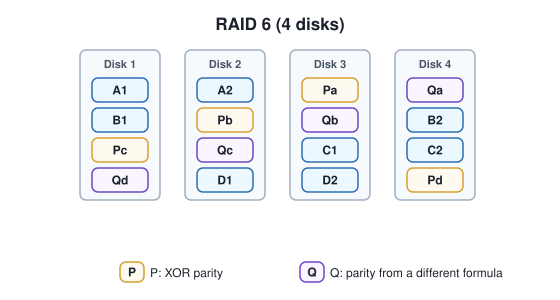

Al crecer el tamaño de los discos, una reconstrucción de RAID 5 tarda desde varias horas hasta más de un día. Si falla otro disco en ese tiempo, se acabó. RAID 6 resiste un fallo más incluso durante la reconstrucción. **Por eso se recomienda RAID 6 para discos grandes.**

### RAID anidado (10 / 01)

RAID 10 crea **primero los espejos** y luego los une con striping. RAID 01 crea **primero las franjas** y luego las refleja. Ambos dan un 50% de capacidad, pero resisten los fallos de forma distinta.

Con 4 discos, cuando falla el disco 1:

- **RAID 10**: solo se pierden datos si también falla su pareja, el disco 2. Solo **1** de los 3 discos restantes es peligroso.
- **RAID 01**: el conjunto A, que contiene el disco 1, se detiene por completo. Si falla el disco 3 o el 4 del conjunto B, se acabó. **2** de los 3 discos restantes son peligrosos.

También en la reconstrucción, RAID 10 solo copia una pareja, mientras que RAID 01 debe reconstruir un conjunto entero. Por eso en la práctica se usa **RAID 10**.

### Penalización de escritura (por qué RAID 5 escribe lento)

La **penalización de escritura** es el número de operaciones reales de E/S en disco que provoca una petición de escritura. Para cambiar un bloque en RAID 5 también hay que recalcular la paridad, así que se producen **cuatro E/S**.

Con 4 discos (150 IOPS cada uno, 600 IOPS en total) y un 70% de lecturas / 30% de escrituras, las cifras son estas. Las lecturas se quedan en 420; las 180 escrituras se dividen entre la penalización.

| Nivel | Cálculo | Resultado |
| --- | --- | --- |
| RAID 10 | 420 + 180 ÷ 2 | **510 IOPS** |
| RAID 5 | 420 + 180 ÷ 4 | **465 IOPS** |
| RAID 6 | 420 + 180 ÷ 6 | **450 IOPS** |

La diferencia crece al aumentar la proporción de escrituras, así que las bases de datos con muchas escrituras usan RAID 10.

### Comparación y usos

| Nivel | Discos mín. | Capacidad útil | Tolerancia a fallos | Penalización de escritura | Uso principal |
| --- | --- | --- | --- | --- | --- |
| RAID 0 | 2 | 100% | Ninguna | 1 | Espacio de trabajo temporal |
| RAID 1 | 2 | 50% | 1 disco | 2 | Disco del sistema operativo |
| RAID 5 | 3 | (N−1)/N | 1 disco | 4 | Servidor de archivos con mucha lectura |
| RAID 6 | 4 | (N−2)/N | 2 discos | 6 | Almacenamiento grande / de copias de seguridad |
| RAID 10 | 4 | 50% | 1 por pareja | 2 | Bases de datos, virtualización |

Ningún nivel ofrece lo mejor de los tres. Se elige según si va primero el **rendimiento, la capacidad o la fiabilidad**.

---

## 4. RAID en Windows

### Montaje del laboratorio

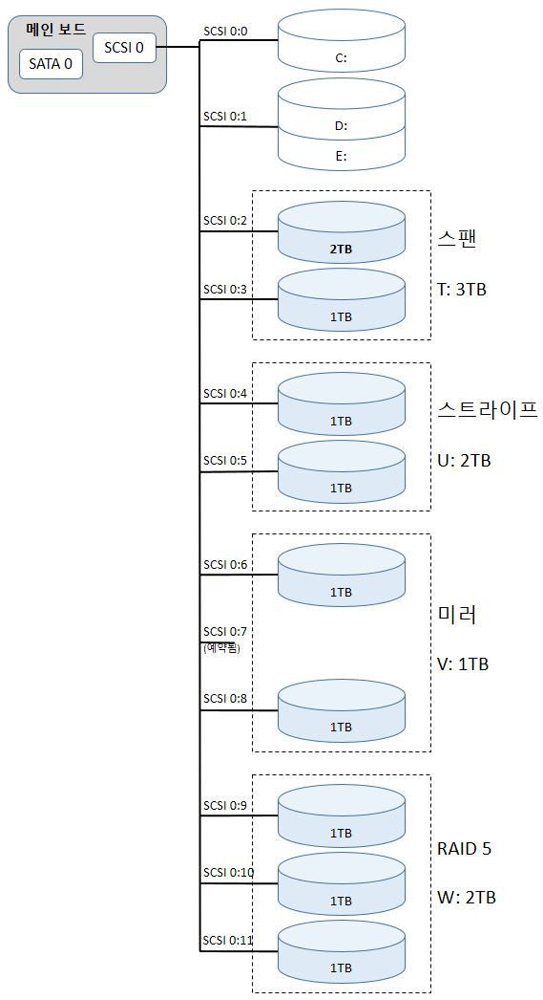

Añade **9** discos duros a la máquina. Podrían ser de verdad de varios TB, pero la **sincronización** —dejar dos discos idénticos, como en un volumen reflejado— puede tardar mucho, así que **se usan discos de GB**. La explicación sigue hablando de TB para parecerse a un entorno real.

| Volumen | Unidad | Discos | Tamaño |
| --- | --- | --- | --- |
| Distribuido | T: | 2TB + 1TB | 3TB |
| Seccionado (RAID 0) | U: | 1TB × 2 | 2TB |
| Reflejado (RAID 1) | V: | 1TB × 2 | 1TB |
| RAID-5 | W: | 1TB × 3 | 2TB |

### Preparación

Tras añadir los 9 discos, ejecuta `diskmgmt.msc`. Pon **en línea** todos los discos añadidos.

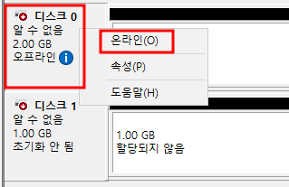

Los discos sin inicializar aparecen marcados automáticamente. A veces inicializar y poner en línea se hacen en otro orden, pero da igual cuál va primero.

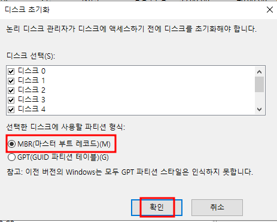

Los volúmenes RAID que vamos a crear solo se pueden hacer en **discos dinámicos**.

El disco 9 ya estaba en uso, así que es mejor no convertirlo. Convierte **solo los discos nuevos para RAID**.

> Los números como Disco 1 o Disco 2 en Administración de discos no están fijados al dispositivo. El sistema operativo simplemente numera los discos instalados **en orden SCSI**. Si se quita un disco intermedio, los números no dejan un hueco: se desplazan uno hacia arriba. Por ejemplo, si se quita el Disco 3 de los Discos 0–10, se renumeran como Discos 0–9.

### Volumen distribuido

No se puede crear un volumen distribuido solo con el Disco 0 de 2TB, así que se añade otro disco de 1TB.

Con 2TB y 1TB añadidos, comprueba que el tamaño total del volumen es de unos 3TB.

Los dos discos quedan unidos en uno y el volumen distribuido está listo. La unidad T se puede usar como un único disco duro de 3TB.

El Explorador de archivos también muestra unos 3TB libres en la unidad T.

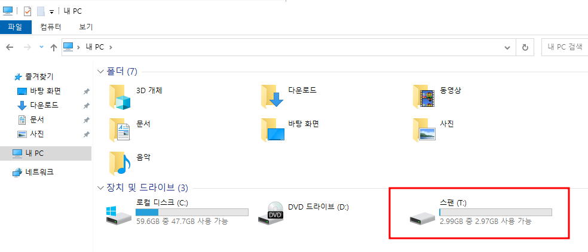

> El tamaño no tiene que coincidir exactamente después de crear el volumen. El espacio que usa el sistema puede causar alguna diferencia.

### Volumen seccionado (RAID 0)

### Volumen reflejado (RAID 1)

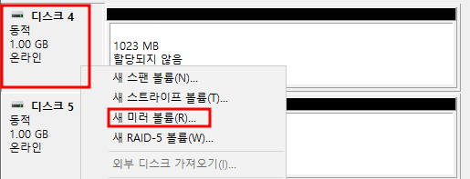

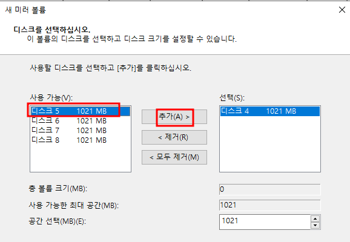

> Un volumen reflejado necesita **sincronización** para dejar idénticos los dos discos, así que puede tardar mucho con discos grandes.

### Volumen RAID-5

Como vimos en los conceptos de RAID, los volúmenes reflejado (V:) y RAID-5 (W:) ofrecen **tolerancia a fallos**.

El Explorador de archivos muestra los cuatro volúmenes.

---

## 5. Fallo de disco y recuperación

### Cuando falla un disco duro

Ahora rompemos un disco de cada volumen y vemos qué tipos de volumen conservan sus datos.

Como en la figura, quita un disco por volumen y comprueba directamente si los datos sobreviven. Primero copia los mismos archivos de prueba en todas las unidades (en el ejemplo, una carpeta de unos 8,6MB).

Apaga la máquina y quita 4 discos. Pulsa **Advanced** y comprueba bien el número SCSI antes de quitarlos. En el ejemplo se quitaron SCSI 0:1, 0:3, 0:5 y 0:8 (0:7 no se usa).

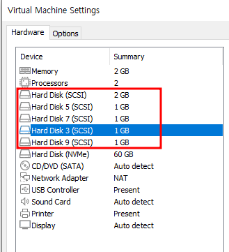

Arranca la máquina de nuevo y abre el Explorador de archivos.

**Solo quedan los volúmenes reflejado (V:) y RAID-5 (W:)**, que ofrecen tolerancia a fallos. Los volúmenes distribuido (T:) y seccionado (U:) ya no aparecen.

Comprueba el estado en `diskmgmt.msc`.

- Los volúmenes distribuido y seccionado están en estado **Error**.
- Los volúmenes reflejado y RAID-5 muestran **Error de redundancia**. Los datos se conservan por ahora, pero la redundancia está rota, así que **ya no toleran un fallo**. Los datos están, pero no están seguros.

### Sustituir por discos nuevos y restaurar

Una vez reparado su estado, los volúmenes reflejado y RAID-5 vuelven a ofrecer tolerancia a fallos. Los volúmenes distribuido y seccionado se pueden recuperar como volumen, pero si el disco se sustituyó por uno nuevo, **no hay forma de recuperar los datos**. (A veces una empresa de recuperación de datos logra rescatarlos de un disco averiado.)

Apaga la máquina, instala discos nuevos en SCSI 0:1, 0:3, 0:5 y 0:8, donde se quitaron, arranca de nuevo y ejecuta `diskmgmt.msc`. Inicializa los discos nuevos y conviértelos en discos dinámicos.

### Recuperar los volúmenes distribuido y seccionado

Los volúmenes distribuido y seccionado no se pueden reparar, así que **se elimina el volumen y se vuelve a crear**. El volumen seccionado se elimina de la misma forma.

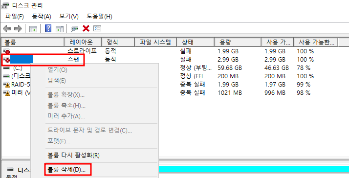

Crea de nuevo el volumen distribuido, como antes.

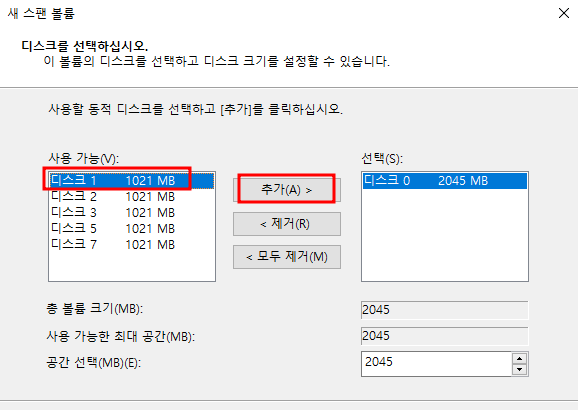

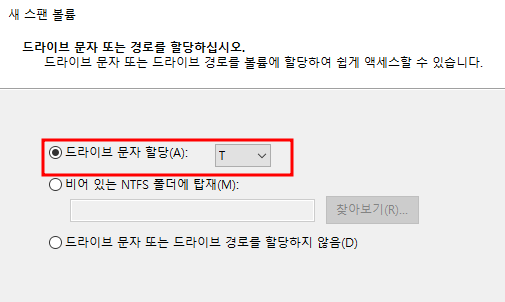

Crea también de nuevo el volumen seccionado.

Ambos están creados de nuevo.

### Recuperar el volumen reflejado

Un volumen reflejado puede **restaurar su redundancia**. Primero, quita el espejo del disco que falta.

Cuando aparezca la advertencia, pulsa **Sí**.

El volumen reflejado (V:) se ha convertido en un volumen simple. El nombre sigue diciendo '미러' (espejo) solo porque esa etiqueta se puso al crear el volumen; no significa nada.

Añade de nuevo el espejo con el disco nuevo.

El volumen reflejado se ha recuperado.

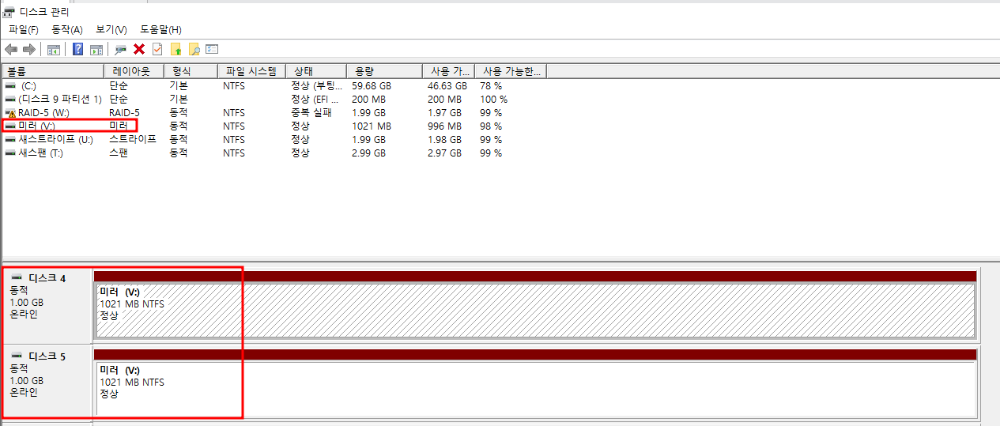

### Recuperar el volumen RAID-5

Un volumen RAID-5 se reconstruye en el disco nuevo con **Reparar volumen**.

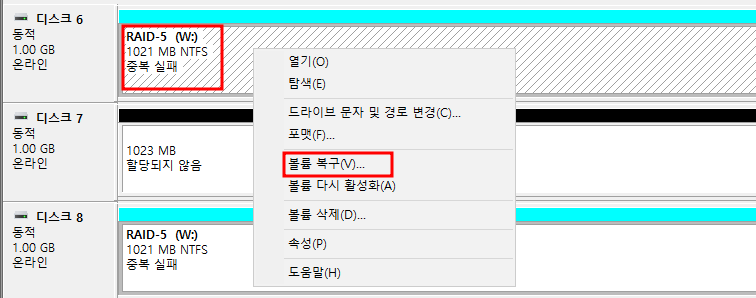

La reparación del RAID-5 ha terminado.

### Cierre

Cierra Administración de discos y ábrela de nuevo. Si al desplazarte hacia abajo ves un **disco que falta** de los errores anteriores, quítalo.

En el Explorador de archivos, los volúmenes distribuido y seccionado se crearon de nuevo y no tienen los datos antiguos, pero **los datos de los volúmenes reflejado y RAID-5 siguen ahí**.

---

## Resumen

- El propósito de RAID no es la capacidad, sino el **rendimiento** y la **disponibilidad**. Las tres técnicas básicas son **striping, mirroring y paridad**.
- En RAID por hardware el trabajo lo hace una controladora dedicada; en RAID por software, el sistema operativo (CPU del servidor).
- El modo **Write-Back** de la caché es rápido, pero necesita una BBU o respaldo flash frente a cortes de luz.
- La paridad se crea y se recupera con **XOR**. RAID 6 usa dos paridades y resiste hasta 2 fallos de disco.
- En la práctica, elige **RAID 10** antes que RAID 01, RAID 10 para cargas con muchas escrituras y **RAID 6** para discos grandes.
- En el laboratorio con discos dinámicos de Windows, al quitar un disco por volumen **solo el reflejado y el RAID-5 conservan los datos**; los volúmenes distribuido y seccionado los pierden.
- Un espejo recupera la tolerancia a fallos con **Quitar reflejo → Agregar reflejo**, y RAID-5 con **Reparar volumen**.
