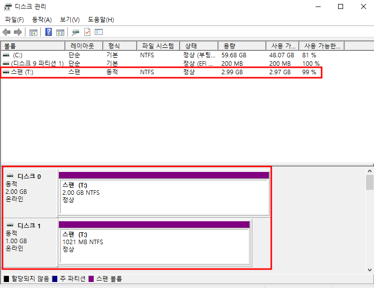
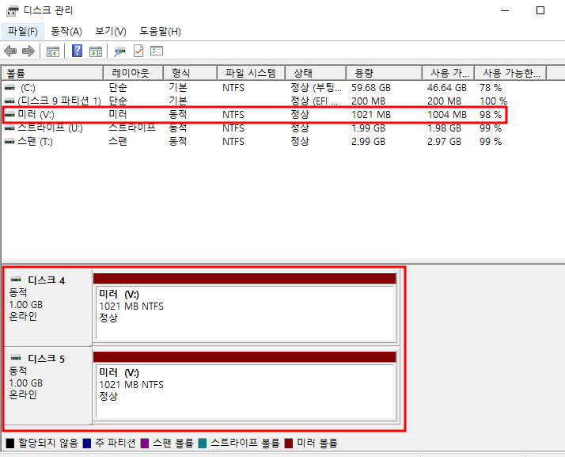
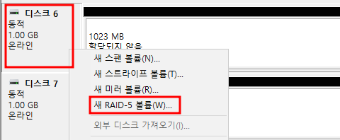
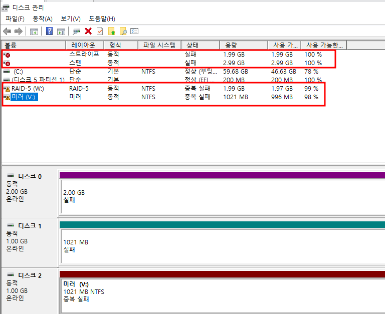
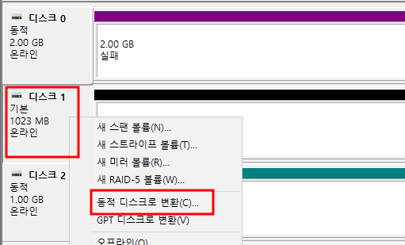
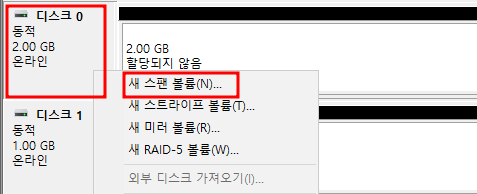
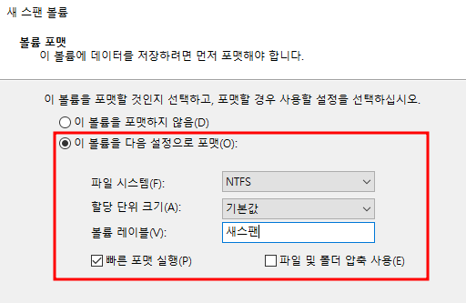
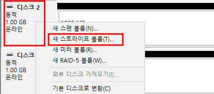
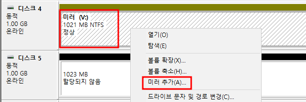

# RAID

[한국어](README.ko.md) | [English](../README.md) | [日本語](README.ja.md) | [简体中文](README.zh-CN.md) | [Español](README.es.md) | **Français**

Notes sur le concept de RAID, les contrôleurs et leur cache, et les niveaux RAID — puis un lab pratique dans la **Gestion des disques** de Windows : création de volumes fractionnés, agrégés par bandes, en miroir et RAID-5, panne de disques puis récupération.

## Sommaire

- [1. Qu'est-ce que le RAID ?](#1-quest-ce-que-le-raid-)
- [2. Contrôleur RAID et mémoire cache](#2-contrôleur-raid-et-mémoire-cache)
- [3. Niveaux RAID](#3-niveaux-raid)
- [4. Mettre en place le RAID sous Windows](#4-mettre-en-place-le-raid-sous-windows)
- [5. Panne de disque et récupération](#5-panne-de-disque-et-récupération)
- [Résumé](#résumé)

---

## 1. Qu'est-ce que le RAID ?

### Concept et objectif

Le **RAID (Redundant Array of Independent Disks)** regroupe plusieurs disques physiques pour les utiliser comme **un seul disque logique**. L'idée était de construire un stockage plus rapide et plus fiable avec plusieurs disques bon marché plutôt qu'avec un gros disque coûteux.

> Plusieurs petits disques et un gros disque peuvent avoir la même capacité. Alors, à quoi bon le RAID ?

L'objectif du RAID n'est pas la capacité, mais la **performance** et la **disponibilité**.

- **Performance** : un disque ne peut fournir qu'un certain nombre d'E/S. Si les données sont réparties sur plusieurs disques, ceux-ci lisent et écrivent en même temps.
- **Disponibilité** : un disque unique est un **point unique de défaillance (SPOF)** : dès qu'il tombe en panne, le service s'arrête. Le RAID maintient le service même quand un disque tombe en panne.

C'est pourquoi on sacrifie parfois volontairement de la capacité pour la tolérance aux pannes. Avec dix disques de 1TB, la capacité utile peut être de 5TB ou de 9TB selon la méthode.

### Trois techniques de base

Tous les niveaux RAID combinent ces trois techniques.

| Technique | Fonctionnement | Ce qu'on gagne |
| --- | --- | --- |
| Striping (agrégation par bandes) | Découpe les données en blocs de taille fixe et les répartit sur les disques | Performance |
| Mirroring (miroir) | Copie les mêmes données sur plusieurs disques | Disponibilité |
| Parité | Enregistre une valeur de récupération avec les données | Disponibilité + efficacité de capacité |

- La **parité** est une information de récupération obtenue par un XOR des données. Si un disque tombe en panne, les données perdues sont recalculées à partir des données restantes et de la parité.
- L'unité de découpage du striping est la **taille de bande (stripe size)**. Une petite bande permet à plusieurs disques de lire ensemble un gros fichier, ce qui favorise le traitement **séquentiel**. Une grande bande permet à chaque disque de traiter seul de petites requêtes, ce qui favorise les **E/S aléatoires**.

### RAID matériel et RAID logiciel

Le RAID se distingue selon **qui effectue le travail RAID**.

| | RAID matériel | RAID logiciel |
| --- | --- | --- |
| Qui s'en charge | Une carte contrôleur RAID dédiée | Le système d'exploitation (CPU du serveur) |
| Avantages | Aucune charge pour le CPU du serveur, stable | Aucun coût supplémentaire |
| Inconvénients | Cher. Chaque constructeur a son propre format, donc un contrôleur en panne doit être remplacé par un modèle de la même gamme | Utilise le CPU du serveur. Ne fonctionne pas au stade du chargeur d'amorçage, donc protéger le disque de démarrage demande une configuration à part |
| Exemples | HPE Smart Array, Dell PERC | Disques dynamiques / Espaces de stockage Windows, Linux mdadm |

---

## 2. Contrôleur RAID et mémoire cache

### Rôle du contrôleur RAID

Le contrôleur RAID se place entre le serveur et les disques et gère le RAID.

- Il regroupe plusieurs disques physiques en disques logiques et les présente au système d'exploitation.
- Il découpe les données, les met en miroir ou calcule la parité, puis les écrit.
- Quand il détecte une panne de disque, il passe le volume en état **dégradé**, et quand un nouveau disque est inséré, il lance une **reconstruction (rebuild)**.
- En fonctionnement normal, il recherche à l'avance les secteurs défectueux et vérifie que données et parité concordent.
- Il utilise la mémoire cache pour compenser la lenteur des E/S disque.

Quand une panne de disque est détectée, deux mécanismes entrent en jeu.

- **Reconstruction** : recréer sur un nouveau disque les données du disque en panne. Un miroir copie son disque partenaire ; les méthodes à parité lisent tous les disques restants et calculent. **Pendant la reconstruction, il n'y a pas de tolérance aux pannes.**
- **Hot spare (disque de secours)** : un disque de réserve installé à l'avance. Quand un disque tombe en panne, le contrôleur l'intègre automatiquement et lance aussitôt la reconstruction.

### Rôle du cache du contrôleur

Les disques sont beaucoup plus lents que la mémoire. Le cache est une zone tampon qui garde brièvement les données entre les deux.

| Mode | Fonctionnement | Remarques |
| --- | --- | --- |
| Write-Through | Confirme seulement après la fin de l'écriture sur disque | Sûr mais lent |
| Write-Back | Confirme dès que les données sont dans le cache | Rapide. Les petites écritures sont regroupées, ce qui réduit aussi le coût d'écriture du RAID 5/6 |
| Read-Ahead | Charge à l'avance les données qui seront probablement lues | Utile pour les lectures séquentielles |

- En Write-Back, il existe un moment où des données non encore écrites ne se trouvent que dans le cache : une coupure de courant les fait disparaître. C'est pourquoi le cache est protégé par une **BBU (batterie)** ou un **module de sauvegarde flash**, et quand ce dispositif tombe en panne, le contrôleur **passe généralement en Write-Through**.
- En RAID 5/6, si le courant est coupé pendant l'écriture des données et de la parité, elles peuvent ne plus concorder : c'est le problème du **write hole**. Le dispositif de protection du cache l'évite aussi.

---

## 3. Niveaux RAID

### RAID 0 / 1 / 5

Les niveaux RAID standard vont de 0 à 6. Les RAID 2, 3 et 4 ne sont presque plus utilisés, car leur correction d'erreurs est passée à l'intérieur des disques ou à cause du goulot d'étranglement du disque de parité. Les bases en pratique sont **0, 1 et 5**.

| Niveau | Méthode | Description |
| --- | --- | --- |
| RAID 0 | Striping | Répartit les données sur les disques. Le plus rapide, mais **la panne d'un seul disque fait perdre toutes les données** |
| RAID 1 | Mirroring | Enregistre les mêmes données sur deux disques. Moitié de la capacité, mais continue de fonctionner si un côté tombe en panne |
| RAID 5 | Parité distribuée | Fait tourner données et parité sur tous les disques. L'équivalent d'un disque sert à la parité, et une panne peut être récupérée. Supprime le goulot d'étranglement du RAID 4, qui gardait toute la parité sur un seul disque |

Sous Windows, ces trois niveaux se créent avec des **disques dynamiques** : le volume agrégé par bandes est le RAID 0, le volume en miroir est le RAID 1 et le volume RAID-5 est le RAID 5. Les volumes simples et fractionnés sont aussi des volumes dynamiques, mais ce ne sont pas du RAID.

### Principe de la parité

La parité se calcule par **XOR** : deux bits égaux donnent 0, deux bits différents donnent 1. Appliquer deux fois un XOR avec la même valeur redonne l'original, donc si une partie est perdue, un XOR du reste la restaure.

Une reconstruction répète ce calcul sur tout le disque. C'est pourquoi elle doit **lire tous les disques restants du début à la fin**.

### RAID 6

Le RAID 6 distribue deux parités (**P et Q**) calculées avec des formules différentes. P est un XOR ; Q utilise une autre méthode, comme les codes de Reed-Solomon. Avec deux équations, on peut retrouver les données même si **deux disques sont perdus en même temps**.

Avec des disques de plus en plus gros, une reconstruction de RAID 5 prend de plusieurs heures à plus d'une journée. Si un autre disque tombe en panne pendant ce temps, c'est fini. Le RAID 6 supporte une panne de plus, même pendant la reconstruction. **C'est pourquoi le RAID 6 est recommandé pour les gros disques.**

### RAID imbriqué (10 / 01)

Le RAID 10 crée **d'abord les miroirs** puis les agrège par bandes. Le RAID 01 crée **d'abord les bandes** puis les met en miroir. Les deux offrent 50 % de capacité, mais ne résistent pas aux pannes de la même façon.

Avec 4 disques, quand le disque 1 tombe en panne :

- **RAID 10** : les données ne sont perdues que si son partenaire, le disque 2, tombe aussi en panne. Seul **1** des 3 disques restants est dangereux.
- **RAID 01** : l'ensemble A, qui contient le disque 1, s'arrête entièrement. Si le disque 3 ou le 4 de l'ensemble B tombe en panne, c'est fini. **2** des 3 disques restants sont dangereux.

Pour la reconstruction aussi, le RAID 10 copie seulement un partenaire, alors que le RAID 01 doit reconstruire un ensemble entier. C'est pourquoi on utilise le **RAID 10** en pratique.

### Pénalité d'écriture (pourquoi le RAID 5 écrit lentement)

La **pénalité d'écriture** est le nombre d'E/S disque réellement provoquées par une requête d'écriture. Pour modifier un bloc en RAID 5, il faut aussi recalculer la parité, ce qui entraîne **quatre E/S**.

Avec 4 disques (150 IOPS chacun, 600 IOPS au total) et 70 % de lectures / 30 % d'écritures, on obtient les chiffres suivants. Les lectures restent à 420 ; les 180 écritures sont divisées par la pénalité.

| Niveau | Calcul | Résultat |
| --- | --- | --- |
| RAID 10 | 420 + 180 ÷ 2 | **510 IOPS** |
| RAID 5 | 420 + 180 ÷ 4 | **465 IOPS** |
| RAID 6 | 420 + 180 ÷ 6 | **450 IOPS** |

L'écart grandit quand la part d'écritures augmente, donc les bases de données très sollicitées en écriture utilisent le RAID 10.

### Comparaison et usages

| Niveau | Disques min. | Capacité utile | Tolérance aux pannes | Pénalité d'écriture | Usage principal |
| --- | --- | --- | --- | --- | --- |
| RAID 0 | 2 | 100% | Aucune | 1 | Espace de travail temporaire |
| RAID 1 | 2 | 50% | 1 disque | 2 | Disque système |
| RAID 5 | 3 | (N−1)/N | 1 disque | 4 | Serveur de fichiers surtout en lecture |
| RAID 6 | 4 | (N−2)/N | 2 disques | 6 | Stockage de grande capacité / de sauvegarde |
| RAID 10 | 4 | 50% | 1 par paire | 2 | Bases de données, virtualisation |

Aucun niveau n'offre le meilleur des trois. On choisit selon la priorité donnée à la **performance, la capacité ou la fiabilité**.

---

## 4. Mettre en place le RAID sous Windows

### Configuration du lab

Ajoutez **9** disques durs à la machine. Ils pourraient vraiment faire plusieurs TB, mais la **synchronisation** — rendre deux disques identiques, comme pour un volume en miroir — peut prendre longtemps, donc **on utilise des disques de quelques GB**. L'explication parle quand même de TB pour rester proche d'un environnement réel.

| Volume | Lecteur | Disques | Taille |
| --- | --- | --- | --- |
| Fractionné | T: | 2TB + 1TB | 3TB |
| Agrégé par bandes (RAID 0) | U: | 1TB × 2 | 2TB |
| En miroir (RAID 1) | V: | 1TB × 2 | 1TB |
| RAID-5 | W: | 1TB × 3 | 2TB |

### Préparation

Après avoir ajouté les 9 disques, lancez `diskmgmt.msc`. Mettez **en ligne** tous les disques ajoutés.

Les disques non initialisés sont cochés automatiquement. L'initialisation et la mise en ligne se font parfois dans l'autre ordre, mais peu importe laquelle vient en premier.

Les volumes RAID que nous allons créer ne peuvent être faits que sur des **disques dynamiques**.

Le disque 9 était déjà utilisé, il vaut donc mieux ne pas le convertir. Convertissez **seulement les nouveaux disques destinés au RAID**.

> Les numéros comme Disque 1 ou Disque 2 dans la Gestion des disques ne sont pas fixés au périphérique. Le système d'exploitation numérote simplement les disques installés **dans l'ordre SCSI**. Si un disque du milieu est retiré, les numéros ne laissent pas de trou : ils remontent d'un cran. Par exemple, si le Disque 3 est retiré des Disques 0–10, ils sont renumérotés Disques 0–9.

### Volume fractionné

On ne peut pas créer un volume fractionné avec le seul Disque 0 de 2TB, donc on ajoute un autre disque de 1TB.

Avec 2TB et 1TB ajoutés, vérifiez que la taille totale du volume est d'environ 3TB.

Les deux disques sont réunis en un seul et le volume fractionné est prêt. Le lecteur T peut maintenant être utilisé comme un unique disque dur de 3TB.

L'Explorateur de fichiers affiche aussi environ 3TB d'espace libre sur le lecteur T.

> La taille n'a pas besoin de correspondre exactement après la création du volume. L'espace utilisé par le système peut créer un petit écart.

### Volume agrégé par bandes (RAID 0)

### Volume en miroir (RAID 1)

> Un volume en miroir a besoin d'une **synchronisation** pour rendre les deux disques identiques ; cela peut prendre longtemps avec de gros disques.

### Volume RAID-5

Comme vu dans les concepts RAID, les volumes en miroir (V:) et RAID-5 (W:) offrent une **tolérance aux pannes**.

L'Explorateur de fichiers affiche les quatre volumes.

---

## 5. Panne de disque et récupération

### Quand un disque dur tombe en panne

Cette fois, on casse un disque de chaque volume et on regarde quels types de volume conservent leurs données.

Comme sur la figure, retirez un disque par volume et vérifiez directement si les données survivent. Copiez d'abord les mêmes fichiers de test sur tous les lecteurs (un dossier d'environ 8,6MB dans l'exemple).

Éteignez la machine et retirez 4 disques. Cliquez sur **Advanced** et vérifiez bien le numéro SCSI avant de les retirer. Dans l'exemple, SCSI 0:1, 0:3, 0:5 et 0:8 ont été retirés (0:7 n'est pas utilisé).

Redémarrez la machine et ouvrez l'Explorateur de fichiers.

**Seuls les volumes en miroir (V:) et RAID-5 (W:)**, qui offrent une tolérance aux pannes, sont encore là. Les volumes fractionné (T:) et agrégé par bandes (U:) ont disparu.

Vérifiez l'état dans `diskmgmt.msc`.

- Les volumes fractionné et agrégé par bandes sont en état **Échec**.
- Les volumes en miroir et RAID-5 affichent **Redondance en échec**. Les données sont conservées pour l'instant, mais la redondance est rompue, donc ils **ne tolèrent plus de panne**. Les données sont là, mais elles ne sont pas en sécurité.

### Remplacer par de nouveaux disques et restaurer

Une fois leur état réparé, les volumes en miroir et RAID-5 offrent de nouveau une tolérance aux pannes. Les volumes fractionné et agrégé par bandes peuvent être recréés, mais si le disque a été remplacé par un neuf, **il n'y a aucun moyen de récupérer les données**. (Il arrive qu'une entreprise de récupération de données sauve les données d'un disque en panne.)

Éteignez la machine, installez de nouveaux disques aux emplacements SCSI 0:1, 0:3, 0:5 et 0:8 où les disques ont été retirés, redémarrez et lancez `diskmgmt.msc`. Initialisez les nouveaux disques et convertissez-les en disques dynamiques.

### Récupérer les volumes fractionné et agrégé par bandes

Les volumes fractionné et agrégé par bandes ne peuvent pas être réparés, donc **on supprime le volume et on le recrée**. Supprimez le volume agrégé par bandes de la même façon.

Recréez le volume fractionné, comme précédemment.

Recréez aussi le volume agrégé par bandes.

Les deux sont recréés.

### Récupérer le volume en miroir

Un volume en miroir peut **restaurer sa redondance**. Supprimez d'abord le miroir du disque manquant.

Quand l'avertissement apparaît, cliquez sur **Oui**.

Le volume en miroir (V:) est devenu un volume simple. Son nom indique encore '미러' (miroir) uniquement parce que cette étiquette a été donnée à la création du volume ; cela ne signifie rien.

Ajoutez de nouveau le miroir avec le nouveau disque.

Le volume en miroir est récupéré.

### Récupérer le volume RAID-5

Un volume RAID-5 est reconstruit sur le nouveau disque avec **Réparer le volume**.

La réparation du RAID-5 est terminée.

### Finalisation

Fermez la Gestion des disques et rouvrez-la. Si, en faisant défiler vers le bas, vous voyez un **disque manquant** laissé par les erreurs précédentes, supprimez-le.

Dans l'Explorateur de fichiers, les volumes fractionné et agrégé par bandes ont été recréés et n'ont plus les anciennes données, mais **les données des volumes en miroir et RAID-5 sont toujours là**.

---

## Résumé

- L'objectif du RAID n'est pas la capacité, mais la **performance** et la **disponibilité**. Les trois techniques de base sont le **striping, le mirroring et la parité**.
- En RAID matériel, un contrôleur dédié effectue le travail RAID ; en RAID logiciel, c'est le système d'exploitation (CPU du serveur).
- Le mode **Write-Back** du cache est rapide, mais nécessite une BBU ou une sauvegarde flash contre les coupures de courant.
- La parité est créée et récupérée par **XOR**. Le RAID 6 utilise deux parités et supporte jusqu'à 2 pannes de disque.
- En pratique, choisissez le **RAID 10** plutôt que le RAID 01, le RAID 10 pour les charges très sollicitées en écriture, et le **RAID 6** pour les gros disques.
- Dans le lab avec les disques dynamiques Windows, retirer un disque par volume ne laisse **des données que sur le miroir et le RAID-5** ; les volumes fractionné et agrégé par bandes les perdent.
- Un miroir retrouve sa tolérance aux pannes avec **Supprimer le miroir → Ajouter un miroir**, et le RAID-5 avec **Réparer le volume**.
