# RAID

[한국어](README.ko.md) | [English](../README.md) | **日本語** | [简体中文](README.zh-CN.md) | [Español](README.es.md) | [Français](README.fr.md)

RAID の概念、コントローラーとキャッシュ、RAID レベルをまとめ、Windows の**ディスクの管理**でスパン・ストライプ・ミラー・RAID-5 ボリュームを実際に作成し、ディスク障害と復旧まで実習します。

## 目次

- [1. RAID とは?](#1-raid-とは)
- [2. RAID コントローラーとキャッシュメモリ](#2-raid-コントローラーとキャッシュメモリ)
- [3. RAID レベル](#3-raid-レベル)
- [4. Windows での RAID 構成](#4-windows-での-raid-構成)
- [5. ディスク障害と復旧](#5-ディスク障害と復旧)
- [まとめ](#まとめ)

---

## 1. RAID とは?

### RAID の概念と目的

**RAID (Redundant Array of Independent Disks)** は、複数の物理ディスクをまとめて**1 つの論理ディスク**のように使う技術です。高価な大容量ディスク 1 台の代わりに、安価なディスクを複数使って、より速く安定したストレージを作ろうという発想から始まりました。

> 小容量ディスク複数台と大容量ディスク 1 台は容量が同じなのに、わざわざ RAID にする必要があるのか?

RAID の目的は容量ではなく、**性能**と**可用性**です。

- **性能**:ディスク 1 台が出せる入出力には限界があります。複数のディスクに分けて保存すると、ディスクが同時に読み書きします。
- **可用性**:ディスク 1 台は、故障した瞬間にサービスが止まる**単一障害点(SPOF)**です。RAID はディスクが故障してもサービスを続けます。

そのため、耐障害性のために容量をあえて犠牲にすることもあります。1TB ディスク 10 台で構成しても、方式によって実際の容量は 5TB にも 9TB にもなります。

### RAID を構成する 3 つの基本技法

すべての RAID レベルは、次の 3 つの組み合わせです。

| 技法 | 方式 | 得られるもの |
| --- | --- | --- |
| ストライピング | データを一定サイズに分割して複数ディスクに分散保存 | 性能 |
| ミラーリング | 同じデータを複数ディスクに複製 | 可用性 |
| パリティ | 復旧用の計算値を一緒に保存 | 可用性 + 容量効率 |

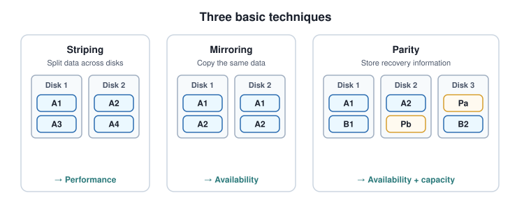

- **パリティ**は、データを XOR 演算して作る復旧用の情報です。ディスクが 1 台故障すると、残りのデータとパリティから失われたデータを再計算します。
- ストライピングで分割する単位を**ストライプサイズ**といいます。小さくすると大きなファイルを複数のディスクで一緒に読めるので**シーケンシャル処理**に有利で、大きくすると小さな要求をディスクごとに別々に処理できるので**ランダム I/O** に有利です。

### ハードウェア RAID とソフトウェア RAID

RAID は、**誰が RAID の処理を行うか**によって分かれます。

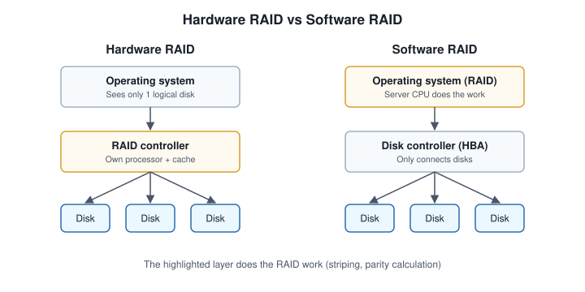

| 区分 | ハードウェア RAID | ソフトウェア RAID |
| --- | --- | --- |
| 処理する主体 | 専用の RAID コントローラーカード | OS(サーバーの CPU) |
| 長所 | サーバー CPU の負担がなく安定 | 追加費用がない |
| 短所 | 高価。メーカーごとに記録形式が異なり、コントローラー故障時は同系列への交換が必要 | サーバー CPU を使う。ブートローダー段階では動作しないため、ブートディスクの保護には別の構成が必要 |
| 例 | HPE Smart Array、Dell PERC | Windows ダイナミックディスク・記憶域スペース、Linux mdadm |

---

## 2. RAID コントローラーとキャッシュメモリ

### RAID コントローラーの役割

RAID コントローラーは、サーバーとディスクの間で RAID を管理する装置です。

- 複数の物理ディスクを論理ディスクにまとめて OS に見せます。
- データを分割し、ミラーリングまたはパリティを計算して書き込みます。
- ディスク故障を検知するとボリュームを**縮退(Degraded)**状態にし、新しいディスクが入ると**リビルド**を行います。
- 普段から不良セクターを事前に探し、データとパリティが一致しているか検査します。
- キャッシュメモリでディスクの遅い入出力を補います。

ディスク故障を検知すると、次の 2 つが動作します。

- **リビルド**:故障したディスクのデータを新しいディスクに作り直す処理です。ミラーは相方のディスクをコピーし、パリティ方式は残りのディスクをすべて読んで計算します。**リビルド中は耐障害性がありません。**
- **ホットスペア**:あらかじめ挿しておく予備ディスクです。ディスクが故障すると、コントローラーが自動で投入してすぐにリビルドを始めます。

### コントローラーキャッシュメモリの役割

ディスクはメモリよりはるかに遅いです。キャッシュは、その間でデータを一時的に保管する緩衝領域です。

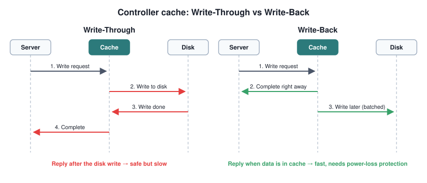

| 方式 | 動作 | 特徴 |
| --- | --- | --- |
| Write-Through | ディスクへの書き込みが終わってから完了を応答 | 安全だが遅い |
| Write-Back | キャッシュに入った時点で完了を応答 | 速い。小さな書き込みをまとめて記録するので、RAID 5・6 の書き込み負担も減る |
| Read-Ahead | 次に読むデータを先に読み込んでおく | シーケンシャル読み込みに効果 |

- Write-Back では、まだ書き込まれていないデータがキャッシュにしかない瞬間があるため、停電するとそのデータが失われます。そのため **BBU(バッテリー)**や**フラッシュバックアップモジュール**でキャッシュを保護し、この装置が故障するとコントローラーは通常 **Write-Through に切り替え**ます。
- RAID 5・6 でデータとパリティを書き込んでいる途中に電源が切れると、両者が一致しなくなる**ライトホール(Write Hole)**問題が起こり得ますが、キャッシュ保護装置はこれも防ぎます。

---

## 3. RAID レベル

### RAID 0 / 1 / 5

標準の RAID レベルは 0〜6 です。このうち RAID 2・3・4 は、エラー訂正がディスク内部に入ったことやパリティディスクのボトルネックのため、今はほとんど使われません。実務で基本になるのは **0、1、5** です。

| レベル | 方式 | 説明 |
| --- | --- | --- |
| RAID 0 | ストライピング | データを複数ディスクに分散保存。最も速いが、**ディスクが 1 台故障しただけで全データを失う** |
| RAID 1 | ミラーリング | 同じデータを 2 台のディスクに保存。容量は半分だが、片方が故障しても運用を続けられる |
| RAID 5 | 分散パリティ | データとパリティをすべてのディスクに順番に保存。ディスク 1 台分をパリティに使い、1 台故障しても復元できる。パリティを 1 台に集めていた RAID 4 のボトルネックをなくした方式 |

Windows では**ダイナミックディスク**でこの 3 つのレベルを作れます。ストライプボリュームが RAID 0、ミラーボリュームが RAID 1、RAID-5 ボリュームが RAID 5 です。シンプルボリュームとスパンボリュームもダイナミックボリュームですが、RAID ではありません。

### パリティの原理

パリティは **XOR 演算**で作ります。2 つのビットが同じなら 0、違えば 1 です。同じ値を 2 回 XOR すると元の値に戻るため、1 つが失われても残りを XOR すれば復元できます。

リビルドは、この計算をディスク全体に繰り返す処理です。そのためリビルド中は、**残りのディスクをすべて最初から最後まで読む**必要があります。

### RAID 6

異なる計算式で作った 2 つのパリティ(**P、Q**)を分散保存します。P は XOR、Q はリード・ソロモン符号のような別の方式です。式が 2 つあるので、**ディスクが 2 台同時に失われても**解くことができます。

ディスク容量が大きくなるにつれ、RAID 5 のリビルドは数時間から 1 日以上かかります。その間にもう 1 台故障したら終わりです。RAID 6 はリビルド中でも、さらに 1 台の故障に耐えます。**大容量ディスクに RAID 6 が推奨される理由**です。

### ネスト RAID (10 / 01)

RAID 10 は**ミラーを先に**作り、ストライプでまとめます。RAID 01 は**ストライプを先に**作り、ミラーでまとめます。容量はどちらも 50% ですが、障害への強さが異なります。

ディスク 4 台のうち 1 番が故障したとき:

- **RAID 10**:相方の 2 番まで故障して初めてデータを失います。危険なディスクは残り 3 台のうち **1 台**です。
- **RAID 01**:1 番が属するセット A が丸ごと停止します。セット B の 3・4 番のどちらか 1 台が故障しただけで終わりです。危険なディスクは 3 台のうち **2 台**です。

リビルドも、RAID 10 は相方 1 台をコピーするだけですが、RAID 01 はセット全体を作り直す必要があります。そのため実務では **RAID 10** を使います。

### 書き込みペナルティ(RAID 5 の書き込みはなぜ遅いのか)

**書き込みペナルティ**は、書き込み要求 1 回で実際に発生するディスク入出力の回数です。RAID 5 でブロックを 1 つ変更するには、パリティも再計算する必要があるため、**4 回の入出力**が発生します。

ディスク 4 台(1 台あたり 150 IOPS、合計 600 IOPS)、読み込み 70%・書き込み 30% の環境で計算すると次のようになります。読み込みはそのまま 420、書き込み 180 はペナルティで割ります。

| レベル | 計算 | 結果 |
| --- | --- | --- |
| RAID 10 | 420 + 180 ÷ 2 | **510 IOPS** |
| RAID 5 | 420 + 180 ÷ 4 | **465 IOPS** |
| RAID 6 | 420 + 180 ÷ 6 | **450 IOPS** |

書き込みの比率が高くなるほど差が大きくなるため、書き込みの多いデータベースには RAID 10 を使います。

### レベル別の比較と用途

| レベル | 最小ディスク数 | 使用可能容量 | 耐障害性 | 書き込みペナルティ | 主な用途 |
| --- | --- | --- | --- | --- | --- |
| RAID 0 | 2 | 100% | なし | 1 | 一時作業領域 |
| RAID 1 | 2 | 50% | 1 台 | 2 | OS ディスク |
| RAID 5 | 3 | (N−1)/N | 1 台 | 4 | 読み込み中心のファイルサーバー |
| RAID 6 | 4 | (N−2)/N | 2 台 | 6 | 大容量・バックアップストレージ |
| RAID 10 | 4 | 50% | ペアごとに 1 台 | 2 | データベース、仮想化 |

3 つすべてを最高にできるレベルはありません。**性能、容量、安定性**のどれを優先するかで選びます。

---

## 4. Windows での RAID 構成

### 実習の構成

マシンにハードディスクを **9 台**追加します。実際に TB 単位で作ってもよいですが、ミラーボリュームのように 2 台のディスクを同じにそろえる**同期**に時間がかかることがあるため、**GB 単位で追加**します。説明では実務環境に近づけるため TB と表記します。

| ボリューム | ドライブ | ディスク | サイズ |
| --- | --- | --- | --- |
| スパン | T: | 2TB + 1TB | 3TB |
| ストライプ (RAID 0) | U: | 1TB × 2 | 2TB |
| ミラー (RAID 1) | V: | 1TB × 2 | 1TB |
| RAID-5 | W: | 1TB × 3 | 2TB |

### 事前準備

ディスクを 9 台追加したら `diskmgmt.msc` を実行します。追加したディスクをすべて**オンライン**にします。

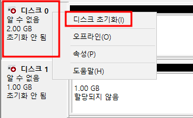

初期化されていないディスクは自動でチェックされています。ディスクの初期化とオンラインの順序が入れ替わることもありますが、どちらを先にしても構いません。

これから構成する RAID(ボリューム)は、必ず**ダイナミックディスク**でないと構成できません。

ディスク 9 は以前から使っているディスクなので、ダイナミックディスクに変換しないほうがよいです。**新しく追加した RAID 用ディスクだけ**変換します。

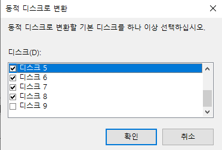

> ディスクの管理のディスク 1、ディスク 2 といった番号は、ハードディスク装置に固定された番号ではなく、OS が現在接続されているディスクに **SCSI の順番で**付けた番号にすぎません。途中のハードディスクが取り外されると、番号が空くのではなく 1 つずつ前に詰められます。たとえばディスク 0〜10 のうちディスク 3 が取り外されると、ディスク 0〜9 として番号が付け直されます。

### スパンボリューム

2TB のディスク 0 だけではスパンボリュームを作れないので、1TB のディスクをもう 1 台追加します。

2TB と 1TB を追加して、ボリューム全体のサイズが約 3TB に設定されたことを確認します。

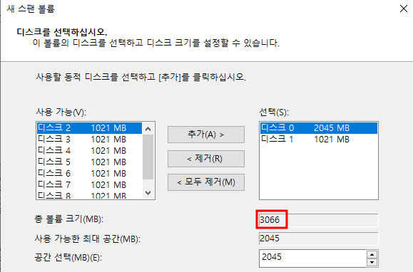

2 台のディスクが 1 台のようにまとめられ、スパンボリュームが完成しました。これで T ドライブを 3TB のハードディスク 1 台のように使えます。

エクスプローラーでも、T ドライブに約 3TB の空き容量があることを確認できます。

> ボリュームを作成した後、サイズが正確に一致しなくても問題ありません。システムが使う領域のため、多少の差が出ることがあります。

### ストライプボリューム (RAID 0)

### ミラーボリューム (RAID 1)

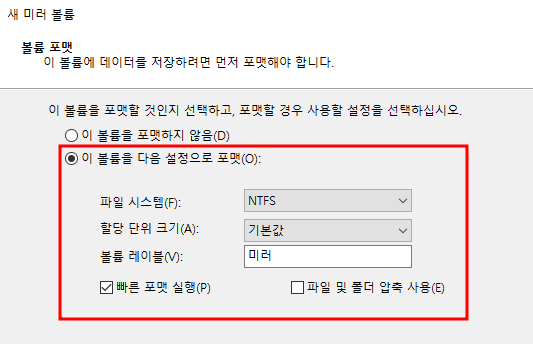

> ミラーボリュームは 2 台のディスクを同じにそろえる**同期**作業が必要なため、ディスク容量が大きいと時間がかかることがあります。

### RAID-5 ボリューム

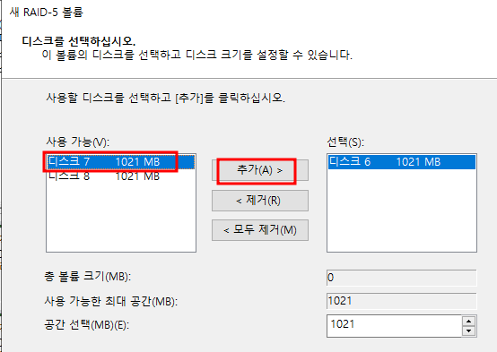

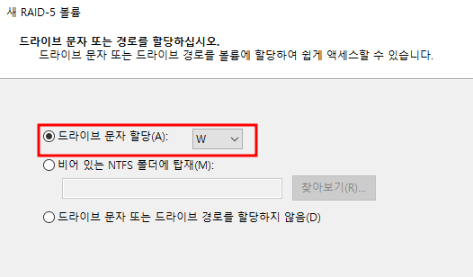

RAID の概念で学んだとおり、ミラー(V:)と RAID-5(W:)は**耐障害性**を提供します。

エクスプローラーでも 4 つのボリュームを確認できます。

---

## 5. ディスク障害と復旧

### ハードディスクに問題が起きたら

今度は各ボリュームのディスクを 1 台ずつ故障させ、どのボリューム方式のデータが残るかを確認します。

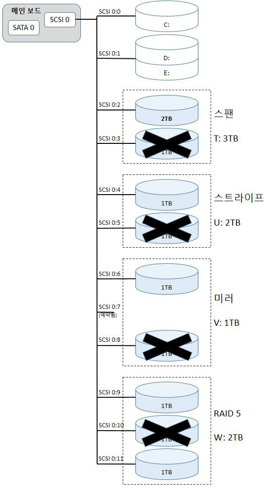

上の図のように、ボリュームごとにディスクを 1 台ずつ故障させ、データが保たれるかを実際に確認します。まず同じテストファイルをすべてのドライブにコピーします(例では約 8.6MB のフォルダー)。

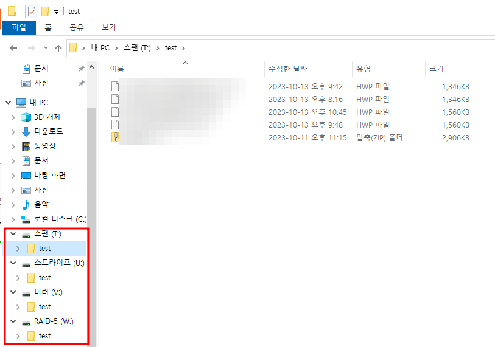

マシンをシャットダウンしてからディスクを 4 台取り外します。**Advanced** を押して SCSI 番号をよく確認してから取り外します。例では SCSI 0:1、0:3、0:5、0:8 を取り外しました(0:7 は使わない番号)。

マシンを再起動し、エクスプローラーを開きます。

耐障害性を提供する**ミラー(V:)と RAID-5(W:)ボリュームだけ**が残っています。スパンボリューム(T:)とストライプボリューム(U:)は見えません。

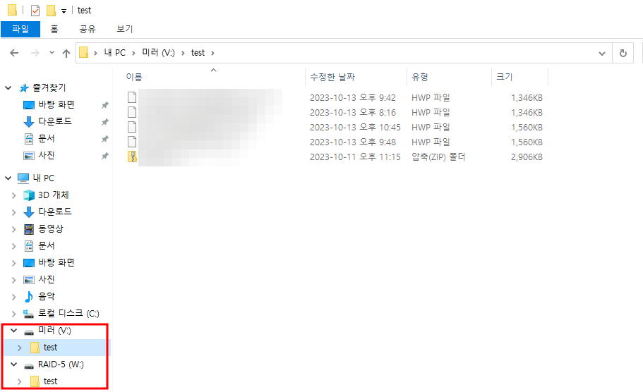

`diskmgmt.msc` で状態を確認します。

- スパンとストライプのボリュームは**エラー(失敗)**状態です。
- ミラーと RAID-5 のボリュームは**冗長性の失敗**状態です。今はデータが保たれていますが冗長性が壊れているため、**耐障害性を提供できない**という意味です。データはあっても安全ではない状態です。

### 新しいディスクに交換して元の状態に復旧

ミラーと RAID-5 は状態を復旧すれば、再び耐障害性を提供します。スパンとストライプは状態を戻すことはできますが、ディスクを新品に交換した場合、**データを復旧する方法はありません。**(故障したディスクをデータ復旧業者に預けて救出することもまれにあります。)

マシンをシャットダウンし、先ほど取り外した SCSI 0:1、0:3、0:5、0:8 の位置に新しいハードディスクを取り付け、再起動して `diskmgmt.msc` を実行します。新しいディスクを初期化し、ダイナミックディスクに変換します。

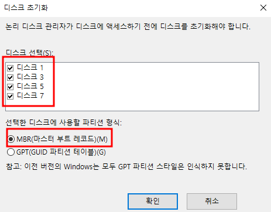

### スパンボリュームとストライプボリュームの復旧

スパンボリュームとストライプボリュームは修復できないため、**ボリュームを削除して作り直します。**ストライプボリュームも同じ方法で削除します。

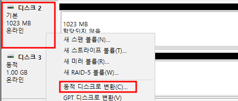

先ほどと同じようにスパンボリュームを作り直します。

ストライプボリュームも作り直します。

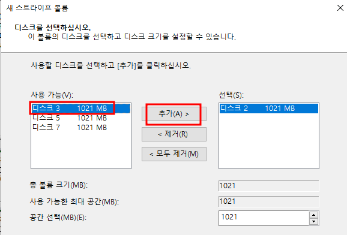

作り直しが完了しました。

### ミラーボリュームの復旧

ミラーボリュームは**冗長性を復元**できます。まず、なくなったディスク側のミラーを削除します。

警告が表示されたら**はい**をクリックします。

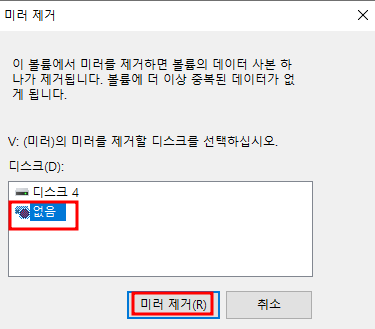

ミラーボリューム(V:)がシンプルボリュームに変わりました。ボリューム名に「미러(ミラー)」と残っているのは、ミラーボリュームを作成したときに付けた名前にすぎず、特に意味はありません。

新しいディスクでミラーを再追加します。

ミラーボリュームが復旧したことを確認できます。

### RAID-5 ボリュームの復旧

RAID-5 ボリュームは**ボリュームの修復**で新しいディスクを入れて作り直します。

RAID-5 の復旧が完了しました。

### 仕上げ

ディスクの管理を終了してから再度実行します。下にスクロールして、以前のエラーで残っている**存在しないディスク**があれば削除します。

エクスプローラーで見ると、スパンボリュームとストライプボリュームは作り直したので以前のデータはありませんが、**ミラーボリュームと RAID-5 ボリュームのデータはそのまま**残っています。

---

## まとめ

- RAID の目的は容量ではなく**性能**と**可用性**です。基本技法は**ストライピング、ミラーリング、パリティ**の 3 つです。
- ハードウェア RAID は専用コントローラーが、ソフトウェア RAID は OS(サーバー CPU)が RAID の処理を行います。
- コントローラーキャッシュの **Write-Back** は速いですが、停電に備えた BBU・フラッシュバックアップが必要です。
- パリティは **XOR** で作成・復旧します。RAID 6 は 2 つのパリティでディスク 2 台の障害まで耐えます。
- 実務では RAID 01 より **RAID 10**、書き込みが多ければ RAID 10、大容量ディスクには **RAID 6** を選びます。
- Windows ダイナミックディスクの実習でディスクを 1 台ずつ外すと、**ミラーと RAID-5 だけデータが残り**、スパンとストライプはデータを失います。
- ミラーは**ミラーの削除 → ミラーの追加**、RAID-5 は**ボリュームの修復**で耐障害性を取り戻します。
