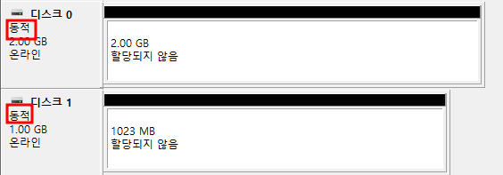
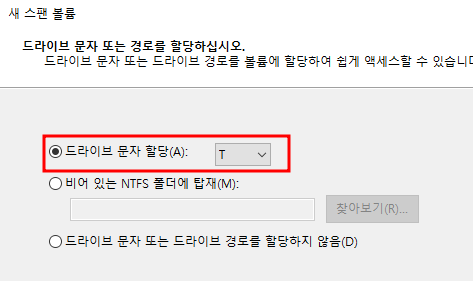
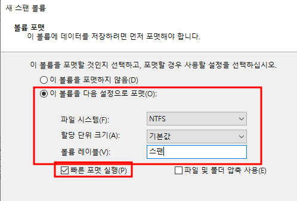
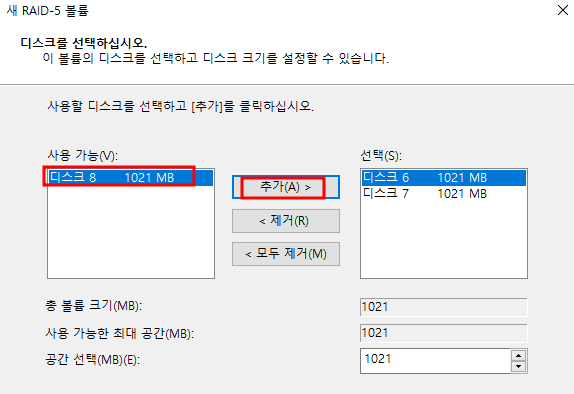
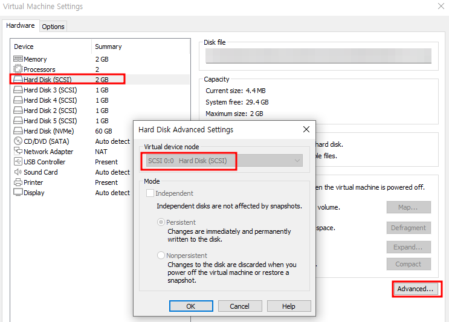
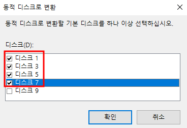
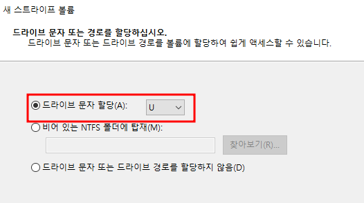
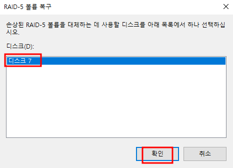
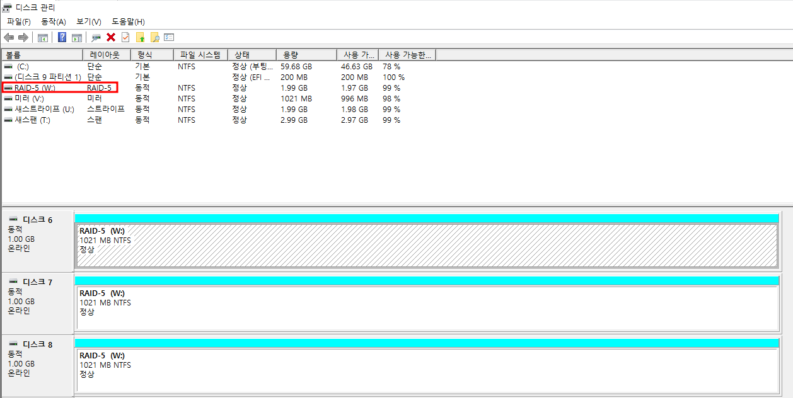
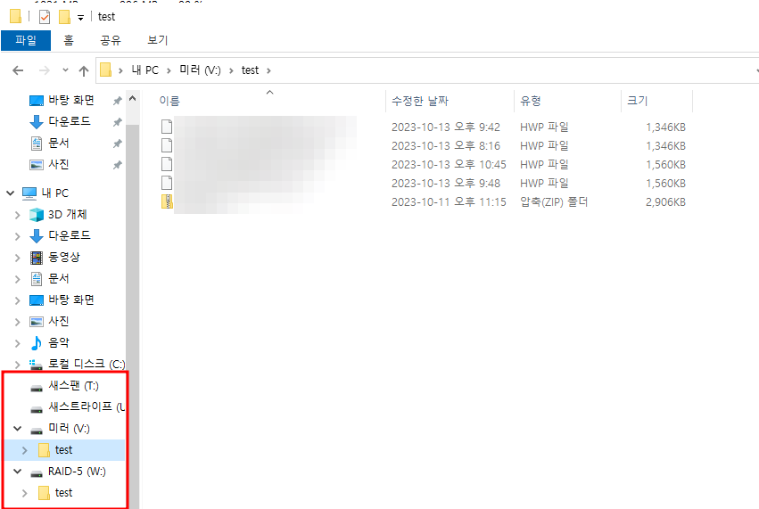

# RAID

**한국어** | [English](../README.md) | [日本語](README.ja.md) | [简体中文](README.zh-CN.md) | [Español](README.es.md) | [Français](README.fr.md)

RAID의 개념, 레이드 컨트롤러와 캐시, RAID 레벨을 정리하고, Windows **디스크 관리**에서 스팬·스트라이프·미러·RAID-5 볼륨을 직접 만들어 디스크 장애와 복구까지 실습합니다.

## 목차

- [1. RAID란 무엇인가?](#1-raid란-무엇인가)
- [2. RAID 컨트롤러와 캐시 메모리](#2-raid-컨트롤러와-캐시-메모리)
- [3. RAID 레벨](#3-raid-레벨)
- [4. Windows에서 RAID 구현](#4-windows에서-raid-구현)
- [5. 디스크 장애와 복구](#5-디스크-장애와-복구)
- [정리](#정리)

---

## 1. RAID란 무엇인가?

### RAID의 개념과 목적

**RAID (Redundant Array of Independent Disks)** 는 여러 물리 디스크를 묶어 **하나의 논리 디스크**처럼 사용하는 기술입니다. 비싼 대용량 디스크 한 개 대신, 저렴한 디스크 여러 개로 더 빠르고 안정적인 저장장치를 만들자는 발상에서 시작했습니다.

> 저용량 디스크 여러 개와 대용량 디스크 한 개는 용량이 같은데, 굳이 RAID를 할 필요가 있을까?

RAID의 목적은 용량이 아니라 **성능**과 **가용성**입니다.

- **성능**: 디스크 한 개가 낼 수 있는 입출력에는 한계가 있습니다. 여러 디스크에 나눠 저장하면 디스크들이 동시에 읽고 씁니다.
- **가용성**: 디스크 한 개는 고장 나는 순간 서비스가 멈추는 **단일 장애점(SPOF)** 입니다. RAID는 디스크가 고장 나도 서비스를 이어갑니다.

그래서 결함 허용을 위해 용량을 일부러 포기하기도 합니다. 1TB 디스크 10개로 구성해도 방식에 따라 실제 용량은 5TB가 될 수도, 9TB가 될 수도 있습니다.

### RAID를 이루는 세 가지 기본 기법

모든 RAID 레벨은 아래 세 가지의 조합입니다.

| 기법 | 방식 | 얻는 것 |
| --- | --- | --- |
| 스트라이핑 | 데이터를 일정 크기로 잘라 여러 디스크에 나눠 저장 | 성능 |
| 미러링 | 같은 데이터를 여러 디스크에 복제 | 가용성 |
| 패리티 | 복구용 계산 값을 함께 저장 | 가용성 + 용량 효율 |

- **패리티**는 데이터를 XOR 연산해서 만든 복구용 정보입니다. 디스크 하나가 고장 나면 나머지 데이터와 패리티로 사라진 데이터를 다시 계산해냅니다.
- 스트라이핑에서 나누는 단위를 **스트라이프 크기**라고 합니다. 작게 잡으면 큰 파일을 여러 디스크가 함께 읽어서 **순차 처리**에 유리하고, 크게 잡으면 작은 요청들을 디스크마다 따로 처리할 수 있어서 **무작위 입출력**에 유리합니다.

### 하드웨어 RAID와 소프트웨어 RAID

RAID는 **누가 RAID 연산을 처리하느냐**에 따라 나뉩니다.

| 구분 | 하드웨어 RAID | 소프트웨어 RAID |
| --- | --- | --- |
| 처리 주체 | 전용 RAID 컨트롤러 카드 | 운영체제 (서버 CPU) |
| 장점 | 서버 CPU 부담이 없고 안정적 | 추가 비용이 없음 |
| 단점 | 비쌈. 제조사마다 기록 형식이 달라 컨트롤러 고장 시 같은 계열로 교체해야 함 | 서버 CPU를 씀. 부트로더 단계에서는 동작하지 않아 부팅 디스크 보호에 별도 구성 필요 |
| 예시 | HPE Smart Array, Dell PERC | Windows 동적 디스크·스토리지 공간, Linux mdadm |

---

## 2. RAID 컨트롤러와 캐시 메모리

### RAID 컨트롤러의 역할

RAID 컨트롤러는 서버와 디스크 사이에서 RAID를 관리하는 장치입니다.

- 여러 물리 디스크를 논리 디스크로 묶어서 운영체제에 보여줍니다.
- 데이터를 나누고, 미러링하거나 패리티를 계산해서 기록합니다.
- 디스크 고장을 감지하면 볼륨을 **성능 저하(Degraded)** 상태로 바꾸고, 새 디스크가 들어오면 **리빌드**를 진행합니다.
- 평소에 불량 섹터를 미리 찾고, 데이터와 패리티가 맞는지 검사합니다.
- 캐시 메모리로 디스크의 느린 입출력을 보완합니다.

디스크 고장을 감지하면 다음 두 가지가 동작합니다.

- **리빌드**: 고장 난 디스크의 데이터를 새 디스크에 다시 만드는 과정입니다. 미러는 짝 디스크를 복사하고, 패리티 방식은 남은 디스크를 전부 읽어 계산합니다. **리빌드 동안은 결함 허용이 없습니다.**
- **핫 스페어**: 미리 꽂아두는 예비 디스크입니다. 디스크가 고장 나면 컨트롤러가 자동으로 투입해서 바로 리빌드를 시작합니다.

### 컨트롤러 캐시 메모리의 역할

디스크는 메모리보다 훨씬 느립니다. 캐시는 그 사이에서 데이터를 잠시 보관하는 완충 공간입니다.

| 방식 | 동작 | 특징 |
| --- | --- | --- |
| Write-Through | 디스크 기록이 끝나야 완료 응답 | 안전하지만 느림 |
| Write-Back | 캐시에 들어오면 바로 완료 응답 | 빠름. 작은 쓰기를 모아서 기록하므로 RAID 5·6의 쓰기 부담도 줄어듦 |
| Read-Ahead | 다음에 읽을 데이터를 미리 올려둠 | 순차 읽기에 효과 |

- Write-Back은 기록되지 않은 데이터가 캐시에만 있는 순간이 있어서, 정전되면 그 데이터가 사라집니다. 그래서 **BBU(배터리)** 나 **플래시 백업 모듈**로 캐시를 보호하고, 이 장치가 고장 나면 컨트롤러는 보통 **Write-Through로 전환**합니다.
- RAID 5·6에서 데이터와 패리티를 기록하는 도중 전원이 끊기면 둘이 서로 맞지 않게 되는 **쓰기 홀(Write Hole)** 문제가 생길 수 있는데, 캐시 보호 장치가 이것도 막아줍니다.

---

## 3. RAID 레벨

### RAID 0 / 1 / 5

표준 RAID 레벨은 0~6입니다. 이 중 RAID 2·3·4는 오류 정정 방식이 디스크 안으로 들어가거나 패리티 디스크 병목 때문에 지금은 거의 쓰지 않습니다. 실무에서 기본이 되는 건 **0, 1, 5** 입니다.

| 레벨 | 방식 | 설명 |
| --- | --- | --- |
| RAID 0 | 스트라이핑 | 데이터를 여러 디스크에 나눠 저장. 가장 빠르지만 **디스크 하나만 고장 나도 모든 데이터를 잃음** |
| RAID 1 | 미러링 | 같은 데이터를 두 디스크에 저장. 용량은 절반이지만 한쪽이 고장 나도 계속 운영 |
| RAID 5 | 분산 패리티 | 데이터와 패리티를 모든 디스크에 돌아가며 저장. 디스크 한 개 분량을 패리티로 쓰고, 하나가 고장 나도 복원. 패리티를 한 디스크에 몰아 저장하던 RAID 4의 병목을 없앤 방식 |

Windows에서는 **동적 디스크**로 이 세 레벨을 만들 수 있습니다. 스트라이프 볼륨이 RAID 0, 미러 볼륨이 RAID 1, RAID-5 볼륨이 RAID 5입니다. 단순 볼륨과 스팬 볼륨도 동적 볼륨이지만 RAID는 아닙니다.

### 패리티의 원리

패리티는 **XOR 연산**으로 만듭니다. 두 비트가 같으면 0, 다르면 1입니다. 같은 값을 두 번 XOR하면 원래 값으로 돌아오기 때문에, 하나가 사라져도 나머지를 XOR하면 복원됩니다.

리빌드는 이 계산을 디스크 전체에 반복하는 과정입니다. 그래서 리빌드 중에는 **남은 디스크 전부를 처음부터 끝까지 읽어야** 합니다.

### RAID 6

서로 다른 계산식으로 만든 패리티 두 개(**P, Q**)를 분산 저장합니다. P는 XOR, Q는 리드-솔로몬 부호 같은 다른 방식입니다. 식이 두 개라서 **디스크 두 개가 동시에 사라져도** 풀어낼 수 있습니다.

디스크 용량이 커지면서 RAID 5의 리빌드는 수 시간에서 하루 이상 걸립니다. 그동안 디스크가 하나 더 고장 나면 끝입니다. RAID 6은 리빌드 중에도 한 개를 더 버팁니다. **대용량 디스크에 RAID 6을 권장하는 이유**입니다.

### 중첩 RAID (10 / 01)

RAID 10은 **미러를 먼저** 만들고 스트라이프로 묶습니다. RAID 01은 **스트라이프를 먼저** 만들고 미러로 묶습니다. 용량은 둘 다 50%지만 장애에 대한 강도가 다릅니다.

디스크 4개 중 1번이 고장 났을 때:

- **RAID 10**: 짝인 2번까지 고장 나야 데이터를 잃습니다. 위험한 디스크는 남은 3개 중 **1개**입니다.
- **RAID 01**: 1번이 속한 세트 A가 통째로 멈춥니다. 세트 B의 3·4번 중 하나만 고장 나도 끝입니다. 위험한 디스크는 3개 중 **2개**입니다.

리빌드도 RAID 10은 짝 하나만 복사하면 되지만, RAID 01은 세트 전체를 다시 만들어야 합니다. 그래서 실무에서는 **RAID 10**을 씁니다.

### 쓰기 패널티 (RAID 5는 왜 쓰기가 느린가)

**쓰기 패널티**는 쓰기 요청 한 번에 실제로 일어나는 디스크 입출력 횟수입니다. RAID 5에서 블록 하나를 고치려면 패리티도 다시 계산해야 해서 **네 번의 입출력**이 일어납니다.

디스크 4개(개당 150 IOPS, 전체 600 IOPS), 읽기 70% · 쓰기 30% 환경으로 계산하면 다음과 같습니다. 읽기는 그대로 420, 쓰기 180은 패널티로 나눕니다.

| 레벨 | 계산 | 결과 |
| --- | --- | --- |
| RAID 10 | 420 + 180 ÷ 2 | **510 IOPS** |
| RAID 5 | 420 + 180 ÷ 4 | **465 IOPS** |
| RAID 6 | 420 + 180 ÷ 6 | **450 IOPS** |

쓰기 비율이 높아질수록 차이가 커지기 때문에, 쓰기가 많은 데이터베이스에는 RAID 10을 씁니다.

### 레벨별 비교와 용도

| 레벨 | 최소 디스크 | 사용 가능 용량 | 결함 허용 | 쓰기 패널티 | 주 용도 |
| --- | --- | --- | --- | --- | --- |
| RAID 0 | 2 | 100% | 없음 | 1 | 임시 작업 공간 |
| RAID 1 | 2 | 50% | 1개 | 2 | OS 디스크 |
| RAID 5 | 3 | (N−1)/N | 1개 | 4 | 읽기 위주 파일 서버 |
| RAID 6 | 4 | (N−2)/N | 2개 | 6 | 대용량·백업 스토리지 |
| RAID 10 | 4 | 50% | 쌍마다 1개 | 2 | 데이터베이스, 가상화 |

세 가지를 모두 최고로 얻는 레벨은 없습니다. **성능, 용량, 안정성** 중 무엇을 우선하느냐에 따라 고릅니다.

---

## 4. Windows에서 RAID 구현

### 실습 구성

머신에 하드디스크 **9개**를 추가로 장착합니다. 실제로 TB 단위로 만들어도 되지만, 미러 볼륨처럼 두 디스크를 똑같이 맞추는 **동기화** 시간이 오래 걸릴 수 있어서 **GB 단위로 장착**합니다. 설명에서는 실무 환경과 비슷하도록 TB라고 표현합니다.

| 볼륨 | 드라이브 | 디스크 | 크기 |
| --- | --- | --- | --- |
| 스팬 | T: | 2TB + 1TB | 3TB |
| 스트라이프 (RAID 0) | U: | 1TB × 2 | 2TB |
| 미러 (RAID 1) | V: | 1TB × 2 | 1TB |
| RAID-5 | W: | 1TB × 3 | 2TB |

### 사전 준비

디스크 9개를 추가한 뒤 `diskmgmt.msc` 를 실행합니다. 추가한 디스크를 모두 **온라인**으로 바꿉니다.

초기화되지 않은 디스크는 자동으로 체크되어 있습니다. 디스크 초기화와 온라인의 순서가 바뀌는 경우도 있지만, 어느 것을 먼저 해도 상관없습니다.

지금 구현할 RAID(볼륨)는 반드시 **동적 디스크**여야 구성할 수 있습니다.

디스크 9는 기존에 쓰던 디스크이므로 동적 디스크로 변환하지 않는 것이 좋습니다. **새로 추가한 RAID용 디스크만** 변환합니다.

> 디스크 관리자의 디스크 1, 디스크 2 같은 번호는 하드디스크 장치에 고정된 번호가 아니라, 운영체제가 현재 장착된 디스크에 **SCSI 순서대로** 붙인 번호일 뿐입니다. 중간의 하드디스크가 제거되면 번호가 비는 것이 아니라 하나씩 앞으로 당겨집니다. 예를 들어 디스크 0~10 중에서 디스크 3이 제거되면 디스크 0~9로 번호가 다시 붙습니다.

### 스팬 볼륨

2TB 디스크 0 하나만으로는 스팬 볼륨을 만들 수 없으므로 1TB 디스크 하나를 더 추가합니다.

2TB와 1TB를 추가해서 전체 볼륨 크기가 약 3TB로 설정된 것을 확인합니다.

두 디스크가 하나처럼 묶여 스팬 볼륨이 완성됐습니다. 이제 T 드라이브를 3TB짜리 하드디스크 하나처럼 쓰면 됩니다.

파일 탐색기에서도 T 드라이브의 약 3TB 여유 공간을 확인할 수 있습니다.

> 볼륨을 만든 뒤 크기가 정확히 맞지 않아도 됩니다. 시스템이 쓰는 공간 때문에 어느 정도 차이가 생길 수 있습니다.

### 스트라이프 볼륨 (RAID 0)

### 미러 볼륨 (RAID 1)

> 미러 볼륨은 두 디스크를 똑같이 맞추는 **동기화** 작업이 필요해서, 디스크 용량이 크면 시간이 오래 걸릴 수 있습니다.

### RAID-5 볼륨

RAID 개념에서 배운 것처럼 미러(V:)와 RAID-5(W:)는 **결함 허용**을 제공합니다.

파일 탐색기에서도 네 볼륨을 확인할 수 있습니다.

---

## 5. 디스크 장애와 복구

### 하드디스크에 문제가 생기면

이번에는 각 볼륨의 디스크를 하나씩 고장 내서, 어떤 볼륨 방식의 데이터가 살아남는지 확인합니다.

위 그림처럼 볼륨마다 디스크 1개씩을 고장 내고 데이터가 보존되는지 직접 확인합니다. 먼저 같은 테스트 파일을 모든 드라이브에 복사합니다(예시에서는 약 8.6MB 폴더).

머신을 종료한 뒤 디스크 4개를 제거합니다. **Advanced** 를 눌러 SCSI 번호를 잘 보고 제거합니다. 예시에서는 SCSI 0:1, 0:3, 0:5, 0:8을 제거했습니다(0:7은 쓰지 않는 번호).

머신을 다시 부팅하고 파일 탐색기를 엽니다.

결함 허용을 제공하는 **미러(V:)와 RAID-5(W:) 볼륨만** 남아 있습니다. 스팬 볼륨(T:)과 스트라이프 볼륨(U:)은 보이지 않습니다.

`diskmgmt.msc` 로 상태를 확인합니다.

- 스팬과 스트라이프 볼륨은 **실패** 상태입니다.
- 미러와 RAID-5 볼륨은 **중복 실패** 상태입니다. 지금은 데이터가 보존되어 있지만 중복이 깨져서 **결함 허용을 지원하지 못한다**는 뜻입니다. 데이터는 있지만 안전하지는 않은 상태입니다.

### 새 디스크로 교체한 후 원래 상태로 복구

미러와 RAID-5는 상태를 복구하면 다시 결함 허용을 제공합니다. 스팬과 스트라이프는 상태를 복원할 수는 있지만, 디스크를 새것으로 바꿨다면 **데이터를 복구할 방법은 없습니다.** (고장 난 디스크를 데이터 복구 업체에 맡겨 살려내는 경우도 가끔 있습니다.)

머신을 종료하고 아까 제거한 SCSI 0:1, 0:3, 0:5, 0:8 위치에 새 하드디스크를 장착한 뒤 다시 부팅하고 `diskmgmt.msc` 를 실행합니다. 새 디스크를 초기화하고 동적 디스크로 변환합니다.

### 스팬 볼륨과 스트라이프 볼륨 복구

스팬 볼륨과 스트라이프 볼륨은 복구할 수 없으므로, **볼륨을 삭제하고 다시 만듭니다.** 스트라이프 볼륨도 같은 방식으로 삭제합니다.

앞에서와 같이 스팬 볼륨을 다시 만듭니다.

스트라이프 볼륨도 다시 만듭니다.

다시 생성이 끝났습니다.

### 미러 볼륨 복구

미러 볼륨은 **중복 기능을 복원**할 수 있습니다. 먼저 없어진 디스크 쪽 미러를 제거합니다.

경고가 나오면 **예**를 클릭합니다.

미러 볼륨(V:)이 단순 볼륨으로 바뀌었습니다. 볼륨 이름에 '미러'라고 남아 있는 것은 미러 볼륨을 만들 때 붙인 이름일 뿐 별 의미는 없습니다.

새 디스크로 미러를 다시 추가합니다.

미러 볼륨이 복구된 것을 확인할 수 있습니다.

### RAID-5 볼륨 복구

RAID-5 볼륨은 **볼륨 복구**로 새 디스크를 넣어 다시 만듭니다.

RAID-5 복구가 끝났습니다.

### 마무리

디스크 관리를 종료한 뒤 다시 실행합니다. 아래로 스크롤했을 때 이전 오류 때문에 남아 있는 **없는 디스크**가 있으면 제거합니다.

파일 탐색기에서 보면 스팬 볼륨과 스트라이프 볼륨은 새로 만들어져 기존 데이터가 없지만, **미러 볼륨과 RAID-5 볼륨의 데이터는 그대로** 남아 있습니다.

---

## 정리

- RAID의 목적은 용량이 아니라 **성능**과 **가용성**입니다. 기본 기법은 **스트라이핑, 미러링, 패리티** 세 가지입니다.
- 하드웨어 RAID는 전용 컨트롤러가, 소프트웨어 RAID는 운영체제(서버 CPU)가 RAID 연산을 처리합니다.
- 컨트롤러 캐시의 **Write-Back** 은 빠르지만 정전에 대비한 BBU·플래시 백업이 필요합니다.
- 패리티는 **XOR** 로 만들고 복구합니다. RAID 6은 패리티 두 개로 디스크 2개 장애까지 버팁니다.
- 실무에서는 RAID 01보다 **RAID 10**, 쓰기가 많으면 RAID 10, 대용량 디스크에는 **RAID 6** 을 고릅니다.
- Windows 동적 디스크 실습에서 디스크를 하나씩 제거하면 **미러와 RAID-5만 데이터가 남고**, 스팬과 스트라이프는 데이터를 잃습니다.
- 미러는 **미러 제거 → 미러 추가**, RAID-5는 **볼륨 복구**로 결함 허용을 되살립니다.
