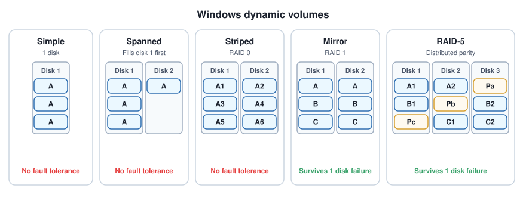
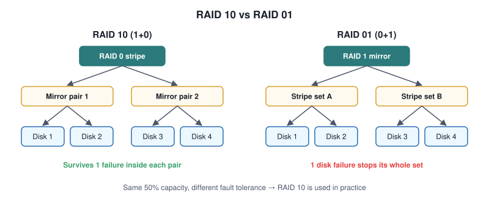
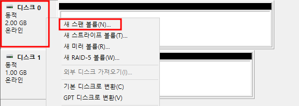
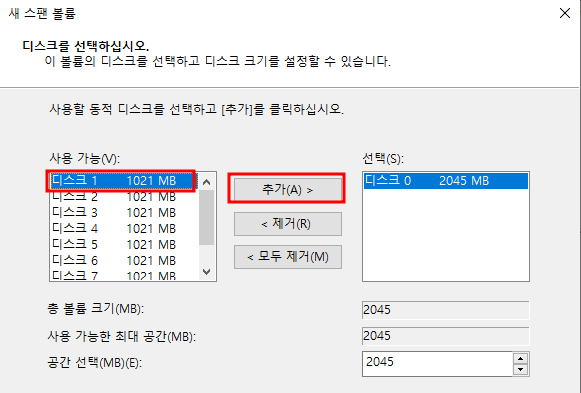
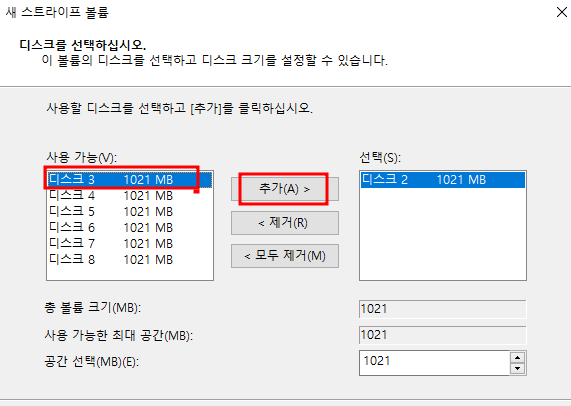
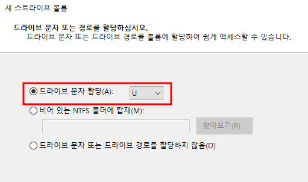
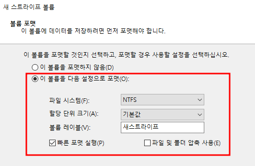
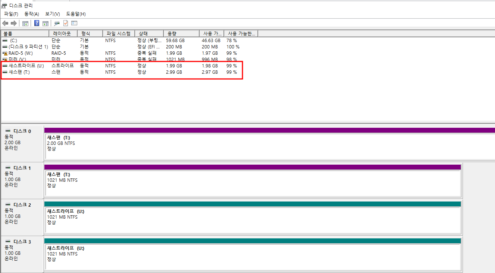
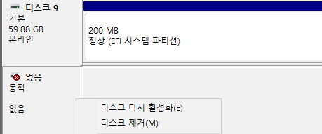

# RAID

[한국어](README.ko.md) | [English](../README.md) | [日本語](README.ja.md) | **简体中文** | [Español](README.es.md) | [Français](README.fr.md)

整理 RAID 的概念、控制器与缓存、RAID 级别,并在 Windows **磁盘管理**中实际创建跨区、带区、镜像、RAID-5 卷,一直实验到磁盘故障与恢复。

## 目录

- [1. 什么是 RAID?](#1-什么是-raid)
- [2. RAID 控制器与缓存](#2-raid-控制器与缓存)
- [3. RAID 级别](#3-raid-级别)
- [4. 在 Windows 中实现 RAID](#4-在-windows-中实现-raid)
- [5. 磁盘故障与恢复](#5-磁盘故障与恢复)
- [总结](#总结)

---

## 1. 什么是 RAID?

### RAID 的概念与目的

**RAID (Redundant Array of Independent Disks)** 是把多块物理磁盘组合起来,当作**一块逻辑磁盘**使用的技术。它最初的想法是:不用一块昂贵的大容量磁盘,而是用多块便宜的磁盘做出更快、更可靠的存储。

> 多块小容量磁盘和一块大容量磁盘的容量相同,那还有必要做 RAID 吗?

RAID 的目的不是容量,而是**性能**和**可用性**。

- **性能**:一块磁盘能提供的 I/O 有上限。把数据分散到多块磁盘上,这些磁盘就能同时读写。
- **可用性**:一块磁盘就是**单点故障(SPOF)**,坏掉的瞬间服务就会停止。RAID 在磁盘故障时也能让服务继续运行。

因此,为了容错,有时会特意牺牲一部分容量。即使用 10 块 1TB 磁盘组建,根据方式不同,实际容量可能是 5TB,也可能是 9TB。

### 组成 RAID 的三种基本技术

所有 RAID 级别都是下面三种技术的组合。

| 技术 | 方式 | 获得的好处 |
| --- | --- | --- |
| 条带化 | 把数据按固定大小切开,分散存到多块磁盘 | 性能 |
| 镜像 | 把同样的数据复制到多块磁盘 | 可用性 |
| 奇偶校验 | 同时保存用于恢复的计算值 | 可用性 + 容量效率 |

- **奇偶校验**是对数据做 XOR 运算得到的恢复信息。一块磁盘坏掉时,用剩下的数据和校验值就能重新算出丢失的数据。
- 条带化切分数据的单位叫**条带大小**。设得小,多块磁盘可以一起读一个大文件,有利于**顺序处理**;设得大,每块磁盘可以各自处理小请求,有利于**随机 I/O**。

### 硬件 RAID 与软件 RAID

RAID 按**由谁来处理 RAID 运算**来区分。

| 区分 | 硬件 RAID | 软件 RAID |
| --- | --- | --- |
| 处理者 | 专用 RAID 控制器卡 | 操作系统(服务器 CPU) |
| 优点 | 不占用服务器 CPU,稳定 | 没有额外费用 |
| 缺点 | 价格高。各厂商的记录格式不同,控制器故障时需换成同系列产品 | 占用服务器 CPU。在引导加载程序阶段不工作,保护启动盘需要另外配置 |
| 例子 | HPE Smart Array、Dell PERC | Windows 动态磁盘・存储空间、Linux mdadm |

---

## 2. RAID 控制器与缓存

### RAID 控制器的作用

RAID 控制器是在服务器和磁盘之间管理 RAID 的设备。

- 把多块物理磁盘组合成逻辑磁盘,呈现给操作系统。
- 拆分数据,进行镜像或计算校验值后写入。
- 检测到磁盘故障时把卷改为**降级(Degraded)**状态,新磁盘插入后进行**重建**。
- 平时提前查找坏扇区,并检查数据与校验值是否一致。
- 用缓存弥补磁盘缓慢的 I/O。

检测到磁盘故障时,会用到下面两种机制。

- **重建**:在新磁盘上重新生成故障磁盘数据的过程。镜像会复制配对的磁盘;校验方式要读取剩下的全部磁盘来计算。**重建期间没有容错能力。**
- **热备盘**:事先插好的备用磁盘。磁盘故障时,控制器会自动启用它并立即开始重建。

### 控制器缓存的作用

磁盘比内存慢得多。缓存是在两者之间临时保存数据的缓冲空间。

| 方式 | 动作 | 特点 |
| --- | --- | --- |
| Write-Through | 写入磁盘完成后才回复完成 | 安全但慢 |
| Write-Back | 数据进入缓存就立即回复完成 | 快。把小的写入合并后再写,也能减轻 RAID 5・6 的写入负担 |
| Read-Ahead | 预先读入接下来要读的数据 | 对顺序读取有效 |

- Write-Back 会有一段时间尚未写入的数据只存在于缓存中,一旦断电这些数据就会丢失。因此要用 **BBU(电池)**或**闪存备份模块**保护缓存;这类装置故障时,控制器通常会**切换为 Write-Through**。
- 在 RAID 5・6 中,如果写入数据和校验值的过程中断电,两者可能不再一致,这就是**写洞(Write Hole)**问题。缓存保护装置也能防止这个问题。

---

## 3. RAID 级别

### RAID 0 / 1 / 5

标准 RAID 级别是 0~6。其中 RAID 2・3・4 因为纠错移到了磁盘内部,或存在校验盘瓶颈,现在几乎不用。实际工作中最基本的是 **0、1、5**。

| 级别 | 方式 | 说明 |
| --- | --- | --- |
| RAID 0 | 条带化 | 把数据分散存到多块磁盘。最快,但**只要坏一块磁盘就会丢失全部数据** |
| RAID 1 | 镜像 | 把同样的数据存到两块磁盘。容量减半,但一侧故障仍能继续运行 |
| RAID 5 | 分布式校验 | 把数据和校验值轮流存到所有磁盘。用一块磁盘的容量存校验值,坏一块也能恢复。消除了把校验值集中存在一块磁盘上的 RAID 4 的瓶颈 |

在 Windows 中可以用**动态磁盘**做出这三个级别:带区卷是 RAID 0,镜像卷是 RAID 1,RAID-5 卷是 RAID 5。简单卷和跨区卷也是动态卷,但不是 RAID。

### 奇偶校验的原理

奇偶校验用 **XOR 运算**生成:两个位相同为 0,不同为 1。同一个值 XOR 两次会回到原值,所以即使丢了一份,把其余部分 XOR 起来就能恢复。

重建就是在整块磁盘上反复进行这种计算。所以重建期间必须**从头到尾读完剩下的全部磁盘**。

### RAID 6

分布存放两个用不同算法生成的校验值(**P、Q**)。P 是 XOR,Q 是里德-所罗门码之类的其他方式。因为有两个方程,**即使同时丢失两块磁盘**也能解出数据。

随着磁盘容量变大,RAID 5 的重建要花几个小时到一天以上。这期间再坏一块磁盘就全完了。RAID 6 在重建期间还能再承受一块磁盘故障。**这就是大容量磁盘推荐使用 RAID 6 的原因。**

### 嵌套 RAID (10 / 01)

RAID 10 **先做镜像**,再用条带组合。RAID 01 **先做条带**,再用镜像组合。两者容量都是 50%,但抗故障能力不同。

4 块磁盘中 1 号磁盘故障时:

- **RAID 10**:只有配对的 2 号也坏掉才会丢数据。危险的磁盘是剩下 3 块中的 **1 块**。
- **RAID 01**:1 号所在的 A 组整体停止。B 组的 3、4 号只要坏一块就完了。危险的磁盘是 3 块中的 **2 块**。

重建时,RAID 10 只需复制一块配对磁盘,而 RAID 01 要重建整个组。所以实际工作中使用 **RAID 10**。

### 写惩罚(为什么 RAID 5 写入慢)

**写惩罚**是一次写请求实际产生的磁盘 I/O 次数。在 RAID 5 中修改一个块,校验值也要重新计算,所以会产生**四次 I/O**。

以 4 块磁盘(每块 150 IOPS,共 600 IOPS)、读 70%・写 30% 的环境计算,结果如下。读保持 420,写的 180 要除以惩罚值。

| 级别 | 计算 | 结果 |
| --- | --- | --- |
| RAID 10 | 420 + 180 ÷ 2 | **510 IOPS** |
| RAID 5 | 420 + 180 ÷ 4 | **465 IOPS** |
| RAID 6 | 420 + 180 ÷ 6 | **450 IOPS** |

写入比例越高差距越大,所以写入多的数据库使用 RAID 10。

### 各级别比较与用途

| 级别 | 最少磁盘数 | 可用容量 | 容错 | 写惩罚 | 主要用途 |
| --- | --- | --- | --- | --- | --- |
| RAID 0 | 2 | 100% | 无 | 1 | 临时工作空间 |
| RAID 1 | 2 | 50% | 1 块 | 2 | 系统盘 |
| RAID 5 | 3 | (N−1)/N | 1 块 | 4 | 以读为主的文件服务器 |
| RAID 6 | 4 | (N−2)/N | 2 块 | 6 | 大容量・备份存储 |
| RAID 10 | 4 | 50% | 每对 1 块 | 2 | 数据库、虚拟化 |

没有哪个级别能三者兼得。根据**性能、容量、可靠性**中优先哪一项来选择。

---

## 4. 在 Windows 中实现 RAID

### 实验配置

给虚拟机额外添加 **9 块**硬盘。真的按 TB 创建也可以,但像镜像卷那样让两块磁盘保持一致的**同步**可能耗时很长,所以**按 GB 添加**。说明中为了接近实际环境,仍写作 TB。

| 卷 | 驱动器 | 磁盘 | 大小 |
| --- | --- | --- | --- |
| 跨区 | T: | 2TB + 1TB | 3TB |
| 带区 (RAID 0) | U: | 1TB × 2 | 2TB |
| 镜像 (RAID 1) | V: | 1TB × 2 | 1TB |
| RAID-5 | W: | 1TB × 3 | 2TB |

### 事前准备

添加 9 块磁盘后运行 `diskmgmt.msc`。把添加的磁盘全部设为**联机**。

未初始化的磁盘会被自动勾选。有时初始化磁盘和联机的顺序会颠倒,但先做哪一个都没关系。

接下来要做的 RAID(卷)必须在**动态磁盘**上才能创建。

磁盘 9 是原来就在用的磁盘,最好不要转换为动态磁盘。**只转换新添加的 RAID 用磁盘**。

> 磁盘管理中的磁盘 1、磁盘 2 这样的编号并不固定在硬盘设备上,只是操作系统按 **SCSI 顺序**给当前安装的磁盘编的号。中间的硬盘被移除后,编号不会空出来,而是依次往前挪。例如磁盘 0~10 中移除磁盘 3 后,会重新编号为磁盘 0~9。

### 跨区卷

只有 2TB 的磁盘 0 无法创建跨区卷,所以再添加一块 1TB 磁盘。

添加 2TB 和 1TB 后,确认卷的总大小约为 3TB。

两块磁盘被合并成一块,跨区卷完成。现在可以把 T 盘当作一块 3TB 的硬盘来用。

在文件资源管理器中也能看到 T 盘约 3TB 的可用空间。

> 创建卷后大小不必完全一致。由于系统占用的空间,可能会有一些差异。

### 带区卷 (RAID 0)

### 镜像卷 (RAID 1)

> 镜像卷需要让两块磁盘保持一致的**同步**操作,磁盘容量大时可能耗时很长。

### RAID-5 卷

正如 RAID 概念中学到的,镜像(V:)和 RAID-5(W:)提供**容错能力**。

在文件资源管理器中也能看到这四个卷。

---

## 5. 磁盘故障与恢复

### 硬盘出问题时

这次让每个卷各坏一块磁盘,看看哪种卷的数据能保留下来。

如上图所示,每个卷各弄坏一块磁盘,直接确认数据是否保留。先把同样的测试文件复制到所有驱动器(示例中是约 8.6MB 的文件夹)。

关闭虚拟机后移除 4 块磁盘。点击 **Advanced**,仔细确认 SCSI 编号后再移除。示例中移除了 SCSI 0:1、0:3、0:5、0:8(0:7 是不使用的编号)。

重新启动虚拟机,打开文件资源管理器。

只剩下提供容错的**镜像(V:)和 RAID-5(W:)卷**。跨区卷(T:)和带区卷(U:)看不到了。

在 `diskmgmt.msc` 中确认状态。

- 跨区卷和带区卷处于**失败**状态。
- 镜像卷和 RAID-5 卷处于**失败的重复**状态。意思是现在数据还在,但冗余已被破坏,**无法再提供容错**。数据虽然在,但并不安全。

### 换上新磁盘后恢复原状

镜像和 RAID-5 恢复状态后会再次提供容错。跨区和带区虽然可以恢复状态,但如果磁盘已换成新的,**就没有办法恢复数据。**(偶尔也有把故障磁盘交给数据恢复公司救回数据的情况。)

关闭虚拟机,在刚才移除的 SCSI 0:1、0:3、0:5、0:8 位置装上新硬盘,重新启动后运行 `diskmgmt.msc`。初始化新磁盘并转换为动态磁盘。

### 恢复跨区卷和带区卷

跨区卷和带区卷无法修复,所以要**删除卷后重新创建。**带区卷也用同样的方法删除。

像之前一样重新创建跨区卷。

带区卷也重新创建。

重新创建完成。

### 恢复镜像卷

镜像卷可以**恢复冗余功能**。先删除丢失磁盘那一侧的镜像。

出现警告时点击**是**。

镜像卷(V:)变成了简单卷。卷名里还留着“미러(镜像)”,只是创建镜像卷时起的名字,没有特别含义。

用新磁盘重新添加镜像。

可以确认镜像卷已经恢复。

### 恢复 RAID-5 卷

RAID-5 卷用**修复卷**放入新磁盘并重建。

RAID-5 恢复完成。

### 收尾

关闭磁盘管理后再重新打开。向下滚动时,如果有因之前的错误而残留的**丢失的磁盘**,就把它删除。

在文件资源管理器中看,跨区卷和带区卷是重新创建的,没有以前的数据;但**镜像卷和 RAID-5 卷的数据原样保留**。

---

## 总结

- RAID 的目的不是容量,而是**性能**和**可用性**。基本技术有**条带化、镜像、奇偶校验**三种。
- 硬件 RAID 由专用控制器处理 RAID 运算,软件 RAID 由操作系统(服务器 CPU)处理。
- 控制器缓存的 **Write-Back** 很快,但需要 BBU・闪存备份来防止断电。
- 奇偶校验用 **XOR** 生成和恢复。RAID 6 用两个校验值,可承受最多 2 块磁盘故障。
- 实际工作中选 **RAID 10** 而不是 RAID 01,写入多时用 RAID 10,大容量磁盘用 **RAID 6**。
- 在 Windows 动态磁盘实验中逐个移除磁盘后,**只有镜像和 RAID-5 保留了数据**,跨区和带区丢失了数据。
- 镜像通过**删除镜像 → 添加镜像**,RAID-5 通过**修复卷**重新获得容错能力。
