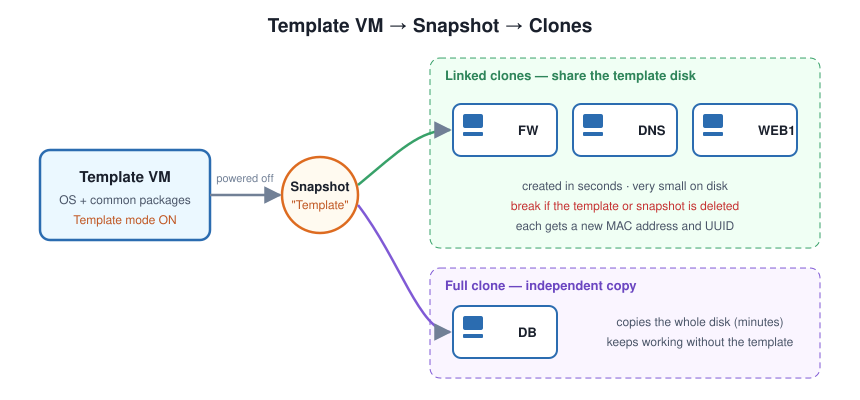

# VMware Template VM

[한국어](README/README.ko.md) | **English** | [日本語](README/README.ja.md) | [简体中文](README/README.zh-CN.md) | [Español](README/README.es.md) | [Français](README/README.fr.md)


When a lab or competition task needs many VMs, installing every OS by hand takes far too long. Instead, install one VM properly, turn it into a **Template VM**, and **clone** the rest from it.



## Contents

- [1. Key terms](#1-key-terms)
- [2. Prepare the Template VM](#2-prepare-the-template-vm)
- [3. Clone from the template](#3-clone-from-the-template)
- [4. After cloning: make each clone unique](#4-after-cloning-make-each-clone-unique)
- [5. Scripts in this folder](#5-scripts-in-this-folder)
- [6. Troubleshooting](#6-troubleshooting)
- [7. Quick checklist](#7-quick-checklist)
- [References](#references)

---

## 1. Key terms

| Term | Meaning |
| --- | --- |
| **Template VM** | The original VM you install once and keep as the base (parent) |
| **Snapshot** | A saved point-in-time state of the VM. Clones are made from a snapshot |
| **Linked clone** | A clone that shares the parent's virtual disk and stores only its own changes |
| **Full clone** | A complete, independent copy of the parent |
| **Template mode** | A VMware option that protects the parent: while it is on, the VM and its snapshots **cannot be deleted** |

---

## 2. Prepare the Template VM

### Step 0. Get the base VM ready

Put everything every clone should share into this VM — and nothing that must be unique.

| ✅ Put in the template | ❌ Keep out of the template |
| --- | --- |
| OS updates, common packages (`vim`, `ssh`, `curl` … ) | Hostname for a specific role (FW, DNS, WEB1 …) |
| Your usual vimrc, SSH settings, time zone | Static IP addresses |
| VMware Tools / open-vm-tools | Certificates, private keys, passwords for a specific server |
| | Domain join (Windows) |

Optionally run [`prepare-template-linux.sh`](scripts/prepare-template-linux.sh) (Linux) or [`Prepare-WindowsTemplate.ps1`](scripts/Prepare-WindowsTemplate.ps1) (Windows) to clean the VM. Both power the VM off when done.

> **Power off the VM before taking the snapshot.** VMware requires the parent to be powered off to clone it, and clones made from a powered-off snapshot boot cleanly, like a freshly started machine.

### Step 1. Create a snapshot named `Template`

**VM → Snapshot → Snapshot Manager → Take Snapshot**

- Name: `Template`
- Description (optional): what is installed, the date, etc.

### Step 2. Enable Template mode

**VM → Settings → Options → Advanced → check `Enable Template mode (to be used for cloning)`**


**Why?**
- With template mode on, **the VM and its snapshots cannot be deleted**.
- **Linked clones depend on the parent's snapshot.** If the parent or its snapshot disappears, every linked clone breaks — template mode prevents that.
- VMware recommends enabling template mode on the parent whenever you create linked clones.

> Template mode can't be enabled for a remote virtual machine.

The Template VM is now ready.

---

## 3. Clone from the template

**Right-click the Template VM → Manage → Clone**

1. **Clone from** → `An existing snapshot` → select `Template`
   (With template mode on, you **can't** clone from the *current state* — this keeps every clone based on the same snapshot.)
2. **Clone type** → `Create a linked clone` or `Create a full clone`
3. Enter the new VM name (e.g. `FW`, `DNS`, `WEB1`) and location → **Finish**

| | **Linked clone** | **Full clone** |
| --- | --- | --- |
| How it works | Shares the parent's disk, stores only changes | Copies the whole disk |
| Creation speed | **Seconds** | Several minutes (depends on disk size) |
| Disk usage | **Very small** | Same as the parent |
| Performance | Slightly lower | Generally better |
| Needs the parent? | **Yes** — breaks if the parent/snapshot is gone | No — fully independent |
| Parent's snapshots | Uses the selected snapshot | No access to the parent's snapshots |
| Good for | Labs, competition practice, many short-lived VMs | VMs you'll keep or move to another PC |

> For labs and competition practice, **linked clones** are usually the best choice. Just never delete or change the Template VM afterwards.

---

## 4. After cloning: make each clone unique

The clone wizard gives every clone a **new MAC address and UUID**, but everything else — VM name, hostname, **static IP** — is identical to the parent. Fix these in each clone **before** connecting it to a shared network.

### Linux (Debian / Ubuntu)

| Item | Why | Fix |
| --- | --- | --- |
| Hostname | Every clone has the template's name | `hostnamectl set-hostname WEB1` + the `127.0.1.1` line in `/etc/hosts` |
| IP address | Avoid IP conflicts | `/etc/network/interfaces` (Debian) or `/etc/netplan/` (Ubuntu) |
| machine-id | Same ID → DHCP may give **the same IP** to different clones | `rm /etc/machine-id && systemd-machine-id-setup` |
| SSH host keys | All clones share the same keys | `rm /etc/ssh/ssh_host_* && ssh-keygen -A` |

All of the above (except the IP) in one command:

```bash
sudo ./post-clone-linux.sh WEB1
```

→ [`scripts/post-clone-linux.sh`](scripts/post-clone-linux.sh)

### Windows Server

Windows clones share the same **SID**, which breaks Active Directory (domain join, etc.).
Run **Sysprep** inside the template **before** taking the `Template` snapshot.

```powershell
C:\Windows\System32\Sysprep\sysprep.exe /generalize /oobe /shutdown
```

| Option | Meaning |
| --- | --- |
| `/generalize` | Removes machine-specific info such as the SID |
| `/oobe` | Shows the first-boot setup screen on the next start |
| `/shutdown` | Powers off when done → then take the snapshot |

→ [`scripts/Prepare-WindowsTemplate.ps1`](scripts/Prepare-WindowsTemplate.ps1) checks for admin rights and domain membership, then runs the command above.

---

## 5. Scripts in this folder

| Script | Run on | When | What it does |
| --- | --- | --- | --- |
| [`prepare-template-linux.sh`](scripts/prepare-template-linux.sh) | Linux template | Before the snapshot | Cleans apt cache, logs, history, DHCP leases; empties machine-id; powers off |
| [`post-clone-linux.sh`](scripts/post-clone-linux.sh) | Each Linux clone | First boot | New hostname, machine-id and SSH host keys |
| [`Prepare-WindowsTemplate.ps1`](scripts/Prepare-WindowsTemplate.ps1) | Windows template | Before the snapshot | Sysprep `/generalize /oobe /shutdown` |

---

## 6. Troubleshooting

| Symptom | Cause | Fix |
| --- | --- | --- |
| Two clones get the same DHCP IP | Same machine-id | Regenerate machine-id ([section 4](#4-after-cloning-make-each-clone-unique)) |
| `WARNING: REMOTE HOST IDENTIFICATION HAS CHANGED` / same fingerprint on every server | Shared SSH host keys | Regenerate host keys, then `ssh-keygen -R <host>` on the client |
| `sudo: unable to resolve host` | `/etc/hosts` still has the old name | Fix the `127.0.1.1` line |
| Windows clone can't join the domain | Same SID | Sysprep the template before the snapshot |
| Linked clone won't start: missing parent disk | Template VM moved or deleted | Keep the template in place; use template mode |
| "Clone from current state" is greyed out | Template mode is on | Clone from the `Template` snapshot |
| Two clones show the same MAC address | VMX copied by hand instead of using the wizard | VM → Settings → Network Adapter → Advanced → **Generate** |

---

## 7. Quick checklist

- [ ] Base VM installed and updated, nothing role-specific inside
- [ ] (Linux) `prepare-template-linux.sh` / (Windows) Sysprep
- [ ] VM powered off
- [ ] Snapshot `Template` created
- [ ] **Enable Template mode** checked
- [ ] Clone from the `Template` snapshot → linked or full
- [ ] In each clone: hostname, IP, machine-id, SSH host keys

---

## References

- Broadcom / VMware Docs — [Enable Template Mode for a Parent Virtual Machine](https://docs.vmware.com/en/VMware-Workstation-Pro/17/com.vmware.ws.using.doc/GUID-B544E04E-8EDD-4918-A486-7F3B7100E3C0.html)
- Broadcom / VMware Docs — [Clone a Virtual Machine](https://docs.vmware.com/en/VMware-Workstation-Pro/17/com.vmware.ws.using.doc/GUID-C86E70AD-85A9-4D85-AEBB-135AA5648554.html)
- Broadcom / VMware Docs — [Using Full Clones](https://docs.vmware.com/en/VMware-Workstation-Pro/17/com.vmware.ws.using.doc/GUID-F8AC53B9-0577-4410-9935-B6E332E87554.html)
- Microsoft Learn — [Sysprep (Generalize) a Windows installation](https://learn.microsoft.com/windows-hardware/manufacture/desktop/sysprep--generalize--a-windows-installation)
- Microsoft Learn — [Sysprep command-line options](https://learn.microsoft.com/windows-hardware/manufacture/desktop/sysprep-command-line-options)
- systemd — [machine-id(5)](https://www.mankier.com/5/machine-id), [systemd-machine-id-setup(1)](https://www.mankier.com/1/systemd-machine-id-setup)
