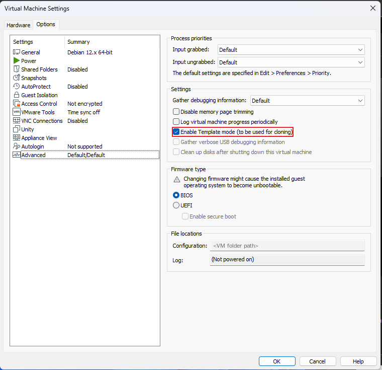

# VMware Template VM

[한국어](../../ko/VMware/Template-VM.md) | [English](../../../VMware/Template-VM.md) | **日本語** | [简体中文](../../zh-CN/VMware/Template-VM.md) | [Español](../../es/VMware/Template-VM.md) | [Français](../../fr/VMware/Template-VM.md)

実習や大会の課題で多くの VM が必要なとき、すべての OS を手作業でインストールしていると時間がかかりすぎます。代わりに VM を1台きちんとインストールして **Template VM** にし、残りはそこから **Clone** して使います。

このページでは、VMware Workstation で Template VM を準備する方法、そこから Clone する方法、そして Clone した各 VM の中で直すべきことをまとめます。

---

## 1. Template VM とは?

Template VM は、すべての Clone の元になる **基準(親)VM** です。

| 用語 | 意味 |
| --- | --- |
| **Template VM** | 一度インストールして基準として保管する元の VM |
| **Snapshot** | VM のある時点の状態を保存したもの。Clone は Snapshot から作られます |
| **Clone** | Template の Snapshot をコピーして作った新しい VM |
| **Template mode** | Template が誤って削除されたり壊れたりしないよう保護する VMware のオプション |

---

## 2. Template VM の準備

### Step 0. 基準 VM の準備

Snapshot を取る前に、すべての Clone が共通して持つべきものをこの VM に入れておきます。

- OS と、いつも使うパッケージをインストール (`vim`、`ssh`、`curl` … )
- 普段使う基本設定を適用 (vimrc、SSH 設定など)
- 機器ごとに異なるべきものは**入れない**: ホスト名、固定 IP、証明書、鍵
- **VM の電源を切る** (Power Off / Shut Down Guest)

> Snapshot は VM の**電源が切れた状態**で取ります。電源オフの Snapshot から作った Clone は、新しく起動したマシンのようにきれいに起動します。

### Step 1. `Template` という名前の Snapshot を作成

**VM → Snapshot → Snapshot Manager → Take Snapshot**

- 名前: `Template`
- 説明(任意): インストールしたもの、日付など

### Step 2. Template mode を有効にする

**VM → Settings → Options → Advanced → `Enable Template mode (to be used for cloning)` にチェック**



**なぜこうするのか?**
- Snapshot が残り、**誤って削除できなく**なります。
- Template VM 自体も**削除から保護**されます。
- **Linked clone は Template の Snapshot に依存する**ため重要です。Template やその Snapshot が消えると、すべての Linked clone が壊れます。

これで Template VM の準備は完了し、Clone を速く安全に行えます。

---

## 3. Template から Clone する

**Template VM を右クリック → Manage → Clone**

1. **Clone from** → `An existing snapshot` → `Template` を選択
2. **Clone type** → 下の2つのどちらかを選択
3. 新しい VM の名前(例: `FW`、`DNS`、`WEB1`)と場所を入力 → **Finish**

| | **Linked clone** | **Full clone** |
| --- | --- | --- |
| 仕組み | Template のディスクを共有し、変更分だけを保存 | ディスク全体をコピー |
| 作成速度 | **数秒** | 数分 (ディスクサイズによる) |
| ディスク使用量 | **とても少ない** | Template と同じ |
| Template が必要か | **必要** — Template/Snapshot がなくなると壊れる | 不要 — 完全に独立 |
| 向いている用途 | 実習、大会練習、短期間使う多数の VM | 長く使う VM、別の PC に移す VM |

> 実習や大会練習には、たいてい **Linked clone** が最適です。速くて軽いからです。ただし、それ以降 Template VM は絶対に削除・変更しないでください。

---

## 4. Clone の後: 重複してはいけない値を直す

Clone は完全なコピーなので、一部の値が Template や他の Clone と**同じ**になります。使う前に各 Clone で直します。

### Linux (Debian / Ubuntu)

| 項目 | 理由 | コマンド |
| --- | --- | --- |
| Hostname | すべての Clone が Template の名前を持つ | `hostnamectl set-hostname WEB1` の後、`/etc/hosts` の `127.0.1.1` の行を修正 |
| IP アドレス | IP の衝突を防ぐ | `/etc/network/interfaces` (Debian) または Netplan (Ubuntu) を修正 |
| machine-id | ID が同じだと、DHCP が別々の Clone に**同じ IP** を払い出すことがある | `rm /etc/machine-id && systemd-machine-id-setup` |
| SSH ホストキー | すべての Clone が同じ鍵を共有する | `rm /etc/ssh/ssh_host_* && dpkg-reconfigure openssh-server` |

```bash
# 例: 新しい Clone の中で実行してから再起動
hostnamectl set-hostname WEB1
sed -i 's/^127.0.1.1.*/127.0.1.1\tWEB1/' /etc/hosts
rm -f /etc/machine-id && systemd-machine-id-setup
rm -f /etc/ssh/ssh_host_* && dpkg-reconfigure openssh-server
reboot
```

### Windows Server

Windows の Clone は同じ **SID** を持つため、Active Directory(ドメイン参加など)で問題が起きます。
`Template` の Snapshot を取る**前に**、Template の中で **Sysprep** を実行します。

```powershell
C:\Windows\System32\Sysprep\sysprep.exe /generalize /oobe /shutdown
```

- `/generalize` : SID などの機器固有の情報を削除
- `/oobe` : 次回起動時に初期設定画面を表示
- `/shutdown` : 完了したら電源を切る → その後 Snapshot を取る

### ネットワークアダプター (MAC アドレス)

VMware は通常、Clone ごとに**新しい MAC アドレス**を自動で割り当てます。
それでも2つの Clone の MAC が同じ場合は、**VM → Settings → Network Adapter → Advanced → Generate** を押します。

---

## 5. まとめ

1. 基準 VM をインストール → 電源を切る
2. Snapshot Manager → `Template` という Snapshot を作成
3. Settings → Options → Advanced → **Enable Template mode**
4. Manage → Clone → `Template` Snapshot から → **Linked clone**(速い) または **Full clone**(独立)
5. 各 Clone で **hostname、IP、machine-id、SSH ホストキー** を変更 (Windows: Snapshot の前に **Sysprep**)
